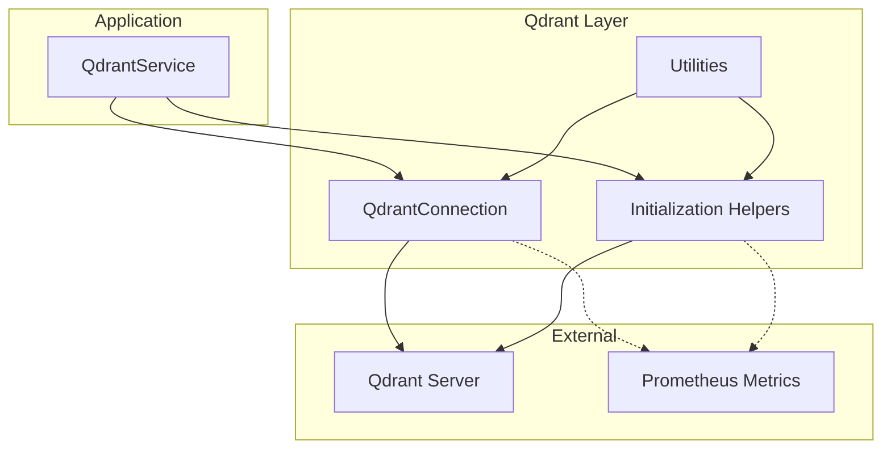
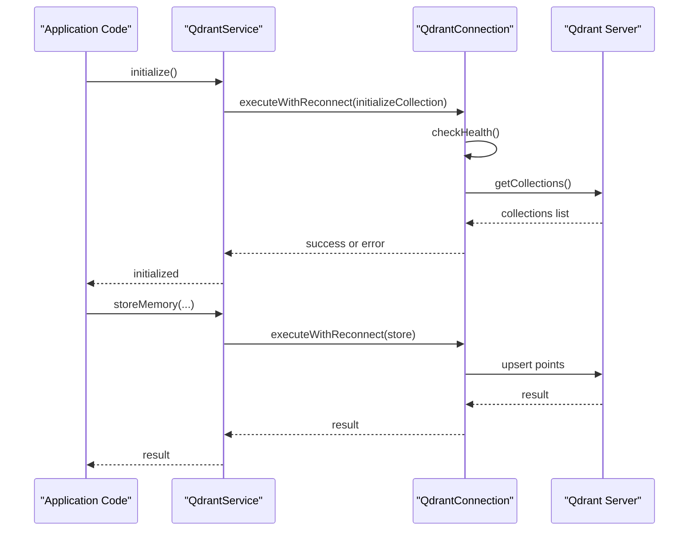
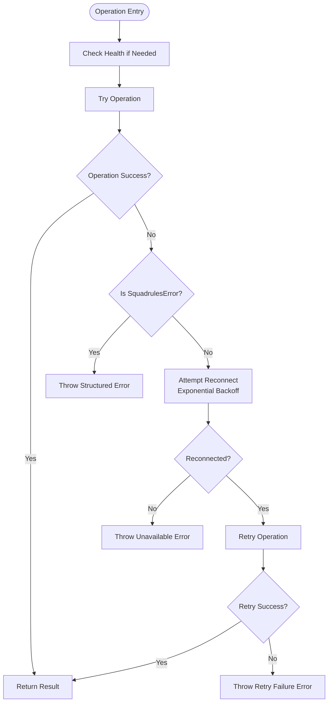
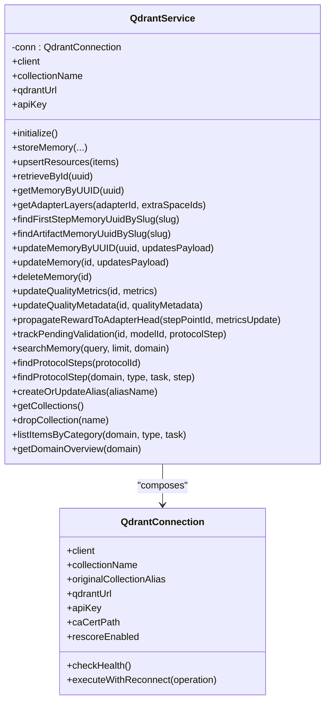
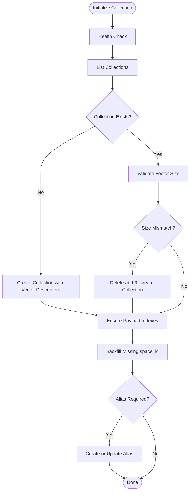
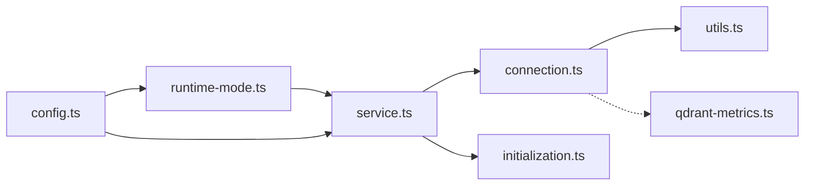

# Connection Management

<cite>
**Referenced Files in This Document**
- [connection.ts](file://src/services/qdrant/connection.ts)
- [initialization.ts](file://src/services/qdrant/initialization.ts)
- [service.ts](file://src/services/qdrant/service.ts)
- [types.ts](file://src/services/qdrant/types.ts)
- [utils.ts](file://src/services/qdrant/utils.ts)
- [config.ts](file://src/config.ts)
- [runtime-mode.ts](file://src/config/runtime-mode.ts)
- [qdrant-metrics.ts](file://src/services/metrics/qdrant-metrics.ts)
</cite>

## Table of Contents
1. [Introduction](#introduction)
2. [Project Structure](#project-structure)
3. [Core Components](#core-components)
4. [Architecture Overview](#architecture-overview)
5. [Detailed Component Analysis](#detailed-component-analysis)
6. [Dependency Analysis](#dependency-analysis)
7. [Performance Considerations](#performance-considerations)
8. [Troubleshooting Guide](#troubleshooting-guide)
9. [Conclusion](#conclusion)

## Introduction
This document explains how the application manages connections to Qdrant, including initialization, authentication, resilience, health checks, configuration, and monitoring. It focuses on the Qdrant service layer that wraps the official Qdrant REST client, provides resilient execution with retry logic, and exposes a stable API for memory, search, protocol, and resource operations.

The project supports two runtime postures:
- Simple local mode: embedded LanceDB only, no external Qdrant URL.
- Clustered HTTP mode: external Qdrant is selected when `QDRANT_URL` is set.

Authentication against Qdrant uses an API key passed through the Qdrant client. JWT tokens are used for application-level OIDC authentication (Keycloak), not directly as Qdrant bearer tokens.

## Project Structure
The Qdrant connection lifecycle lives under `src/services/qdrant`. The most relevant files are:
- `connection.ts`: Client construction, TLS handling, health checking, and resilient operation wrapper.
- `initialization.ts`: Collection creation, vector schema validation, payload index setup, alias management, and backfill helpers.
- `service.ts`: High-level service facade that composes `QdrantConnection` and delegates domain operations.
- `types.ts`: Shared upsert types used by resource operations.
- `utils.ts`: Helpers for environment parsing, ID validation, and point sanitization.
- `config.ts` and `runtime-mode.ts`: Environment-driven configuration and mode selection.
- `qdrant-metrics.ts`: Prometheus metrics for Qdrant operations.

**Diagram sources**
- [service.ts:17-161](file://src/services/qdrant/service.ts#L17-L161)
- [connection.ts:11-131](file://src/services/qdrant/connection.ts#L11-L131)
- [initialization.ts:13-184](file://src/services/qdrant/initialization.ts#L13-L184)
- [utils.ts:77-128](file://src/services/qdrant/utils.ts#L77-L128)
- [qdrant-metrics.ts:11-40](file://src/services/metrics/qdrant-metrics.ts#L11-L40)

**Section sources**
- [service.ts:17-161](file://src/services/qdrant/service.ts#L17-L161)
- [connection.ts:11-131](file://src/services/qdrant/connection.ts#L11-L131)
- [initialization.ts:13-184](file://src/services/qdrant/initialization.ts#L13-L184)
- [config.ts:106-107](file://src/config.ts#L106-L107)
- [config.ts:297-303](file://src/config.ts#L297-L303)
- [runtime-mode.ts:143-149](file://src/config/runtime-mode.ts#L143-L149)

## Core Components
- `QdrantConnection`: Encapsulates the Qdrant REST client, TLS configuration, health state, reconnection attempts, and resilient execution via `executeWithReconnect`.
- `QdrantService`: Public facade exposing collection initialization, memory CRUD, search, protocol queries, alias management, and listing helpers.
- Initialization helpers: Create or validate collections, ensure payload indexes, optionally create aliases, and backfill missing fields.
- Utilities: Boolean environment parsing, ID validation, and point sanitization.
- Configuration: Centralized environment variables for Qdrant URL, API key, collection name, rescore behavior, snapshot settings, and mode detection.
- Metrics: Prometheus counters and histograms for Qdrant operations and durations.

**Section sources**
- [connection.ts:11-131](file://src/services/qdrant/connection.ts#L11-L131)
- [service.ts:17-161](file://src/services/qdrant/service.ts#L17-L161)
- [initialization.ts:13-184](file://src/services/qdrant/initialization.ts#L13-L184)
- [utils.ts:77-128](file://src/services/qdrant/utils.ts#L77-L128)
- [config.ts:106-107](file://src/config.ts#L106-L107)
- [config.ts:297-303](file://src/config.ts#L297-L303)
- [qdrant-metrics.ts:11-40](file://src/services/metrics/qdrant-metrics.ts#L11-L40)

## Architecture Overview
At runtime:
- `QdrantService` constructs a `QdrantConnection` using values from configuration.
- `initializeCollection` ensures the target collection exists, validates vector dimensions, creates payload indexes, optionally sets an alias, and backfills legacy data.
- All database operations go through `QdrantConnection.executeWithReconnect`, which performs health checks, retries with exponential backoff, and throws structured errors when unavailable.
- Metrics are exposed via Prometheus-compatible counters and histograms.

**Diagram sources**
- [service.ts:48-64](file://src/services/qdrant/service.ts#L48-L64)
- [connection.ts:63-131](file://src/services/qdrant/connection.ts#L63-L131)
- [initialization.ts:13-93](file://src/services/qdrant/initialization.ts#L13-L93)

## Detailed Component Analysis

### QdrantConnection
Responsibilities:
- Initialize the Qdrant REST client with URL, optional API key, TLS CA certificate, and rejection policy.
- Track health state and reconnect attempts.
- Provide `checkHealth` by calling `getCollections`.
- Wrap operations with `executeWithReconnect`, which:
  - Checks health if needed.
  - Logs detailed errors.
  - Attempts reconnection with exponential backoff.
  - Retries the operation once after successful reconnection.
  - Throws structured errors for unrecoverable failures.

Key behaviors:
- TLS: If the URL starts with HTTPS, it enables strict verification. A custom CA can be loaded from a file path; otherwise, system CAs are used.
- Reconnect delay: Exponential backoff starting at 1 second, doubling per attempt, capped by `maxReconnectAttempts`.
- Health reset: Successful health checks reset reconnect attempts.

**Diagram sources**
- [connection.ts:63-131](file://src/services/qdrant/connection.ts#L63-L131)

**Section sources**
- [connection.ts:11-131](file://src/services/qdrant/connection.ts#L11-L131)

### QdrantService
Responsibilities:
- Compose `QdrantConnection` with configuration values.
- Expose safe getters for underlying connection properties.
- Delegate domain operations to specialized modules while preserving resilient execution.

Notable methods:
- `initialize()`: Ensures collection and indexes exist.
- `storeMemory(...)`, `updateMemory(...)`, `deleteMemory(...)`: Memory persistence.
- `searchMemory(...)`: Semantic search.
- `createOrUpdateAlias(...)`: Best-effort alias creation for active collection.
- `getCollections()`, `dropCollection(...)`: Collection management.

Singleton behavior:
- When Qdrant is configured, a real `QdrantService` instance is created.
- Otherwise, the shared embedded record store is cast to this shape so other modules remain compatible.

**Diagram sources**
- [service.ts:17-161](file://src/services/qdrant/service.ts#L17-L161)
- [connection.ts:11-131](file://src/services/qdrant/connection.ts#L11-L131)

**Section sources**
- [service.ts:17-161](file://src/services/qdrant/service.ts#L17-L161)

### Initialization and Collection Lifecycle
Responsibilities:
- Ensure the collection exists with correct vector size.
- Recreate the collection if vector dimensions mismatch.
- Create payload indexes for filtering and text search.
- Optionally create or update an alias pointing to the active collection.
- Backfill missing `space_id` for older points.

Key behaviors:
- Vector dimension validation uses embedding configuration to compare expected vs current sizes.
- Alias creation tries multiple REST endpoints to support different Qdrant versions.
- Backfill runs in batches and is idempotent.

**Diagram sources**
- [initialization.ts:13-126](file://src/services/qdrant/initialization.ts#L13-L126)

**Section sources**
- [initialization.ts:13-184](file://src/services/qdrant/initialization.ts#L13-L184)

### Authentication Mechanisms
- Qdrant API key: Passed to the Qdrant client constructor when present. It is read from `QDRANT_API_KEY`.
- TLS: Enabled automatically for HTTPS URLs. Custom CA certificates can be provided via `QDRANT_CA_CERT_PATH`; otherwise, system CAs are used.
- Application JWT: Used for Keycloak OIDC authentication at the application layer, not directly as Qdrant bearer tokens.

Important notes:
- There is no built-in JWT-to-Qdrant token exchange in this codebase.
- For Qdrant server-side authentication, use the API key mechanism supported by the Qdrant client.

**Section sources**
- [connection.ts:24-61](file://src/services/qdrant/connection.ts#L24-L61)
- [config.ts:106-107](file://src/config.ts#L106-L107)

### Connection Pooling Strategies
- The implementation does not implement explicit connection pooling beyond what the underlying Qdrant REST client provides.
- Resilience is achieved through `executeWithReconnect`, which recreates the client on failure and retries operations.
- For high-throughput scenarios, consider tuning the underlying HTTP client options if you extend the connection layer.

[No sources needed since this section provides general guidance]

### Retry Logic and Circuit Breaker Patterns
- Retry logic: Implemented in `attemptReconnect` with exponential backoff starting at 1 second and doubling per attempt.
- Maximum attempts: Configurable via `maxReconnectAttempts` (default 5).
- Circuit breaker pattern: Not explicitly implemented. Instead, repeated failures lead to throwing a structured “unavailable” error after exhausting retries.

Recommendation:
- If you need circuit-breaking behavior (e.g., fail-fast after sustained failures), wrap `executeWithReconnect` with a circuit breaker that opens after consecutive failures and periodically probes health.

**Section sources**
- [connection.ts:76-96](file://src/services/qdrant/connection.ts#L76-L96)
- [connection.ts:98-131](file://src/services/qdrant/connection.ts#L98-L131)

### Health Check Implementations
- Health check calls `getCollections` and resets reconnect attempts on success.
- Failures log warnings and mark the connection unhealthy.
- Initialization requires a healthy connection before proceeding.

**Section sources**
- [connection.ts:63-74](file://src/services/qdrant/connection.ts#L63-L74)
- [initialization.ts:13-21](file://src/services/qdrant/initialization.ts#L13-L21)

### Configuration Options
Environment variables relevant to Qdrant connection and behavior:
- `QDRANT_URL`: Required for clustered mode; determines the Qdrant endpoint.
- `QDRANT_API_KEY`: Optional API key for Qdrant authentication.
- `QDRANT_COLLECTION`: Target collection name; defaults to `squadrules`.
- `QDRANT_RESCORE`: Enables or disables rescore behavior; parsed as boolean.
- `QDRANT_CA_CERT_PATH`: Path to a custom CA certificate for HTTPS.
- `QDRANT_CREATE_ALIAS`: Whether to create or update the `current` alias during initialization.
- `QDRANT_SNAPSHOT_ON_START` and `QDRANT_SNAPSHOT_DIR`: Snapshot-related settings used elsewhere in the application.

Mode selection:
- `isQdrantConfigured` is true when `QDRANT_URL` is non-empty.
- In simple local mode (`TRANSPORT_TYPE=stdio`), setting `QDRANT_URL` is rejected as inconsistent.

**Section sources**
- [config.ts:106-107](file://src/config.ts#L106-L107)
- [config.ts:268-277](file://src/config.ts#L268-L277)
- [config.ts:297-303](file://src/config.ts#L297-L303)
- [runtime-mode.ts:110-118](file://src/config/runtime-mode.ts#L110-L118)
- [runtime-mode.ts:143-149](file://src/config/runtime-mode.ts#L143-L149)
- [connection.ts:24-36](file://src/services/qdrant/connection.ts#L24-L36)
- [initialization.ts:84-91](file://src/services/qdrant/initialization.ts#L84-L91)

### Examples: Connecting to Single-Node and Clustered Deployments
- Single-node deployment:
  - Set `QDRANT_URL` to the single-node endpoint (for example, `http://localhost:6333`).
  - Optionally set `QDRANT_API_KEY` if your Qdrant instance requires authentication.
  - Optionally set `QDRANT_CA_CERT_PATH` for HTTPS with a custom CA.
- Clustered deployment:
  - Point `QDRANT_URL` to the cluster’s load-balanced endpoint.
  - Use the same authentication and TLS configuration as above.
  - Ensure the application runs in HTTP transport mode (`TRANSPORT_TYPE=http`) when using external Qdrant.

Note:
- The code does not perform automatic cluster discovery; it relies on the configured endpoint(s).

**Section sources**
- [config.ts:297-303](file://src/config.ts#L297-L303)
- [runtime-mode.ts:110-118](file://src/config/runtime-mode.ts#L110-L118)
- [connection.ts:24-61](file://src/services/qdrant/connection.ts#L24-L61)

### Connection Monitoring and Metrics
- Prometheus metrics are defined for Qdrant operations and durations:
  - Total operations counter with labels for operation, status, and tenant.
  - Histograms for operation duration, query duration, and upsert duration.
- These metrics enable monitoring of latency distributions and throughput.

Operational tips:
- Scrape the metrics endpoint exposed by the application.
- Correlate Qdrant operation durations with application logs to identify slow queries or transient network issues.

**Section sources**
- [qdrant-metrics.ts:11-40](file://src/services/metrics/qdrant-metrics.ts#L11-L40)

### Debugging Techniques
- Enable structured logging to capture connection errors, collection names, URLs, and timestamps.
- Inspect health check logs to determine whether the connection is marked healthy.
- Review retry logs to understand backoff behavior and failure counts.
- Validate TLS configuration by checking CA certificate loading logs.
- Use Prometheus metrics to detect spikes in operation duration or error rates.

**Section sources**
- [connection.ts:63-131](file://src/services/qdrant/connection.ts#L63-L131)

## Dependency Analysis
High-level dependencies:
- `QdrantService` depends on `QdrantConnection` and initialization helpers.
- `QdrantConnection` depends on the Qdrant REST client and utilities for environment parsing.
- Configuration is centralized in `config.ts`, with runtime mode decisions in `runtime-mode.ts`.
- Metrics are registered via the Prometheus registry.

**Diagram sources**
- [config.ts:106-107](file://src/config.ts#L106-L107)
- [config.ts:297-303](file://src/config.ts#L297-L303)
- [runtime-mode.ts:143-149](file://src/config/runtime-mode.ts#L143-L149)
- [service.ts:17-161](file://src/services/qdrant/service.ts#L17-L161)
- [connection.ts:11-131](file://src/services/qdrant/connection.ts#L11-L131)
- [initialization.ts:13-184](file://src/services/qdrant/initialization.ts#L13-L184)
- [utils.ts:77-128](file://src/services/qdrant/utils.ts#L77-L128)
- [qdrant-metrics.ts:11-40](file://src/services/metrics/qdrant-metrics.ts#L11-L40)

**Section sources**
- [service.ts:17-161](file://src/services/qdrant/service.ts#L17-L161)
- [connection.ts:11-131](file://src/services/qdrant/connection.ts#L11-L131)
- [initialization.ts:13-184](file://src/services/qdrant/initialization.ts#L13-L184)
- [config.ts:106-107](file://src/config.ts#L106-L107)
- [config.ts:297-303](file://src/config.ts#L297-L303)
- [runtime-mode.ts:143-149](file://src/config/runtime-mode.ts#L143-L149)
- [qdrant-metrics.ts:11-40](file://src/services/metrics/qdrant-metrics.ts#L11-L40)

## Performance Considerations
- Vector dimension mismatches trigger collection recreation, which can be expensive; ensure embedding dimension configuration matches Qdrant schema.
- Payload index creation is best-effort; existing indexes are tolerated.
- Batch backfill reduces memory pressure and improves throughput for large datasets.
- Metrics histograms help identify slow operations and guide tuning.

[No sources needed since this section provides general guidance]

## Troubleshooting Guide

Common problems and resolutions:
- Authentication failures:
  - Verify `QDRANT_API_KEY` is set and valid for the configured Qdrant endpoint.
  - Confirm TLS settings: for HTTPS, either use system CAs or provide `QDRANT_CA_CERT_PATH`.
  - Application JWT is separate from Qdrant authentication; do not confuse Keycloak tokens with Qdrant API keys.

- Network timeouts:
  - Check `QDRANT_URL` connectivity and DNS resolution.
  - Inspect retry logs for exponential backoff behavior and maximum attempts.
  - Use health check logs to confirm whether the connection is marked healthy.

- Resource exhaustion:
  - Monitor Prometheus metrics for operation duration spikes and error rates.
  - Avoid unnecessary collection recreation by ensuring embedding dimensions match.
  - Reduce batch sizes if memory pressure occurs during backfill or upsert operations.

- Collection schema issues:
  - If vector size mismatches occur, the initialization logic will recreate the collection; verify embedding configuration and Qdrant schema alignment.
  - Validate payload indexes are created successfully; failures are logged but considered best-effort.

- Mode misconfiguration:
  - In simple local mode (`TRANSPORT_TYPE=stdio`), `QDRANT_URL` is rejected; switch to HTTP transport or unset the variable.
  - Ensure `isQdrantConfigured` reflects your intended backend (external Qdrant vs embedded LanceDB).

**Section sources**
- [connection.ts:24-61](file://src/services/qdrant/connection.ts#L24-L61)
- [connection.ts:63-131](file://src/services/qdrant/connection.ts#L63-L131)
- [initialization.ts:27-48](file://src/services/qdrant/initialization.ts#L27-L48)
- [runtime-mode.ts:110-118](file://src/config/runtime-mode.ts#L110-L118)
- [qdrant-metrics.ts:11-40](file://src/services/metrics/qdrant-metrics.ts#L11-L40)

## Conclusion
The Qdrant connection layer provides robust initialization, resilient execution with exponential backoff, health checks, and clear configuration boundaries. While it does not implement explicit connection pooling or a circuit breaker, it offers strong operational visibility through structured logging and Prometheus metrics. For production deployments, ensure proper TLS and API key configuration, align embedding dimensions with Qdrant schemas, and monitor metrics to maintain reliability and performance.