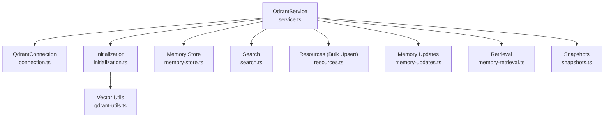
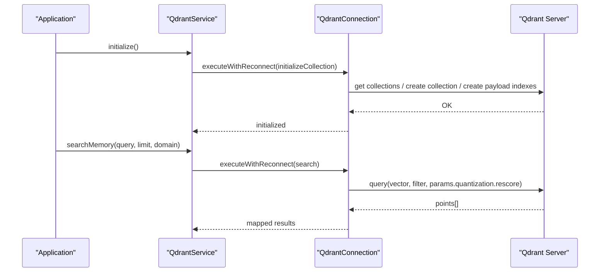
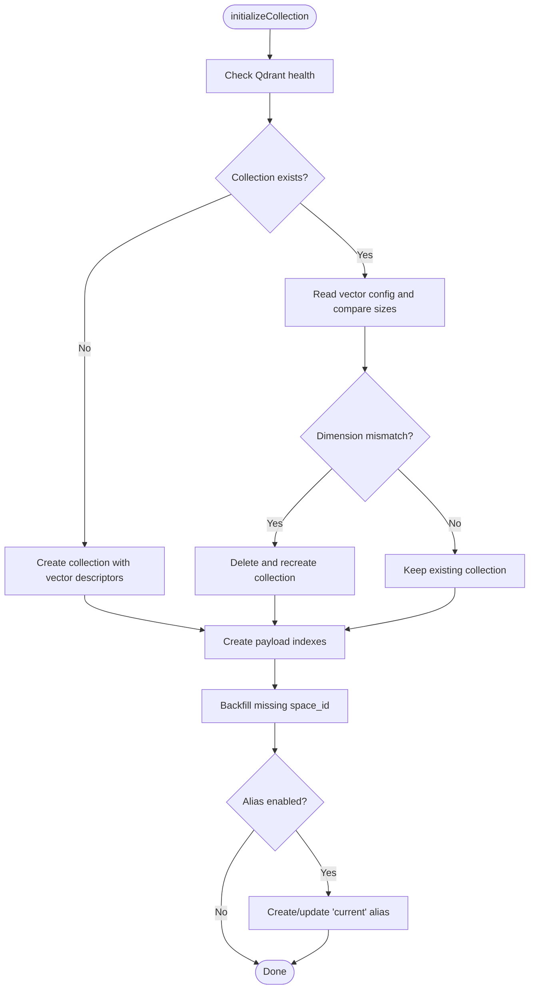
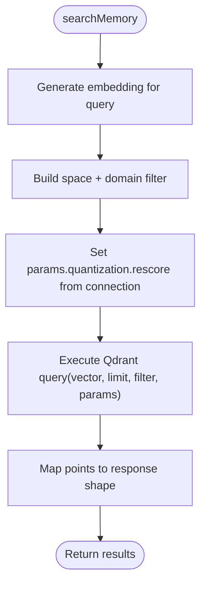
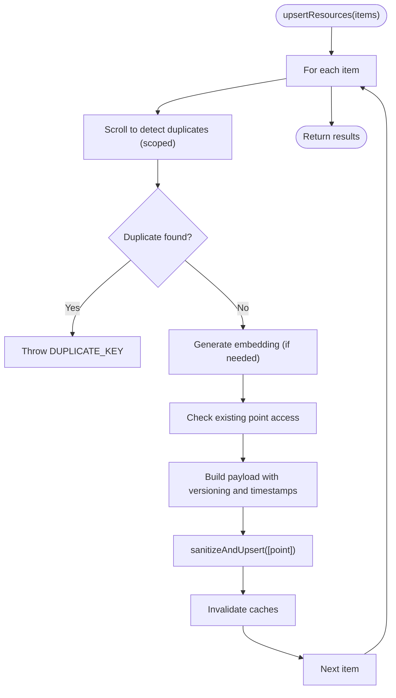
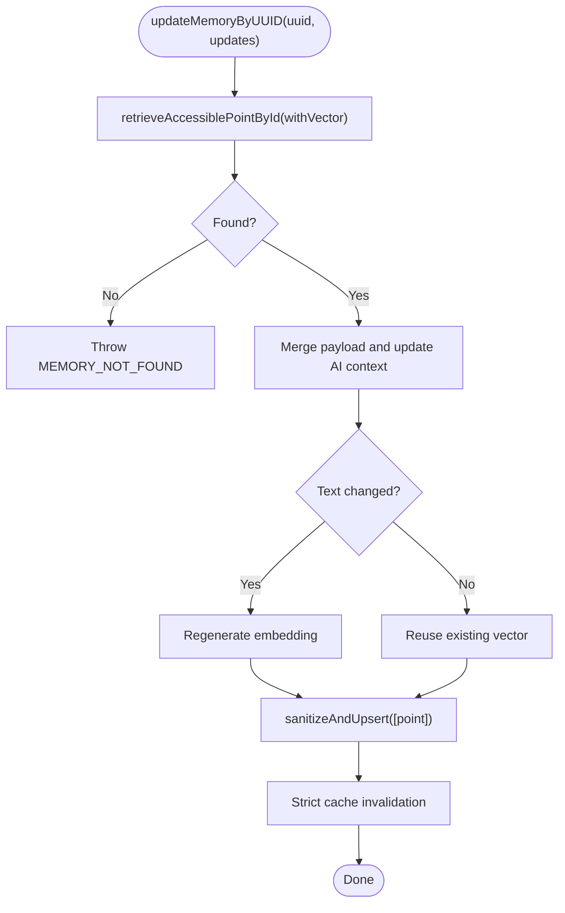
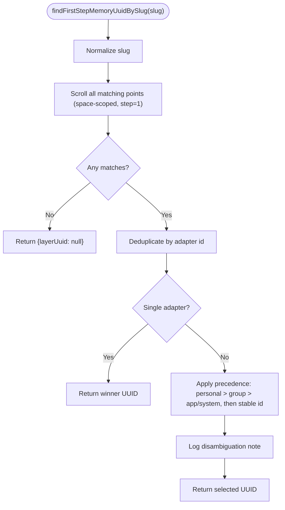
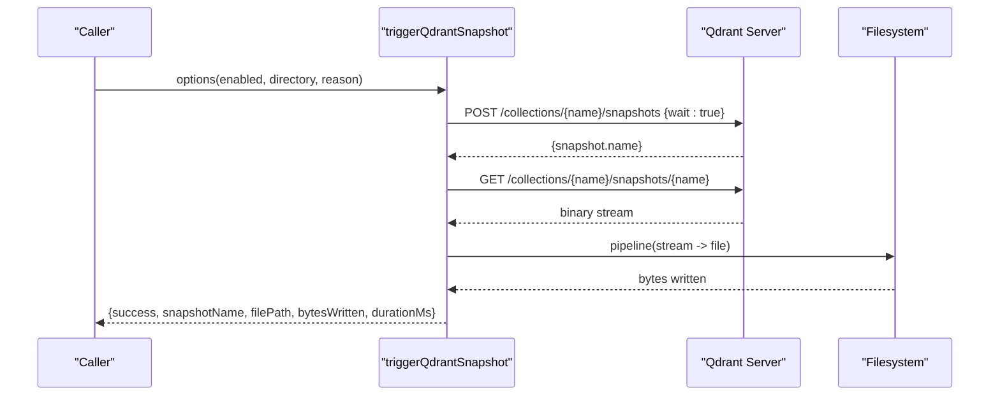
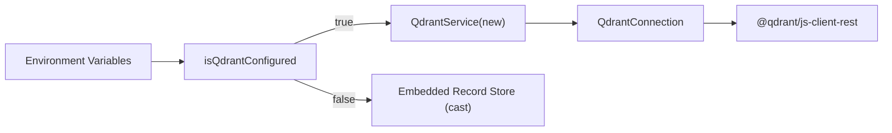

# Performance Optimization

<cite>
**Referenced Files in This Document**
- [service.ts](file://src/services/qdrant/service.ts)
- [connection.ts](file://src/services/qdrant/connection.ts)
- [initialization.ts](file://src/services/qdrant/initialization.ts)
- [memory-store.ts](file://src/services/qdrant/memory-store.ts)
- [search.ts](file://src/services/qdrant/search.ts)
- [resources.ts](file://src/services/qdrant/resources.ts)
- [memory-updates.ts](file://src/services/qdrant/memory-updates.ts)
- [memory-retrieval.ts](file://src/services/qdrant/memory-retrieval.ts)
- [snapshots.ts](file://src/services/qdrant/snapshots.ts)
- [qdrant-utils.ts](file://src/utils/qdrant-utils.ts)
- [config.ts](file://src/config.ts)
- [runtime-mode.ts](file://src/config/runtime-mode.ts)
</cite>

## Table of Contents
1. [Introduction](#introduction)
2. [Project Structure](#project-structure)
3. [Core Components](#core-components)
4. [Architecture Overview](#architecture-overview)
5. [Detailed Component Analysis](#detailed-component-analysis)
6. [Dependency Analysis](#dependency-analysis)
7. [Performance Considerations](#performance-considerations)
8. [Troubleshooting Guide](#troubleshooting-guide)
9. [Conclusion](#conclusion)
10. [Appendices](#appendices)

## Introduction
This document provides performance optimization and tuning guidance for the Qdrant-backed vector store used by the application. It focuses on index configuration, query performance tuning, bulk operation optimization, monitoring and profiling, capacity planning, snapshot management, and benchmarking strategies. The content is grounded in the actual implementation files that manage Qdrant connections, collection initialization, indexing, search, updates, and snapshots.

## Project Structure
The Qdrant integration is organized into a service layer with focused modules:
- Service orchestration and singleton wiring
- Connection lifecycle, TLS, and resilience
- Collection initialization and payload indexes
- Memory write paths (single and bulk)
- Search and retrieval flows
- Snapshot creation and download

**Diagram sources**
- [service.ts:17-161](file://src/services/qdrant/service.ts#L17-L161)
- [connection.ts:11-131](file://src/services/qdrant/connection.ts#L11-L131)
- [initialization.ts:13-93](file://src/services/qdrant/initialization.ts#L13-L93)
- [memory-store.ts:14-126](file://src/services/qdrant/memory-store.ts#L14-L126)
- [search.ts:11-83](file://src/services/qdrant/search.ts#L11-L83)
- [resources.ts:18-139](file://src/services/qdrant/resources.ts#L18-L139)
- [memory-updates.ts:15-235](file://src/services/qdrant/memory-updates.ts#L15-L235)
- [memory-retrieval.ts:25-340](file://src/services/qdrant/memory-retrieval.ts#L25-L340)
- [snapshots.ts:68-168](file://src/services/qdrant/snapshots.ts#L68-L168)
- [qdrant-utils.ts:1-4](file://src/utils/qdrant-utils.ts#L1-L4)

**Section sources**
- [service.ts:17-161](file://src/services/qdrant/service.ts#L17-L161)
- [connection.ts:11-131](file://src/services/qdrant/connection.ts#L11-L131)
- [initialization.ts:13-93](file://src/services/qdrant/initialization.ts#L13-L93)

## Core Components
- QdrantService: Central facade exposing operations for initialization, upserts, retrieval, search, aliasing, listing, and reward propagation. It composes QdrantConnection and delegates to specialized modules.
- QdrantConnection: Encapsulates client initialization, TLS configuration, health checks, and resilient execution with exponential backoff reconnection.
- Initialization: Ensures collection existence, validates vector dimension, creates payload indexes, backfills missing fields, and optionally sets an alias.
- Memory Store: Single-point upsert path with tenant context, cache invalidation, and metrics instrumentation.
- Search: Embedding generation, space-scoped filtering, similarity search with optional rescore, and result mapping.
- Resources: Bulk upsert with duplicate detection, embedding generation, versioning, and strict cache invalidation.
- Memory Updates: Update/delete flows with conditional embedding regeneration and strict cache invalidation.
- Retrieval: Access control checks, paginated scrolling, slug resolution, and artifact lookup.
- Snapshots: Create and stream Qdrant snapshots to local storage with error handling and cleanup.

**Section sources**
- [service.ts:17-161](file://src/services/qdrant/service.ts#L17-L161)
- [connection.ts:11-131](file://src/services/qdrant/connection.ts#L11-L131)
- [initialization.ts:13-93](file://src/services/qdrant/initialization.ts#L13-L93)
- [memory-store.ts:14-126](file://src/services/qdrant/memory-store.ts#L14-L126)
- [search.ts:11-83](file://src/services/qdrant/search.ts#L11-L83)
- [resources.ts:18-139](file://src/services/qdrant/resources.ts#L18-L139)
- [memory-updates.ts:15-235](file://src/services/qdrant/memory-updates.ts#L15-L235)
- [memory-retrieval.ts:25-340](file://src/services/qdrant/memory-retrieval.ts#L25-L340)
- [snapshots.ts:68-168](file://src/services/qdrant/snapshots.ts#L68-L168)

## Architecture Overview
The runtime selects either a remote Qdrant server or an embedded LanceDB store based on environment configuration. When Qdrant is configured, QdrantService wraps a QdrantConnection and delegates to domain-specific modules. All operations are wrapped with resilient execution and metrics.

**Diagram sources**
- [service.ts:48-122](file://src/services/qdrant/service.ts#L48-L122)
- [connection.ts:98-131](file://src/services/qdrant/connection.ts#L98-L131)
- [initialization.ts:13-93](file://src/services/qdrant/initialization.ts#L13-L93)
- [search.ts:11-83](file://src/services/qdrant/search.ts#L11-L83)

## Detailed Component Analysis

### Index Configuration and Collection Initialization
- Vector dimensions: Determined at boot; if mismatched, the collection is recreated to match the embedding model’s dimension.
- Payload indexes: Keyword and text indexes are created for filtering and full-text queries across adapter metadata, protocol steps, quality fields, and content tokens.
- Alias support: Optional alias “current” can be created/updated via multiple REST variants for compatibility.
- Backfill: Missing space_id values are backfilled using batched scroll + upsert.

**Diagram sources**
- [initialization.ts:13-93](file://src/services/qdrant/initialization.ts#L13-L93)
- [initialization.ts:99-126](file://src/services/qdrant/initialization.ts#L99-L126)
- [initialization.ts:133-163](file://src/services/qdrant/initialization.ts#L133-L163)

**Section sources**
- [initialization.ts:13-93](file://src/services/qdrant/initialization.ts#L13-L93)
- [initialization.ts:99-126](file://src/services/qdrant/initialization.ts#L99-L126)
- [initialization.ts:133-163](file://src/services/qdrant/initialization.ts#L133-L163)
- [qdrant-utils.ts:1-4](file://src/utils/qdrant-utils.ts#L1-L4)

### Query Performance Tuning
- Rescore parameter: Search requests include quantization.rescore controlled by an environment flag. Disabling rescore can reduce latency when approximate nearest neighbor speed is prioritized over precision.
- Limiting results: Default limit is applied; callers should set appropriate limits to bound memory and CPU usage.
- Space scoping: Filters restrict searches to allowed spaces, reducing candidate set size.
- Embedding reuse: Embeddings are generated per query; caching embeddings at the caller level can avoid redundant computation.

**Diagram sources**
- [search.ts:11-83](file://src/services/qdrant/search.ts#L11-L83)
- [connection.ts:35-36](file://src/services/qdrant/connection.ts#L35-L36)

**Section sources**
- [search.ts:11-83](file://src/services/qdrant/search.ts#L11-L83)
- [connection.ts:35-36](file://src/services/qdrant/connection.ts#L35-L36)

### Bulk Operation Optimization
- Duplicate detection: Before upsert, a scoped scroll checks for duplicates by composite key (domain/type/task/step).
- Batch processing: Each item is processed sequentially within the bulk function; consider external batching for very large payloads to reduce per-item overhead.
- Conditional embedding: Embeddings are regenerated only when text changes; otherwise, existing vectors are reused.
- Cache invalidation: After each successful upsert, caches are invalidated to maintain consistency.

**Diagram sources**
- [resources.ts:18-139](file://src/services/qdrant/resources.ts#L18-L139)

**Section sources**
- [resources.ts:18-139](file://src/services/qdrant/resources.ts#L18-L139)

### Memory Writes and Updates
- Single upsert: Generates deterministic IDs, constructs payload, performs upsert, and invalidates caches.
- Update by UUID: Reads existing point, merges updates, regenerates embedding if text changed, and enforces strict cache invalidation.
- Delete: Validates ID, deletes point, and invalidates caches.

**Diagram sources**
- [memory-updates.ts:15-96](file://src/services/qdrant/memory-updates.ts#L15-L96)

**Section sources**
- [memory-store.ts:14-126](file://src/services/qdrant/memory-store.ts#L14-L126)
- [memory-updates.ts:15-235](file://src/services/qdrant/memory-updates.ts#L15-L235)

### Retrieval and Slug Resolution
- Point retrieval: Enforces space-based read access before returning data.
- Adapter layers: Paginates sibling points filtered by adapter id and excludes artifacts.
- Slug resolution: Finds first step memory UUID by slug with deterministic tie-breaking across spaces and stable ids; logs disambiguation notes.
- Artifact slug resolution: Returns single artifact UUID or ambiguity note.

**Diagram sources**
- [memory-retrieval.ts:228-301](file://src/services/qdrant/memory-retrieval.ts#L228-L301)

**Section sources**
- [memory-retrieval.ts:25-102](file://src/services/qdrant/memory-retrieval.ts#L25-L102)
- [memory-retrieval.ts:152-200](file://src/services/qdrant/memory-retrieval.ts#L152-L200)
- [memory-retrieval.ts:228-301](file://src/services/qdrant/memory-retrieval.ts#L228-L301)
- [memory-retrieval.ts:303-339](file://src/services/qdrant/memory-retrieval.ts#L303-L339)

### Snapshot Management
- Creation: POST to Qdrant snapshot endpoint with wait=true.
- Download: GET snapshot file and stream to disk.
- Error handling: Cleans partial files on failure and returns structured results.

**Diagram sources**
- [snapshots.ts:68-168](file://src/services/qdrant/snapshots.ts#L68-L168)

**Section sources**
- [snapshots.ts:68-168](file://src/services/qdrant/snapshots.ts#L68-L168)

## Dependency Analysis
- Environment-driven backend selection: If QDRANT_URL is set, QdrantService is instantiated; otherwise, the embedded record store is cast to the same interface.
- Configuration keys: QDRANT_URL, QDRANT_API_KEY, QDRANT_COLLECTION, QDRANT_CA_CERT_PATH, QDRANT_RESCORE, QDRANT_CREATE_ALIAS.
- Metrics: Operations and durations are instrumented for upserts, queries, and general operations.

**Diagram sources**
- [runtime-mode.ts:148-149](file://src/config/runtime-mode.ts#L148-L149)
- [service.ts:153-161](file://src/services/qdrant/service.ts#L153-L161)
- [connection.ts:24-37](file://src/services/qdrant/connection.ts#L24-L37)

**Section sources**
- [runtime-mode.ts:148-149](file://src/config/runtime-mode.ts#L148-L149)
- [service.ts:153-161](file://src/services/qdrant/service.ts#L153-L161)
- [connection.ts:24-37](file://src/services/qdrant/connection.ts#L24-L37)

## Performance Considerations

### Index Configuration Options
- Vector dimension alignment: The system recreates the collection if the stored vector size differs from the current embedding dimension. Ensure embedding models are stable to avoid costly recreation.
- Payload indexes: Keyword and text indexes improve filter and full-text performance. Review index coverage for high-cardinality filters to avoid slow scans.
- Aliases: Using aliases reduces client-side refactoring during collection swaps; ensure alias creation is enabled where needed.

Tuning recommendations:
- Keep embedding model versions consistent to prevent collection recreation.
- Add targeted payload indexes for frequently filtered fields (e.g., domain, type, task, adapter fields).
- Use aliases for zero-downtime collection migrations.

**Section sources**
- [initialization.ts:27-48](file://src/services/qdrant/initialization.ts#L27-L48)
- [initialization.ts:50-79](file://src/services/qdrant/initialization.ts#L50-L79)
- [initialization.ts:83-91](file://src/services/qdrant/initialization.ts#L83-L91)

### Quantization and Rescore Settings
- Rescore toggle: Controlled by QDRANT_RESCORE; enabling improves accuracy at the cost of additional compute during search.
- Limiting results: Set explicit limits to constrain memory and CPU usage.

Tuning recommendations:
- Disable rescore for latency-sensitive workloads where approximate recall is acceptable.
- Tune limit per use case; smaller limits reduce resource consumption.

**Section sources**
- [connection.ts:35-36](file://src/services/qdrant/connection.ts#L35-L36)
- [search.ts:27-33](file://src/services/qdrant/search.ts#L27-L33)

### Memory Usage Optimization
- Avoid unnecessary vector transfers: Retrieval functions allow disabling vector fetch when not needed.
- Reuse existing vectors: Update paths preserve existing vectors unless text changes.
- Pagination: Scroll operations use fixed page sizes to bound memory.

Tuning recommendations:
- Prefer payload-only reads where possible.
- Batch updates to minimize repeated embedding computations.
- Monitor pagination sizes and adjust if necessary.

**Section sources**
- [memory-retrieval.ts:32-36](file://src/services/qdrant/memory-retrieval.ts#L32-L36)
- [memory-updates.ts:51-70](file://src/services/qdrant/memory-updates.ts#L51-L70)
- [memory-retrieval.ts:176-186](file://src/services/qdrant/memory-retrieval.ts#L176-L186)

### Query Performance Tuning
- Space scoping: Always scope queries to allowed spaces to reduce candidate sets.
- Domain filters: Apply domain filters to narrow search scope.
- Embedding caching: Cache query embeddings at the caller level to avoid recomputation.

Tuning recommendations:
- Use domain filters wherever applicable.
- Cache embeddings for repeated queries.
- Adjust rescore based on latency vs. accuracy trade-offs.

**Section sources**
- [search.ts:23-33](file://src/services/qdrant/search.ts#L23-L33)

### Bulk Operation Optimization
- Duplicate detection: Prevents redundant writes but adds a scroll per item; consider pre-checking duplicates in application logic for very large batches.
- Conditional embedding: Only regenerate embeddings when text changes.
- Cache invalidation: Ensures consistency but may cause downstream cache thrashing; batch invalidations where possible.

Tuning recommendations:
- Group updates by domain/type/task to localize duplicate checks.
- Minimize text churn to avoid embedding regeneration.
- Coalesce cache invalidations at the boundary of larger transactions.

**Section sources**
- [resources.ts:23-45](file://src/services/qdrant/resources.ts#L23-L45)
- [resources.ts:53-60](file://src/services/qdrant/resources.ts#L53-L60)
- [resources.ts:123-124](file://src/services/qdrant/resources.ts#L123-L124)

### Monitoring and Profiling
- Metrics: Operations counters and timers are recorded for upserts, queries, and general operations.
- Logging: Structured logs capture errors, reconnection attempts, and snapshot lifecycle events.

Tuning recommendations:
- Track qdrantOperations and qdrantQueryDuration/qdrantUpsertDuration to identify hotspots.
- Alert on reconnection failures and snapshot errors.

**Section sources**
- [memory-store.ts:107-113](file://src/services/qdrant/memory-store.ts#L107-L113)
- [search.ts:39-45](file://src/services/qdrant/search.ts#L39-L45)
- [memory-updates.ts:79-93](file://src/services/qdrant/memory-updates.ts#L79-L93)
- [connection.ts:102-129](file://src/services/qdrant/connection.ts#L102-L129)
- [snapshots.ts:146-147](file://src/services/qdrant/snapshots.ts#L146-L147)

### Capacity Planning and Scaling
- Embedding dimension stability: Changes force collection recreation; plan model upgrades carefully.
- Index cardinality: High-cardinality keyword indexes increase memory; monitor index sizes.
- Concurrency: Resilient reconnection and health checks mitigate transient failures; tune max reconnect attempts and delays if needed.

Tuning recommendations:
- Freeze embedding model versions between deployments.
- Audit payload indexes for selectivity and necessity.
- Monitor Qdrant server resources (CPU, RAM, disk) relative to vector count and query load.

**Section sources**
- [initialization.ts:27-48](file://src/services/qdrant/initialization.ts#L27-L48)
- [connection.ts:19-22](file://src/services/qdrant/connection.ts#L19-L22)

### Snapshot Management for Backup and Recovery
- Enable/disable snapshots via configuration; ensure backup directory is writable.
- Stream snapshots directly to disk to minimize memory footprint.
- Handle partial files on failure to keep backups clean.

Tuning recommendations:
- Schedule periodic snapshots during low-traffic windows.
- Retain multiple snapshots according to retention policy.
- Validate downloaded snapshots periodically.

**Section sources**
- [snapshots.ts:68-168](file://src/services/qdrant/snapshots.ts#L68-L168)

### Benchmarking and Regression Detection
- Use operation timers and counters to baseline latencies and throughput.
- Compare search latency under different rescore settings and limits.
- Track bulk upsert throughput and embedding regeneration costs.
- Integrate regression checks in CI by comparing metrics against thresholds.

[No sources needed since this section provides general guidance]

## Troubleshooting Guide
Common issues and resolutions:
- Qdrant unavailable: The connection layer retries with exponential backoff; check network connectivity and server health.
- TLS certificate errors: Ensure CA certificate path is correct and readable; verify hostname and port.
- Collection dimension mismatch: The system recreates the collection; confirm embedding model version consistency.
- Duplicate key errors: Bulk upsert detects duplicates; resolve conflicts in application logic or remove conflicting records.
- Snapshot failures: Verify Qdrant snapshot API availability and destination directory permissions; inspect logs for HTTP status codes.

**Section sources**
- [connection.ts:63-96](file://src/services/qdrant/connection.ts#L63-L96)
- [connection.ts:102-129](file://src/services/qdrant/connection.ts#L102-L129)
- [initialization.ts:31-48](file://src/services/qdrant/initialization.ts#L31-L48)
- [resources.ts:41-45](file://src/services/qdrant/resources.ts#L41-L45)
- [snapshots.ts:99-133](file://src/services/qdrant/snapshots.ts#L99-L133)

## Conclusion
Optimizing Qdrant performance in this codebase centers on careful index design, controlling rescore and result limits, minimizing embedding recomputation, and ensuring robust resilience and observability. By aligning embedding model versions, tuning payload indexes, and leveraging snapshots and metrics, teams can achieve predictable latency, efficient memory usage, and reliable backups.

[No sources needed since this section summarizes without analyzing specific files]

## Appendices

### Environment Variables and Configuration Keys
- QDRANT_URL: Qdrant server URL.
- QDRANT_API_KEY: Authentication key for Qdrant.
- QDRANT_COLLECTION: Target collection name or alias.
- QDRANT_CA_CERT_PATH: Path to custom CA certificate for HTTPS.
- QDRANT_RESCORE: Toggle for quantization rescore in search.
- QDRANT_CREATE_ALIAS: Whether to create/update the “current” alias.
- isQdrantConfigured: Derived boolean indicating whether Qdrant is configured.

**Section sources**
- [connection.ts:24-37](file://src/services/qdrant/connection.ts#L24-L37)
- [runtime-mode.ts:148-149](file://src/config/runtime-mode.ts#L148-L149)
- [config.ts:297-301](file://src/config.ts#L297-L301)