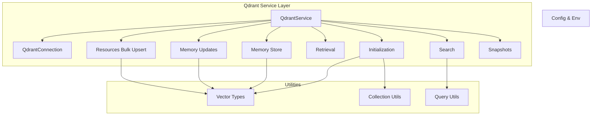
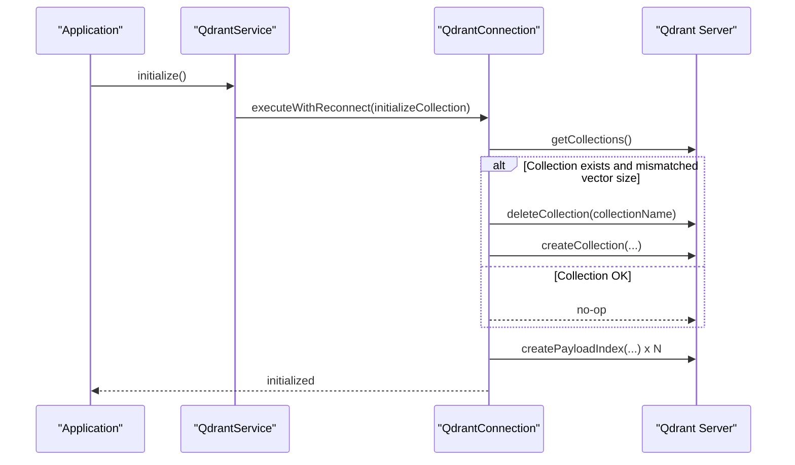
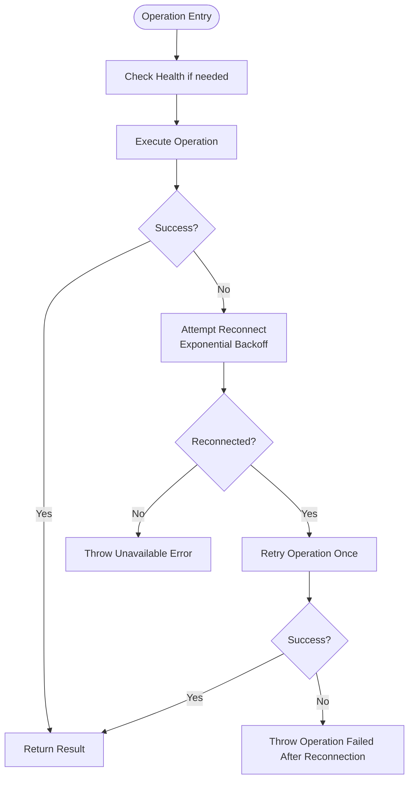
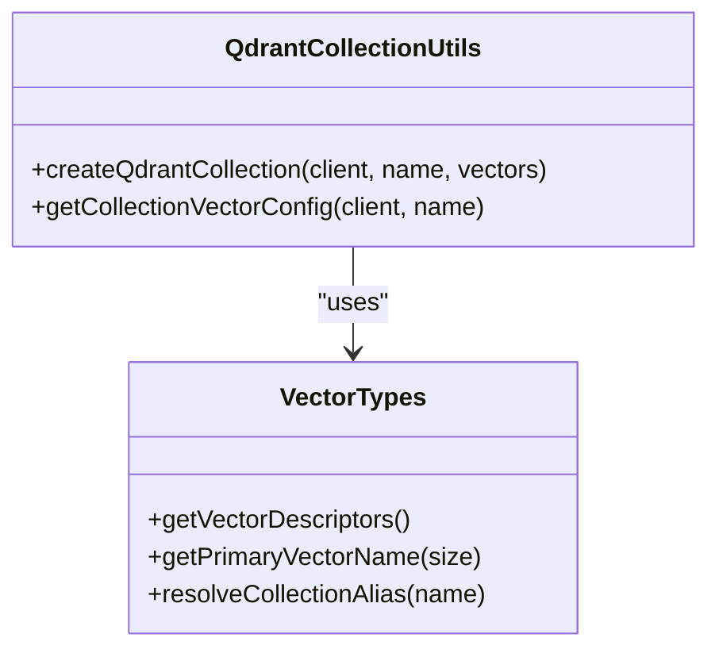
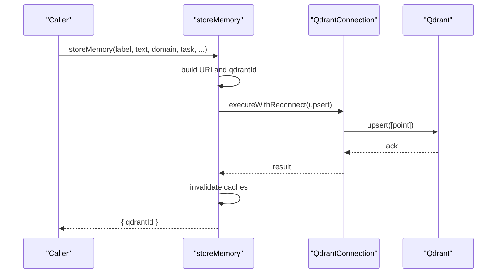
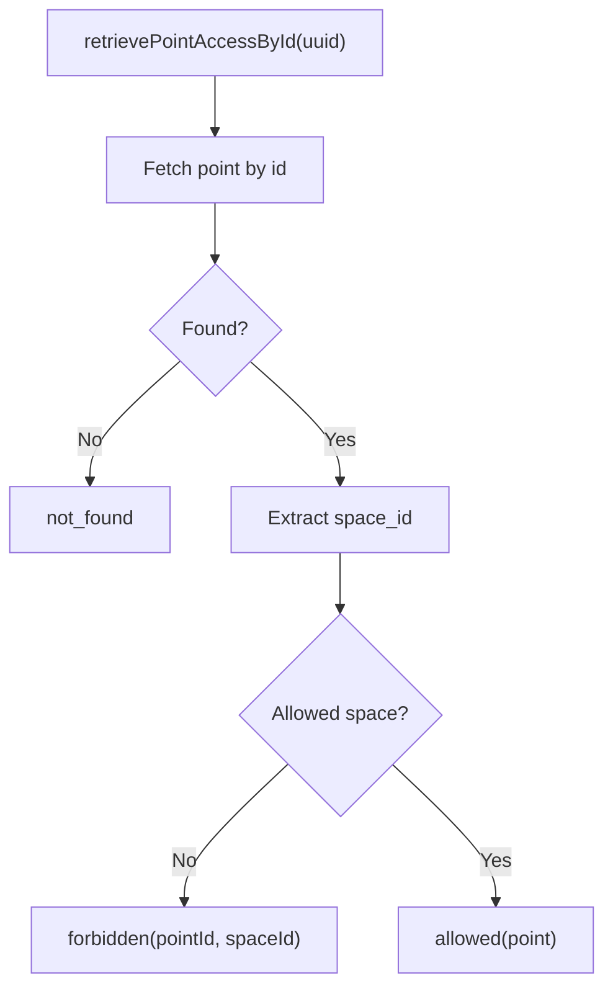
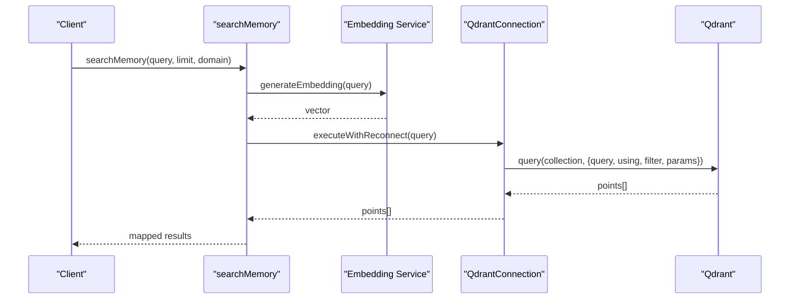
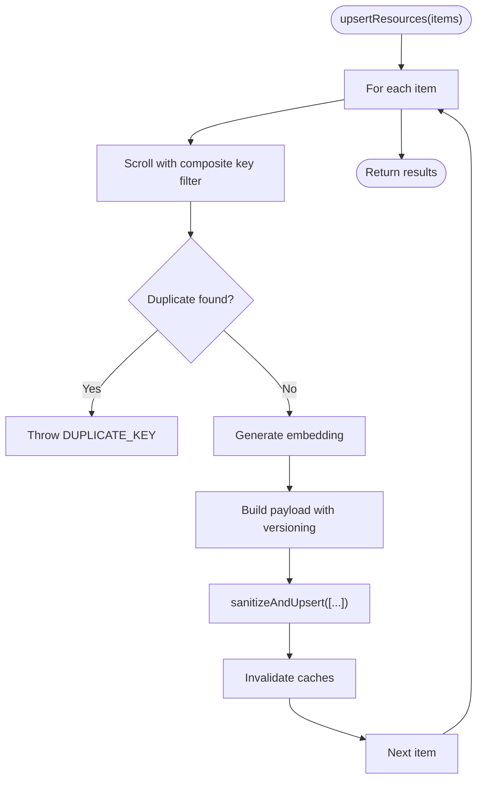
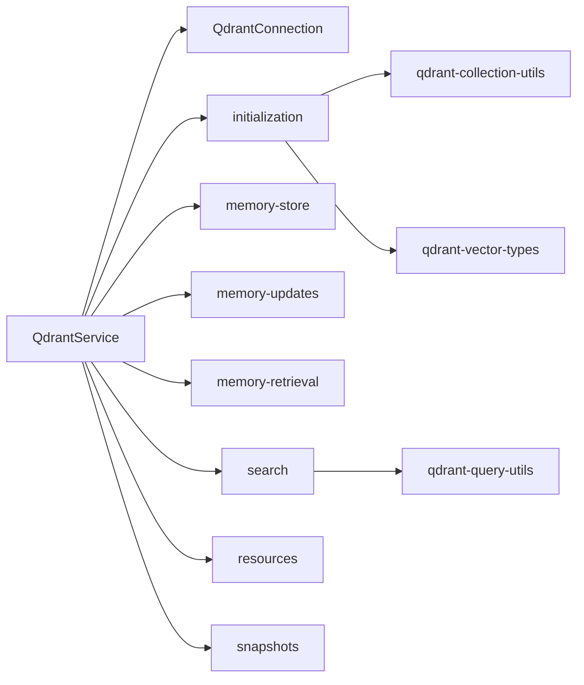

# Qdrant Integration

<cite>
**Referenced Files in This Document**
- [connection.ts](file://src/services/qdrant/connection.ts)
- [service.ts](file://src/services/qdrant/service.ts)
- [initialization.ts](file://src/services/qdrant/initialization.ts)
- [memory-store.ts](file://src/services/qdrant/memory-store.ts)
- [memory-updates.ts](file://src/services/qdrant/memory-updates.ts)
- [memory-retrieval.ts](file://src/services/qdrant/memory-retrieval.ts)
- [search.ts](file://src/services/qdrant/search.ts)
- [resources.ts](file://src/services/qdrant/resources.ts)
- [snapshots.ts](file://src/services/qdrant/snapshots.ts)
- [qdrant-collection-utils.ts](file://src/utils/qdrant-collection-utils.ts)
- [qdrant-query-utils.ts](file://src/utils/qdrant-query-utils.ts)
- [qdrant-vector-types.ts](file://src/utils/qdrant-vector-types.ts)
- [config.ts](file://src/config.ts)
</cite>

## Table of Contents
1. [Introduction](#introduction)
2. [Project Structure](#project-structure)
3. [Core Components](#core-components)
4. [Architecture Overview](#architecture-overview)
5. [Detailed Component Analysis](#detailed-component-analysis)
6. [Dependency Analysis](#dependency-analysis)
7. [Performance Considerations](#performance-considerations)
8. [High Availability and Disaster Recovery](#high-availability-and-disaster-recovery)
9. [Troubleshooting Guide](#troubleshooting-guide)
10. [Conclusion](#conclusion)

## Introduction
This document explains the Qdrant vector database integration used as the primary production storage backend for semantic search and memory persistence. It covers connection management (authentication, TLS, health checks, and retry), collection lifecycle and schema, data ingestion and updates, search workflows, bulk operations, performance tuning, high availability via aliases and snapshots, and operational troubleshooting.

The integration is implemented as a service layer over the Qdrant REST client with resilient execution, payload indexing, space-scoped access control, and metrics instrumentation.

## Project Structure
The Qdrant integration lives under `src/services/qdrant` with supporting utilities under `src/utils`. Key responsibilities:
- Connection and resilience: `connection.ts`
- Service facade and composition: `service.ts`
- Collection initialization and indexes: `initialization.ts`, `qdrant-collection-utils.ts`
- Data write paths: `memory-store.ts`, `resources.ts`, `memory-updates.ts`
- Retrieval and filtering: `memory-retrieval.ts`, `search.ts`, `qdrant-query-utils.ts`
- Snapshots and disaster recovery: `snapshots.ts`
- Configuration and environment: `config.ts`, `qdrant-vector-types.ts`

**Diagram sources**
- [service.ts:17-161](file://src/services/qdrant/service.ts#L17-L161)
- [connection.ts:11-131](file://src/services/qdrant/connection.ts#L11-L131)
- [initialization.ts:13-93](file://src/services/qdrant/initialization.ts#L13-L93)
- [memory-store.ts:14-126](file://src/services/qdrant/memory-store.ts#L14-L126)
- [memory-updates.ts:15-235](file://src/services/qdrant/memory-updates.ts#L15-L235)
- [memory-retrieval.ts:25-340](file://src/services/qdrant/memory-retrieval.ts#L25-L340)
- [search.ts:11-83](file://src/services/qdrant/search.ts#L11-L83)
- [resources.ts:18-139](file://src/services/qdrant/resources.ts#L18-L139)
- [snapshots.ts:68-168](file://src/services/qdrant/snapshots.ts#L68-L168)
- [qdrant-collection-utils.ts:7-39](file://src/utils/qdrant-collection-utils.ts#L7-L39)
- [qdrant-query-utils.ts:8-23](file://src/utils/qdrant-query-utils.ts#L8-L23)
- [qdrant-vector-types.ts:28-35](file://src/utils/qdrant-vector-types.ts#L28-L35)
- [config.ts:297-303](file://src/config.ts#L297-L303)

**Section sources**
- [service.ts:17-161](file://src/services/qdrant/service.ts#L17-L161)
- [connection.ts:11-131](file://src/services/qdrant/connection.ts#L11-L131)
- [initialization.ts:13-93](file://src/services/qdrant/initialization.ts#L13-L93)
- [memory-store.ts:14-126](file://src/services/qdrant/memory-store.ts#L14-L126)
- [memory-updates.ts:15-235](file://src/services/qdrant/memory-updates.ts#L15-L235)
- [memory-retrieval.ts:25-340](file://src/services/qdrant/memory-retrieval.ts#L25-L340)
- [search.ts:11-83](file://src/services/qdrant/search.ts#L11-L83)
- [resources.ts:18-139](file://src/services/qdrant/resources.ts#L18-L139)
- [snapshots.ts:68-168](file://src/services/qdrant/snapshots.ts#L68-L168)
- [qdrant-collection-utils.ts:7-39](file://src/utils/qdrant-collection-utils.ts#L7-L39)
- [qdrant-query-utils.ts:8-23](file://src/utils/qdrant-query-utils.ts#L8-L23)
- [qdrant-vector-types.ts:28-35](file://src/utils/qdrant-vector-types.ts#L28-L35)
- [config.ts:297-303](file://src/config.ts#L297-L303)

## Core Components
- QdrantConnection: Encapsulates client initialization, TLS configuration, health checks, and resilient operation execution with exponential backoff reconnection.
- QdrantService: Facade exposing store, retrieval, update, search, aliasing, and snapshot capabilities; composed around QdrantConnection.
- Initialization: Ensures collection existence, validates vector dimension, creates payload indexes, backfills missing fields, and optionally sets an alias.
- Memory Store and Updates: Write single points or update/delete by ID/UUID with embedding regeneration when text changes and cache invalidation.
- Retrieval: Access-controlled reads with space scoping, adapter layer listing, and slug resolution helpers.
- Search: Vector similarity search using generated embeddings, space filters, and optional rescore.
- Resources Bulk Upsert: Batch upsert with duplicate detection, versioning, and quality metadata.
- Snapshots: Create and download Qdrant snapshots to local disk for backup/disaster recovery.

**Section sources**
- [connection.ts:11-131](file://src/services/qdrant/connection.ts#L11-L131)
- [service.ts:17-161](file://src/services/qdrant/service.ts#L17-L161)
- [initialization.ts:13-93](file://src/services/qdrant/initialization.ts#L13-L93)
- [memory-store.ts:14-126](file://src/services/qdrant/memory-store.ts#L14-L126)
- [memory-updates.ts:15-235](file://src/services/qdrant/memory-updates.ts#L15-L235)
- [memory-retrieval.ts:25-340](file://src/services/qdrant/memory-retrieval.ts#L25-L340)
- [search.ts:11-83](file://src/services/qdrant/search.ts#L11-L83)
- [resources.ts:18-139](file://src/services/qdrant/resources.ts#L18-L139)
- [snapshots.ts:68-168](file://src/services/qdrant/snapshots.ts#L68-L168)

## Architecture Overview
The system composes a resilient Qdrant client behind a service facade. All operations are wrapped with reconnect logic, tenant-aware context, and metrics. Collections are created with named vectors and sparse BM25 vectors, plus payload indexes for efficient filtering.

**Diagram sources**
- [service.ts:48-50](file://src/services/qdrant/service.ts#L48-L50)
- [connection.ts:98-131](file://src/services/qdrant/connection.ts#L98-L131)
- [initialization.ts:13-93](file://src/services/qdrant/initialization.ts#L13-L93)

## Detailed Component Analysis

### Connection Management and Resilience
- Authentication: Optional API key passed to QdrantClient; TLS enabled for https URLs with optional custom CA certificate path.
- Health check: Calls collections endpoint to validate connectivity; resets reconnect counters on success.
- Retry mechanism: Operations executed via `executeWithReconnect` catch errors, attempt exponential backoff reconnection up to a maximum number of attempts, then either retry once or fail with a structured error.

**Diagram sources**
- [connection.ts:63-131](file://src/services/qdrant/connection.ts#L63-L131)

**Section sources**
- [connection.ts:24-61](file://src/services/qdrant/connection.ts#L24-L61)
- [connection.ts:63-131](file://src/services/qdrant/connection.ts#L63-L131)

### Collection Lifecycle and Schema
- Creation: Creates collection with named vectors derived from embedding dimension and sparse BM25 vector support. Scalar int8 quantization is configured with RAM preference.
- Dimension validation: On boot, compares current vector size with expected embedding dimension; recreates collection if mismatched.
- Payload indexes: Initializes keyword and text indexes for space_id, domain, type, task, protocol.step, quality fields, adapter fields, slugs, content_type, and text fields for label/tag patterns.
- Alias: Optionally creates or updates an alias named 'current' pointing to the active collection.

**Diagram sources**
- [qdrant-collection-utils.ts:7-39](file://src/utils/qdrant-collection-utils.ts#L7-L39)
- [qdrant-vector-types.ts:28-35](file://src/utils/qdrant-vector-types.ts#L28-L35)

**Section sources**
- [initialization.ts:13-93](file://src/services/qdrant/initialization.ts#L13-L93)
- [qdrant-collection-utils.ts:7-39](file://src/utils/qdrant-collection-utils.ts#L7-L39)
- [qdrant-vector-types.ts:28-35](file://src/utils/qdrant-vector-types.ts#L28-L35)

### Data Ingestion and Updates
- Single point insertion: Generates deterministic IDs from URIs, constructs payloads with space scoping, quality metrics, and timestamps, then upserts. Invalidates caches after write.
- Update by UUID or ID: Reads existing point, merges updates, regenerates embeddings when text changes, preserves vector naming convention, and invalidates caches strictly.
- Delete: Validates access, deletes point, and invalidates caches.

**Diagram sources**
- [memory-store.ts:14-126](file://src/services/qdrant/memory-store.ts#L14-L126)
- [connection.ts:98-131](file://src/services/qdrant/connection.ts#L98-L131)

**Section sources**
- [memory-store.ts:14-126](file://src/services/qdrant/memory-store.ts#L14-L126)
- [memory-updates.ts:15-235](file://src/services/qdrant/memory-updates.ts#L15-L235)

### Retrieval and Filtering
- Access control: Points include space_id; reads enforce allowedSpaceIds and app-space bypass.
- Space-scoped queries: Filters built from tenant context ensure isolation across spaces.
- Adapter layers and slug resolution: Paginated scroll with deterministic tie-breaking and disambiguation notes.

**Diagram sources**
- [memory-retrieval.ts:25-70](file://src/services/qdrant/memory-retrieval.ts#L25-L70)

**Section sources**
- [memory-retrieval.ts:25-340](file://src/services/qdrant/memory-retrieval.ts#L25-L340)

### Search Capabilities
- Vector similarity search: Embeds query text, selects named vector based on embedding length, applies space filter and optional domain filter, and returns scored results.
- Rescore: Controlled by environment flag; enables server-side rescore within quantization pipeline.
- Note: Hybrid BM25+vector scoring is not implemented in this integration; only dense vector search is used.

**Diagram sources**
- [search.ts:11-83](file://src/services/qdrant/search.ts#L11-L83)
- [connection.ts:98-131](file://src/services/qdrant/connection.ts#L98-L131)

**Section sources**
- [search.ts:11-83](file://src/services/qdrant/search.ts#L11-L83)

### Bulk Operations
- Bulk upsert: Iterates items, performs duplicate checks scoped to allowed spaces, generates embeddings, handles updates vs creates with versioning, and writes points. Cache invalidation occurs per item.

**Diagram sources**
- [resources.ts:18-139](file://src/services/qdrant/resources.ts#L18-L139)

**Section sources**
- [resources.ts:18-139](file://src/services/qdrant/resources.ts#L18-L139)

## Dependency Analysis
Key dependencies and relationships:
- QdrantService depends on QdrantConnection and multiple feature modules (initialization, store, retrieval, updates, search, resources, protocol, listing, reward propagation).
- Initialization depends on collection utils and vector types to configure vectors and payload indexes.
- Search depends on embedding service and space filter utilities.
- Snapshots depend on QdrantService properties and HTTP fetch to Qdrant’s snapshot endpoints.

**Diagram sources**
- [service.ts:1-161](file://src/services/qdrant/service.ts#L1-L161)
- [initialization.ts:1-93](file://src/services/qdrant/initialization.ts#L1-L93)
- [search.ts:1-83](file://src/services/qdrant/search.ts#L1-L83)
- [snapshots.ts:1-168](file://src/services/qdrant/snapshots.ts#L1-L168)

**Section sources**
- [service.ts:1-161](file://src/services/qdrant/service.ts#L1-L161)
- [initialization.ts:1-93](file://src/services/qdrant/initialization.ts#L1-L93)
- [search.ts:1-83](file://src/services/qdrant/search.ts#L1-L83)
- [snapshots.ts:1-168](file://src/services/qdrant/snapshots.ts#L1-L168)

## Performance Considerations
- Vector dimension optimization: Named vectors use `vs{dimension}` naming; collection recreation ensures alignment with embedding dimension at startup. Keep embedding model stable to avoid costly recreation.
- Quantization: Scalar int8 quantization configured for vectors to reduce memory footprint while maintaining RAM residency.
- Payload indexing: Keyword and text indexes accelerate filtering and full-text-like queries on label, tags, activation patterns, and adapter fields.
- Query optimization: Use space filters to minimize scan scope; leverage rescore flag to improve accuracy when needed; tune limits and thresholds via configuration.
- Metrics: Upsert/query durations and operation counts are instrumented for observability.

Configuration knobs relevant to performance:
- `QDRANT_RESCORE`: Enable/disable rescore in search parameters.
- `SQUADRULES_SEARCH_MAX_CHOICES`, `SQUADRULES_SEARCH_LIMIT_CAP`, `SQUADRULES_SEARCH_LIMIT_MIN`: Control returned choices and caps.
- `SCORE_THRESHOLD`, `SIMILAR_MEMORY_THRESHOLD`: Tune downstream scoring thresholds.

**Section sources**
- [initialization.ts:27-79](file://src/services/qdrant/initialization.ts#L27-L79)
- [qdrant-collection-utils.ts:27-39](file://src/utils/qdrant-collection-utils.ts#L27-L39)
- [search.ts:27-33](file://src/services/qdrant/search.ts#L27-L33)
- [config.ts:268-287](file://src/config.ts#L268-L287)

## High Availability and Disaster Recovery
- Aliases: The initialization flow can create/update an alias named 'current' pointing to the active collection, enabling zero-downtime switching between collections.
- Snapshots: Snapshot creation and download are supported; snapshots can be triggered at startup or via API, saved locally, and used for disaster recovery.

Operational guidance:
- Ensure `QDRANT_SNAPSHOT_DIR` is set to enable snapshots; otherwise snapshot endpoints return 503.
- Use alias 'current' to route clients to the latest collection while performing maintenance on another.

**Section sources**
- [initialization.ts:84-91](file://src/services/qdrant/initialization.ts#L84-L91)
- [snapshots.ts:68-168](file://src/services/qdrant/snapshots.ts#L68-L168)
- [config.ts:268-277](file://src/config.ts#L268-L277)

## Troubleshooting Guide
Common issues and resolutions:
- Connection timeouts or unavailable Qdrant:
  - Symptoms: Errors indicating Qdrant is unavailable after retries.
  - Checks: Validate `QDRANT_URL`, network reachability, TLS settings, and CA certificate path if using HTTPS with custom CA.
  - Behavior: Automatic reconnection with exponential backoff; max attempts enforced.
- Memory constraints:
  - Symptoms: OOM or slow writes.
  - Actions: Verify quantization config and vector sizes; ensure embedding dimensions match collection; consider reducing batch sizes and enabling rescore judiciously.
- Search performance degradation:
  - Symptoms: Slow or inaccurate results.
  - Actions: Confirm payload indexes exist; apply space filters; adjust `QDRANT_RESCORE`; verify embedding model consistency.
- Duplicate keys during bulk upsert:
  - Symptoms: Errors indicating duplicate composite keys.
  - Actions: Review domain/type/task/step combinations; ensure uniqueness policy is enforced upstream.

Operational tips:
- Monitor metrics for upsert/query durations and operation counts.
- Use snapshots to back up collections regularly and test restore procedures.

**Section sources**
- [connection.ts:63-131](file://src/services/qdrant/connection.ts#L63-L131)
- [resources.ts:23-45](file://src/services/qdrant/resources.ts#L23-L45)
- [initialization.ts:50-79](file://src/services/qdrant/initialization.ts#L50-L79)
- [snapshots.ts:68-168](file://src/services/qdrant/snapshots.ts#L68-L168)

## Conclusion
The Qdrant integration provides a robust, resilient, and observable backend for semantic search and memory persistence. It emphasizes safe connection handling, consistent collection schemas aligned with embedding dimensions, indexed payload fields for efficient filtering, and clear separation of concerns through a service facade. Operational readiness is enhanced by alias-based routing and snapshot-backed disaster recovery. For hybrid search, the current implementation focuses on dense vector similarity; BM25 vectors are provisioned but not combined with vector scores in this integration.