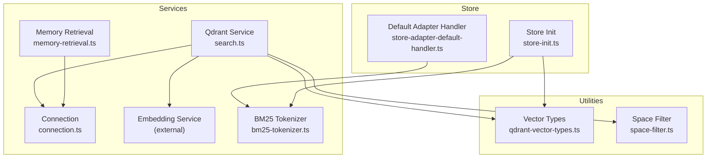
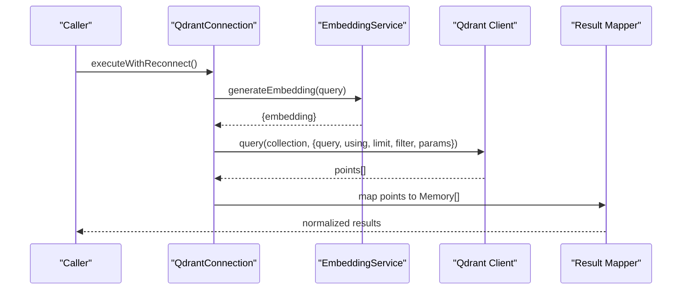
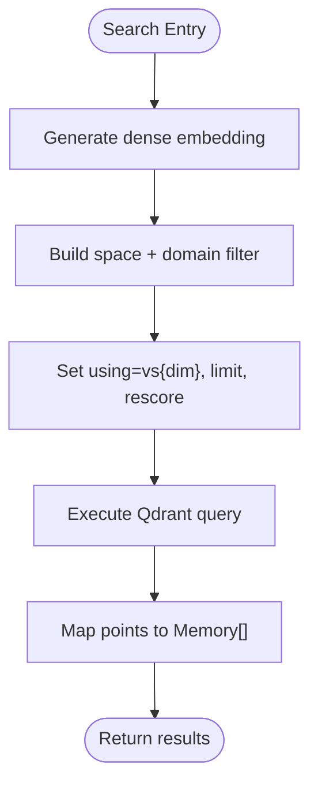
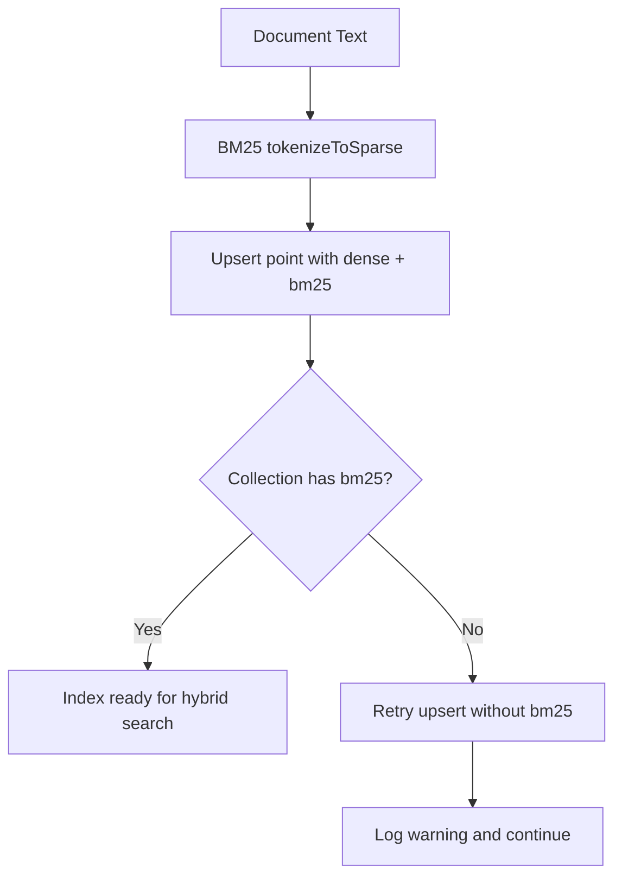
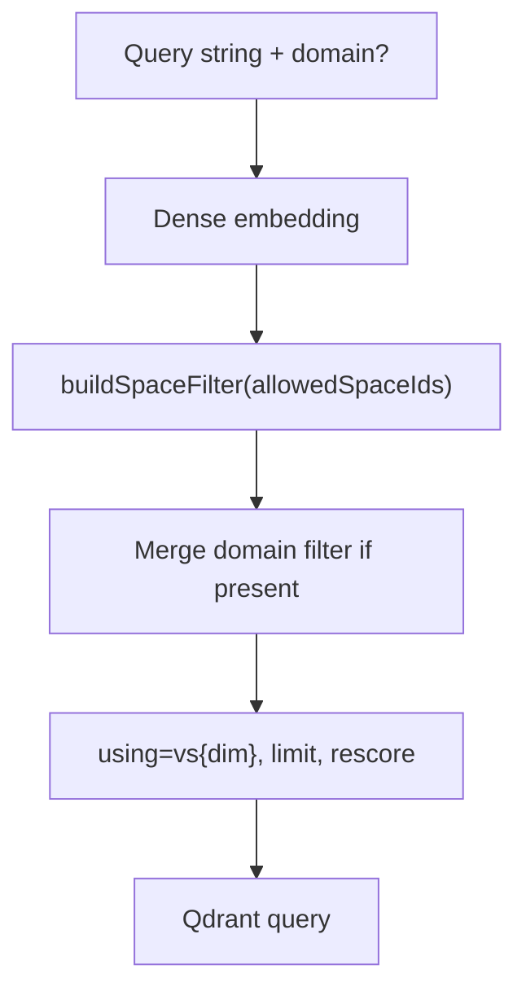
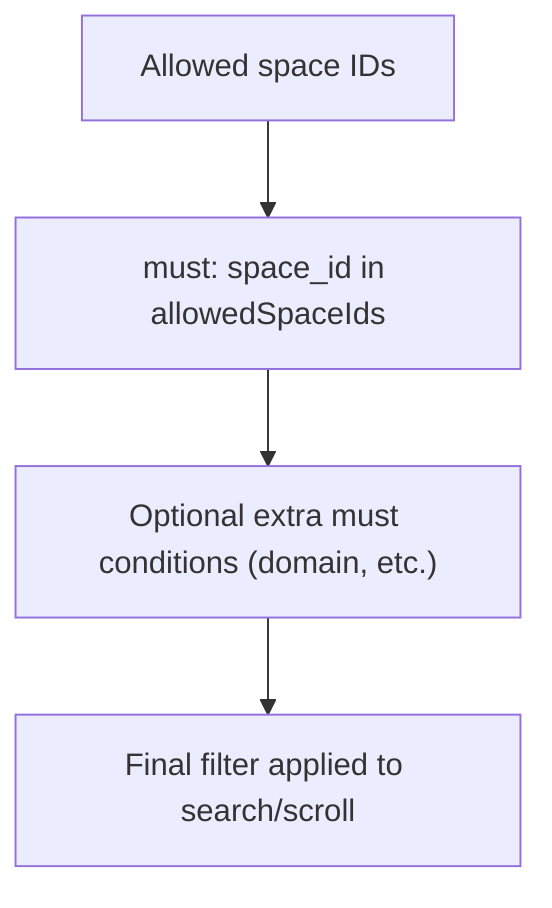
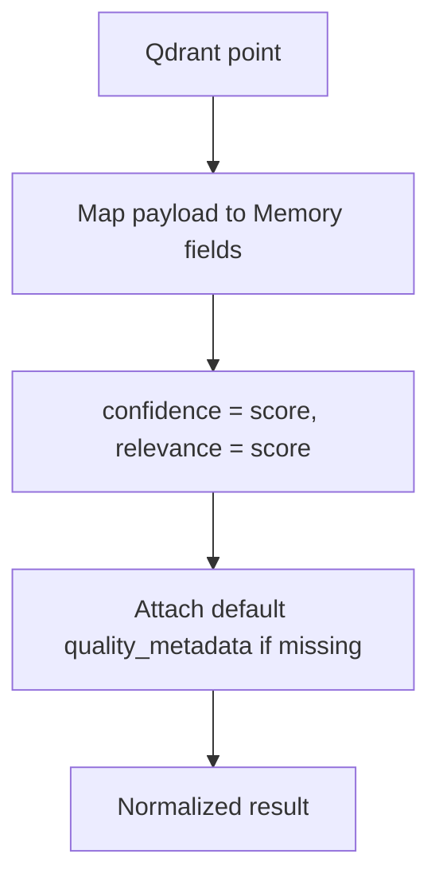
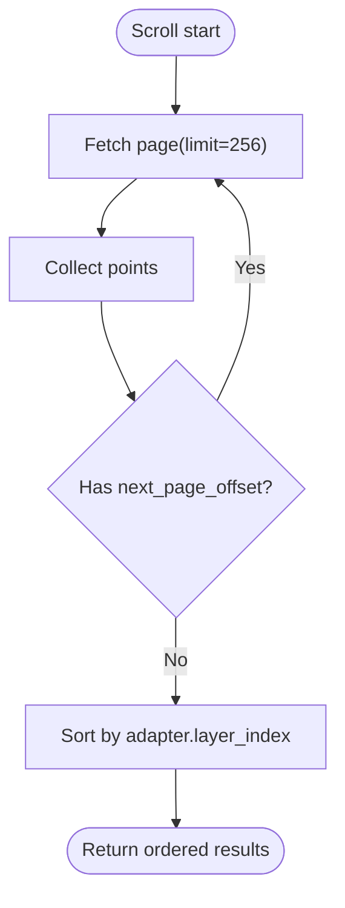
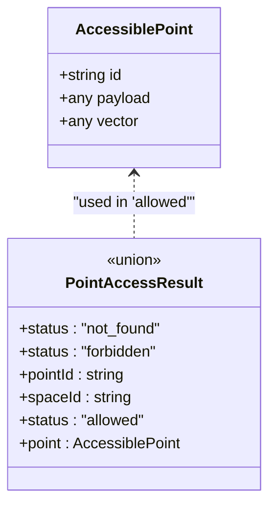
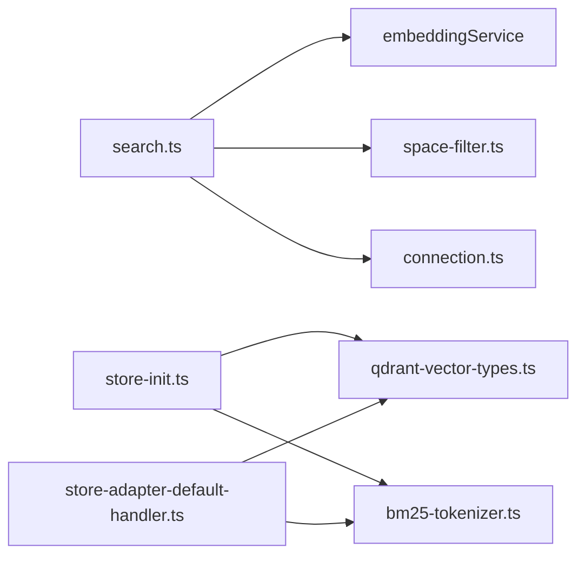

# Vector Search Operations

<cite>
**Referenced Files in This Document**
- [search.ts](file://src/services/qdrant/search.ts)
- [memory-retrieval.ts](file://src/services/qdrant/memory-retrieval.ts)
- [connection.ts](file://src/services/qdrant/connection.ts)
- [bm25-tokenizer.ts](file://src/services/embedding/bm25-tokenizer.ts)
- [qdrant-vector-types.ts](file://src/utils/qdrant-vector-types.ts)
- [space-filter.ts](file://src/utils/space-filter.ts)
- [store-init.ts](file://src/services/memory/store-init.ts)
- [store-adapter-default-handler.ts](file://src/services/memory/store-adapter-default-handler.ts)
</cite>

## Table of Contents
1. [Introduction](#introduction)
2. [Project Structure](#project-structure)
3. [Core Components](#core-components)
4. [Architecture Overview](#architecture-overview)
5. [Detailed Component Analysis](#detailed-component-analysis)
6. [Dependency Analysis](#dependency-analysis)
7. [Performance Considerations](#performance-considerations)
8. [Troubleshooting Guide](#troubleshooting-guide)
9. [Conclusion](#conclusion)

## Introduction
This document explains how vector search and retrieval work in the project, focusing on Qdrant-based similarity search, hybrid search combining BM25 sparse vectors with dense embeddings, filtering by metadata, query construction patterns, result ranking, pagination, and performance tuning. It also covers quality metrics and A/B testing strategies for improving search relevance.

The system uses:
- Dense vector search via named vectors (e.g., vs{dimension}) with Cosine distance by default.
- Hybrid search using BM25-style sparse vectors stored alongside dense vectors.
- Metadata filtering through space isolation and payload constraints.
- Rescoring to improve recall/precision when enabled.

## Project Structure
The vector search functionality is implemented across services and utilities:
- Qdrant service layer handles connection resilience, search execution, and retrieval helpers.
- Embedding service provides dense embeddings; BM25 tokenizer produces sparse vectors.
- Utilities define vector naming/distance, collection aliasing, and filter builders.
- Store initialization ensures collections have correct vector schemas, BM25 sparse config, and full-text indexes.

**Diagram sources**
- [search.ts:1-83](file://src/services/qdrant/search.ts#L1-L83)
- [memory-retrieval.ts:1-340](file://src/services/qdrant/memory-retrieval.ts#L1-L340)
- [connection.ts:1-131](file://src/services/qdrant/connection.ts#L1-L131)
- [bm25-tokenizer.ts:1-57](file://src/services/embedding/bm25-tokenizer.ts#L1-L57)
- [qdrant-vector-types.ts:1-57](file://src/utils/qdrant-vector-types.ts#L1-L57)
- [space-filter.ts:1-48](file://src/utils/space-filter.ts#L1-L48)
- [store-init.ts:1-350](file://src/services/memory/store-init.ts#L1-L350)
- [store-adapter-default-handler.ts:1-256](file://src/services/memory/store-adapter-default-handler.ts#L1-L256)

**Section sources**
- [search.ts:1-83](file://src/services/qdrant/search.ts#L1-L83)
- [memory-retrieval.ts:1-340](file://src/services/qdrant/memory-retrieval.ts#L1-L340)
- [connection.ts:1-131](file://src/services/qdrant/connection.ts#L1-L131)
- [bm25-tokenizer.ts:1-57](file://src/services/embedding/bm25-tokenizer.ts#L1-L57)
- [qdrant-vector-types.ts:1-57](file://src/utils/qdrant-vector-types.ts#L1-L57)
- [space-filter.ts:1-48](file://src/utils/space-filter.ts#L1-L48)
- [store-init.ts:1-350](file://src/services/memory/store-init.ts#L1-L350)
- [store-adapter-default-handler.ts:1-256](file://src/services/memory/store-adapter-default-handler.ts#L1-L256)

## Core Components
- QdrantConnection: Encapsulates client initialization, TLS configuration, health checks, and resilient execution with exponential backoff reconnection.
- searchMemory: Generates a dense embedding for the query, builds a space-aware filter, executes similarity search with optional rescoring, and maps results to a normalized memory shape.
- Memory retrieval helpers: Provide access control, point retrieval by UUID, adapter layer listing with pagination, and slug resolution with deterministic tie-breaking.
- BM25 tokenizer: Produces sparse vectors from text using FNV-1a hashing into a fixed dimension, with stop-word removal and sublinear TF values.
- Vector types: Define named vector names, dimensions, distances (Cosine/Euclid/Dot), and collection alias resolution.
- Space filter: Builds must conditions to restrict queries to allowed spaces and supports sibling scrolling filters.
- Store initialization: Ensures collection schema correctness, migrates vector dimensions/names, adds BM25 sparse config (with recreation fallback), creates full-text indexes, and backfills activation vectors.

**Section sources**
- [connection.ts:1-131](file://src/services/qdrant/connection.ts#L1-L131)
- [search.ts:1-83](file://src/services/qdrant/search.ts#L1-L83)
- [memory-retrieval.ts:1-340](file://src/services/qdrant/memory-retrieval.ts#L1-L340)
- [bm25-tokenizer.ts:1-57](file://src/services/embedding/bm25-tokenizer.ts#L1-L57)
- [qdrant-vector-types.ts:1-57](file://src/utils/qdrant-vector-types.ts#L1-L57)
- [space-filter.ts:1-48](file://src/utils/space-filter.ts#L1-L48)
- [store-init.ts:1-350](file://src/services/memory/store-init.ts#L1-L350)

## Architecture Overview
The search pipeline integrates embedding generation, filtering, similarity search, and result normalization. Hybrid search is supported at ingestion time by storing both dense and sparse vectors per point.

**Diagram sources**
- [search.ts:11-36](file://src/services/qdrant/search.ts#L11-L36)
- [connection.ts:98-131](file://src/services/qdrant/connection.ts#L98-L131)

## Detailed Component Analysis

### Similarity Search Algorithms and Metrics
- Distance metric: Named vectors are configured with Cosine distance by default. Euclidean and Dot are available as options in the type definitions.
- Query vector name: The primary vector name follows the pattern vs{dimension}, derived from the current embedding dimension.
- Rescoring: The search request includes quantization rescore controlled by an environment flag; enabling it can improve accuracy at additional cost.

**Diagram sources**
- [search.ts:11-36](file://src/services/qdrant/search.ts#L11-L36)
- [qdrant-vector-types.ts:8-34](file://src/utils/qdrant-vector-types.ts#L8-L34)

**Section sources**
- [qdrant-vector-types.ts:1-57](file://src/utils/qdrant-vector-types.ts#L1-L57)
- [search.ts:11-36](file://src/services/qdrant/search.ts#L11-L36)

### Hybrid Search (BM25 + Dense Vectors)
- Sparse vector generation: Text is tokenized into indices/values using FNV-1a hashing into a fixed dimension, with stop words removed and sublinear TF scoring.
- Ingestion: Points are upserted with both dense vectors and a bm25 sparse vector field. If the collection lacks sparse config, the handler retries without bm25 and logs a warning.
- Initialization: On startup, the store ensures the collection has BM25 sparse vector config; if updateCollection is unsupported, it recreates the collection with dense+bm25 schema.

**Diagram sources**
- [bm25-tokenizer.ts:32-52](file://src/services/embedding/bm25-tokenizer.ts#L32-L52)
- [store-adapter-default-handler.ts:157-231](file://src/services/memory/store-adapter-default-handler.ts#L157-L231)
- [store-init.ts:131-149](file://src/services/memory/store-init.ts#L131-L149)

**Section sources**
- [bm25-tokenizer.ts:1-57](file://src/services/embedding/bm25-tokenizer.ts#L1-L57)
- [store-adapter-default-handler.ts:147-231](file://src/services/memory/store-adapter-default-handler.ts#L147-L231)
- [store-init.ts:131-149](file://src/services/memory/store-init.ts#L131-L149)

### Query Construction Patterns
- Space isolation: All searches apply a must condition restricting space_id to allowedSpaceIds. Additional constraints (e.g., domain) can be merged.
- Domain filter: Optional must condition on payload.domain.
- Using named vectors: The query specifies using=vs{dimension} to target the correct vector space.
- Rescoring parameter: Quantization rescore toggled via environment variable.

**Diagram sources**
- [search.ts:19-33](file://src/services/qdrant/search.ts#L19-L33)
- [space-filter.ts:14-25](file://src/utils/space-filter.ts#L14-L25)

**Section sources**
- [search.ts:19-33](file://src/services/qdrant/search.ts#L19-L33)
- [space-filter.ts:1-48](file://src/utils/space-filter.ts#L1-L48)

### Filtering Capabilities
- Space-based filtering: Enforced via buildSpaceFilter to ensure tenant/space isolation.
- Payload constraints: Examples include matching domain or content_type; scroll operations exclude artifact MIMEs where needed.
- Sibling scrolling: For adapter siblings, a must/should combination matches adapter.id and either allowed space_id or missing space_id.

**Diagram sources**
- [space-filter.ts:14-47](file://src/utils/space-filter.ts#L14-L47)
- [memory-retrieval.ts:164-175](file://src/services/qdrant/memory-retrieval.ts#L164-L175)

**Section sources**
- [space-filter.ts:1-48](file://src/utils/space-filter.ts#L1-L48)
- [memory-retrieval.ts:152-199](file://src/services/qdrant/memory-retrieval.ts#L152-L199)

### Result Ranking Strategies
- Score mapping: Results from Qdrant are mapped to confidence and relevance fields equal to the raw score.
- Quality metadata: Default quality metadata is attached if not present; adapters may carry their own quality signals.
- Post-processing: Consumers can further sort or re-rank based on quality_metadata, tags, or other payload fields.

**Diagram sources**
- [search.ts:47-70](file://src/services/qdrant/search.ts#L47-L70)

**Section sources**
- [search.ts:47-70](file://src/services/qdrant/search.ts#L47-L70)

### Pagination Handling
- Scroll pagination: Adapter layers and slug resolution use scroll with a page size and next_page_offset until exhaustion.
- Limiting artifacts: When listing adapter siblings, artifact MIMEs are excluded via must_not.

**Diagram sources**
- [memory-retrieval.ts:176-199](file://src/services/qdrant/memory-retrieval.ts#L176-L199)

**Section sources**
- [memory-retrieval.ts:152-199](file://src/services/qdrant/memory-retrieval.ts#L152-L199)

### Result Post-processing
- Normalization: The search mapper converts Qdrant payloads into a consistent Memory-like structure with id, description, content, confidence, relevance, domain, task, type, tags, timestamps, protocol info, and quality metadata.
- Access control: Retrieval functions check space_id against allowedSpaceIds and return forbidden/not_found states accordingly.

**Diagram sources**
- [memory-retrieval.ts:14-23](file://src/services/qdrant/memory-retrieval.ts#L14-L23)

**Section sources**
- [memory-retrieval.ts:25-70](file://src/services/qdrant/memory-retrieval.ts#L25-L70)
- [search.ts:47-70](file://src/services/qdrant/search.ts#L47-L70)

## Dependency Analysis
Key dependencies and relationships:
- search.ts depends on embeddingService for dense embeddings, space-filter for isolation, and QdrantConnection for resilient execution.
- store-init.ts orchestrates collection setup, vector migration, BM25 sparse config, and full-text index creation.
- store-adapter-default-handler.ts generates dense and sparse vectors and upserts them, with fallback behavior when sparse config is missing.
- qdrant-vector-types.ts centralizes vector naming and distance configuration.

**Diagram sources**
- [search.ts:1-7](file://src/services/qdrant/search.ts#L1-L7)
- [store-init.ts:1-18](file://src/services/memory/store-init.ts#L1-L18)
- [store-adapter-default-handler.ts:1-18](file://src/services/memory/store-adapter-default-handler.ts#L1-L18)
- [qdrant-vector-types.ts:1-34](file://src/utils/qdrant-vector-types.ts#L1-L34)
- [bm25-tokenizer.ts:1-57](file://src/services/embedding/bm25-tokenizer.ts#L1-L57)

**Section sources**
- [search.ts:1-83](file://src/services/qdrant/search.ts#L1-L83)
- [store-init.ts:1-350](file://src/services/memory/store-init.ts#L1-L350)
- [store-adapter-default-handler.ts:1-256](file://src/services/memory/store-adapter-default-handler.ts#L1-L256)
- [qdrant-vector-types.ts:1-57](file://src/utils/qdrant-vector-types.ts#L1-L57)
- [bm25-tokenizer.ts:1-57](file://src/services/embedding/bm25-tokenizer.ts#L1-L57)

## Performance Considerations
- Pre-filtering: Always apply space isolation and any domain/content_type constraints before searching to reduce candidate sets.
- Index tuning:
  - Use named vectors sized to the embedding dimension; avoid mixing dimensions.
  - Ensure BM25 sparse config exists; otherwise hybrid search will fall back to dense-only.
  - Enable full-text indexes for payload fields used in keyword searches.
- Query parameters:
  - Set appropriate limit to balance latency and recall.
  - Enable rescoring when higher accuracy is required; note the trade-off in latency.
- Batch operations:
  - Use batch embedding generation for ingestion to minimize API calls.
  - Paginate scrolls with reasonable page sizes (e.g., 256) to avoid large payloads.
- Connection resilience:
  - Rely on QdrantConnection’s exponential backoff and health checks to recover from transient failures.

[No sources needed since this section provides general guidance]

## Troubleshooting Guide
Common issues and resolutions:
- Missing BM25 sparse config:
  - Symptom: Upsert fails with sparse/vector errors; handler retries without bm25 and logs a warning.
  - Resolution: Run store initialization to add BM25 sparse config; if updateCollection is unsupported, the recreation path will rebuild the collection with dense+bm25.
- Dimension mismatch:
  - Symptom: Migration logs indicate existingDim vs currentDim differences.
  - Resolution: Ensure embedding dimension is stable; the init flow migrates data from old to new vector spaces.
- Unavailable Qdrant:
  - Symptom: Operation fails after max reconnect attempts.
  - Resolution: Verify Qdrant URL, API key, TLS CA cert path, and network connectivity; check health endpoint.

**Section sources**
- [store-adapter-default-handler.ts:216-231](file://src/services/memory/store-adapter-default-handler.ts#L216-L231)
- [store-init.ts:131-149](file://src/services/memory/store-init.ts#L131-L149)
- [store-init.ts:172-350](file://src/services/memory/store-init.ts#L172-L350)
- [connection.ts:63-131](file://src/services/qdrant/connection.ts#L63-L131)

## Conclusion
The system implements robust vector search over Qdrant with Cosine similarity by default, hybrid search via BM25 sparse vectors, and strict space isolation. Initialization routines ensure schema correctness and BM25 support, while connection resilience and paginated scrolling provide reliable operation at scale. For best results, pre-filter queries, tune limits and rescoring, and maintain consistent embedding dimensions. Quality metadata and post-processing enable flexible ranking and evaluation, supporting A/B testing of search algorithms.

[No sources needed since this section summarizes without analyzing specific files]