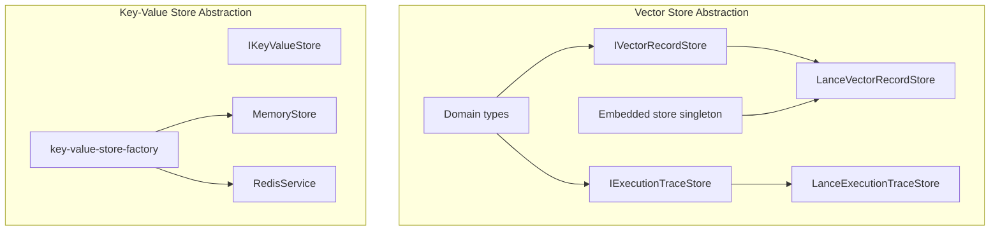
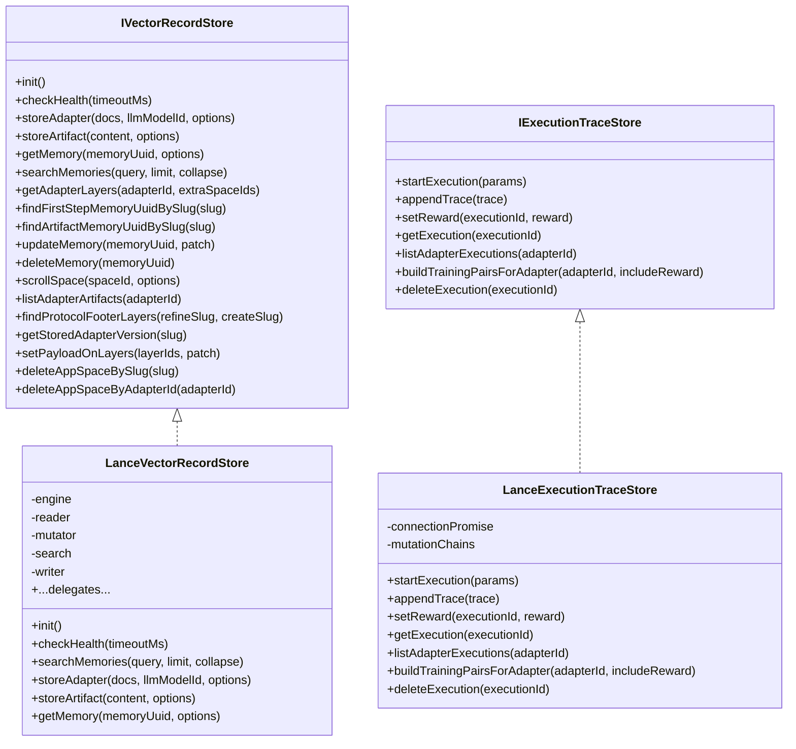
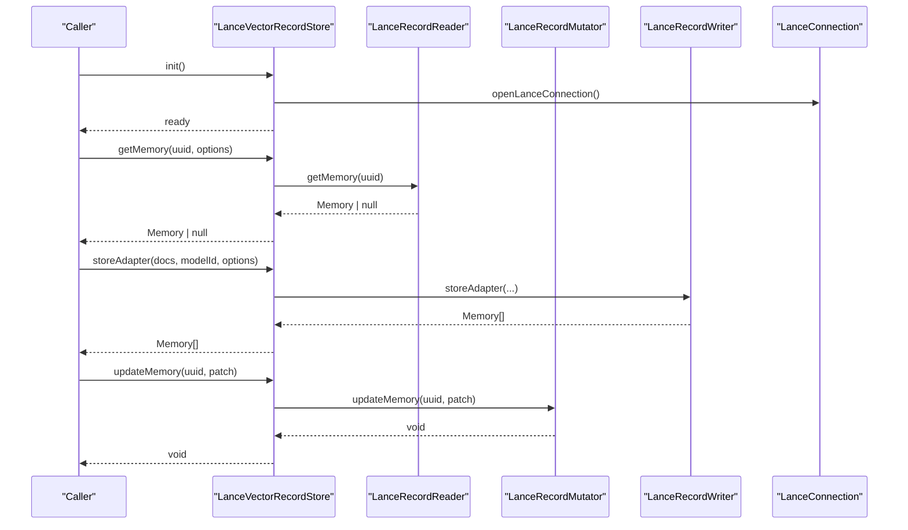
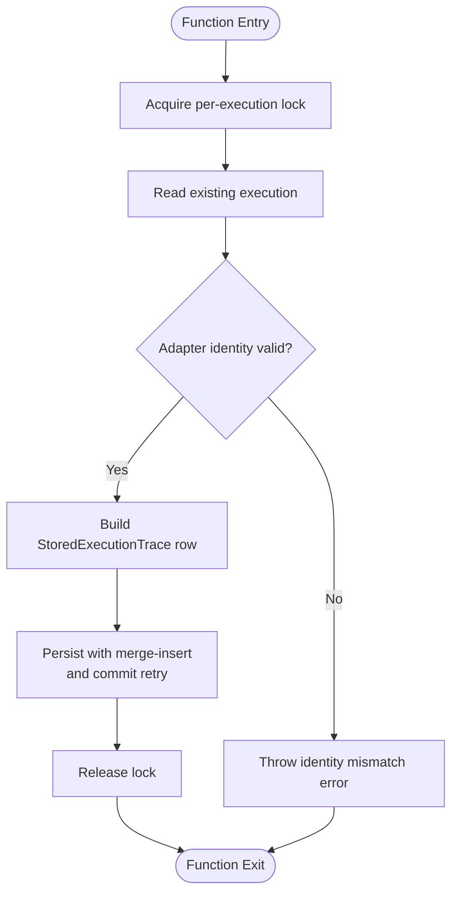
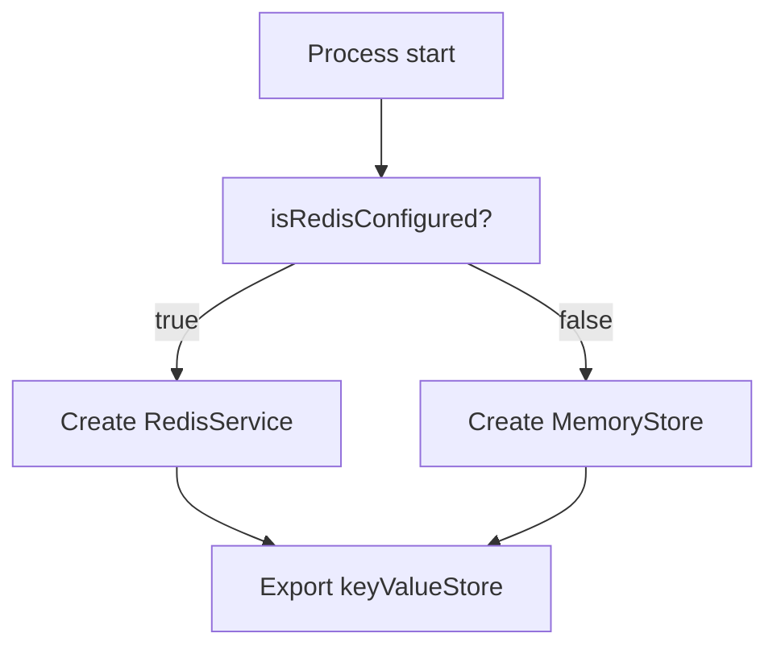
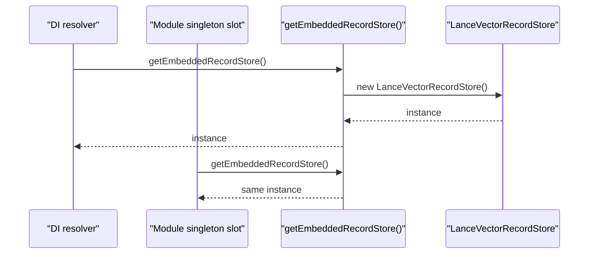
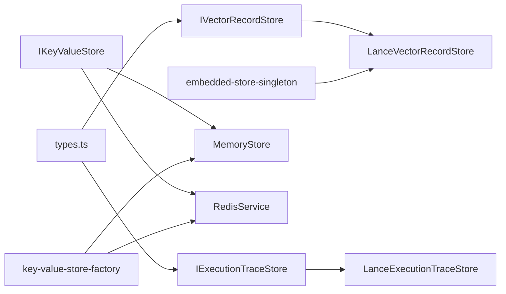

# Storage Abstraction Layer

<cite>
**Referenced Files in This Document**
- [IVectorRecordStore.ts](file://src/services/vector-store/IVectorRecordStore.ts)
- [IExecutionTraceStore.ts](file://src/services/vector-store/IExecutionTraceStore.ts)
- [types.ts](file://src/services/vector-store/types.ts)
- [embedded-store-singleton.ts](file://src/services/vector-store/embedded-store-singleton.ts)
- [LanceVectorRecordStore.ts](file://src/services/vector-store/lancedb/LanceVectorRecordStore.ts)
- [LanceExecutionTraceStore.ts](file://src/services/vector-store/lancedb/LanceExecutionTraceStore.ts)
- [key-value-store.ts](file://src/services/key-value-store.ts)
- [key-value-store-factory.ts](file://src/services/key-value-store-factory.ts)
- [memory-store.ts](file://src/services/memory-store.ts)
- [redis.ts](file://src/services/redis.ts)
</cite>

## Table of Contents
1. [Introduction](#introduction)
2. [Project Structure](#project-structure)
3. [Core Components](#core-components)
4. [Architecture Overview](#architecture-overview)
5. [Detailed Component Analysis](#detailed-component-analysis)
6. [Dependency Analysis](#dependency-analysis)
7. [Performance Considerations](#performance-considerations)
8. [Troubleshooting Guide](#troubleshooting-guide)
9. [Conclusion](#conclusion)

## Introduction
This document explains the storage abstraction layer that unifies access to vector and key-value backends. It covers:
- The adapter pattern for vector stores (Qdrant vs LanceDB).
- The factory pattern for key-value stores (Redis vs in-memory).
- Interface contracts, error handling, and consistency guarantees.
- Embedded store singleton usage for local development.
- Transaction boundaries, connection strategies, and performance techniques.
- Configuration and environment-specific behavior.

The design keeps backend-specific details behind stable interfaces so callers remain portable across environments and deployments.

## Project Structure
The storage abstraction is split into two layers:
- Vector-store abstraction: domain-neutral ports and LanceDB implementations.
- Key-value store abstraction: a shared interface with Redis and in-memory implementations selected at runtime.

**Diagram sources**
- [IVectorRecordStore.ts:27-73](file://src/services/vector-store/IVectorRecordStore.ts#L27-L73)
- [IExecutionTraceStore.ts:10-31](file://src/services/vector-store/IExecutionTraceStore.ts#L10-L31)
- [types.ts:1-95](file://src/services/vector-store/types.ts#L1-L95)
- [LanceVectorRecordStore.ts:35-192](file://src/services/vector-store/lancedb/LanceVectorRecordStore.ts#L35-L192)
- [LanceExecutionTraceStore.ts:51-257](file://src/services/vector-store/lancedb/LanceExecutionTraceStore.ts#L51-L257)
- [embedded-store-singleton.ts:12-17](file://src/services/vector-store/embedded-store-singleton.ts#L12-L17)
- [key-value-store.ts:7-28](file://src/services/key-value-store.ts#L7-L28)
- [key-value-store-factory.ts:13-22](file://src/services/key-value-store-factory.ts#L13-L22)
- [memory-store.ts:27-201](file://src/services/memory-store.ts#L27-L201)
- [redis.ts:26-292](file://src/services/redis.ts#L26-L292)

**Section sources**
- [IVectorRecordStore.ts:1-74](file://src/services/vector-store/IVectorRecordStore.ts#L1-L74)
- [IExecutionTraceStore.ts:1-32](file://src/services/vector-store/IExecutionTraceStore.ts#L1-L32)
- [types.ts:1-95](file://src/services/vector-store/types.ts#L1-L95)
- [key-value-store.ts:1-29](file://src/services/key-value-store.ts#L1-L29)
- [key-value-store-factory.ts:1-23](file://src/services/key-value-store-factory.ts#L1-L23)
- [memory-store.ts:1-202](file://src/services/memory-store.ts#L1-L202)
- [redis.ts:1-293](file://src/services/redis.ts#L1-L293)

## Core Components
- Vector record port: `IVectorRecordStore` defines lifecycle, writes, reads, search, adapter-layer operations, and admin helpers.
- Execution trace port: `IExecutionTraceStore` defines execution lifecycle, trace appending, reward attachment, listing, training pair generation, and deletion.
- Domain types: neutral shapes like `Memory`, `LayerRecord`, `StoredExecutionTrace`, `TrainingPair`.
- Key-value port: `IKeyValueStore` defines string/hash/JSON operations, counters, pub/sub, and connection management.
- Implementations:
  - Vector: LanceDB-backed `LanceVectorRecordStore` and `LanceExecutionTraceStore`.
  - Key-value: `RedisService` and `MemoryStore`, selected by `key-value-store-factory`.

**Section sources**
- [IVectorRecordStore.ts:27-73](file://src/services/vector-store/IVectorRecordStore.ts#L27-L73)
- [IExecutionTraceStore.ts:10-31](file://src/services/vector-store/IExecutionTraceStore.ts#L10-L31)
- [types.ts:14-95](file://src/services/vector-store/types.ts#L14-L95)
- [key-value-store.ts:7-28](file://src/services/key-value-store.ts#L7-L28)

## Architecture Overview
The system uses an adapter pattern around vector backends and a factory pattern for key-value backends. Callers depend only on the ports; concrete backends are wired at runtime.

**Diagram sources**
- [IVectorRecordStore.ts:27-73](file://src/services/vector-store/IVectorRecordStore.ts#L27-L73)
- [IExecutionTraceStore.ts:10-31](file://src/services/vector-store/IExecutionTraceStore.ts#L10-L31)
- [LanceVectorRecordStore.ts:35-192](file://src/services/vector-store/lancedb/LanceVectorRecordStore.ts#L35-L192)
- [LanceExecutionTraceStore.ts:51-257](file://src/services/vector-store/lancedb/LanceExecutionTraceStore.ts#L51-L257)

## Detailed Component Analysis

### Vector Record Store Port and LanceDB Adapter
- Contract: `IVectorRecordStore` exposes lifecycle, writes, reads, semantic search, adapter-layer navigation, and admin helpers.
- Implementation: `LanceVectorRecordStore` delegates to specialized readers, mutators, writers, and search components over a single Lance connection.
- Health and initialization: `init()` opens the connection; `checkHealth()` returns readiness based on connection availability.
- Search: Uses JS cosine similarity when embedded; integration tests validate parity with Qdrant.

**Diagram sources**
- [LanceVectorRecordStore.ts:43-62](file://src/services/vector-store/lancedb/LanceVectorRecordStore.ts#L43-L62)
- [LanceVectorRecordStore.ts:64-115](file://src/services/vector-store/lancedb/LanceVectorRecordStore.ts#L64-L115)
- [LanceVectorRecordStore.ts:175-191](file://src/services/vector-store/lancedb/LanceVectorRecordStore.ts#L175-L191)

**Section sources**
- [IVectorRecordStore.ts:27-73](file://src/services/vector-store/IVectorRecordStore.ts#L27-L73)
- [LanceVectorRecordStore.ts:35-192](file://src/services/vector-store/lancedb/LanceVectorRecordStore.ts#L35-L192)

### Execution Trace Store Port and LanceDB Adapter
- Contract: `IExecutionTraceStore` manages execution lifecycles, traces, rewards, enumeration, training pairs, and deletion.
- Implementation: `LanceExecutionTraceStore` persists one JSON row per execution, serializes mutations per execution id, and retries commits via `withCommitRetry`.
- Consistency: In-process mutation locks ensure concurrent forwards serialize per execution, mirroring Qdrant path semantics.

**Diagram sources**
- [LanceExecutionTraceStore.ts:103-120](file://src/services/vector-store/lancedb/LanceExecutionTraceStore.ts#L103-L120)
- [LanceExecutionTraceStore.ts:122-147](file://src/services/vector-store/lancedb/LanceExecutionTraceStore.ts#L122-L147)
- [LanceExecutionTraceStore.ts:149-173](file://src/services/vector-store/lancedb/LanceExecutionTraceStore.ts#L149-L173)
- [LanceExecutionTraceStore.ts:89-101](file://src/services/vector-store/lancedb/LanceExecutionTraceStore.ts#L89-L101)

**Section sources**
- [IExecutionTraceStore.ts:10-31](file://src/services/vector-store/IExecutionTraceStore.ts#L10-L31)
- [LanceExecutionTraceStore.ts:51-257](file://src/services/vector-store/lancedb/LanceExecutionTraceStore.ts#L51-L257)

### Key-Value Store Factory Pattern
- Selection logic: When Redis is configured, use `RedisService`; otherwise, use `MemoryStore`.
- Shared instance: A module-level `keyValueStore` provides a single, consistent backend across the process.

**Diagram sources**
- [key-value-store-factory.ts:13-22](file://src/services/key-value-store-factory.ts#L13-L22)

**Section sources**
- [key-value-store-factory.ts:1-23](file://src/services/key-value-store-factory.ts#L1-L23)

### Embedded Store Singleton
- Purpose: Provide a single `LanceVectorRecordStore` instance shared between dependency injection and module-level service slots for local/embedded runs.
- Behavior: Lazily creates and caches one instance to ensure internal consistency across facades.

**Diagram sources**
- [embedded-store-singleton.ts:12-17](file://src/services/vector-store/embedded-store-singleton.ts#L12-L17)
- [LanceVectorRecordStore.ts:35-52](file://src/services/vector-store/lancedb/LanceVectorRecordStore.ts#L35-L52)

**Section sources**
- [embedded-store-singleton.ts:1-18](file://src/services/vector-store/embedded-store-singleton.ts#L1-L18)
- [LanceVectorRecordStore.ts:35-52](file://src/services/vector-store/lancedb/LanceVectorRecordStore.ts#L35-L52)

### Interface Contracts and Error Handling Patterns
- Vector record store:
  - Lifecycle methods return promises; health checks catch errors and report readiness.
  - Writes and updates delegate to focused mutators; search returns structured results.
- Execution trace store:
  - Identity validation throws explicit errors when reassigning executions or appending traces to mismatched adapters.
  - Reads gracefully handle missing tables or malformed data by returning null or empty collections.
- Key-value store:
  - Redis implementation logs errors and returns safe defaults (null, false, empty arrays, zero) on failures.
  - In-memory implementation simulates TTLs, namespaces, and simple glob-based key matching.

**Section sources**
- [LanceVectorRecordStore.ts:54-62](file://src/services/vector-store/lancedb/LanceVectorRecordStore.ts#L54-L62)
- [LanceExecutionTraceStore.ts:132-136](file://src/services/vector-store/lancedb/LanceExecutionTraceStore.ts#L132-L136)
- [LanceExecutionTraceStore.ts:153-157](file://src/services/vector-store/lancedb/LanceExecutionTraceStore.ts#L153-L157)
- [redis.ts:119-155](file://src/services/redis.ts#L119-L155)
- [redis.ts:200-217](file://src/services/redis.ts#L200-L217)
- [memory-store.ts:48-84](file://src/services/memory-store.ts#L48-L84)

### Data Consistency Guarantees
- Vector records:
  - Single connection per store instance; read/write paths reuse it.
  - Embedded store singleton ensures cross-facade visibility within a process.
- Execution traces:
  - Per-execution mutation locks serialize concurrent appends and updates.
  - Commit retries improve durability under transient failures.
- Key-value:
  - Redis provides atomic GETDEL and INCR; in-memory mimics these behaviors locally.
  - Space namespacing isolates keys across tenants.

**Section sources**
- [LanceVectorRecordStore.ts:43-46](file://src/services/vector-store/lancedb/LanceVectorRecordStore.ts#L43-L46)
- [embedded-store-singleton.ts:12-17](file://src/services/vector-store/embedded-store-singleton.ts#L12-L17)
- [LanceExecutionTraceStore.ts:103-120](file://src/services/vector-store/lancedb/LanceExecutionTraceStore.ts#L103-L120)
- [LanceExecutionTraceStore.ts:89-101](file://src/services/vector-store/lancedb/LanceExecutionTraceStore.ts#L89-L101)
- [redis.ts:128-135](file://src/services/redis.ts#L128-L135)
- [redis.ts:191-198](file://src/services/redis.ts#L191-L198)
- [memory-store.ts:117-157](file://src/services/memory-store.ts#L117-L157)

### Configuration Management and Environment-Specific Settings
- Vector store:
  - Collection label derived from configuration; embedded store reports a synthetic URL and no API key.
- Key-value store:
  - Factory selects Redis vs in-memory based on configuration flag.
  - Both implementations apply a global prefix and space namespacing; special prefixes bypass namespacing.

**Section sources**
- [LanceVectorRecordStore.ts:33-34](file://src/services/vector-store/lancedb/LanceVectorRecordStore.ts#L33-L34)
- [LanceVectorRecordStore.ts:163-173](file://src/services/vector-store/lancedb/LanceVectorRecordStore.ts#L163-L173)
- [key-value-store-factory.ts:7-10](file://src/services/key-value-store-factory.ts#L7-L10)
- [memory-store.ts:27-46](file://src/services/memory-store.ts#L27-L46)
- [redis.ts:33-45](file://src/services/redis.ts#L33-L45)
- [redis.ts:110-117](file://src/services/redis.ts#L110-L117)

### Extending the Abstraction: Implementing Custom Backends
- Vector record store:
  - Implement `IVectorRecordStore` with lifecycle, reads, writes, search, and admin helpers.
  - Reuse domain types to keep payloads backend-neutral.
- Execution trace store:
  - Implement `IExecutionTraceStore` with per-execution serialization and durable persistence.
- Key-value store:
  - Implement `IKeyValueStore` supporting strings, hashes, JSON, counters, pub/sub, and connection lifecycle.
  - Respect key prefixing and optional space namespacing for multi-tenant isolation.

**Section sources**
- [IVectorRecordStore.ts:27-73](file://src/services/vector-store/IVectorRecordStore.ts#L27-L73)
- [IExecutionTraceStore.ts:10-31](file://src/services/vector-store/IExecutionTraceStore.ts#L10-L31)
- [key-value-store.ts:7-28](file://src/services/key-value-store.ts#L7-L28)

## Dependency Analysis

**Diagram sources**
- [IVectorRecordStore.ts:27-73](file://src/services/vector-store/IVectorRecordStore.ts#L27-L73)
- [IExecutionTraceStore.ts:10-31](file://src/services/vector-store/IExecutionTraceStore.ts#L10-L31)
- [types.ts:1-95](file://src/services/vector-store/types.ts#L1-L95)
- [LanceVectorRecordStore.ts:35-192](file://src/services/vector-store/lancedb/LanceVectorRecordStore.ts#L35-L192)
- [LanceExecutionTraceStore.ts:51-257](file://src/services/vector-store/lancedb/LanceExecutionTraceStore.ts#L51-L257)
- [key-value-store.ts:7-28](file://src/services/key-value-store.ts#L7-L28)
- [memory-store.ts:27-201](file://src/services/memory-store.ts#L27-L201)
- [redis.ts:26-292](file://src/services/redis.ts#L26-L292)
- [key-value-store-factory.ts:13-22](file://src/services/key-value-store-factory.ts#L13-L22)
- [embedded-store-singleton.ts:12-17](file://src/services/vector-store/embedded-store-singleton.ts#L12-L17)

**Section sources**
- [IVectorRecordStore.ts:27-73](file://src/services/vector-store/IVectorRecordStore.ts#L27-L73)
- [IExecutionTraceStore.ts:10-31](file://src/services/vector-store/IExecutionTraceStore.ts#L10-L31)
- [types.ts:1-95](file://src/services/vector-store/types.ts#L1-L95)
- [key-value-store.ts:7-28](file://src/services/key-value-store.ts#L7-L28)
- [key-value-store-factory.ts:13-22](file://src/services/key-value-store-factory.ts#L13-L22)
- [memory-store.ts:27-201](file://src/services/memory-store.ts#L27-L201)
- [redis.ts:26-292](file://src/services/redis.ts#L26-L292)
- [embedded-store-singleton.ts:12-17](file://src/services/vector-store/embedded-store-singleton.ts#L12-L17)

## Performance Considerations
- Connection pooling:
  - Vector stores maintain a single connection promise per store instance to avoid repeated handshakes.
  - Embedded store singleton ensures one engine/connection across multiple consumers.
- Search optimization:
  - Embedded vector search uses JS cosine similarity; consider pre-filtering or limiting result sets.
- Mutation efficiency:
  - Execution traces batch updates per execution using merge-insert and commit retries to reduce disk churn.
- Key-value operations:
  - Redis leverages native atomic operations (GETDEL, INCR); in-memory uses Maps for O(1) access.
  - Namespacing reduces collisions but increases key length; balance tenant count and key size.

[No sources needed since this section provides general guidance]

## Troubleshooting Guide
- Vector store health:
  - If `checkHealth` fails, inspect connection initialization and network reachability.
- Execution trace identity errors:
  - Errors indicate attempts to reassign an execution to a different adapter or append traces to mismatched URIs; verify caller inputs.
- Redis connectivity:
  - Connection events and errors are logged; check REDIS_URL and prefix settings.
  - Pub/sub publish returns subscriber counts; zero indicates no subscribers or channel issues.
- In-memory store:
  - TTL expiration is time-based; ensure clocks are synchronized if relying on precise expiry.
  - Keys method uses simple glob-to-regex; patterns must match stored prefixed keys.

**Section sources**
- [LanceVectorRecordStore.ts:54-62](file://src/services/vector-store/lancedb/LanceVectorRecordStore.ts#L54-L62)
- [LanceExecutionTraceStore.ts:132-136](file://src/services/vector-store/lancedb/LanceExecutionTraceStore.ts#L132-L136)
- [LanceExecutionTraceStore.ts:153-157](file://src/services/vector-store/lancedb/LanceExecutionTraceStore.ts#L153-L157)
- [redis.ts:47-85](file://src/services/redis.ts#L47-L85)
- [redis.ts:226-235](file://src/services/redis.ts#L226-L235)
- [memory-store.ts:48-84](file://src/services/memory-store.ts#L48-L84)
- [memory-store.ts:170-184](file://src/services/memory-store.ts#L170-L184)

## Conclusion
The storage abstraction layer cleanly separates concerns through stable interfaces and concrete adapters. Vector operations are backed by LanceDB with a clear contract for future extensions, while key-value operations switch between Redis and in-memory based on configuration. Embedded deployment benefits from a singleton store ensuring consistency across components. With well-defined contracts, error handling, and consistency mechanisms, the system supports scalable, testable, and portable storage behavior across environments.

[No sources needed since this section summarizes without analyzing specific files]