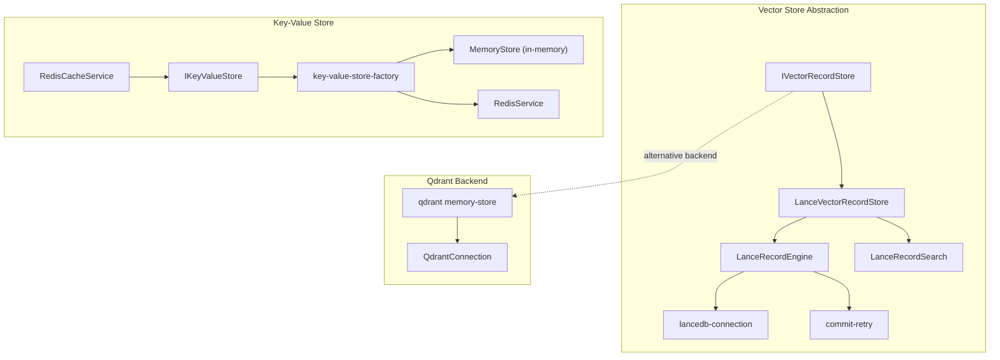
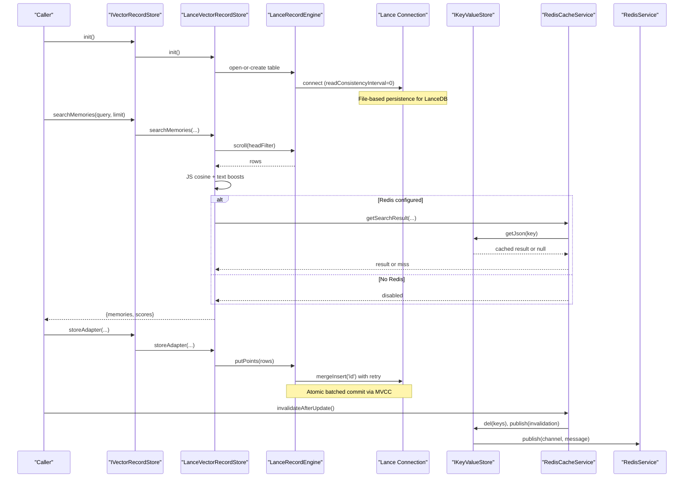
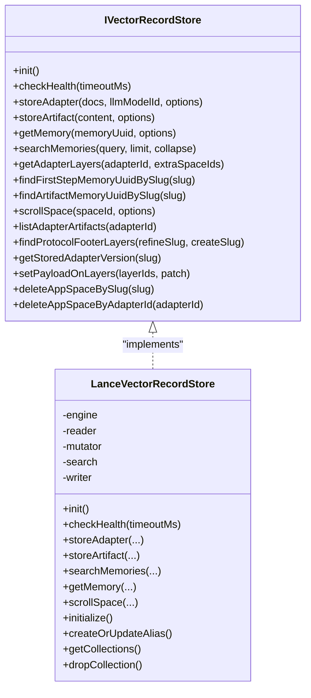
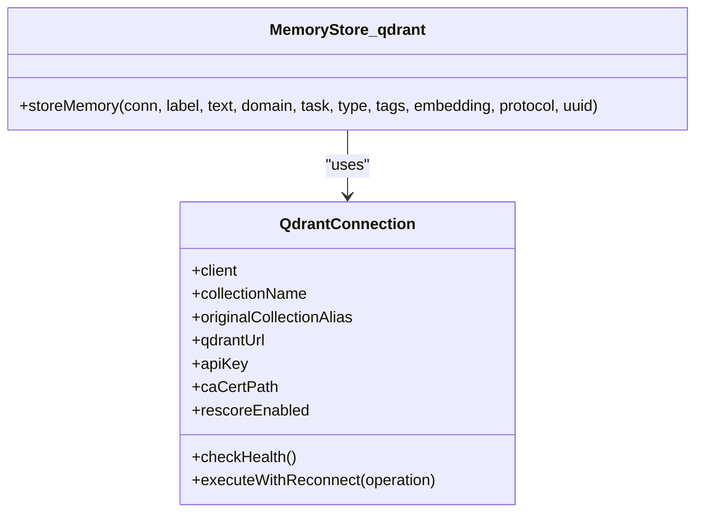
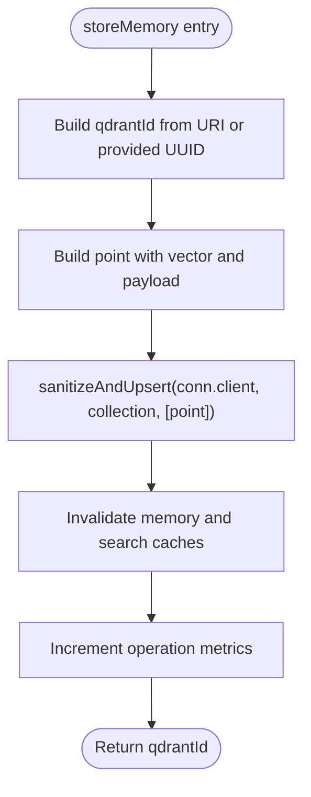
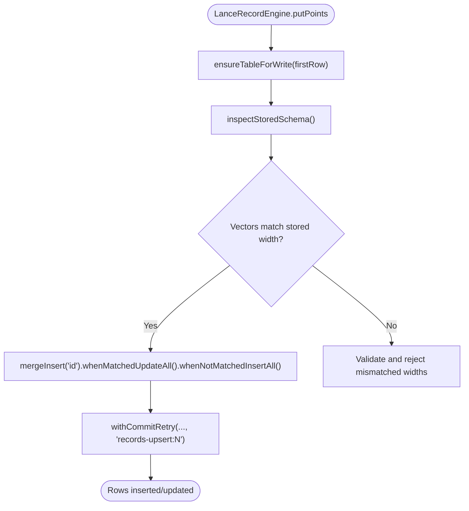
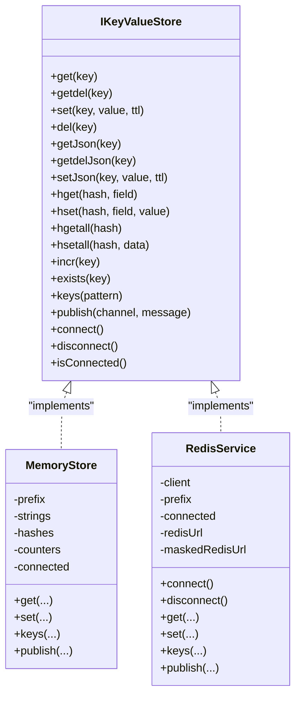
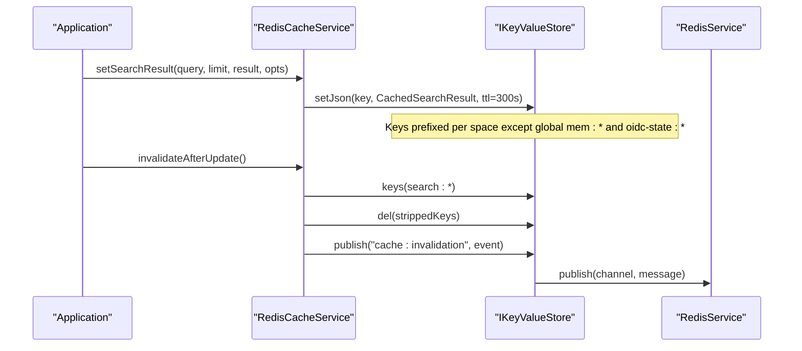
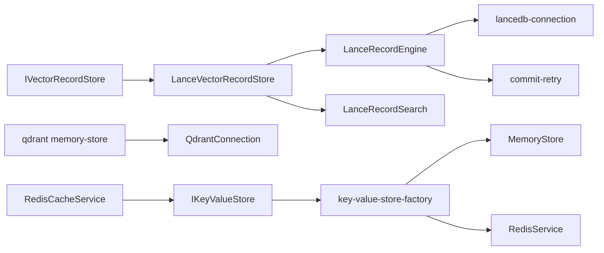

# Storage Backends

<cite>
**Referenced Files in This Document**
- [IVectorRecordStore.ts](file://src/services/vector-store/IVectorRecordStore.ts)
- [LanceVectorRecordStore.ts](file://src/services/vector-store/lancedb/LanceVectorRecordStore.ts)
- [lance-records-engine.ts](file://src/services/vector-store/lancedb/lance-records-engine.ts)
- [lance-records-search.ts](file://src/services/vector-store/lancedb/lance-records-search.ts)
- [lancedb-connection.ts](file://src/services/vector-store/lancedb-connection.ts)
- [commit-retry.ts](file://src/services/vector-store/commit-retry.ts)
- [memory-store.ts](file://src/services/memory-store.ts)
- [key-value-store.ts](file://src/services/key-value-store.ts)
- [key-value-store-factory.ts](file://src/services/key-value-store-factory.ts)
- [redis.ts](file://src/services/redis.ts)
- [redis-cache.ts](file://src/services/redis-cache.ts)
- [memory-store.ts](file://src/services/qdrant/memory-store.ts)
- [connection.ts](file://src/services/qdrant/connection.ts)
- [0013-embedded-store-multiprocess-safety.md](file://docs/adr/0013-embedded-store-multiprocess-safety.md)
</cite>

## Table of Contents
1. [Introduction](#introduction)
2. [Project Structure](#project-structure)
3. [Core Components](#core-components)
4. [Architecture Overview](#architecture-overview)
5. [Detailed Component Analysis](#detailed-component-analysis)
6. [Dependency Analysis](#dependency-analysis)
7. [Performance Considerations](#performance-considerations)
8. [Troubleshooting Guide](#troubleshooting-guide)
9. [Conclusion](#conclusion)
10. [Appendices](#appendices)

## Introduction
This document explains the storage backend abstraction system that supports multiple vector databases and key-value stores. It focuses on:
- The adapter pattern used to unify Qdrant and LanceDB for vector search.
- Qdrant integration, including connection management, collection operations, and vector search optimization.
- LanceDB embedded storage for local development and lightweight deployments, including file-based persistence and concurrent access patterns.
- Key-value store abstraction supporting Redis and an in-memory implementation for sessions, caching, and transient state.
- Migration strategies between backends, data consistency guarantees, performance characteristics, configuration examples, deployment considerations, troubleshooting, scalability, backup, and disaster recovery.

The project uses Qdrant as the primary remote-capable vector store and LanceDB as a secondary embedded option. Redis is used for shared cache and session state; when Redis is unavailable, an in-memory store is used instead.

## Project Structure
The storage-related code is organized into three main areas:
- Vector record store abstraction and implementations under `src/services/vector-store`.
- Qdrant service implementation under `src/services/qdrant`.
- Key-value store abstraction and implementations under `src/services`, plus Redis-backed caching under `src/services/redis-cache`.

**Diagram sources**
- [IVectorRecordStore.ts:27-73](file://src/services/vector-store/IVectorRecordStore.ts#L27-L73)
- [LanceVectorRecordStore.ts:35-192](file://src/services/vector-store/lancedb/LanceVectorRecordStore.ts#L35-L192)
- [lance-records-engine.ts:25-195](file://src/services/vector-store/lancedb/lance-records-engine.ts#L25-L195)
- [lance-records-search.ts:96-141](file://src/services/vector-store/lancedb/lance-records-search.ts#L96-L141)
- [lancedb-connection.ts](file://src/services/vector-store/lancedb-connection.ts)
- [commit-retry.ts](file://src/services/vector-store/commit-retry.ts)
- [memory-store.ts:27-201](file://src/services/memory-store.ts#L27-L201)
- [key-value-store.ts:7-28](file://src/services/key-value-store.ts#L7-L28)
- [key-value-store-factory.ts:13-22](file://src/services/key-value-store-factory.ts#L13-L22)
- [redis.ts:26-292](file://src/services/redis.ts#L26-L292)
- [redis-cache.ts:21-274](file://src/services/redis-cache.ts#L21-L274)
- [memory-store.ts:14-126](file://src/services/qdrant/memory-store.ts#L14-L126)
- [connection.ts:11-131](file://src/services/qdrant/connection.ts#L11-L131)

**Section sources**
- [IVectorRecordStore.ts:27-73](file://src/services/vector-store/IVectorRecordStore.ts#L27-L73)
- [LanceVectorRecordStore.ts:35-192](file://src/services/vector-store/lancedb/LanceVectorRecordStore.ts#L35-L192)
- [lance-records-engine.ts:25-195](file://src/services/vector-store/lancedb/lance-records-engine.ts#L25-L195)
- [lance-records-search.ts:96-141](file://src/services/vector-store/lancedb/lance-records-search.ts#L96-L141)
- [memory-store.ts:27-201](file://src/services/memory-store.ts#L27-L201)
- [key-value-store.ts:7-28](file://src/services/key-value-store.ts#L7-L28)
- [key-value-store-factory.ts:13-22](file://src/services/key-value-store-factory.ts#L13-L22)
- [redis.ts:26-292](file://src/services/redis.ts#L26-L292)
- [redis-cache.ts:21-274](file://src/services/redis-cache.ts#L21-L274)
- [memory-store.ts:14-126](file://src/services/qdrant/memory-store.ts#L14-L126)
- [connection.ts:11-131](file://src/services/qdrant/connection.ts#L11-L131)

## Core Components
- Vector record store interface: Defines lifecycle, writes, reads, search, adapter structure operations, enumeration, and admin methods. Both Qdrant and LanceDB implementations satisfy this contract.
- LanceDB embedded store: Implements the vector record store using a single table with Qdrant-shaped points, JS cosine scoring, and MVCC-safe commits.
- Qdrant connection and memory store: Provides resilient HTTP client usage, TLS support, reconnection logic, and upserts with cache invalidation.
- Key-value store abstraction: A unified interface for string, JSON, hash, counter, keys, publish, and lifecycle operations.
- In-memory key-value store: Process-local Map-based implementation with TTL, glob-style keys, and no cross-process pub/sub.
- Redis key-value store: Production-grade implementation with namespacing, TTL, JSON helpers, and pub/sub.
- Redis cache service: Application-level cache for search results and memory resources, with invalidation events and bounded TTLs.

**Section sources**
- [IVectorRecordStore.ts:27-73](file://src/services/vector-store/IVectorRecordStore.ts#L27-L73)
- [LanceVectorRecordStore.ts:35-192](file://src/services/vector-store/lancedb/LanceVectorRecordStore.ts#L35-L192)
- [lance-records-engine.ts:25-195](file://src/services/vector-store/lancedb/lance-records-engine.ts#L25-L195)
- [lance-records-search.ts:96-141](file://src/services/vector-store/lancedb/lance-records-search.ts#L96-L141)
- [memory-store.ts:27-201](file://src/services/memory-store.ts#L27-L201)
- [key-value-store.ts:7-28](file://src/services/key-value-store.ts#L7-L28)
- [key-value-store-factory.ts:13-22](file://src/services/key-value-store-factory.ts#L13-L22)
- [redis.ts:26-292](file://src/services/redis.ts#L26-L292)
- [redis-cache.ts:21-274](file://src/services/redis-cache.ts#L21-L274)
- [memory-store.ts:14-126](file://src/services/qdrant/memory-store.ts#L14-L126)
- [connection.ts:11-131](file://src/services/qdrant/connection.ts#L11-L131)

## Architecture Overview
The system uses an adapter pattern to abstract storage backends behind stable interfaces. Callers depend on `IVectorRecordStore` and `IKeyValueStore`, while runtime wiring selects the concrete implementation based on configuration.

**Diagram sources**
- [LanceVectorRecordStore.ts:49-178](file://src/services/vector-store/lancedb/LanceVectorRecordStore.ts#L49-L178)
- [lance-records-engine.ts:73-118](file://src/services/vector-store/lancedb/lance-records-engine.ts#L73-L118)
- [lance-records-search.ts:99-124](file://src/services/vector-store/lancedb/lance-records-search.ts#L99-L124)
- [redis-cache.ts:43-79](file://src/services/redis-cache.ts#L43-L79)
- [redis-cache.ts:245-252](file://src/services/redis-cache.ts#L245-L252)
- [redis.ts:226-235](file://src/services/redis.ts#L226-L235)

**Section sources**
- [LanceVectorRecordStore.ts:35-192](file://src/services/vector-store/lancedb/LanceVectorRecordStore.ts#L35-L192)
- [lance-records-engine.ts:25-195](file://src/services/vector-store/lancedb/lance-records-engine.ts#L25-L195)
- [lance-records-search.ts:96-141](file://src/services/vector-store/lancedb/lance-records-search.ts#L96-L141)
- [redis-cache.ts:21-274](file://src/services/redis-cache.ts#L21-L274)
- [redis.ts:26-292](file://src/services/redis.ts#L26-L292)

## Detailed Component Analysis

### Vector Record Store Adapter Pattern
The vector record store defines a focused interface for lifecycle, writes, reads, search, adapter structure, enumeration, and admin operations. Implementations can be swapped without changing callers.

**Diagram sources**
- [IVectorRecordStore.ts:27-73](file://src/services/vector-store/IVectorRecordStore.ts#L27-L73)
- [LanceVectorRecordStore.ts:35-192](file://src/services/vector-store/lancedb/LanceVectorRecordStore.ts#L35-L192)

**Section sources**
- [IVectorRecordStore.ts:27-73](file://src/services/vector-store/IVectorRecordStore.ts#L27-L73)
- [LanceVectorRecordStore.ts:35-192](file://src/services/vector-store/lancedb/LanceVectorRecordStore.ts#L35-L192)

### Qdrant Integration
Qdrant provides the primary vector database path with resilient connections, TLS support, and cache invalidation after writes.

Key behaviors:
- Connection initialization supports URL, API key, CA certificate, and rescore toggle.
- Health checks and exponential backoff reconnection are handled by `executeWithReconnect`.
- Upserts include tenant/space context, quality metrics, and timestamp fields.
- After successful upsert, application caches are invalidated.

**Diagram sources**
- [memory-store.ts:14-126](file://src/services/qdrant/memory-store.ts#L14-L126)
- [connection.ts:11-131](file://src/services/qdrant/connection.ts#L11-L131)

**Section sources**
- [connection.ts:11-131](file://src/services/qdrant/connection.ts#L11-L131)
- [memory-store.ts:14-126](file://src/services/qdrant/memory-store.ts#L14-L126)

### LanceDB Embedded Storage
LanceDB is used as an embedded, file-based vector store suitable for local development and lightweight deployments.

Core responsibilities:
- Single table `memory_records` storing Qdrant-shaped points.
- Lazy table creation on first write; read paths do not create tables.
- Schema inspection and metadata persistence to track embedding dimension and provider/model.
- Atomic upserts via `mergeInsert('id')` wrapped in optimistic concurrency retry.
- JS cosine scoring across primary, title, and activation vectors plus text boosts.

**Diagram sources**
- [lance-records-engine.ts:73-118](file://src/services/vector-store/lancedb/lance-records-engine.ts#L73-L118)
- [lance-records-engine.ts:91-118](file://src/services/vector-store/lancedb/lance-records-engine.ts#L91-L118)

Concurrent access and consistency:
- Each process opens the shared directory directly; no daemon or lock file.
- Reads use strong consistency (`readConsistencyInterval: 0`) to see latest committed manifest.
- Writes are serialized at the filesystem level by Lance; conflicts are retried with exponential backoff and jitter.
- Per-process application-level cache may briefly serve stale values; acceptable at target scale.

**Section sources**
- [lance-records-engine.ts:25-195](file://src/services/vector-store/lancedb/lance-records-engine.ts#L25-L195)
- [lance-records-search.ts:96-141](file://src/services/vector-store/lancedb/lance-records-search.ts#L96-L141)
- [0013-embedded-store-multiprocess-safety.md:27-51](file://docs/adr/0013-embedded-store-multiprocess-safety.md#L27-L51)

### Key-Value Store Abstraction
The key-value store abstraction provides a uniform API for string, JSON, hash, counter, keys, publish, and lifecycle operations. At runtime, the factory selects either Redis or in-memory implementation.

**Diagram sources**
- [key-value-store.ts:7-28](file://src/services/key-value-store.ts#L7-L28)
- [memory-store.ts:27-201](file://src/services/memory-store.ts#L27-L201)
- [redis.ts:26-292](file://src/services/redis.ts#L26-L292)

Runtime selection:
- If Redis is configured, the factory returns `RedisService`; otherwise it returns `MemoryStore`.
- Logging indicates which backend is active.

**Section sources**
- [key-value-store.ts:7-28](file://src/services/key-value-store.ts#L7-L28)
- [key-value-store-factory.ts:13-22](file://src/services/key-value-store-factory.ts#L13-L22)
- [memory-store.ts:27-201](file://src/services/memory-store.ts#L27-L201)
- [redis.ts:26-292](file://src/services/redis.ts#L26-L292)

### Redis Cache Service
The cache service wraps the key-value store to provide:
- Search result caching keyed by query, limit, and collapse mode.
- Memory resource caching with bounded TTL.
- Invalidations for search, memory, begin/activate, and general updates.
- Pub/sub invalidation events to notify other processes.

**Diagram sources**
- [redis-cache.ts:62-79](file://src/services/redis-cache.ts#L62-L79)
- [redis-cache.ts:245-252](file://src/services/redis-cache.ts#L245-L252)
- [redis.ts:226-235](file://src/services/redis.ts#L226-L235)

**Section sources**
- [redis-cache.ts:21-274](file://src/services/redis-cache.ts#L21-L274)
- [redis.ts:226-235](file://src/services/redis.ts#L226-L235)

## Dependency Analysis
The following diagram shows how components depend on each other:

**Diagram sources**
- [IVectorRecordStore.ts:27-73](file://src/services/vector-store/IVectorRecordStore.ts#L27-L73)
- [LanceVectorRecordStore.ts:35-192](file://src/services/vector-store/lancedb/LanceVectorRecordStore.ts#L35-L192)
- [lance-records-engine.ts:25-195](file://src/services/vector-store/lancedb/lance-records-engine.ts#L25-L195)
- [lance-records-search.ts:96-141](file://src/services/vector-store/lancedb/lance-records-search.ts#L96-L141)
- [lancedb-connection.ts](file://src/services/vector-store/lancedb-connection.ts)
- [commit-retry.ts](file://src/services/vector-store/commit-retry.ts)
- [memory-store.ts:27-201](file://src/services/memory-store.ts#L27-L201)
- [key-value-store-factory.ts:13-22](file://src/services/key-value-store-factory.ts#L13-L22)
- [redis.ts:26-292](file://src/services/redis.ts#L26-L292)
- [redis-cache.ts:21-274](file://src/services/redis-cache.ts#L21-L274)
- [memory-store.ts:14-126](file://src/services/qdrant/memory-store.ts#L14-L126)
- [connection.ts:11-131](file://src/services/qdrant/connection.ts#L11-L131)

**Section sources**
- [IVectorRecordStore.ts:27-73](file://src/services/vector-store/IVectorRecordStore.ts#L27-L73)
- [LanceVectorRecordStore.ts:35-192](file://src/services/vector-store/lancedb/LanceVectorRecordStore.ts#L35-L192)
- [lance-records-engine.ts:25-195](file://src/services/vector-store/lancedb/lance-records-engine.ts#L25-L195)
- [lance-records-search.ts:96-141](file://src/services/vector-store/lancedb/lance-records-search.ts#L96-L141)
- [memory-store.ts:27-201](file://src/services/memory-store.ts#L27-L201)
- [key-value-store-factory.ts:13-22](file://src/services/key-value-store-factory.ts#L13-L22)
- [redis.ts:26-292](file://src/services/redis.ts#L26-L292)
- [redis-cache.ts:21-274](file://src/services/redis-cache.ts#L21-L274)
- [memory-store.ts:14-126](file://src/services/qdrant/memory-store.ts#L14-L126)
- [connection.ts:11-131](file://src/services/qdrant/connection.ts#L11-L131)

## Performance Considerations
- Qdrant:
  - Remote HTTP calls incur network latency; resilience is provided by health checks and reconnection.
  - Rescore can be toggled via environment variables to tune accuracy vs. speed.
  - Cache invalidation after writes ensures search results stay fresh but increases Redis traffic.
- LanceDB:
  - Local file I/O avoids network overhead; schema inspection and metadata lookup add small startup costs.
  - JS cosine scoring scans head records; suitable for small-to-medium datasets.
  - Strong consistency reads increase manifest checks; acceptable for local multi-process workloads.
  - Atomic batched upserts reduce partial states and improve durability.
- Key-value store:
  - Redis offers distributed caching and pub/sub; in-memory store is fast but process-scoped.
  - Bounded TTLs prevent permanent staleness if invalidation fails.
  - Glob-style keys in in-memory store are O(n) scans; acceptable for local development.

[No sources needed since this section provides general guidance]

## Troubleshooting Guide
- Qdrant connectivity:
  - Verify URL, API key, and optional CA certificate path.
  - Check health endpoint and logs for reconnection attempts.
  - Confirm rescore flag behavior if search ranking seems off.
- LanceDB embedded:
  - Ensure the shared directory is writable and accessible by all processes.
  - Validate embedding dimension matches stored metadata; mismatches cause validation errors.
  - Monitor commit retries; frequent conflicts indicate contention or inconsistent schemas.
- Redis:
  - Confirm REDIS_URL is reachable and credentials are correct.
  - Use masked URL logging to avoid leaking secrets while diagnosing connection issues.
  - Check pub/sub channel delivery for invalidation events.
- In-memory store:
  - Remember that publish returns zero subscribers; cross-process invalidation does not occur.
  - Keys are namespaced by space unless they are global prefixes.

**Section sources**
- [connection.ts:39-61](file://src/services/qdrant/connection.ts#L39-L61)
- [connection.ts:63-131](file://src/services/qdrant/connection.ts#L63-L131)
- [lance-records-engine.ts:73-118](file://src/services/vector-store/lancedb/lance-records-engine.ts#L73-L118)
- [redis.ts:33-85](file://src/services/redis.ts#L33-L85)
- [redis.ts:87-117](file://src/services/redis.ts#L87-L117)
- [memory-store.ts:40-46](file://src/services/memory-store.ts#L40-L46)
- [memory-store.ts:170-188](file://src/services/memory-store.ts#L170-L188)

## Conclusion
The storage backend abstraction cleanly separates application logic from underlying storage choices. Qdrant provides robust remote vector search with resilient networking, while LanceDB offers a zero-config embedded alternative for local development. The key-value store abstraction enables seamless switching between Redis and in-memory backends for caching and transient state. Consistency and concurrency are addressed through strong-read settings, atomic batched commits, and bounded retries. With proper configuration, monitoring, and operational procedures, teams can scale from local development to production deployments confidently.

[No sources needed since this section summarizes without analyzing specific files]

## Appendices

### Configuration Examples
- Qdrant:
  - Environment variables: `QDRANT_URL`, `QDRANT_API_KEY`, `QDRANT_COLLECTION`, `QDRANT_CA_CERT_PATH`, `QDRANT_RESCORE`.
  - TLS is enabled automatically for HTTPS URLs; custom CA certificates can be provided.
- LanceDB:
  - Uses a shared per-user directory resolved by `resolveLanceDbDir()`; no server required.
  - Embedding dimension and provider/model metadata are persisted on first write.
- Redis:
  - Environment variable: `REDIS_URL`.
  - Key prefix: `SQUADRULES_REDIS_PREFIX`; global prefixes for memory cache and OIDC state.
- Runtime selection:
  - If Redis is configured, the factory returns `RedisService`; otherwise it returns `MemoryStore`.

**Section sources**
- [connection.ts:24-37](file://src/services/qdrant/connection.ts#L24-L37)
- [lance-records-engine.ts:73-88](file://src/services/vector-store/lancedb/lance-records-engine.ts#L73-L88)
- [redis.ts:33-45](file://src/services/redis.ts#L33-L45)
- [key-value-store-factory.ts:13-22](file://src/services/key-value-store-factory.ts#L13-L22)

### Migration Strategies Between Storage Backends
- Vector store migration:
  - Maintain the `IVectorRecordStore` contract so callers remain unchanged.
  - For Qdrant to LanceDB: ensure embedding dimensions match; validate vector widths before writes.
  - For LanceDB to Qdrant: export records and upsert into Qdrant collections; preserve payloads and IDs.
- Key-value store migration:
  - Switch via factory configuration; both implementations share the same interface.
  - When moving from in-memory to Redis, ensure key naming and TTL policies align.

**Section sources**
- [IVectorRecordStore.ts:27-73](file://src/services/vector-store/IVectorRecordStore.ts#L27-L73)
- [lance-records-engine.ts:91-118](file://src/services/vector-store/lancedb/lance-records-engine.ts#L91-L118)
- [key-value-store-factory.ts:13-22](file://src/services/key-value-store-factory.ts#L13-L22)

### Data Consistency Guarantees
- Qdrant:
  - Network resilience via health checks and reconnection; eventual consistency depends on Qdrant cluster state.
- LanceDB:
  - Strong-consistency reads with manifest refresh; atomic batched commits with optimistic retry.
  - Acceptable short staleness window in per-process application cache.
- Key-value store:
  - Redis provides atomic operations and pub/sub; in-memory store provides process-local atomicity.

**Section sources**
- [connection.ts:63-131](file://src/services/qdrant/connection.ts#L63-L131)
- [0013-embedded-store-multiprocess-safety.md:27-51](file://docs/adr/0013-embedded-store-multiprocess-safety.md#L27-L51)
- [lance-records-engine.ts:91-118](file://src/services/vector-store/lancedb/lance-records-engine.ts#L91-L118)
- [redis.ts:119-235](file://src/services/redis.ts#L119-L235)

### Deployment Considerations
- Qdrant:
  - Deploy a managed or self-hosted instance; configure TLS and authentication.
  - Monitor collection sizes and indexing parameters; enable rescore only when needed.
- LanceDB:
  - Share a persistent volume across processes; ensure permissions and disk space.
  - Avoid heavy compaction workloads until periodic optimization is added.
- Redis:
  - Use a managed service or dedicated cluster; configure persistence and replication.
  - Set appropriate TTLs for search and memory caches.

**Section sources**
- [connection.ts:39-61](file://src/services/qdrant/connection.ts#L39-L61)
- [0013-embedded-store-multiprocess-safety.md:64-69](file://docs/adr/0013-embedded-store-multiprocess-safety.md#L64-L69)
- [redis-cache.ts:26-32](file://src/services/redis-cache.ts#L26-L32)

### Scalability Patterns
- Horizontal scaling:
  - Use Qdrant for distributed vector search; scale nodes and partitions.
  - Use Redis clusters for distributed caching and pub/sub.
- Read-heavy workloads:
  - Enable search result caching; invalidate aggressively on writes.
- Multi-process local development:
  - Rely on LanceDB’s MVCC and strong-read settings; accept brief per-process cache staleness.

**Section sources**
- [redis-cache.ts:43-79](file://src/services/redis-cache.ts#L43-L79)
- [0013-embedded-store-multiprocess-safety.md:27-51](file://docs/adr/0013-embedded-store-multiprocess-safety.md#L27-L51)

### Backup and Disaster Recovery
- Qdrant:
  - Use Qdrant snapshots and replication; back up collections regularly.
  - Test restore procedures and verify collection aliases.
- LanceDB:
  - Back up the shared directory containing the LanceDB files and metadata.
  - Validate embedding dimension metadata before restoring.
- Redis:
  - Enable AOF/RDB persistence; back up dump files and configuration.
  - Test failover and data restoration procedures.

**Section sources**
- [lance-records-engine.ts:73-88](file://src/services/vector-store/lancedb/lance-records-engine.ts#L73-L88)
- [redis.ts:33-45](file://src/services/redis.ts#L33-L45)