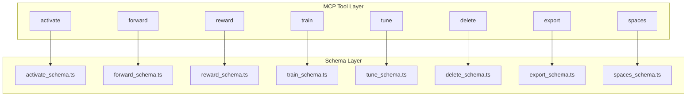
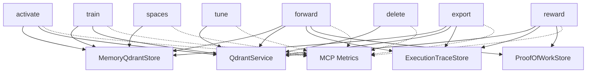

# Core Tools Reference

<cite>
**Referenced Files in This Document**
- [activate.ts](file://src/tools/activate.ts)
- [activate_schema.ts](file://src/tools/activate_schema.ts)
- [forward.ts](file://src/tools/forward.ts)
- [forward_schema.ts](file://src/tools/forward_schema.ts)
- [reward.ts](file://src/tools/reward.ts)
- [reward_schema.ts](file://src/tools/reward_schema.ts)
- [train.ts](file://src/tools/train.ts)
- [train_schema.ts](file://src/tools/train_schema.ts)
- [tune.ts](file://src/tools/tune.ts)
- [tune_schema.ts](file://src/tools/tune_schema.ts)
- [delete.ts](file://src/tools/delete.ts)
- [delete_schema.ts](file://src/tools/delete_schema.ts)
- [export.ts](file://src/tools/export.ts)
- [export_schema.ts](file://src/tools/export_schema.ts)
- [spaces.ts](file://src/tools/spaces.ts)
- [spaces_schema.ts](file://src/tools/spaces_schema.ts)
</cite>

## Table of Contents
1. [Introduction](#introduction)
2. [Project Structure](#project-structure)
3. [Core Components](#core-components)
4. [Architecture Overview](#architecture-overview)
5. [Detailed Component Analysis](#detailed-component-analysis)
6. [Dependency Analysis](#dependency-analysis)
7. [Performance Considerations](#performance-considerations)
8. [Troubleshooting Guide](#troubleshooting-guide)
9. [Conclusion](#conclusion)

## Introduction
This document is the authoritative reference for the core SquadRules MCP tools: activate, forward, train, reward, tune, delete, export, and spaces. It explains how each tool works, what it accepts and returns, how errors are handled, and how the tools chain together through the canonical activation → execution → reward workflow.

Key system context:
- SquadRules is agent-first: AI agents drive workflows; humans configure preferences through agents.
- The core flow is activate → forward → reward. Adapters define deterministic, auditable task layers.
- Storage uses Qdrant (primary vector store), LanceDB (secondary embedded store), Redis (sessions/rate limiting), and filesystem (config/artifacts).
- Authentication uses Keycloak + Google IdP with JWT validation for both human and agent requests.
- Tools are exposed via MCP protocol methods and can be invoked from HTTP routes or CLI backends.

## Project Structure
The core tools live under `src/tools`. Each tool typically has:
- A registration function that binds an MCP tool name to a handler.
- An execute function containing business logic.
- A schema file defining Zod-based input/output validation.



**Diagram sources**
- [activate.ts:231-280](file://src/tools/activate.ts#L231-L280)
- [forward.ts:91-339](file://src/tools/forward.ts#L91-L339)
- [reward.ts:132-175](file://src/tools/reward.ts#L132-L175)
- [train.ts:246-381](file://src/tools/train.ts#L246-L381)
- [tune.ts:19-69](file://src/tools/tune.ts#L19-L69)
- [delete.ts:73-115](file://src/tools/delete.ts#L73-L115)
- [export.ts:347-390](file://src/tools/export.ts#L347-L390)
- [spaces.ts:195-254](file://src/tools/spaces.ts#L195-L254)

**Section sources**
- [activate.ts:231-280](file://src/tools/activate.ts#L231-L280)
- [forward.ts:91-339](file://src/tools/forward.ts#L91-L339)
- [reward.ts:132-175](file://src/tools/reward.ts#L132-L175)
- [train.ts:246-381](file://src/tools/train.ts#L246-L381)
- [tune.ts:19-69](file://src/tools/tune.ts#L19-L69)
- [delete.ts:73-115](file://src/tools/delete.ts#L73-L115)
- [export.ts:347-390](file://src/tools/export.ts#L347-L390)
- [spaces.ts:195-254](file://src/tools/spaces.ts#L195-L254)

## Core Components
Each tool follows a consistent pattern:
- Registration: binds a tool name, title, description, input/output schemas, and optional UI metadata.
- Input validation: uses Zod schemas wrapped by a loose MCP input wrapper.
- Execution: calls a pure execute function with dependencies like memory store and Qdrant service.
- Metrics: records call counts, durations, input/output sizes, and error counts per tenant.
- Error handling: converts validation failures into structured teaching results; rate-limiting is surfaced where applicable.

Common response shape:
- content: array of text parts for transport payloads.
- structuredContent: typed object matching the output schema.

**Section sources**
- [activate.ts:231-280](file://src/tools/activate.ts#L231-L280)
- [forward.ts:91-339](file://src/tools/forward.ts#L91-L339)
- [reward.ts:132-175](file://src/tools/reward.ts#L132-L175)
- [train.ts:246-381](file://src/tools/train.ts#L246-L381)
- [tune.ts:19-69](file://src/tools/tune.ts#L19-L69)
- [delete.ts:73-115](file://src/tools/delete.ts#L73-L115)
- [export.ts:347-390](file://src/tools/export.ts#L347-L390)
- [spaces.ts:195-254](file://src/tools/spaces.ts#L195-L254)

## Architecture Overview
The canonical workflow connects three primary tools:

```mermaid
sequenceDiagram
participant Agent as "Agent / Client"
participant MCP as "MCP Server"
participant Activate as "activate.executeActivate"
participant Forward as "forward.executeForward"
participant Reward as "reward.executeReward"
participant Store as "Memory/Qdrant Stores"
Agent->>MCP : Call "activate" with query and optional space
MCP->>Activate : Validate input, search adapters
Activate-->>MCP : Choices with next_action and execution_id
MCP-->>Agent : Structured choices and guidance
Agent->>MCP : Call "forward" with adapter URI (start)
MCP->>Forward : Load layer, create execution, return contract
Forward-->>MCP : Contract and next_action
MCP-->>Agent : Contract and instructions
Agent->>MCP : Call "forward" with layer URI + solution (continue)
MCP->>Forward : Validate proof, apply solution, advance layers
Forward-->>MCP : Next layer or completion signal
MCP-->>Agent : Updated state or final message
Agent->>MCP : Call "reward" with final layer URI and outcome
MCP->>Reward : Evaluate, persist metrics and trace
Reward-->>MCP : Evaluation labels and eligibility flags
MCP-->>Agent : Rated result summary
```

**Diagram sources**
- [activate.ts:168-229](file://src/tools/activate.ts#L168-L229)
- [forward.ts:91-339](file://src/tools/forward.ts#L91-L339)
- [reward.ts:28-130](file://src/tools/reward.ts#L28-L130)

## Detailed Component Analysis

### activate
Purpose:
- Find the best adapter(s) for a natural-language query.
- Return ranked choices with explicit next actions, including guidance to start forward runs.
- Support authoring workflows for creating, reviewing, or updating adapters.

HTTP endpoints:
- Exposed as an MCP tool named `activate`. There is no dedicated REST endpoint shown in this file; MCP clients invoke it through the MCP server’s tool interface.

MCP method:
- Method name: `activate`
- Transport: stdio or http (indicated by transport field in output).

CLI command:
- Not defined in this file. CLI commands are implemented elsewhere; this tool is primarily MCP-invoked.

Request schema (key fields):
- query: required string.
- execution_id: optional UUID for refinement sequences.
- space or space_id: optional scoping to personal/group/app spaces.
- max_choices: optional integer within configured limits.
- authoring: optional authoring context when starting authoring workflows.

Response schema (key fields):
- must_obey: always true.
- message: grounding reminder and match count guidance.
- next_action: directive to pick one choice and follow its next_action.
- execution_id: server-issued ID for refinement continuity.
- choices: array of match/refine/create choices with uri, label, role, tags, next_action, adapter_version, space_name, slug, and optional linked_artifacts.
- squadrules_local_artifact_dir: ordered hints for local artifact handoff.
- transport: stdio or http.

Parameter validation rules:
- query must be non-empty.
- execution_id must be a UUID if provided.
- space/space_id scope selection is supported.
- max_choices bounded by configured minimum and maximum.

Execution flow:
- If authoring is present, route to authoring workflow and return a single author adapter choice with forward_first_call guidance.
- Otherwise, run semantic search across memory and Qdrant, map results to activation choices, attach artifact materialization instructions when needed, and include creation/refinement messaging.

Error handling:
- Input validation errors return structured teaching results.
- Rate-limiting errors are detected and returned as MCP rate-limit responses.
- Other errors propagate up.

Integration points:
- Memory store and Qdrant service for search and artifact loading.
- Local artifact directory hints for shell challenges.
- Spaces filtering via tenant context.

Practical examples:
- Start a new run: call activate with query and optional space; then call forward with the first choice’s forward_first_call.uri.
- Refine a previous run: echo execution_id and adjust query to improve matches.

State management:
- execution_id ties refine iterations together.
- Choices may include linked_artifacts requiring materialization before forward.

**Section sources**
- [activate.ts:44-166](file://src/tools/activate.ts#L44-L166)
- [activate.ts:168-229](file://src/tools/activate.ts#L168-L229)
- [activate.ts:231-280](file://src/tools/activate.ts#L231-L280)
- [activate_schema.ts:86-139](file://src/tools/activate_schema.ts#L86-L139)

### forward
Purpose:
- Execute an adapter’s layered workflow deterministically.
- Manage multi-step contracts, user input elicitation, proof-of-work validation, and layer progression.
- Support authoring workflows and continuation via execution_id.

HTTP endpoints:
- Exposed as an MCP tool named `forward`. No dedicated REST endpoint is shown here.

MCP method:
- Method name: `forward`

CLI command:
- Not defined in this file.

Request schema (key fields):
- uri: adapter URI to start a run, or layer URI to continue.
- solution: omitted on start; required on continuation with type, outcome, evidence, and optional nonce/proof_hash.
- authoring: optional authoring context fixed for the run.

Response schema (key fields):
- current_layer: markdown layer content and MIME type.
- contract: expected step contract (shell/forward/user_input/comment/subagent).
- next_action: instruction for the next step.
- proof_hash: echoed or computed proof hash when applicable.
- execution_id: run identifier for continuation.
- message: contextual guidance or completion message.
- error_code and retry_count: present when missing proof or blocked payload occurs.
- next_call: suggested next MCP call (forward or reward).
- adapter layer index/count and space/context labels.

Parameter validation rules:
- Starting a run must omit solution.
- Continuing a run must include solution and use layer URI with execution_id.
- Solution normalization supports legacy and v2 formats.

Execution flow:
- Resolve adapter or layer, initialize execution if new, pin manifest, and return contract without solution.
- On continuation, normalize solution, elicit user input if required, validate proofs, apply solutions to previous steps when appropriate, update quality metrics, append execution traces, and advance to next layer or finalize.

Error handling:
- Not found layers/adapters raise structured errors.
- Authoring context mismatches raise specific errors.
- Missing proof or blocked payloads return guided retry messages.
- Quality updates are recorded on success/failure paths.

Integration points:
- Proof-of-work store for hashes and results.
- Forward runtime store for execution metadata.
- Execution trace store for training data generation.
- Qdrant service for step quality updates.

Practical examples:
- Start: forward(adapter_uri) → receive contract → continue with forward(layer_uri?execution_id=..., solution).
- Authoring: carry forward_first_call.authoring from activate into forward to create/review/update adapters.

State management:
- execution_id persists across continuation calls.
- Authoring operation and target are locked once started.

**Section sources**
- [forward.ts:91-339](file://src/tools/forward.ts#L91-L339)
- [forward_schema.ts:234-318](file://src/tools/forward_schema.ts#L234-L318)

### reward
Purpose:
- Record evaluation signals after adapter execution completes.
- Normalize scores, compute eligibility for SFT/preference datasets, and persist metrics.

HTTP endpoints:
- Exposed as an MCP tool named `reward`.

MCP method:
- Method name: `reward`

CLI command:
- Not defined in this file.

Request schema (key fields):
- uri: layer URI of the final step.
- outcome: success or failure.
- score: optional normalized score.
- feedback: optional evaluator feedback.
- rater: optional human evaluator identifier.
- rubric_version: optional policy version tag.
- llm_model_id: optional LLM model identifier.

Response schema (key fields):
- results: array of rated entries with outcome, score, feedback, rater, rubric_version, llm_model_id, grader_kind, evaluation_label, exportability flags, blockers, and rated_at timestamp.
- total_rated and total_failed: aggregate counters.
- next_call: null.

Parameter validation rules:
- uri must be a layer URI.
- Success rewards are rejected if the layer’s last stored proof failed.

Execution flow:
- Parse URI and enforce conflict guard against failed proofs.
- Evaluate reward to determine normalized score, signed score, quality bonus, grader kind, and export eligibility.
- Apply reward metrics to Qdrant and persist execution trace reward data when execution_id is present.

Error handling:
- Invalid URI raises structured error.
- Persistence failures wrap as retryable service unavailable errors.

Integration points:
- Qdrant service for reward metrics.
- Execution trace store for dataset construction.
- Proof-of-work store for conflict checks.

Practical examples:
- After forward completes, call reward with the final layer URI, outcome, and optional evaluator identity and rubric version to enable dataset exports.

**Section sources**
- [reward.ts:28-130](file://src/tools/reward.ts#L28-L130)
- [reward.ts:132-175](file://src/tools/reward.ts#L132-L175)
- [reward_schema.ts:10-53](file://src/tools/reward_schema.ts#L10-L53)

### train
Purpose:
- Register new adapters or artifacts into storage.
- Support markdown adapters, artifact attachments, forking from existing adapters, and batch directory training.

HTTP endpoints:
- Exposed as an MCP tool named `train`.

MCP method:
- Method name: `train`

CLI command:
- Not defined in this file.

Request schema (key fields):
- content: markdown or artifact source.
- llm_model_id: required model identifier.
- force_update: optional overwrite flag.
- protocol_version: optional version tag.
- space: optional target space.
- source_adapter_uri: optional fork source.
- mime: optional MIME type; required for non-markdown artifacts unless inferred.
- artifact_name: required for artifact mode.
- adapter_uri: required for artifact attachment.
- relative_path: optional skill-root-relative path for artifacts.
- review_evidence: required for markdown adapter trains.
- directory: optional absolute directory for batch training (SIMPLE/stdio mode only).
- recursive: optional recursive scan flag.

Response schema (key fields):
- items: array of stored URIs and metadata.
- status: stored.
- batch_manifest: per-file results when using directory mode.

Parameter validation rules:
- Content or source_adapter_uri or directory must be provided.
- Artifact mode requires artifact_name and adapter_uri; mime inference rules apply.
- Markdown adapter trains require review_evidence.
- relative_path allowed only for artifact rows and must be safe.

Execution flow:
- Resolve content from inline, forked adapter dump, or directory files.
- Determine artifact vs adapter mode and validate review evidence accordingly.
- Normalize artifact paths and build store payload.
- Persist via train store and construct output items with resolved adapter URIs and artifact URIs.

Error handling:
- Train-specific errors are normalized into user-friendly payloads with next_action guidance.
- Duplicate adapter and similar memory conflicts are surfaced with actionable messages.
- Rate-limiting errors are surfaced where applicable.

Integration points:
- Memory store and Qdrant service for adapter lookup and dumping.
- Directory access utilities for batch scanning.
- Space resolution for write targets.

Practical examples:
- Create a new markdown adapter with review_evidence.
- Attach an artifact to an existing adapter with artifact_name, adapter_uri, and optional relative_path.
- Fork an existing adapter into a new space using source_adapter_uri.
- Batch-train multiple markdown files from a directory.

**Section sources**
- [train.ts:88-135](file://src/tools/train.ts#L88-L135)
- [train.ts:137-244](file://src/tools/train.ts#L137-L244)
- [train.ts:246-381](file://src/tools/train.ts#L246-L381)
- [train_schema.ts:54-199](file://src/tools/train_schema.ts#L54-L199)

### tune
Purpose:
- Update adapter layer content or advanced field updates.
- Optionally move all layers of target adapters to a different space.

HTTP endpoints:
- Exposed as an MCP tool named `tune`.

MCP method:
- Method name: `tune`

CLI command:
- Not defined in this file.

Request schema (key fields):
- uris: non-empty array of adapter or layer URIs.
- content: optional updated content bodies (one per URI).
- updates: optional advanced field updates.
- space: optional target space to move layers.
- review_evidence: required when content is provided.

Response schema (key fields):
- results: per-URI status and message.
- total_updated and total_failed: aggregates.

Parameter validation rules:
- content length must match uris length.
- At least one of content, updates, or space must be provided.
- review_evidence required when content updates are present.

Execution flow:
- Lazily load Qdrant service if not injected.
- Execute tune operations and invalidate caches so subsequent reads reflect changes.

Error handling:
- Input validation errors return structured teaching results.
- Other errors propagate up.

Integration points:
- Qdrant service for persistence.
- Cache invalidation utility for consistency.

Practical examples:
- Update markdown content for one or more adapters with review_evidence.
- Move adapters between spaces without changing content.

**Section sources**
- [tune.ts:19-69](file://src/tools/tune.ts#L19-L69)
- [tune_schema.ts:14-72](file://src/tools/tune_schema.ts#L14-L72)

### delete
Purpose:
- Delete adapter resources or individual layers by URI.

HTTP endpoints:
- Exposed as an MCP tool named `delete`.

MCP method:
- Method name: `delete`

CLI command:
- Not defined in this file.

Request schema (key fields):
- uris: non-empty array of adapter or layer URIs.

Response schema (key fields):
- results: per-URI deletion status and message.
- total_deleted and total_failed: aggregates.

Parameter validation rules:
- URIs must be valid adapter or layer URIs.

Execution flow:
- For adapter URIs, resolve head layer, enumerate all layers, and delete them individually.
- For layer URIs, delete directly.
- Aggregate per-URI outcomes.

Error handling:
- Per-URI failures are captured with error messages; overall operation continues for remaining URIs.

Integration points:
- Qdrant service for adapter enumeration and deletion.

Practical examples:
- Delete a single layer by URI.
- Delete an entire adapter by slug URI to remove all its layers.

**Section sources**
- [delete.ts:12-71](file://src/tools/delete.ts#L12-L71)
- [delete.ts:73-115](file://src/tools/delete.ts#L73-L115)
- [delete_schema.ts:14-33](file://src/tools/delete_schema.ts#L14-L33)

### export
Purpose:
- Export adapters and artifacts in multiple formats: markdown, JSONL training datasets, skill trees, and ZIP bundles.
- Support directory-based bulk export and download references for large assets.

HTTP endpoints:
- Exposed as an MCP tool named `export`.

MCP method:
- Method name: `export`

CLI command:
- Not defined in this file.

Request schema (key fields):
- uri: single adapter, layer, or artifact URI.
- adapters: list of adapter URIs.
- all_adapters: boolean to export all adapters in a space (requires space_name).
- space_name: required when all_adapters is true.
- format: markdown, trace_jsonl, reward_jsonl, sft_jsonl, preference_jsonl, source, skill_tree, skill_zip.
- delivery: download_ref or inline_base64 (only for skill_zip).
- include_reward: include reward data in training exports.
- directory: absolute path for directory-based bulk export (SIMPLE/stdio mode only).

Response schema (key fields):
- uri, format, content_type, content: standard export envelope.
- item_count, adapter_name, adapter_version: metadata.
- space_id, space_name, space_type: present for markdown adapter exports.
- content_encoding and bundle_sha256: for base64-encoded exports like ZIP.
- skill_bundle_manifest: compact manifest for skill bundles.
- download_ref: short-lived capability URL for ZIP downloads.
- directory_manifest: per-file results when writing to disk.

Parameter validation rules:
- Exactly one selection mode: uri, adapters, or all_adapters.
- all_adapters requires space_name.
- markdown export with adapters/all_adapters requires directory.
- Training formats require a single uri.
- delivery only valid with skill_zip.
- adapters list capped at configured maximum.

Execution flow:
- Normalize URIs and resolve selection.
- For directory export, write per-adapter markdown files and return manifest.
- For flat markdown, dump single adapter and include space metadata.
- For training JSONL formats, build pairs from execution traces and serialize.
- For skill_tree, assemble skill items and return JSON tree.
- For skill_zip, either return base64 bytes with SHA-256 or mint a download capability URL.

Error handling:
- Unsupported format combinations raise errors.
- Telemetry wraps execution to capture success/failure and size metrics.

Integration points:
- Dump utility for markdown extraction.
- Execution trace store for training pair construction.
- Download capability store for secure ZIP delivery.
- Skill export utilities for zipping and hashing.

Practical examples:
- Export a single adapter as markdown.
- Export training datasets (trace/reward/sft/preference) as JSONL.
- Export a skill bundle as ZIP with download_ref.
- Bulk-export multiple adapters to a directory.

**Section sources**
- [export.ts:67-87](file://src/tools/export.ts#L67-L87)
- [export.ts:89-345](file://src/tools/export.ts#L89-L345)
- [export.ts:347-390](file://src/tools/export.ts#L347-L390)
- [export_schema.ts:44-162](file://src/tools/export_schema.ts#L44-L162)

### spaces
Purpose:
- List available spaces with human-readable names, adapter counts, and optionally adapter titles and artifact metadata.

HTTP endpoints:
- Exposed as an MCP tool named `spaces`.

MCP method:
- Method name: `spaces`

CLI command:
- Not defined in this file.

Request schema (key fields):
- include_adapter_titles: optional boolean to include adapter lists per space.
- include_widget_html: optional boolean to append HTML table widget (implies adapter titles).
- include_artifacts: optional boolean to include artifact metadata per adapter.

Response schema (key fields):
- spaces: array of space info objects with name, space_id, type, adapter_count, and optional adapters list.
- adapters: optional list with adapter_id, title, layer_count, slug, uri, and optional artifacts.

Parameter validation rules:
- Boolean flags control verbosity; defaults are minimal.

Execution flow:
- Read space context and allowed space IDs.
- Scroll memory store per space and build aggregated adapter information.
- Optionally render HTML widget content for UI integration.

Error handling:
- Errors are logged and converted into a generic internal_error response with isError flag.

Integration points:
- Memory store for space enumeration.
- Space display utilities for names and types.
- Widget renderer for UI consumption.

Practical examples:
- List spaces with adapter counts.
- Include adapter titles and artifacts for richer exploration.
- Request HTML widget for embedding in MCP apps.

**Section sources**
- [spaces.ts:172-189](file://src/tools/spaces.ts#L172-L189)
- [spaces.ts:195-254](file://src/tools/spaces.ts#L195-L254)
- [spaces_schema.ts:3-53](file://src/tools/spaces_schema.ts#L3-L53)

## Dependency Analysis
Tools depend on shared infrastructure:
- Memory store for adapter and layer retrieval.
- Qdrant service for vector search, reward metrics, and adapter enumeration.
- Execution trace store for training data and reward persistence.
- Proof-of-work store for challenge validation and conflict checks.
- Tenant context for space scoping and default write spaces.
- Metrics registry for call counting, duration tracking, and error reporting.



**Diagram sources**
- [activate.ts:168-229](file://src/tools/activate.ts#L168-L229)
- [forward.ts:91-339](file://src/tools/forward.ts#L91-L339)
- [reward.ts:28-130](file://src/tools/reward.ts#L28-L130)
- [train.ts:137-244](file://src/tools/train.ts#L137-L244)
- [tune.ts:44-52](file://src/tools/tune.ts#L44-L52)
- [delete.ts:12-71](file://src/tools/delete.ts#L12-L71)
- [export.ts:89-345](file://src/tools/export.ts#L89-L345)
- [spaces.ts:172-189](file://src/tools/spaces.ts#L172-L189)

**Section sources**
- [activate.ts:168-229](file://src/tools/activate.ts#L168-L229)
- [forward.ts:91-339](file://src/tools/forward.ts#L91-L339)
- [reward.ts:28-130](file://src/tools/reward.ts#L28-L130)
- [train.ts:137-244](file://src/tools/train.ts#L137-L244)
- [tune.ts:44-52](file://src/tools/tune.ts#L44-L52)
- [delete.ts:12-71](file://src/tools/delete.ts#L12-L71)
- [export.ts:89-345](file://src/tools/export.ts#L89-L345)
- [spaces.ts:172-189](file://src/tools/spaces.ts#L172-L189)

## Performance Considerations
- Activation searches are bounded by max_choices and configured limits; keep queries concise and scoped to relevant spaces.
- Forward runs should reuse execution_id for continuations to avoid redundant setup and manifest pinning.
- Reward evaluations add metrics overhead; include rater and rubric_version when exporting datasets to maximize eligibility.
- Train directory mode processes files sequentially; consider batching smaller sets to reduce latency.
- Export skill_zip with download_ref avoids large base64 payloads over MCP; use the capability URL for efficient transfer.
- All tools record call counts, durations, and I/O sizes; monitor these metrics to identify bottlenecks and rate-limit triggers.

[No sources needed since this section provides general guidance]

## Troubleshooting Guide
Common issues and resolutions:
- Validation errors: Most tools return structured teaching results indicating invalid parameters. Check required fields like query, uri, content, and review_evidence.
- Missing proof or blocked payload in forward: Follow the error_code and retry_count guidance; supply the required proof or complete prior steps.
- Reward success conflict: Cannot record success if the layer’s last proof failed; fix the step and rerun, or record failure with reason.
- Duplicate adapter during train: Use force_update with the same adapter id to replace, or choose a distinct label.
- Similar memory found: Inspect the match and decide whether to replace or rename; force_update can overwrite when intentional.
- Export format mismatch: Ensure format matches selection constraints (single uri for training formats; directory for multi-adapter markdown).
- Spaces listing errors: Internal errors are wrapped; check logs and ensure memory store connectivity.

Rate limiting:
- Some tools detect rate-limit conditions and return MCP rate-limit error results; back off and retry.

Authentication and authorization:
- Requests are authenticated via JWT tokens validated by Keycloak + Google IdP.
- Authorization scopes and space permissions are enforced by middleware and tenant context; ensure the caller has write access for mutation tools (train, tune, delete) and read access for query tools (activate, spaces, export).

**Section sources**
- [forward.ts:113-131](file://src/tools/forward.ts#L113-L131)
- [reward.ts:32-54](file://src/tools/reward.ts#L32-L54)
- [train.ts:343-379](file://src/tools/train.ts#L343-L379)
- [export.ts:342-345](file://src/tools/export.ts#L342-L345)
- [spaces.ts:242-251](file://src/tools/spaces.ts#L242-L251)

## Conclusion
The core SquadRules tools provide a cohesive, agent-driven workflow for discovering, executing, evaluating, and maintaining adapters. By following the activate → forward → reward chain and leveraging train/tune/delete/export/spaces for lifecycle management, teams can build deterministic, auditable automation pipelines. Proper parameter validation, error handling, and state management ensure reliable operation across MCP, HTTP, and CLI integrations.

[No sources needed since this section summarizes without analyzing specific files]