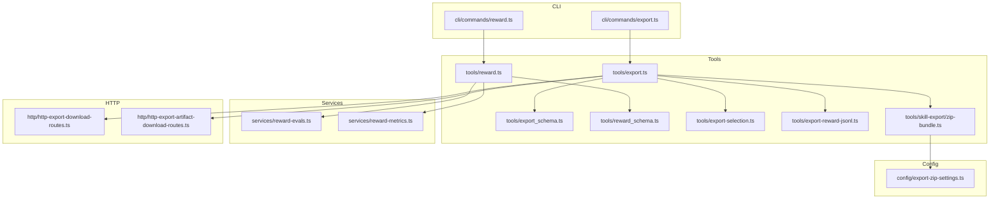
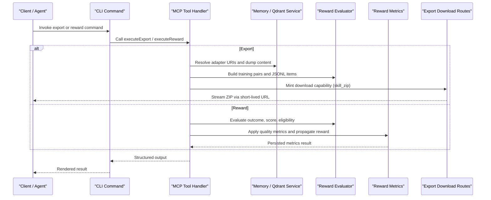
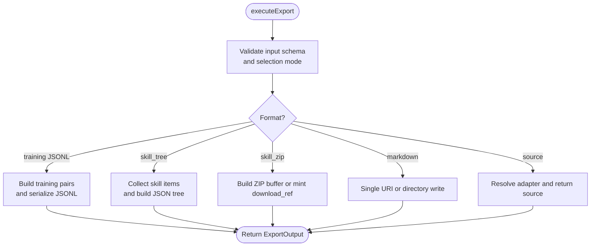
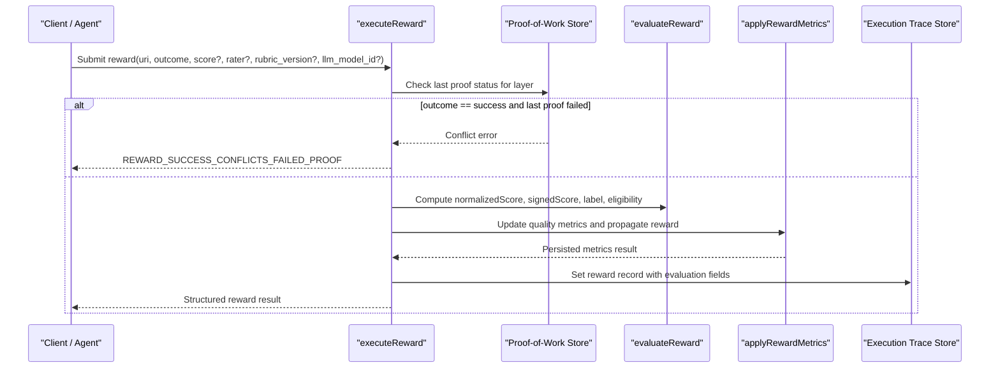
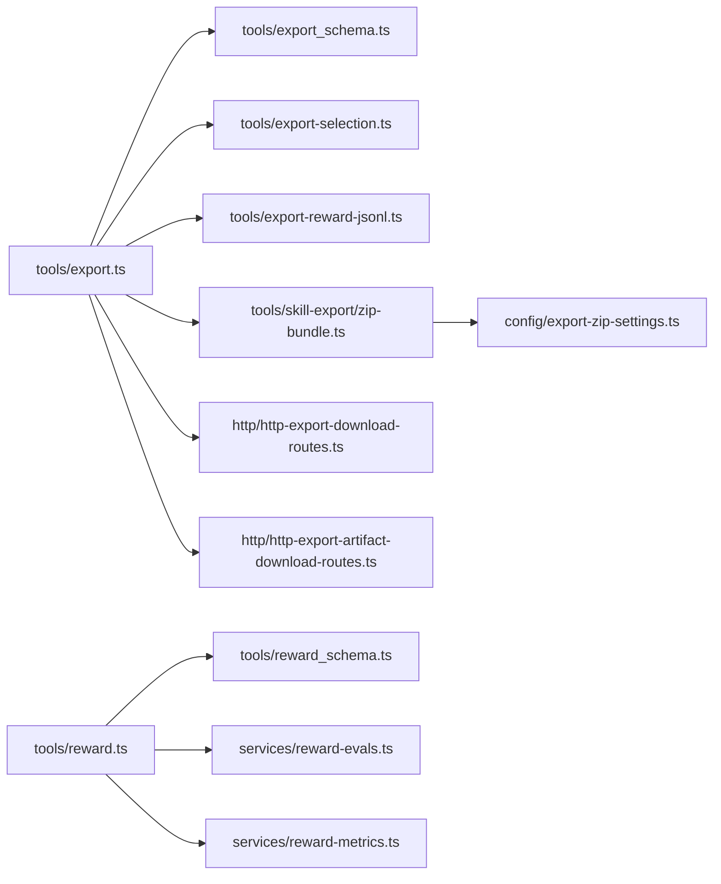

# Data Tools (Export & Reward)

<cite>
**Referenced Files in This Document**
- [export.ts](file://src/tools/export.ts)
- [reward.ts](file://src/tools/reward.ts)
- [export_schema.ts](file://src/tools/export_schema.ts)
- [reward_schema.ts](file://src/tools/reward_schema.ts)
- [export-selection.ts](file://src/tools/export-selection.ts)
- [export-reward-jsonl.ts](file://src/tools/export-reward-jsonl.ts)
- [zip-bundle.ts](file://src/tools/skill-export/zip-bundle.ts)
- [export-zip-settings.ts](file://src/config/export-zip-settings.ts)
- [http-export-download-routes.ts](file://src/http/http-export-download-routes.ts)
- [http-export-artifact-download-routes.ts](file://src/http/http-export-artifact-download-routes.ts)
- [reward-evals.ts](file://src/services/reward-evals.ts)
- [reward-metrics.ts](file://src/services/reward-metrics.ts)
- [export.ts CLI](file://src/cli/commands/export.ts)
- [reward.ts CLI](file://src/cli/commands/reward.ts)
</cite>

## Table of Contents
1. [Introduction](#introduction)
2. [Project Structure](#project-structure)
3. [Core Components](#core-components)
4. [Architecture Overview](#architecture-overview)
5. [Detailed Component Analysis](#detailed-component-analysis)
6. [Dependency Analysis](#dependency-analysis)
7. [Performance Considerations](#performance-considerations)
8. [Troubleshooting Guide](#troubleshooting-guide)
9. [Conclusion](#conclusion)

## Introduction
This document explains the data portability and performance feedback tools: **export** and **reward**. The export tool supports adapter markdown, skill bundles, training JSONL datasets, and source exports. The reward tool records execution outcomes, computes normalized scores and eligibility for downstream training formats, and updates vector-store quality metrics. Both tools are exposed as MCP tools and also have CLI commands for automation.

Key design goals:
- Deterministic, auditable adapter workflows through the activate → forward → reward chain.
- Portable exports for adapters, skills, and training datasets.
- Performance feedback that improves retrieval quality and model implementation bonuses.
- Safe, scoped access to spaces, tenants, and short-lived download capabilities.

## Project Structure
The export and reward functionality is implemented across tool handlers, schemas, service utilities, HTTP routes, and CLI commands.

**Diagram sources**
- [export.ts CLI:296-345](file://src/cli/commands/export.ts#L296-L345)
- [reward.ts CLI:13-66](file://src/cli/commands/reward.ts#L13-L66)
- [export.ts:67-345](file://src/tools/export.ts#L67-L345)
- [reward.ts:28-175](file://src/tools/reward.ts#L28-L175)
- [export_schema.ts:44-158](file://src/tools/export_schema.ts#L44-L158)
- [reward_schema.ts:10-48](file://src/tools/reward_schema.ts#L10-L48)
- [export-selection.ts:38-67](file://src/tools/export-selection.ts#L38-L67)
- [export-reward-jsonl.ts:92-181](file://src/tools/export-reward-jsonl.ts#L92-L181)
- [zip-bundle.ts:11-66](file://src/tools/skill-export/zip-bundle.ts#L11-L66)
- [export-zip-settings.ts:17-27](file://src/config/export-zip-settings.ts#L17-L27)
- [http-export-download-routes.ts:9-47](file://src/http/http-export-download-routes.ts#L9-L47)
- [http-export-artifact-download-routes.ts:7-61](file://src/http/http-export-artifact-download-routes.ts#L7-L61)

**Section sources**
- [export.ts CLI:296-345](file://src/cli/commands/export.ts#L296-L345)
- [reward.ts CLI:13-66](file://src/cli/commands/reward.ts#L13-L66)
- [export.ts:67-345](file://src/tools/export.ts#L67-L345)
- [reward.ts:28-175](file://src/tools/reward.ts#L28-L175)

## Core Components
- Export tool: Validates input, resolves selection, serializes content into supported formats, optionally writes files or returns base64 ZIPs, and exposes short-lived download capability URLs.
- Reward tool: Validates layer URIs, enforces proof-of-work state, evaluates scoring and eligibility, persists metrics and trace rewards, and returns structured evaluation results.

Key responsibilities:
- Input validation via Zod schemas.
- Adapter resolution and space-scoped enumeration.
- Serialization to markdown, JSONL, skill tree, and skill zip.
- Streaming and compression for large ZIP bundles.
- Feedback aggregation and quality metric updates.

**Section sources**
- [export_schema.ts:44-158](file://src/tools/export_schema.ts#L44-L158)
- [reward_schema.ts:10-48](file://src/tools/reward_schema.ts#L10-L48)
- [export.ts:67-345](file://src/tools/export.ts#L67-L345)
- [reward.ts:28-175](file://src/tools/reward.ts#L28-L175)

## Architecture Overview
The export and reward tools integrate with storage, vector services, and HTTP endpoints.

**Diagram sources**
- [export.ts:67-345](file://src/tools/export.ts#L67-L345)
- [reward.ts:28-175](file://src/tools/reward.ts#L28-L175)
- [http-export-download-routes.ts:9-47](file://src/http/http-export-download-routes.ts#L9-L47)
- [reward-evals.ts:105-147](file://src/services/reward-evals.ts#L105-L147)
- [reward-metrics.ts:20-119](file://src/services/reward-metrics.ts#L20-L119)

## Detailed Component Analysis

### Export Tool
The export tool supports multiple selection modes and serialization formats. It normalizes inputs, validates constraints, and produces portable artifacts.

Supported formats:
- `markdown`: Single adapter markdown; bulk mode requires a directory destination.
- `source`: Source export for a single adapter or layer URI.
- `trace_jsonl`, `reward_jsonl`, `sft_jsonl`, `preference_jsonl`: Training dataset formats derived from execution traces and rewards.
- `skill_tree`: JSON representation of skills and files.
- `skill_zip`: Compressed ZIP bundle, either inline base64 or via short-lived download capability.

Selection rules:
- Exactly one of: single `uri`, non-empty `adapters` list, or `all_adapters` with `space_name`.
- Training formats require a single `uri`.
- Markdown with multi-adapter selections requires `directory`.
- `delivery` is only valid for `skill_zip`.

Data serialization details:
- JSONL formats use newline-delimited JSON lines.
- Skill ZIP uses configurable zlib compression level and optional base64 encoding.
- Directory export writes per-adapter `.md` files and returns a manifest instead of inline content.

**Diagram sources**
- [export.ts:67-345](file://src/tools/export.ts#L67-L345)
- [export-selection.ts:38-67](file://src/tools/export-selection.ts#L38-L67)
- [export-reward-jsonl.ts:92-181](file://src/tools/export-reward-jsonl.ts#L92-L181)
- [zip-bundle.ts:11-66](file://src/tools/skill-export/zip-bundle.ts#L11-L66)

#### API Specification: Export
Input schema fields:
- `uri`: Optional adapter, layer, or artifact URI string.
- `adapters`: Optional array of adapter URIs or slugs (max 256).
- `all_adapters`: Optional boolean; when true, requires `space_name`.
- `space_name`: Optional string used with `all_adapters`.
- `format`: One of `markdown`, `trace_jsonl`, `reward_jsonl`, `sft_jsonl`, `preference_jsonl`, `source`, `skill_tree`, `skill_zip`. Default `skill_zip`.
- `delivery`: One of `download_ref`, `inline_base64`; only valid with `skill_zip`.
- `include_reward`: Optional boolean defaulting to true; affects training pair construction.
- `directory`: Optional absolute path for markdown bulk writes; SIMPLE/stdio mode only.

Output schema fields:
- `uri`: Primary selected URI.
- `format`: Export format.
- `content_type`: MIME type.
- `content`: String payload; may be base64-encoded when `content_encoding` is set.
- `item_count`: Number of exported items.
- `adapter_name`, `adapter_version`: Optional metadata.
- `space_id`, `space_name`, `space_type`: Optional space context for markdown exports.
- `content_encoding`: Optional `base64`.
- `bundle_sha256`: Optional SHA-256 label for ZIP bundles.
- `export_adapter_count`: Optional count for multi-adapter bundles.
- `skill_bundle_manifest`: Optional compact JSON string describing skill bundle contents.
- `download_ref`: Optional object with `url`, `expires_at`, optional `filename`, optional `content_type`.
- `directory_manifest`: Optional array of per-file write results with `slug`, `path`, `bytes`, `status`, optional `error`.

Filtering parameters:
- Selection by `uri`, `adapters`, or `all_adapters` with `space_name`.
- `include_reward` toggles reward inclusion for training formats.
- `delivery` controls ZIP delivery strategy.

Compression options:
- ZIP compression level controlled by environment variable `SQUADRULES_EXPORT_ZIP_COMPRESSION_LEVEL` (0–9); default is a balanced setting.

Authentication and authorization:
- Space-scoped enumeration uses tenant context and read-only app search scope where applicable.
- Short-lived download capability URLs are verified before streaming ZIP content.

Compliance features:
- Content integrity via `bundle_sha256`.
- Capability-based downloads with expiration.
- Directory export restricts filesystem access to validated paths.

Practical examples:
- Export a single adapter as markdown to a directory:
  - Use `format: markdown` with `directory` and a single `uri`.
- Export all adapters in a space as a ZIP bundle:
  - Use `all_adapters: true`, `space_name`, `format: skill_zip`, and choose `delivery: inline_base64` or `download_ref`.
- Export training JSONL:
  - Use `format: reward_jsonl` or `sft_jsonl` with a single `uri` and `include_reward: true`.

Integration patterns:
- CLI automation writes artifacts to disk and emits a machine-readable manifest.
- HTTP clients can consume `download_ref.url` to stream ZIPs without loading full payloads into memory.

**Section sources**
- [export_schema.ts:44-158](file://src/tools/export_schema.ts#L44-L158)
- [export.ts:67-345](file://src/tools/export.ts#L67-L345)
- [export-selection.ts:38-67](file://src/tools/export-selection.ts#L38-L67)
- [export-reward-jsonl.ts:92-181](file://src/tools/export-reward-jsonl.ts#L92-L181)
- [zip-bundle.ts:11-66](file://src/tools/skill-export/zip-bundle.ts#L11-L66)
- [export-zip-settings.ts:17-27](file://src/config/export-zip-settings.ts#L17-L27)
- [http-export-download-routes.ts:9-47](file://src/http/http-export-download-routes.ts#L9-L47)
- [export.ts CLI:48-143](file://src/cli/commands/export.ts#L48-L143)
- [export.ts CLI:201-266](file://src/cli/commands/export.ts#L201-L266)

### Reward Tool
The reward tool records performance feedback for adapter executions, computes normalized scores, and updates quality metrics.

Processing steps:
- Parse and validate layer URI.
- Enforce proof-of-work state: cannot record success if last stored proof failed.
- Evaluate outcome, optional score, rater, rubric version, and LLM model ID.
- Apply reward metrics to vector store and propagate to adapter head.
- Persist structured reward to execution trace store.
- Return evaluation results including eligibility flags and blockers.

Scoring algorithm highlights:
- Normalized score clamped to [0, 1]; defaults to 1 for success, 0 for failure.
- Signed score equals normalized score for success and negative normalized score for failure.
- Quality bonus equals signed score.
- Label assignment: rejected for failure; gold ≥ 0.85; silver ≥ SFT threshold; bronze otherwise.
- Eligibility for SFT and preference export depends on rubric version, evaluator identity, outcome, and thresholds.

Telemetry aggregation:
- Updates retrieval counts, success/failure counts, last rated timestamp, and last rater.
- Calculates implementation bonus and step quality metadata.
- Invalidates begin cache and logs events.

**Diagram sources**
- [reward.ts:28-130](file://src/tools/reward.ts#L28-L130)
- [reward-evals.ts:105-147](file://src/services/reward-evals.ts#L105-L147)
- [reward-metrics.ts:20-119](file://src/services/reward-metrics.ts#L20-L119)

#### API Specification: Reward
Input schema fields:
- `uri`: Layer URI string (`squadrules://layer/{uuid}[?execution_id={uuid}]`).
- `outcome`: Enum `success` or `failure`.
- `score`: Optional number in [0, 1].
- `feedback`: Optional string describing completion or failure.
- `rater`: Optional human evaluator identifier.
- `rubric_version`: Optional policy/rubric version tag.
- `llm_model_id`: Optional LLM model identifier for attribution.

Output schema fields:
- `results`: Array of evaluation results containing:
  - `uri`, `outcome`, `score`, `feedback`, `rater`, `rubric_version`, `llm_model_id`.
  - `grader_kind`: Enum `human`, `model`, `unknown`.
  - `evaluation_label`: Enum `gold`, `silver`, `bronze`, `rejected`.
  - `exportable_for_sft`: Boolean.
  - `exportable_for_preference`: Boolean.
  - `sft_blockers`: Array of blocker reasons.
  - `preference_blockers`: Array of blocker reasons.
  - `rated_at`: ISO timestamp.
- `total_rated`: Number of rated items.
- `total_failed`: Number of failed items.
- `next_call`: Null.

Eligibility blockers:
- `missing_rubric_version`
- `missing_evaluator_identity`
- `outcome_not_success`
- `score_below_sft_threshold`
- `score_below_preference_threshold`

Authentication and authorization:
- Requires valid layer URI and appropriate tenant/space context.
- Success rewards are blocked if the layer’s last proof failed.

Compliance features:
- Evaluation labels and blockers provide auditability for downstream training pipelines.
- Evaluator identity and rubric version enable provenance tracking.

Practical examples:
- Record a human-rated success with feedback and rubric version:
  - Provide `outcome: success`, `score`, `rater`, `rubric_version`, and optional `feedback`.
- Attribute an automated rating to an LLM model:
  - Provide `outcome`, `score`, `llm_model_id`, and optional `rubric_version`.

Integration patterns:
- CLI command renders pretty or text output and handles errors consistently.
- Downstream exporters filter by eligibility flags to include only approved data.

**Section sources**
- [reward_schema.ts:10-48](file://src/tools/reward_schema.ts#L10-L48)
- [reward.ts:28-175](file://src/tools/reward.ts#L28-L175)
- [reward-evals.ts:105-147](file://src/services/reward-evals.ts#L105-L147)
- [reward-metrics.ts:20-119](file://src/services/reward-metrics.ts#L20-L119)
- [reward.ts CLI:13-66](file://src/cli/commands/reward.ts#L13-L66)

## Dependency Analysis
The export and reward tools depend on schemas, selection logic, JSONL builders, ZIP bundling, evaluation functions, and metrics services.

**Diagram sources**
- [export.ts:67-345](file://src/tools/export.ts#L67-L345)
- [export_schema.ts:44-158](file://src/tools/export_schema.ts#L44-L158)
- [export-selection.ts:38-67](file://src/tools/export-selection.ts#L38-L67)
- [export-reward-jsonl.ts:92-181](file://src/tools/export-reward-jsonl.ts#L92-L181)
- [zip-bundle.ts:11-66](file://src/tools/skill-export/zip-bundle.ts#L11-L66)
- [export-zip-settings.ts:17-27](file://src/config/export-zip-settings.ts#L17-L27)
- [reward.ts:28-175](file://src/tools/reward.ts#L28-L175)
- [reward_schema.ts:10-48](file://src/tools/reward_schema.ts#L10-L48)
- [reward-evals.ts:105-147](file://src/services/reward-evals.ts#L105-L147)
- [reward-metrics.ts:20-119](file://src/services/reward-metrics.ts#L20-L119)
- [http-export-download-routes.ts:9-47](file://src/http/http-export-download-routes.ts#L9-L47)
- [http-export-artifact-download-routes.ts:7-61](file://src/http/http-export-artifact-download-routes.ts#L7-L61)

**Section sources**
- [export.ts:67-345](file://src/tools/export.ts#L67-L345)
- [reward.ts:28-175](file://src/tools/reward.ts#L28-L175)

## Performance Considerations
- Large dataset exports:
  - Prefer `skill_zip` with `delivery: download_ref` to avoid loading entire archives into memory.
  - For training JSONL, use newline-delimited streaming where possible and process line-by-line.
- Compression trade-offs:
  - Adjust `SQUADRULES_EXPORT_ZIP_COMPRESSION_LEVEL` to balance CPU usage and archive size.
- Directory exports:
  - Use `directory` for markdown bulk writes to avoid large response payloads.
- Reward processing:
  - Avoid recording success when last proof failed; fix underlying issues first.
  - Provide evaluator identity and rubric version to maximize export eligibility and reduce reprocessing.

[No sources needed since this section provides general guidance]

## Troubleshooting Guide
Common issues and resolutions:
- Format compatibility:
  - Ensure `delivery` is only used with `skill_zip`.
  - For markdown bulk exports, always supply `directory`.
  - Training formats require a single `uri`.
- Scoring anomalies:
  - Verify `score` is within [0, 1]; values outside are clamped.
  - Check eligibility blockers to understand why data is not included in SFT or preference exports.
- Persistence failures:
  - If reward persistence fails, retry once after storage recovers; the tool surfaces a specific error indicating no reward was stored.
- Download capability errors:
  - Short-lived URLs may expire; regenerate via export tool.
  - Forbidden responses indicate invalid or expired capability tokens.

**Section sources**
- [export_schema.ts:44-158](file://src/tools/export_schema.ts#L44-L158)
- [reward.ts:19-26](file://src/tools/reward.ts#L19-L26)
- [reward-metrics.ts:106-115](file://src/services/reward-metrics.ts#L106-L115)
- [http-export-download-routes.ts:14-23](file://src/http/http-export-download-routes.ts#L14-L23)
- [http-export-artifact-download-routes.ts:11-20](file://src/http/http-export-artifact-download-routes.ts#L11-L20)

## Conclusion
The export and reward tools provide robust data portability and performance feedback mechanisms. Export supports flexible selection, serialization, and delivery strategies suitable for both small and large-scale operations. Reward captures actionable signals that improve retrieval quality and guide downstream training pipelines. Together, they enable agents and humans to maintain auditable, high-quality adapter workflows while ensuring safe, compliant data handling.

[No sources needed since this section summarizes without analyzing specific files]