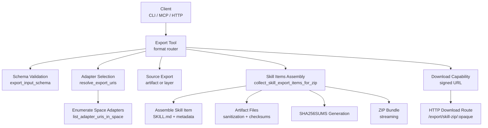
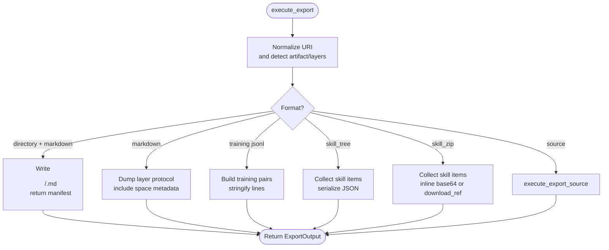
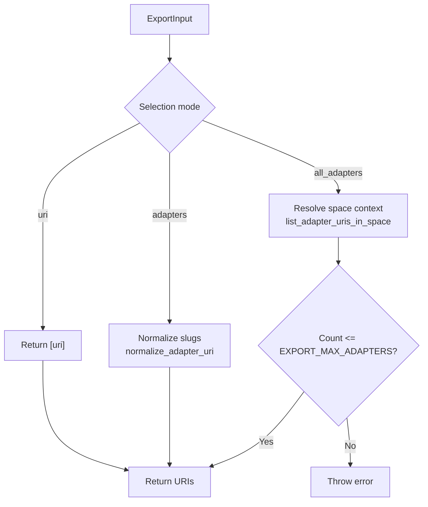
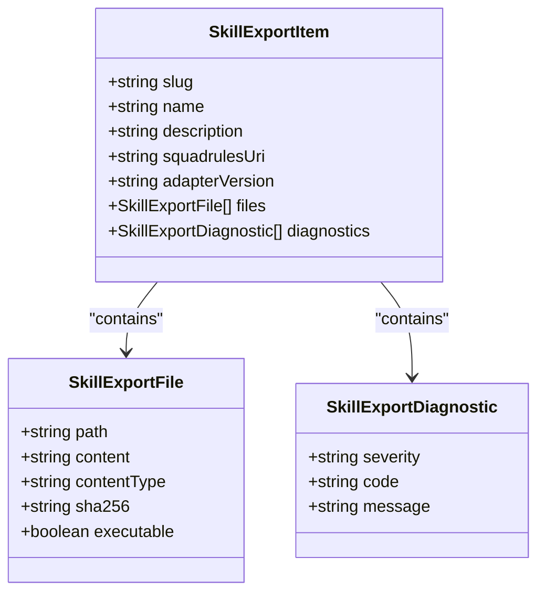
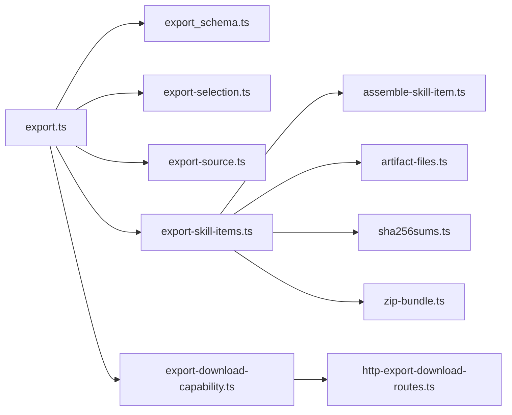

# Export Tool

<cite>
**Referenced Files in This Document**
- [export.ts](file://src/tools/export.ts)
- [export_schema.ts](file://src/tools/export_schema.ts)
- [export-selection.ts](file://src/tools/export-selection.ts)
- [export-source.ts](file://src/tools/export-source.ts)
- [export-skill-items.ts](file://src/tools/export-skill-items.ts)
- [assemble-skill-item.ts](file://src/tools/skill-export/assemble-skill-item.ts)
- [build-skill-md.ts](file://src/tools/skill-export/build-skill-md.ts)
- [artifact-files.ts](file://src/tools/skill-export/artifact-files.ts)
- [enumerate-space-adapters.ts](file://src/tools/skill-export/enumerate-space-adapters.ts)
- [sha256sums.ts](file://src/tools/skill-export/sha256sums.ts)
- [zip-bundle.ts](file://src/tools/skill-export/zip-bundle.ts)
- [types.ts](file://src/tools/skill-export/types.ts)
- [http-export-download-routes.ts](file://src/http/http-export-download-routes.ts)
- [export-skill-zip-http.ts](file://src/http/export-skill-zip-http.ts)
- [export-download-capability.ts](file://src/services/export-download-capability.ts)
- [export.ts (CLI)](file://src/cli/commands/export.ts)
</cite>

## Table of Contents
1. [Introduction](#introduction)
2. [Project Structure](#project-structure)
3. [Core Components](#core-components)
4. [Architecture Overview](#architecture-overview)
5. [Detailed Component Analysis](#detailed-component-analysis)
6. [Dependency Analysis](#dependency-analysis)
7. [Performance Considerations](#performance-considerations)
8. [Troubleshooting Guide](#troubleshooting-guide)
9. [Conclusion](#conclusion)
10. [Appendices](#appendices)

## Introduction
This document explains the export tool that provides data portability and skill bundle generation for SQUADRULES adapters. It covers the complete export workflow, including adapter selection, artifact bundling, metadata extraction, compression formats, schema validation, filtering by space and adapter types, telemetry inclusion, skill bundle structure with SKILL.md generation, artifact file organization, dependency resolution, CLI usage patterns, HTTP API behavior, programmatic integration, authentication and authorization considerations, privacy controls, performance guidance for large collections, streaming exports, and troubleshooting.

The export tool supports multiple output formats:
- Flat markdown for a single adapter or layer.
- Source listing or source content for artifacts and layers.
- Training JSONL variants for traces, rewards, supervised fine-tuning, and preference datasets.
- Skill tree JSON for multi-adapter bundles.
- Skill ZIP bundles with SKILL.md, artifact files, SHA256SUMS, and optional compressed delivery.

## Project Structure
The export functionality is implemented across several modules:
- Core orchestration and format routing live in the main export module.
- Input/output schemas define validation rules and response shapes.
- Selection logic resolves URIs from positional URIs, explicit adapter lists, or all adapters in a named space.
- Source export handles artifact and layer payloads.
- Skill item assembly builds SKILL.md, collects attached artifacts, computes checksums, and produces diagnostics.
- ZIP bundling streams archive bytes efficiently.
- HTTP routes expose capability-signed download URLs and stream ZIP responses.
- The CLI command maps user flags to the same internal input model used by MCP tools and HTTP endpoints.



**Diagram sources**
- [export.ts:67-345](file://src/tools/export.ts#L67-L345)
- [export_schema.ts:44-117](file://src/tools/export_schema.ts#L44-L117)
- [export-selection.ts:38-67](file://src/tools/export-selection.ts#L38-L67)
- [enumerate-space-adapters.ts:17-30](file://src/tools/skill-export/enumerate-space-adapters.ts#L17-L30)
- [export-source.ts:94-113](file://src/tools/export-source.ts#L94-L113)
- [export-skill-items.ts:17-55](file://src/tools/export-skill-items.ts#L17-L55)
- [assemble-skill-item.ts:37-86](file://src/tools/skill-export/assemble-skill-item.ts#L37-L86)
- [artifact-files.ts:30-87](file://src/tools/skill-export/artifact-files.ts#L30-L87)
- [sha256sums.ts:15-36](file://src/tools/skill-export/sha256sums.ts#L15-L36)
- [zip-bundle.ts:19-66](file://src/tools/skill-export/zip-bundle.ts#L19-L66)
- [http-export-download-routes.ts:9-47](file://src/http/http-export-download-routes.ts#L9-L47)
- [export-download-capability.ts:63-110](file://src/services/export-download-capability.ts#L63-L110)

**Section sources**
- [export.ts:67-345](file://src/tools/export.ts#L67-L345)
- [export_schema.ts:44-117](file://src/tools/export_schema.ts#L44-L117)
- [export-selection.ts:38-67](file://src/tools/export-selection.ts#L38-L67)
- [enumerate-space-adapters.ts:17-30](file://src/tools/skill-export/enumerate-space-adapters.ts#L17-L30)
- [export-source.ts:94-113](file://src/tools/export-source.ts#L94-L113)
- [export-skill-items.ts:17-55](file://src/tools/export-skill-items.ts#L17-L55)
- [assemble-skill-item.ts:37-86](file://src/tools/skill-export/assemble-skill-item.ts#L37-L86)
- [artifact-files.ts:30-87](file://src/tools/skill-export/artifact-files.ts#L30-L87)
- [sha256sums.ts:15-36](file://src/tools/skill-export/sha256sums.ts#L15-L36)
- [zip-bundle.ts:19-66](file://src/tools/skill-export/zip-bundle.ts#L19-L66)
- [http-export-download-routes.ts:9-47](file://src/http/http-export-download-routes.ts#L9-L47)
- [export-download-capability.ts:63-110](file://src/services/export-download-capability.ts#L63-L110)

## Core Components
- Export orchestrator: Routes requests to appropriate handlers based on format and selection mode. Supports directory-based bulk markdown writes, flat markdown, training JSONL, source export, skill tree JSON, and skill ZIP bundles.
- Schema validator: Enforces exactly one selection mode, required fields per format, maximum adapter counts, and delivery constraints.
- Adapter selection: Normalizes URIs, deduplicates slugs, and enumerates adapters within a named space with safety limits.
- Source exporter: Resolves artifact URIs (by UUID or slug), lists artifacts for an adapter, or returns layer content.
- Skill item assembler: Builds SKILL.md with YAML frontmatter, derives metadata, scans diagnostics, and attaches artifact files.
- Artifact loader: Loads attached artifacts, normalizes relative paths, applies sanitization rules, validates stored checksums, and emits diagnostics.
- Checksum generator: Produces GNU-style SHA256SUMS per skill bundle.
- ZIP bundler: Streams ZIP archives efficiently; supports both in-memory buffering and writable streaming.
- Download capability: Creates signed, time-limited capability tokens for secure ZIP downloads outside the primary API surface.
- HTTP download route: Verifies capability tokens, enforces space context, and streams ZIP responses with metadata headers.
- CLI command: Maps user flags to the same internal input model, writes artifacts to disk, and prints machine-friendly manifests.

**Section sources**
- [export.ts:67-345](file://src/tools/export.ts#L67-L345)
- [export_schema.ts:44-117](file://src/tools/export_schema.ts#L44-L117)
- [export-selection.ts:38-67](file://src/tools/export-selection.ts#L38-L67)
- [export-source.ts:94-113](file://src/tools/export-source.ts#L94-L113)
- [export-skill-items.ts:17-55](file://src/tools/export-skill-items.ts#L17-L55)
- [assemble-skill-item.ts:37-86](file://src/tools/skill-export/assemble-skill-item.ts#L37-L86)
- [artifact-files.ts:30-87](file://src/tools/skill-export/artifact-files.ts#L30-L87)
- [sha256sums.ts:15-36](file://src/tools/skill-export/sha256sums.ts#L15-L36)
- [zip-bundle.ts:19-66](file://src/tools/skill-export/zip-bundle.ts#L19-L66)
- [http-export-download-routes.ts:9-47](file://src/http/http-export-download-routes.ts#L9-L47)
- [export-download-capability.ts:63-110](file://src/services/export-download-capability.ts#L63-L110)
- [export.ts (CLI):48-143](file://src/cli/commands/export.ts#L48-L143)

## Architecture Overview
The export tool follows a layered architecture:
- Entry points: MCP tool registration, CLI command, and HTTP routes.
- Validation layer: Zod schemas enforce input contracts and cross-field constraints.
- Resolution layer: Adapter URIs are resolved from selections, including space enumeration.
- Processing layer: Format-specific handlers produce outputs (markdown, JSONL, source, skill_tree, skill_zip).
- Packaging layer: Skill items are assembled, artifacts are sanitized and checksummed, and ZIP archives are streamed.
- Delivery layer: Inline base64 or signed capability URLs for ZIP downloads.

```mermaid
sequenceDiagram
participant Client as "Client"
participant Tool as "Export Tool"
participant Schema as "Schema Validator"
participant Selection as "Adapter Selection"
participant Handler as "Format Handler"
participant Skill as "Skill Assembler"
participant Zip as "ZIP Bundler"
participant Cap as "Download Capability"
participant Http as "HTTP Download Route"
Client->>Tool : "Call export(input)"
Tool->>Schema : "Validate input"
Schema-->>Tool : "Validated input"
Tool->>Selection : "Resolve adapter URIs"
Selection-->>Tool : "Adapter URIs"
Tool->>Handler : "Dispatch by format"
alt "skill_zip"
Handler->>Skill : "Collect skill items"
Skill-->>Handler : "Items with SKILL.md + artifacts"
Handler->>Zip : "Stream ZIP"
Zip-->>Handler : "ZIP bytes"
opt "delivery=inline_base64"
Handler-->>Client : "Base64 ZIP + manifest"
else "delivery=download_ref"
Handler->>Cap : "Mint capability"
Cap-->>Handler : "Signed URL"
Handler-->>Client : "download_ref + manifest"
end
else "other formats"
Handler-->>Client : "Formatted payload"
end
Note over Http,Cap : "Optional : client uses signed URL to stream ZIP"
```

**Diagram sources**
- [export.ts:67-345](file://src/tools/export.ts#L67-L345)
- [export_schema.ts:44-117](file://src/tools/export_schema.ts#L44-L117)
- [export-selection.ts:38-67](file://src/tools/export-selection.ts#L38-L67)
- [export-skill-items.ts:17-55](file://src/tools/export-skill-items.ts#L17-L55)
- [zip-bundle.ts:19-66](file://src/tools/skill-export/zip-bundle.ts#L19-L66)
- [export-download-capability.ts:63-110](file://src/services/export-download-capability.ts#L63-L110)
- [http-export-download-routes.ts:9-47](file://src/http/http-export-download-routes.ts#L9-L47)

## Detailed Component Analysis

### Export Orchestrator and Format Routing
The orchestrator parses and normalizes URIs, then dispatches to format-specific handlers:
- Single URI or artifact URIs can be exported directly via source export.
- Directory-based bulk markdown writes each adapter into `<directory>/<slug>.md` and returns a manifest instead of inline content.
- Flat markdown requires a single URI and includes space metadata when available.
- Training JSONL formats require a single adapter and build pairs from execution traces, optionally including reward data.
- Skill tree JSON returns an in-memory representation of skills and files.
- Skill ZIP bundles either return inline base64 or mint a signed download capability.



**Diagram sources**
- [export.ts:67-345](file://src/tools/export.ts#L67-L345)

**Section sources**
- [export.ts:67-345](file://src/tools/export.ts#L67-L345)

### Schema Validation System
Input validation ensures safe and consistent exports:
- Exactly one selection mode: `uri`, non-empty `adapters`, or `all_adapters` with `space_name`.
- `format: markdown` with `adapters` or `all_adapters` requires `directory`.
- Training formats and `source` require a single `uri`.
- Maximum adapter count enforced (`EXPORT_MAX_ADAPTERS`).
- `delivery` is only valid with `format: skill_zip`.

Output schema defines common fields like `uri`, `format`, `content_type`, `content`, plus optional fields such as `item_count`, `adapter_name`, `adapter_version`, `space_id`, `space_name`, `space_type`, `content_encoding`, `bundle_sha256`, `export_adapter_count`, `skill_bundle_manifest`, `download_ref`, and `directory_manifest`.

**Section sources**
- [export_schema.ts:44-117](file://src/tools/export_schema.ts#L44-L117)
- [export_schema.ts:121-158](file://src/tools/export_schema.ts#L121-L158)

### Adapter Selection and Space Filtering
Adapter selection supports three modes:
- Single `uri`: Returns the normalized URI.
- Explicit `adapters` list: Normalizes slugs to canonical URIs and deduplicates.
- All adapters in a space: Resolves the space context, enumerates unique adapter URIs, and enforces the maximum adapter limit.

Space enumeration scrolls the memory store for the given space and deduplicates by adapter ID, ensuring artifacts do not introduce duplicate entries.



**Diagram sources**
- [export-selection.ts:38-67](file://src/tools/export-selection.ts#L38-L67)
- [enumerate-space-adapters.ts:17-30](file://src/tools/skill-export/enumerate-space-adapters.ts#L17-L30)
- [export_schema.ts:22-22](file://src/tools/export_schema.ts#L22-L22)

**Section sources**
- [export-selection.ts:38-67](file://src/tools/export-selection.ts#L38-L67)
- [enumerate-space-adapters.ts:17-30](file://src/tools/skill-export/enumerate-space-adapters.ts#L17-L30)

### Source Export and Artifact Listing
Source export handles:
- Artifact URIs: Resolves by UUID or slug using Qdrant service if needed, then returns the artifact’s text content and metadata.
- Adapter URIs: Lists all artifacts associated with the adapter, returning structured JSON with labels, slugs, versions, checksums, names, content types, tags, and relative paths.
- Layer URIs: Dumps layer content directly.

**Section sources**
- [export-source.ts:13-34](file://src/tools/export-source.ts#L13-L34)
- [export-source.ts:36-50](file://src/tools/export-source.ts#L36-L50)
- [export-source.ts:52-92](file://src/tools/export-source.ts#L52-L92)
- [export-source.ts:94-113](file://src/tools/export-source.ts#L94-L113)

### Skill Bundle Assembly and SKILL.md Generation
Skill bundle assembly constructs one `SkillExportItem` per adapter:
- Dump protocol markdown and normalize vocabulary.
- Derive metadata (name, description, slug) and construct SKILL.md with YAML frontmatter.
- Attach artifact files under `artifacts/` with sanitization and diagnostics.
- Compute SHA256 checksums for each file and append a GNU-style `SHA256SUMS` file.
- Deduplicate slugs and rehome files when conflicts occur.



**Diagram sources**
- [types.ts:5-29](file://src/tools/skill-export/types.ts#L5-L29)
- [assemble-skill-item.ts:37-86](file://src/tools/skill-export/assemble-skill-item.ts#L37-L86)
- [artifact-files.ts:30-87](file://src/tools/skill-export/artifact-files.ts#L30-L87)
- [sha256sums.ts:15-36](file://src/tools/skill-export/sha256sums.ts#L15-L36)

**Section sources**
- [export-skill-items.ts:17-55](file://src/tools/export-skill-items.ts#L17-L55)
- [assemble-skill-item.ts:37-86](file://src/tools/skill-export/assemble-skill-item.ts#L37-L86)
- [build-skill-md.ts:18-27](file://src/tools/skill-export/build-skill-md.ts#L18-L27)
- [artifact-files.ts:30-87](file://src/tools/skill-export/artifact-files.ts#L30-L87)
- [sha256sums.ts:15-36](file://src/tools/skill-export/sha256sums.ts#L15-L36)

### Artifact File Organization and Sanitization
Attached artifacts are organized under `artifacts/<safe-name>` unless a valid `relative_path` is provided. Invalid relative paths trigger warnings and fallback behavior. Sanitization rules validate declared content types and emit diagnostics. Stored `sha256` values are compared against computed checksums; mismatches generate warnings while preserving current content hashes.

**Section sources**
- [artifact-files.ts:30-87](file://src/tools/skill-export/artifact-files.ts#L30-L87)

### Compression Formats and Streaming ZIP
Skill ZIP bundles support two delivery modes:
- `inline_base64`: ZIP bytes are base64-encoded and included in the response along with a manifest and optional `bundle_sha256`.
- `download_ref`: A signed capability URL is returned; clients fetch the ZIP via `/export/skill-zip/:opaque`.

ZIP creation streams data through an archiver to avoid buffering entire archives in memory where possible. HTTP streaming sets appropriate headers and records compressed byte counts for telemetry.

**Section sources**
- [export.ts:250-339](file://src/tools/export.ts#L250-L339)
- [zip-bundle.ts:19-66](file://src/tools/skill-export/zip-bundle.ts#L19-L66)
- [export-skill-zip-http.ts:11-40](file://src/http/export-skill-zip-http.ts#L11-L40)

### Telemetry Data Inclusion Options
Training JSONL formats include telemetry-derived pairs:
- `trace_jsonl`: Raw trace pairs.
- `reward_jsonl`: Reward-focused pairs.
- `sft_jsonl`: Supervised fine-tuning pairs, optionally including reward data.
- `preference_jsonl`: Preference-oriented pairs.

The `include_reward` flag controls whether reward information is included in training pair construction.

**Section sources**
- [export.ts:193-247](file://src/tools/export.ts#L193-L247)
- [export_schema.ts:37-42](file://src/tools/export_schema.ts#L37-L42)

### Authentication, Authorization, and Privacy Controls
- Capability-signed download URLs protect ZIP downloads outside the primary API surface. Tokens are HMAC-signed and time-limited, with server-side storage keyed by opaque identifiers.
- Download verification checks signature, expiration, and record existence before streaming.
- Space context is restored during download to ensure authorization boundaries are respected.
- For local CLI mode, directory writes are gated to SIMPLE/stdio-only contexts; remote servers reject directory writes and suggest alternative formats.

**Section sources**
- [export-download-capability.ts:63-110](file://src/services/export-download-capability.ts#L63-L110)
- [http-export-download-routes.ts:9-47](file://src/http/http-export-download-routes.ts#L9-L47)
- [export.ts (CLI):189-199](file://src/cli/commands/export.ts#L189-L199)

### CLI Usage Patterns
The CLI command maps flags to the internal export input model:
- Selection modes: positional `<uri>`, `--adapters` (repeatable), or `--all-adapters --space <name>`.
- Output format: `--as skill_zip` (default), `markdown`, `skill_tree`, `source`, or training JSONL formats.
- Delivery: `--delivery download_ref` or `--delivery inline_base64` (only for `skill_zip`).
- Directory export: `--directory <dir>` with `--as markdown` writes per-adapter markdown files locally.
- Output control: `--out <dir>`, `--to <file>`, `--zip-out <file>`.

Examples:
- Export a single adapter as a skill ZIP:
  - `squadrules export squadrules://adapter/my-adapter --as skill_zip --zip-out ./bundle.zip`
- Export all adapters in a space as markdown files:
  - `squadrules export --all-adapters --space my-space --as markdown --directory ./exports`
- Export training JSONL for a single adapter:
  - `squadrules export squadrules://adapter/my-adapter --as sft_jsonl --to ./train.jsonl`

**Section sources**
- [export.ts (CLI):48-143](file://src/cli/commands/export.ts#L48-L143)
- [export.ts (CLI):296-345](file://src/cli/commands/export.ts#L296-L345)

### HTTP API Calls and Programmatic Integration
Programmatic integration uses the same input schema as the CLI:
- Call the export tool with validated input parameters.
- For `skill_zip` with `delivery: inline_base64`, decode base64 content to obtain ZIP bytes.
- For `skill_zip` with `delivery: download_ref`, use the returned URL to stream the ZIP via the HTTP endpoint.
- For other formats, parse the `content` field according to `content_type`.

HTTP download endpoint:
- `GET /export/skill-zip/:opaque` verifies capability and streams ZIP bytes with metadata headers.

**Section sources**
- [export.ts:347-390](file://src/tools/export.ts#L347-L390)
- [http-export-download-routes.ts:9-47](file://src/http/http-export-download-routes.ts#L9-L47)
- [export-skill-zip-http.ts:11-40](file://src/http/export-skill-zip-http.ts#L11-L40)

## Dependency Analysis
The export tool depends on:
- Memory store for adapter and artifact retrieval.
- Qdrant service for artifact slug resolution and additional lookups.
- Execution trace store for training pair construction.
- Archiver for ZIP streaming.
- Crypto utilities for capability signing and verification.
- Configuration for export settings (compression level, TTL, base URL).



**Diagram sources**
- [export.ts:67-345](file://src/tools/export.ts#L67-L345)
- [export_schema.ts:44-117](file://src/tools/export_schema.ts#L44-L117)
- [export-selection.ts:38-67](file://src/tools/export-selection.ts#L38-L67)
- [export-source.ts:94-113](file://src/tools/export-source.ts#L94-L113)
- [export-skill-items.ts:17-55](file://src/tools/export-skill-items.ts#L17-L55)
- [assemble-skill-item.ts:37-86](file://src/tools/skill-export/assemble-skill-item.ts#L37-L86)
- [artifact-files.ts:30-87](file://src/tools/skill-export/artifact-files.ts#L30-L87)
- [sha256sums.ts:15-36](file://src/tools/skill-export/sha256sums.ts#L15-L36)
- [zip-bundle.ts:19-66](file://src/tools/skill-export/zip-bundle.ts#L19-L66)
- [export-download-capability.ts:63-110](file://src/services/export-download-capability.ts#L63-L110)
- [http-export-download-routes.ts:9-47](file://src/http/http-export-download-routes.ts#L9-L47)

**Section sources**
- [export.ts:67-345](file://src/tools/export.ts#L67-L345)
- [export-schema dependencies:44-117](file://src/tools/export_schema.ts#L44-L117)
- [export-selection dependencies:38-67](file://src/tools/export-selection.ts#L38-L67)
- [export-source dependencies:94-113](file://src/tools/export-source.ts#L94-L113)
- [export-skill-items dependencies:17-55](file://src/tools/export-skill-items.ts#L17-L55)
- [assemble-skill-item dependencies:37-86](file://src/tools/skill-export/assemble-skill-item.ts#L37-L86)
- [artifact-files dependencies:30-87](file://src/tools/skill-export/artifact-files.ts#L30-L87)
- [sha256sums dependencies:15-36](file://src/tools/skill-export/sha256sums.ts#L15-L36)
- [zip-bundle dependencies:19-66](file://src/tools/skill-export/zip-bundle.ts#L19-L66)
- [export-download-capability dependencies:63-110](file://src/services/export-download-capability.ts#L63-L110)
- [http-export-download-routes dependencies:9-47](file://src/http/http-export-download-routes.ts#L9-L47)

## Performance Considerations
- Large adapter collections: Use `skill_tree` or `skill_zip` for multi-adapter bundles; avoid returning large inline content when possible. Prefer `download_ref` for large ZIPs.
- Streaming ZIP: Use streaming ZIP functions to minimize memory pressure; HTTP streaming avoids buffering full archives.
- Directory exports: Write per-adapter markdown files locally to reduce response size and improve throughput.
- Compression level: Configurable via export ZIP settings to balance CPU and bandwidth.
- Training JSONL: Build pairs once per adapter; consider caching or batching if exporting many adapters repeatedly.

[No sources needed since this section provides general guidance]

## Troubleshooting Guide
Common issues and resolutions:
- Missing artifacts: Ensure artifacts are attached to the adapter and have valid `relative_path` values. Invalid paths fall back to `artifacts/<safe-name>` and emit warnings.
- Format compatibility problems: Verify that `format` matches selection constraints (e.g., training JSONL requires a single `uri`; `markdown` with multiple adapters requires `directory`).
- Download link invalid or expired: Capability tokens are time-limited; regenerate via a new export call.
- Base64 decoding errors: Confirm `content_encoding` is `base64` and decode accordingly.
- Local directory writes failing remotely: `--directory` is only supported in local mode; switch to `skill_zip` or `skill_tree` for HTTP targets.

**Section sources**
- [artifact-files.ts:30-87](file://src/tools/skill-export/artifact-files.ts#L30-L87)
- [export_schema.ts:81-117](file://src/tools/export_schema.ts#L81-L117)
- [http-export-download-routes.ts:14-46](file://src/http/http-export-download-routes.ts#L14-L46)
- [export.ts (CLI):189-199](file://src/cli/commands/export.ts#L189-L199)

## Conclusion
The export tool provides robust data portability and skill bundle generation for SQUADRULES adapters. It supports flexible selection modes, comprehensive schema validation, secure delivery mechanisms, and efficient streaming for large bundles. By understanding the workflow, formats, and constraints, users can reliably export adapters, artifacts, and training datasets for downstream consumption.

[No sources needed since this section summarizes without analyzing specific files]

## Appendices

### Practical Examples

- CLI examples:
  - Export a single adapter as a skill ZIP:
    - `squadrules export squadrules://adapter/my-adapter --as skill_zip --zip-out ./bundle.zip`
  - Export all adapters in a space as markdown files:
    - `squadrules export --all-adapters --space my-space --as markdown --directory ./exports`
  - Export training JSONL for a single adapter:
    - `squadrules export squadrules://adapter/my-adapter --as sft_jsonl --to ./train.jsonl`

- HTTP API example:
  - Call export with `format: skill_zip` and `delivery: download_ref`.
  - Use the returned `download_ref.url` to GET `/export/skill-zip/:opaque`.
  - Stream the ZIP response and inspect headers for primary export URI and adapter count.

- Programmatic integration:
  - Validate input using `export_input_schema`.
  - Handle `content_encoding: base64` for ZIP payloads.
  - Parse `skill_bundle_manifest` for bundle metadata.

**Section sources**
- [export.ts (CLI):296-345](file://src/cli/commands/export.ts#L296-L345)
- [http-export-download-routes.ts:9-47](file://src/http/http-export-download-routes.ts#L9-L47)
- [export.ts:250-339](file://src/tools/export.ts#L250-L339)