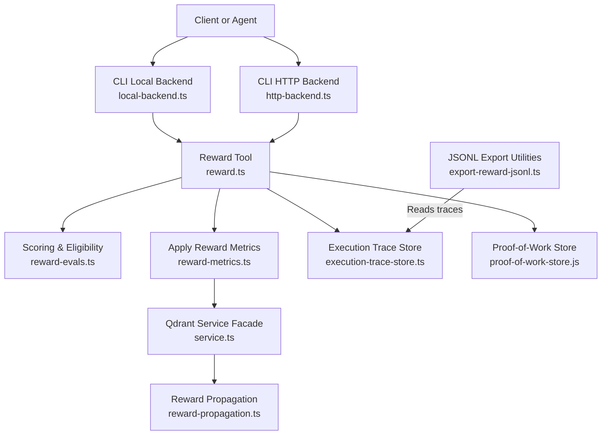
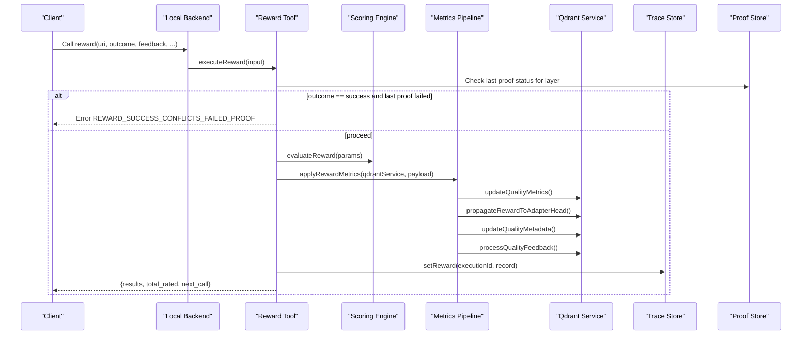
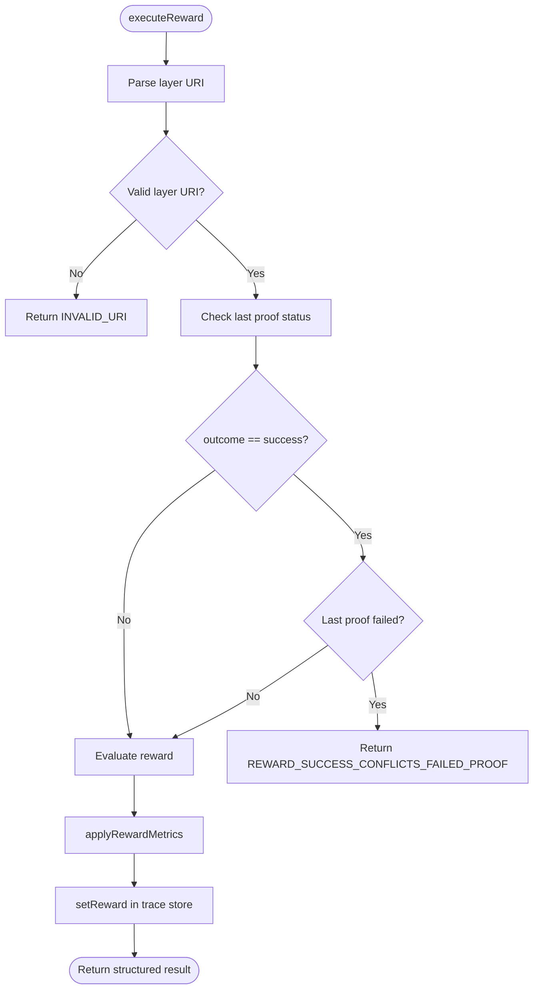
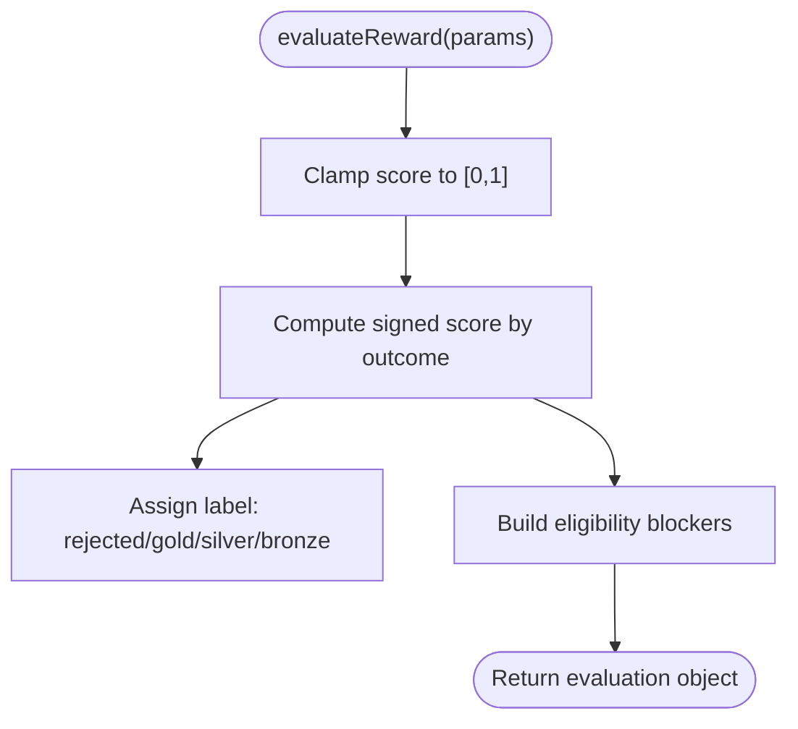
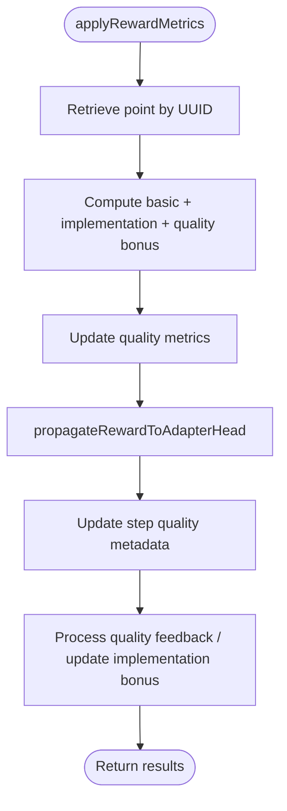
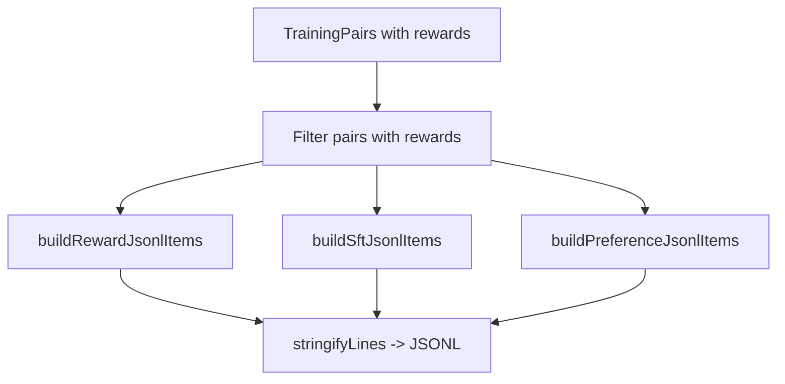
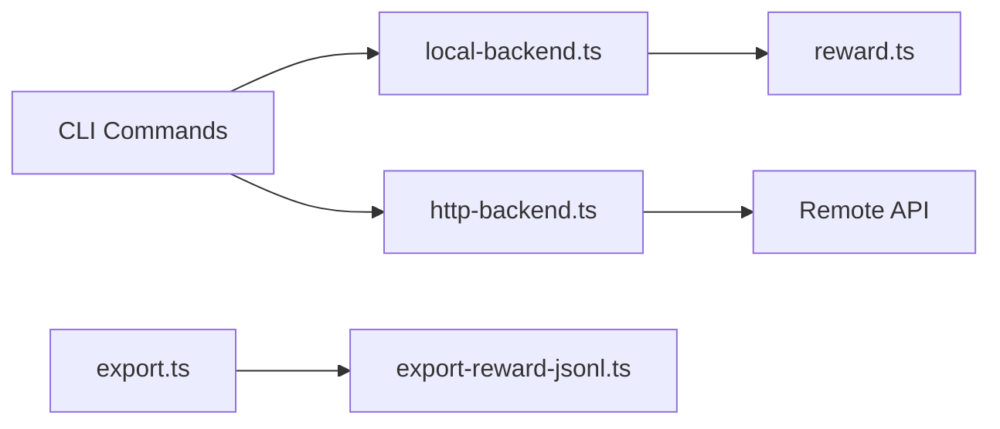
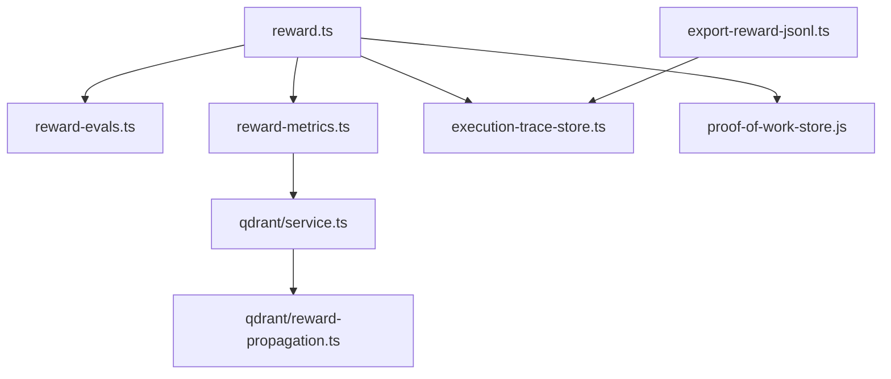

# Reward Tool

<cite>
**Referenced Files in This Document**
- [reward.ts](file://src/tools/reward.ts)
- [reward_schema.ts](file://src/tools/reward_schema.ts)
- [export-reward-jsonl.ts](file://src/tools/export-reward-jsonl.ts)
- [reward-evals.ts](file://src/services/reward-evals.ts)
- [reward-metrics.ts](file://src/services/reward-metrics.ts)
- [reward-propagation.ts](file://src/services/qdrant/reward-propagation.ts)
- [service.ts](file://src/services/qdrant/service.ts)
- [execution-trace-store.ts](file://src/services/execution-trace-store.ts)
- [proof-of-work-store.ts](file://src/services/proof-of-work-store.js)
- [local-backend.ts](file://src/cli/backend/local-backend.ts)
- [http-backend.ts](file://src/cli/backend/http-backend.ts)
- [action-backend.ts](file://src/cli/backend/action-backend.ts)
- [export.ts](file://src/cli/commands/export.ts)
- [mcp-metrics.js](file://src/services/metrics/mcp-metrics.js)
- [structured-logger.js](file://src/utils/structured-logger.js)
</cite>

## Table of Contents
1. [Introduction](#introduction)
2. [Project Structure](#project-structure)
3. [Core Components](#core-components)
4. [Architecture Overview](#architecture-overview)
5. [Detailed Component Analysis](#detailed-component-analysis)
6. [Dependency Analysis](#dependency-analysis)
7. [Performance Considerations](#performance-considerations)
8. [Troubleshooting Guide](#troubleshooting-guide)
9. [Conclusion](#conclusion)
10. [Appendices](#appendices)

## Introduction
This document explains the reward tool that records performance feedback and evaluation metrics for adapter execution layers. It covers the end-to-end reward submission workflow, proof validation, scoring algorithms, metric aggregation, telemetry, JSONL export formats, authentication and authorization considerations, data retention implications, and operational guidance for high-volume usage.

The reward tool is part of the MCP toolchain where agents follow an activate → forward → reward chain to execute adapters deterministically and audibly. Rewards are attached after execution to improve model quality signals, propagate feedback to adapter heads, and support downstream training pipelines (SFT and preference learning).

## Project Structure
The reward feature spans several modules:
- Tool entrypoint and registration: src/tools/reward.ts
- Input/output schemas: src/tools/reward_schema.ts
- Scoring and eligibility logic: src/services/reward-evals.ts
- Metrics application and persistence: src/services/reward-metrics.ts
- Reward propagation to adapter head: src/services/qdrant/reward-propagation.ts
- Qdrant service facade: src/services/qdrant/service.ts
- Execution trace storage: src/services/execution-trace-store.ts
- Proof-of-work store: src/services/proof-of-work-store.js
- CLI backends and commands: src/cli/backend/*.ts, src/cli/commands/export.ts
- Telemetry and logging: src/services/metrics/mcp-metrics.js, src/utils/structured-logger.js
- JSONL export utilities: src/tools/export-reward-jsonl.ts

**Diagram sources**
- [reward.ts:28-130](file://src/tools/reward.ts#L28-L130)
- [reward-metrics.ts:20-119](file://src/services/reward-metrics.ts#L20-L119)
- [reward-propagation.ts:13-76](file://src/services/qdrant/reward-propagation.ts#L13-L76)
- [service.ts:112-113](file://src/services/qdrant/service.ts#L112-L113)
- [execution-trace-store.ts](file://src/services/execution-trace-store.ts)
- [proof-of-work-store.js](file://src/services/proof-of-work-store.js)
- [export-reward-jsonl.ts:96-181](file://src/tools/export-reward-jsonl.ts#L96-L181)

**Section sources**
- [reward.ts:1-176](file://src/tools/reward.ts#L1-L176)
- [reward-metrics.ts:1-120](file://src/services/reward-metrics.ts#L1-L120)
- [reward-propagation.ts:1-76](file://src/services/qdrant/reward-propagation.ts#L1-L76)
- [service.ts:112-113](file://src/services/qdrant/service.ts#L112-L113)
- [export-reward-jsonl.ts:1-182](file://src/tools/export-reward-jsonl.ts#L1-L182)

## Core Components
- Reward tool handler: validates input, enforces proof constraints, evaluates scores, applies metrics, persists traces, and returns structured results.
- Scoring engine: normalizes scores, assigns labels, determines grader kind, and computes eligibility for SFT and preference datasets.
- Metrics pipeline: updates vector DB quality metrics, propagates rewards to adapter heads, updates step quality metadata, and logs telemetry.
- JSONL exporters: produce reward JSONL, SFT-aligned messages, and preference pairs from execution traces.

Key responsibilities:
- Input validation and schema enforcement via reward schema.
- Honest verification against stored proof outcomes.
- Deterministic scoring with thresholds and labels.
- Aggregation and persistence of quality metrics.
- Propagation of reward signals to adapter heads.
- Telemetry emission for tool calls, durations, and errors.

**Section sources**
- [reward.ts:28-130](file://src/tools/reward.ts#L28-L130)
- [reward-evals.ts:105-147](file://src/services/reward-evals.ts#L105-L147)
- [reward-metrics.ts:20-119](file://src/services/reward-metrics.ts#L20-L119)
- [export-reward-jsonl.ts:96-181](file://src/tools/export-reward-jsonl.ts#L96-L181)

## Architecture Overview
The reward submission flow integrates multiple services to ensure correctness, observability, and downstream usability.

**Diagram sources**
- [reward.ts:28-130](file://src/tools/reward.ts#L28-L130)
- [reward-metrics.ts:20-119](file://src/services/reward-metrics.ts#L20-L119)
- [reward-propagation.ts:13-76](file://src/services/qdrant/reward-propagation.ts#L13-L76)

## Detailed Component Analysis

### Reward Tool Handler
Responsibilities:
- Parse and validate URI; require a layer URI.
- Enforce honest verification: reject success if the layer’s last proof failed.
- Evaluate reward using the scoring engine.
- Apply reward metrics to vector DB and propagate to adapter head.
- Persist reward details into execution trace store when an execution ID is present.
- Emit telemetry for call counts, duration, input/output sizes, and errors.

Error handling:
- Invalid URI yields a client error.
- Success conflicting with failed proof yields a conflict error.
- Persistence failures return a specific error indicating no reward was stored and advising retry once storage is healthy.

Telemetry:
- Uses MCP tool metrics for calls, duration, input size, output size, and error counters.

**Diagram sources**
- [reward.ts:28-130](file://src/tools/reward.ts#L28-L130)

**Section sources**
- [reward.ts:19-130](file://src/tools/reward.ts#L19-L130)
- [reward.ts:132-176](file://src/tools/reward.ts#L132-L176)

### Scoring and Eligibility Engine
Responsibilities:
- Normalize and clamp scores to [0,1].
- Compute signed score based on outcome.
- Determine label: rejected, gold, silver, bronze.
- Infer grader kind: human, model, unknown.
- Compute eligibility for SFT and preference datasets based on rubric version, evaluator identity, outcome, and score thresholds.

Thresholds and rules:
- Default success score and failure score.
- Minimum thresholds for SFT and preference eligibility.
- Blockers include missing rubric version, missing evaluator identity, non-success outcome, and low scores.

**Diagram sources**
- [reward-evals.ts:105-147](file://src/services/reward-evals.ts#L105-L147)

**Section sources**
- [reward-evals.ts:1-168](file://src/services/reward-evals.ts#L1-L168)

### Metrics Application and Propagation
Responsibilities:
- Update quality metrics for the target layer.
- Propagate reward to the adapter head.
- Update step quality metadata.
- Process quality feedback and adjust implementation bonuses.
- Invalidate begin cache to reflect updated state.

Propagation logic:
- Resolve adapter head for the same adapter at layer index 1.
- Skip if already at head or missing adapter context.
- Update head metrics and invalidate cache.

**Diagram sources**
- [reward-metrics.ts:20-119](file://src/services/reward-metrics.ts#L20-L119)
- [reward-propagation.ts:13-76](file://src/services/qdrant/reward-propagation.ts#L13-L76)

**Section sources**
- [reward-metrics.ts:1-120](file://src/services/reward-metrics.ts#L1-L120)
- [reward-propagation.ts:1-76](file://src/services/qdrant/reward-propagation.ts#L1-L76)
- [service.ts:112-113](file://src/services/qdrant/service.ts#L112-L113)

### JSONL Export Formats
The exporter transforms execution traces with rewards into three primary formats:
- Reward JSONL: full instruction/response/reward/metadata per line.
- SFT JSONL: user/assistant message pairs optionally including reward metadata.
- Preference JSONL: chosen vs rejected pairs per layer, selecting highest-scoring success and failure examples.

Normalization:
- Canonicalizes layer URIs for consistent grouping.
- Computes eligibility flags for SFT and preference datasets when not precomputed.

**Diagram sources**
- [export-reward-jsonl.ts:52-181](file://src/tools/export-reward-jsonl.ts#L52-L181)

**Section sources**
- [export-reward-jsonl.ts:1-182](file://src/tools/export-reward-jsonl.ts#L1-L182)

### CLI Integration and Backends
- Local backend parses inputs using the reward schema and executes the reward tool within a transactional run context.
- HTTP backend forwards reward calls to the remote API client.
- Action backend defines the interface for reward options and output types.
- Export command supports exporting reward data alongside other artifacts.

**Diagram sources**
- [local-backend.ts:167-183](file://src/cli/backend/local-backend.ts#L167-L183)
- [http-backend.ts:56-62](file://src/cli/backend/http-backend.ts#L56-L62)
- [action-backend.ts:65-106](file://src/cli/backend/action-backend.ts#L65-L106)
- [export.ts:130-151](file://src/cli/commands/export.ts#L130-L151)

**Section sources**
- [local-backend.ts:167-183](file://src/cli/backend/local-backend.ts#L167-L183)
- [http-backend.ts:56-62](file://src/cli/backend/http-backend.ts#L56-L62)
- [action-backend.ts:65-106](file://src/cli/backend/action-backend.ts#L65-L106)
- [export.ts:130-151](file://src/cli/commands/export.ts#L130-L151)

## Dependency Analysis
The reward system has clear separation between tool orchestration, scoring, metrics, persistence, and export.

**Diagram sources**
- [reward.ts:28-130](file://src/tools/reward.ts#L28-L130)
- [reward-metrics.ts:20-119](file://src/services/reward-metrics.ts#L20-L119)
- [service.ts:112-113](file://src/services/qdrant/service.ts#L112-L113)
- [reward-propagation.ts:13-76](file://src/services/qdrant/reward-propagation.ts#L13-L76)
- [export-reward-jsonl.ts:96-181](file://src/tools/export-reward-jsonl.ts#L96-L181)

Coupling and cohesion:
- The reward tool orchestrates but delegates specialized concerns to dedicated modules.
- Metrics module encapsulates all vector DB interactions and cache invalidation.
- Propagation is isolated to avoid side effects in the main metrics path.
- Export utilities depend only on trace data and scoring eligibility functions.

Potential circular dependencies:
- None observed among core modules; dependencies are directional from tool to services.

External integrations:
- Vector DB (Qdrant) for quality metrics and adapter head updates.
- Redis cache for begin cache invalidation.
- Structured logger for auditability.

**Section sources**
- [reward.ts:1-176](file://src/tools/reward.ts#L1-L176)
- [reward-metrics.ts:1-120](file://src/services/reward-metrics.ts#L1-L120)
- [reward-propagation.ts:1-76](file://src/services/qdrant/reward-propagation.ts#L1-L76)
- [export-reward-jsonl.ts:1-182](file://src/tools/export-reward-jsonl.ts#L1-L182)

## Performance Considerations
- High-volume submissions:
  - Use batched exports rather than many small reward calls when possible.
  - Ensure vector DB connectivity and Redis availability to avoid retries and delays.
- Batch processing capabilities:
  - The metrics pipeline processes one URI at a time; consider aggregating rewards across executions before export.
  - JSONL exporters can handle large trace sets efficiently by streaming lines.
- Telemetry overhead:
  - Tool metrics capture call counts, durations, and I/O sizes; monitor these to detect bottlenecks.
- Cache invalidation:
  - Begin cache invalidation occurs after reward application; ensure Redis health to prevent stale reads.

[No sources needed since this section provides general guidance]

## Troubleshooting Guide
Common issues and resolutions:
- Invalid URI:
  - Symptom: Error indicating reward requires a layer URI.
  - Resolution: Ensure the URI points to a layer resource.
- Success conflicts with failed proof:
  - Symptom: Conflict error stating the layer’s last proof failed.
  - Resolution: Fix the step and rerun, or record outcome failure with reason.
- Persistence failures:
  - Symptom: Errors indicating reward metrics could not be persisted.
  - Resolution: Retry once storage is healthy; check vector DB and Redis connectivity.
- Missing evaluator identity:
  - Symptom: Eligibility blockers include missing evaluator identity.
  - Resolution: Provide rater or llm_model_id to identify the grader.
- Missing rubric version:
  - Symptom: Eligibility blockers include missing rubric version.
  - Resolution: Include rubric_version in reward submission.

Operational checks:
- Monitor MCP tool metrics for error rates and latency spikes.
- Review structured logs for reward propagation warnings and cache invalidation failures.

**Section sources**
- [reward.ts:19-54](file://src/tools/reward.ts#L19-L54)
- [reward.ts:75-106](file://src/tools/reward.ts#L75-L106)
- [reward-evals.ts:55-93](file://src/services/reward-evals.ts#L55-L93)
- [reward-metrics.ts:106-119](file://src/services/reward-metrics.ts#L106-L119)
- [mcp-metrics.js](file://src/services/metrics/mcp-metrics.js)
- [structured-logger.js](file://src/utils/structured-logger.js)

## Conclusion
The reward tool provides a robust mechanism to attach performance feedback to adapter execution layers, enforce honest proof-based constraints, compute deterministic scores and labels, aggregate quality metrics, and propagate rewards to adapter heads. Its integration with execution traces enables rich JSONL exports for SFT and preference learning. Proper use of evaluator identity and rubric versions ensures eligibility for downstream training pipelines. Monitoring telemetry and addressing common pitfalls will help maintain reliable reward processing at scale.

[No sources needed since this section summarizes without analyzing specific files]

## Appendices

### Authentication and Authorization
- Authentication: JWT tokens validate both human and agent requests.
- Authorization: Space-level write guards control access; reward submissions respect tenant and space contexts.
- Best practice: Always submit rewards within the intended space context and ensure the caller has write permissions.

[No sources needed since this section provides general guidance]

### Data Retention Policies
- Reward data is persisted in execution traces and vector DB quality metrics.
- Retention depends on storage configuration; review vector DB and cache policies for lifecycle management.
- Exported JSONL artifacts should be managed according to organizational data governance.

[No sources needed since this section provides general guidance]

### Practical Examples and Patterns
- Reward submission patterns:
  - Submit success with explicit score and rubric version for higher eligibility.
  - Record failure with reason when steps do not complete successfully.
  - Include llm_model_id for model-routed evaluations or rater for human evaluations.
- Custom scoring functions:
  - Use the scoring engine’s normalization and labeling to derive consistent labels and eligibility flags.
- Performance tracking workflows:
  - Combine reward submissions with telemetry monitoring and periodic JSONL exports for analysis.

[No sources needed since this section provides general guidance]