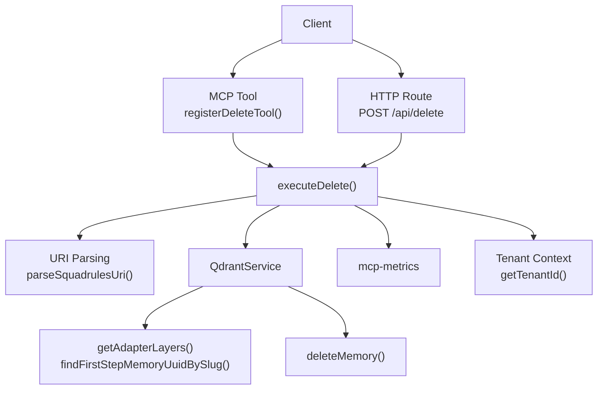
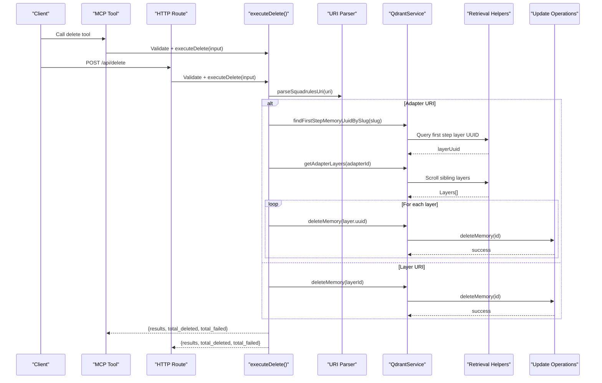
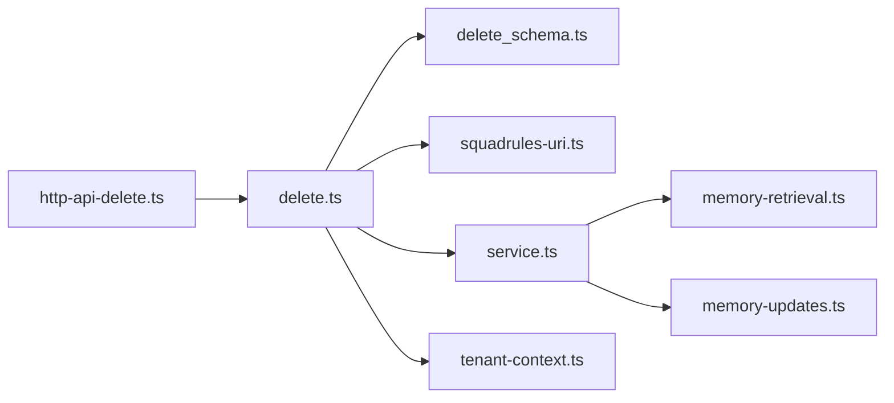

# Delete Tool

<cite>
**Referenced Files in This Document**
- [delete.ts](file://src/tools/delete.ts)
- [delete_schema.ts](file://src/tools/delete_schema.ts)
- [squadrules-uri.ts](file://src/tools/squadrules-uri.ts)
- [http-api-delete.ts](file://src/http/http-api-delete.ts)
- [service.ts](file://src/services/qdrant/service.ts)
- [memory-retrieval.ts](file://src/services/qdrant/memory-retrieval.ts)
- [memory-updates.ts](file://src/services/qdrant/memory-updates.ts)
- [tenant-context.ts](file://src/utils/tenant-context.ts)
- [delete.ts](file://src/cli/commands/delete.ts)
</cite>

## Table of Contents
1. [Introduction](#introduction)
2. [Project Structure](#project-structure)
3. [Core Components](#core-components)
4. [Architecture Overview](#architecture-overview)
5. [Detailed Component Analysis](#detailed-component-analysis)
6. [Dependency Analysis](#dependency-analysis)
7. [Performance Considerations](#performance-considerations)
8. [Troubleshooting Guide](#troubleshooting-guide)
9. [Conclusion](#conclusion)

## Introduction
The delete tool removes SquadRules adapter resources from the vector memory store. It supports deleting a single adapter, a single layer, or multiple URIs in one call. When an adapter is deleted, all its layers are discovered and removed. The implementation validates inputs, resolves adapter slugs to canonical identifiers, enforces space-based access control, and records metrics for observability.

This document explains:
- Deletion workflow and dependency resolution
- Data integrity checks during deletion
- Artifact cleanup behavior
- User directory and storage considerations
- Safety mechanisms (soft deletes, backups, rollback)
- API specifications with schemas, validation, and error handling
- Authentication, authorization, audit logging, and performance guidance

## Project Structure
The delete feature spans several modules:
- MCP tool registration and execution logic
- HTTP route wrapper
- URI parsing and validation
- Qdrant service abstraction
- Vector retrieval helpers
- Low-level update operations including deletion
- Tenant context for multitenancy and isolation
- CLI command entry point

**Diagram sources**
- [delete.ts:12-70](file://src/tools/delete.ts#L12-L70)
- [http-api-delete.ts:11-34](file://src/http/http-api-delete.ts#L11-L34)
- [squadrules-uri.ts:42-102](file://src/tools/squadrules-uri.ts#L42-L102)
- [service.ts:78-100](file://src/services/qdrant/service.ts#L78-L100)
- [memory-retrieval.ts:152-200](file://src/services/qdrant/memory-retrieval.ts#L152-L200)
- [memory-updates.ts:199-232](file://src/services/qdrant/memory-updates.ts#L199-L232)

**Section sources**
- [delete.ts:12-115](file://src/tools/delete.ts#L12-L115)
- [http-api-delete.ts:11-34](file://src/http/http-api-delete.ts#L11-L34)
- [delete_schema.ts:14-29](file://src/tools/delete_schema.ts#L14-L29)
- [squadrules-uri.ts:42-102](file://src/tools/squadrules-uri.ts#L42-L102)
- [service.ts:78-100](file://src/services/qdrant/service.ts#L78-L100)
- [memory-retrieval.ts:152-200](file://src/services/qdrant/memory-retrieval.ts#L152-L200)
- [memory-updates.ts:199-232](file://src/services/qdrant/memory-updates.ts#L199-L232)
- [tenant-context.ts:308-311](file://src/utils/tenant-context.ts#L308-L311)

## Core Components
- MCP tool: registers the delete tool, validates input, measures metrics, and delegates to shared execution logic.
- Shared execution: iterates over URIs, parses them, resolves adapters by slug if needed, discovers layers, and deletes each memory point.
- HTTP route: validates request body using the same schema, runs the operation under tenant context, and returns structured results.
- URI utilities: parse and validate adapter, artifact, and layer URIs; normalize slugs; enforce wire-format constraints.
- Qdrant service: exposes methods for retrieving adapter layers, resolving slugs, and deleting memories.
- Retrieval helpers: implement pagination and filtering for adapter siblings and slug resolution.
- Update operations: perform actual deletion, cache invalidation, and metric recording.
- Tenant context: provides tenant ID for metrics and ensures space-scoped operations.

**Section sources**
- [delete.ts:12-115](file://src/tools/delete.ts#L12-L115)
- [http-api-delete.ts:11-34](file://src/http/http-api-delete.ts#L11-L34)
- [squadrules-uri.ts:42-102](file://src/tools/squadrules-uri.ts#L42-L102)
- [service.ts:78-100](file://src/services/qdrant/service.ts#L78-L100)
- [memory-retrieval.ts:152-200](file://src/services/qdrant/memory-retrieval.ts#L152-L200)
- [memory-updates.ts:199-232](file://src/services/qdrant/memory-updates.ts#L199-L232)
- [tenant-context.ts:308-311](file://src/utils/tenant-context.ts#L308-L311)

## Architecture Overview
The delete tool follows a layered architecture:
- Entry points: MCP tool and HTTP route
- Validation layer: Zod schemas and URI regexes
- Orchestration: executeDelete() coordinates parsing, resolution, and deletion
- Storage layer: QdrantService delegates to retrieval and update modules
- Observability: metrics capture duration, input/output sizes, and status

**Diagram sources**
- [delete.ts:21-70](file://src/tools/delete.ts#L21-L70)
- [http-api-delete.ts:12-34](file://src/http/http-api-delete.ts#L12-L34)
- [squadrules-uri.ts:42-102](file://src/tools/squadrules-uri.ts#L42-L102)
- [service.ts:78-100](file://src/services/qdrant/service.ts#L78-L100)
- [memory-retrieval.ts:152-200](file://src/services/qdrant/memory-retrieval.ts#L152-L200)
- [memory-updates.ts:199-232](file://src/services/qdrant/memory-updates.ts#L199-L232)

## Detailed Component Analysis

### MCP Tool Registration and Execution
Responsibilities:
- Register the delete tool with title, description, input/output schemas
- Parse and validate input via Zod schema
- Measure input size, duration, output size, and errors
- Delegate to shared executeDelete()
- Return structured content alongside text payload

Key behaviors:
- Input validation failure emits error metrics and returns a teaching-friendly error result
- Successful calls increment success counters and record output size
- Errors propagate after incrementing error metrics

**Section sources**
- [delete.ts:73-115](file://src/tools/delete.ts#L73-L115)
- [delete_schema.ts:14-29](file://src/tools/delete_schema.ts#L14-L29)

### Shared Deletion Logic
Responsibilities:
- Iterate over provided URIs
- Parse each URI and branch on kind (adapter vs layer)
- For adapters:
  - Normalize to canonical adapter URI
  - Resolve slug to first-step layer UUID
  - Retrieve adapter layers
  - Delete each layer’s memory point
- For layers:
  - Delete the specified layer directly
- Accumulate per-URI results and totals

Error handling:
- Per-URI failures are captured without aborting the batch
- Each failure pushes an error result with message and increments total_failed

**Section sources**
- [delete.ts:12-70](file://src/tools/delete.ts#L12-L70)
- [squadrules-uri.ts:42-102](file://src/tools/squadrules-uri.ts#L42-L102)
- [service.ts:78-100](file://src/services/qdrant/service.ts#L78-L100)
- [memory-retrieval.ts:152-200](file://src/services/qdrant/memory-retrieval.ts#L152-L200)

### HTTP Route Wrapper
Responsibilities:
- Validate request body using deleteInputSchema
- Log request and completion counts
- Execute under tenant context
- Return structured JSON response or error

Status codes:
- 200 on success
- 400 on invalid input
- 500 on unexpected server-side errors

**Section sources**
- [http-api-delete.ts:11-34](file://src/http/http-api-delete.ts#L11-L34)

### URI Parsing and Validation
Responsibilities:
- Define regex patterns for adapter, artifact, and layer URIs
- Parse URIs into typed structures with idKind and optional executionId
- Provide wire-format guard for adapter URIs

Validation rules:
- Adapter URIs accept UUIDs or normalized slugs
- Layer URIs accept UUIDs and optional execution_id query parameter
- Invalid URIs throw descriptive errors

**Section sources**
- [squadrules-uri.ts:1-130](file://src/tools/squadrules-uri.ts#L1-L130)

### Qdrant Service Abstraction
Responsibilities:
- Expose high-level methods for adapter layer discovery, slug resolution, and deletion
- Compose underlying connection and collection configuration
- Provide singleton instance selection based on environment

Key methods used by delete:
- findFirstStepMemoryUuidBySlug(slug)
- getAdapterLayers(adapterId)
- deleteMemory(id)

**Section sources**
- [service.ts:78-100](file://src/services/qdrant/service.ts#L78-L100)

### Retrieval Helpers
Responsibilities:
- Paginate through Qdrant collections using scroll
- Filter adapter siblings by space and adapter identifier
- Exclude artifact content types when listing adapter layers
- Resolve adapter slug deterministically with precedence rules and disambiguation notes

Deletion path integration:
- getAdapterLayers() returns ordered layers for cascade deletion
- findFirstStepMemoryUuidBySlug() maps slug to canonical layer UUID

**Section sources**
- [memory-retrieval.ts:152-200](file://src/services/qdrant/memory-retrieval.ts#L152-L200)
- [memory-retrieval.ts:228-300](file://src/services/qdrant/memory-retrieval.ts#L228-L300)

### Update Operations and Cache Invalidation
Responsibilities:
- Validate IDs and retrieve existing points before deletion
- Delete points from Qdrant
- Invalidate Redis caches strictly to prevent stale reads
- Record operation metrics and durations

Safety characteristics:
- Throws not-found errors when target does not exist
- Ensures cache invalidation even after successful deletions

**Section sources**
- [memory-updates.ts:199-232](file://src/services/qdrant/memory-updates.ts#L199-L232)

### CLI Command Entry Point
Responsibilities:
- Accept one or more URIs as arguments
- Use backend to call delete operation
- Render results in pretty or text format
- Handle API errors consistently

**Section sources**
- [delete.ts:1-31](file://src/cli/commands/delete.ts#L1-L31)

### API Specifications

#### Request Schema
- Endpoint: POST /api/delete
- Body: object with non-empty array uris
- URI formats:
  - squadrules://adapter/{uuid|slug}
  - squadrules://layer/{uuid}[?execution_id={uuid}]

Validation:
- uris must be a non-empty array
- Each element must match adapter or layer URI regex
- Adapter URIs are normalized to canonical form internally

Response schema:
- results: array of per-URI outcomes
  - uri: original URI string
  - status: "deleted" | "error"
  - message: human-readable outcome
- total_deleted: number of successfully deleted items
- total_failed: number of failed items

Status codes:
- 200: success
- 400: INVALID_INPUT
- 500: DELETE_FAILED

**Section sources**
- [delete_schema.ts:14-29](file://src/tools/delete_schema.ts#L14-L29)
- [http-api-delete.ts:12-34](file://src/http/http-api-delete.ts#L12-L34)

#### Error Handling
- Input validation errors return 400 with error code and message
- Unexpected server errors return 500 with error code and message
- Per-URI failures do not abort the entire batch; they are recorded in results

**Section sources**
- [http-api-delete.ts:12-34](file://src/http/http-api-delete.ts#L12-L34)
- [delete.ts:55-63](file://src/tools/delete.ts#L55-L63)

### Data Integrity Checks
- Slug resolution requires at least one matching first-step layer; otherwise, deletion fails for that adapter URI
- Adapter layer discovery excludes artifacts and respects space filters
- Deletion validates existence before removing points

**Section sources**
- [memory-retrieval.ts:228-300](file://src/services/qdrant/memory-retrieval.ts#L228-L300)
- [memory-retrieval.ts:152-200](file://src/services/qdrant/memory-retrieval.ts#L152-L200)
- [memory-updates.ts:199-232](file://src/services/qdrant/memory-updates.ts#L199-L232)

### Artifact Cleanup Processes
- When listing adapter layers, artifact content types are excluded from deletion targets
- Deleting an adapter removes only adapter-related layers; artifacts remain untouched unless explicitly targeted

**Section sources**
- [memory-retrieval.ts:152-200](file://src/services/qdrant/memory-retrieval.ts#L152-L200)

### User Directory Management and Storage Space Reclamation
- The delete tool operates against the vector memory store (Qdrant or embedded equivalent)
- There is no explicit user directory management in the delete flow
- Storage space reclamation occurs when points are deleted from the vector store and associated caches are invalidated

**Section sources**
- [memory-updates.ts:199-232](file://src/services/qdrant/memory-updates.ts#L199-L232)
- [service.ts:153-161](file://src/services/qdrant/service.ts#L153-L161)

### Safety Mechanisms
- Soft deletes: Not implemented; deletion removes points directly
- Backup creation: Not implemented by the delete tool
- Rollback capabilities: Not implemented; operations are destructive
- Idempotency: Deleting a non-existent layer raises a not-found error; adapter deletion may partially succeed across layers with per-URI error reporting

Recommendations:
- Implement soft deletes by marking points instead of removing them
- Add pre-deletion snapshots or export steps for critical adapters
- Introduce transactional boundaries or compensating actions for partial failures

**Section sources**
- [memory-updates.ts:199-232](file://src/services/qdrant/memory-updates.ts#L199-L232)
- [delete.ts:55-63](file://src/tools/delete.ts#L55-L63)

### Authentication and Authorization
- HTTP routes run under tenant context derived from authentication middleware
- Space-based access control restricts which spaces can be read/written
- Metrics use tenant ID derived from current space context

Notes:
- Authorization scopes are enforced by the broader auth middleware and space context utilities
- The delete tool itself does not define additional scopes beyond inherited context

**Section sources**
- [tenant-context.ts:256-303](file://src/utils/tenant-context.ts#L256-L303)
- [tenant-context.ts:308-311](file://src/utils/tenant-context.ts#L308-L311)
- [http-api-delete.ts:24-24](file://src/http/http-api-delete.ts#L24-L24)

### Audit Logging
- Structured logging is used around HTTP route lifecycle
- Qdrant operations emit metrics for duration and status
- MCP tool metrics include input/output sizes and error counts

Limitations:
- No dedicated audit event emission is present in the delete flow shown here
- Consider integrating with the project’s audit log system for compliance

**Section sources**
- [http-api-delete.ts:23-33](file://src/http/http-api-delete.ts#L23-L33)
- [delete.ts:84-112](file://src/tools/delete.ts#L84-L112)
- [memory-updates.ts:199-232](file://src/services/qdrant/memory-updates.ts#L199-L232)

### Practical Examples

- Single adapter deletion:
  - Provide a single adapter URI
  - System resolves slug to first-step layer, retrieves all layers, and deletes each
  - Response includes one result with status "deleted"

- Single layer deletion:
  - Provide a layer URI
  - System deletes the specified layer directly
  - Response includes one result with status "deleted"

- Bulk operations:
  - Provide an array of mixed adapter and layer URIs
  - Each URI is processed independently; successes and failures are aggregated
  - Response includes per-URI results and totals

- Dependency cleanup:
  - Deleting an adapter triggers cascade deletion of its layers
  - Artifacts are not included in adapter layer deletion

- Disaster recovery scenarios:
  - Since there is no built-in backup or rollback, operators should export or snapshot data before bulk deletions
  - After accidental deletion, restore from external backups and re-run activation workflows to rebuild adapters

[No sources needed since this section provides conceptual examples]

## Dependency Analysis
The delete tool depends on:
- URI parsing and validation utilities
- Qdrant service abstractions
- Retrieval helpers for adapter layer enumeration and slug resolution
- Update operations for point deletion and cache invalidation
- Tenant context for metrics and isolation
- HTTP route for REST exposure
- MCP tool registration for agent-facing interface

**Diagram sources**
- [delete.ts:12-115](file://src/tools/delete.ts#L12-L115)
- [delete_schema.ts:14-29](file://src/tools/delete_schema.ts#L14-L29)
- [squadrules-uri.ts:42-102](file://src/tools/squadrules-uri.ts#L42-L102)
- [http-api-delete.ts:11-34](file://src/http/http-api-delete.ts#L11-L34)
- [service.ts:78-100](file://src/services/qdrant/service.ts#L78-L100)
- [memory-retrieval.ts:152-200](file://src/services/qdrant/memory-retrieval.ts#L152-L200)
- [memory-updates.ts:199-232](file://src/services/qdrant/memory-updates.ts#L199-L232)
- [tenant-context.ts:308-311](file://src/utils/tenant-context.ts#L308-L311)

**Section sources**
- [delete.ts:12-115](file://src/tools/delete.ts#L12-L115)
- [http-api-delete.ts:11-34](file://src/http/http-api-delete.ts#L11-L34)
- [service.ts:78-100](file://src/services/qdrant/service.ts#L78-L100)
- [memory-retrieval.ts:152-200](file://src/services/qdrant/memory-retrieval.ts#L152-L200)
- [memory-updates.ts:199-232](file://src/services/qdrant/memory-updates.ts#L199-L232)
- [tenant-context.ts:308-311](file://src/utils/tenant-context.ts#L308-L311)

## Performance Considerations
- Batch processing: The tool processes URIs sequentially; large batches may take time proportional to the number of URIs and layers
- Pagination: Adapter layer enumeration uses paginated scrolling; ensure adequate limits and avoid excessive page sizes
- Cache invalidation: Strict cache invalidation occurs per deletion; consider batching where possible to reduce overhead
- Metrics: Duration and I/O sizes are measured; monitor for latency spikes during bulk deletions
- Concurrency: Current implementation is synchronous per URI; adding concurrency could improve throughput but requires careful error aggregation and resource management

Recommendations:
- Monitor total_deleted and total_failed ratios
- Use backoff strategies for downstream services
- Pre-validate URIs to minimize unnecessary network calls
- Consider implementing concurrent deletion with bounded parallelism for very large adapter sets

[No sources needed since this section provides general guidance]

## Troubleshooting Guide
Common issues:
- Invalid URI format: Ensure URIs match supported patterns; check slug casing and UUID validity
- Adapter not found: Slug resolution requires a matching first-step layer; verify slug correctness and space visibility
- Permission denied: Space context may not allow access to the target; confirm allowedSpaceIds and defaultWriteSpaceId
- Partial failures: Review per-URI results; some URIs may fail while others succeed
- Stale cache: If reads still reflect deleted data, verify cache invalidation and restart consumers if necessary

Diagnostic steps:
- Inspect HTTP response status and error messages
- Check structured logs for request correlation IDs
- Validate tenant context and space IDs
- Confirm Qdrant connectivity and collection configuration

**Section sources**
- [http-api-delete.ts:12-34](file://src/http/http-api-delete.ts#L12-L34)
- [delete.ts:55-63](file://src/tools/delete.ts#L55-L63)
- [memory-retrieval.ts:228-300](file://src/services/qdrant/memory-retrieval.ts#L228-L300)
- [memory-updates.ts:199-232](file://src/services/qdrant/memory-updates.ts#L199-L232)

## Conclusion
The delete tool provides a robust mechanism for removing SquadRules adapter resources and their layers from the vector memory store. It validates inputs, resolves adapter slugs, enforces space-based access control, and records comprehensive metrics. While it lacks soft deletes, backups, and rollback capabilities, it offers clear per-URI error reporting and integrates well with the broader authentication and observability systems. Operators should plan disaster recovery procedures externally and monitor performance during large-scale deletions.