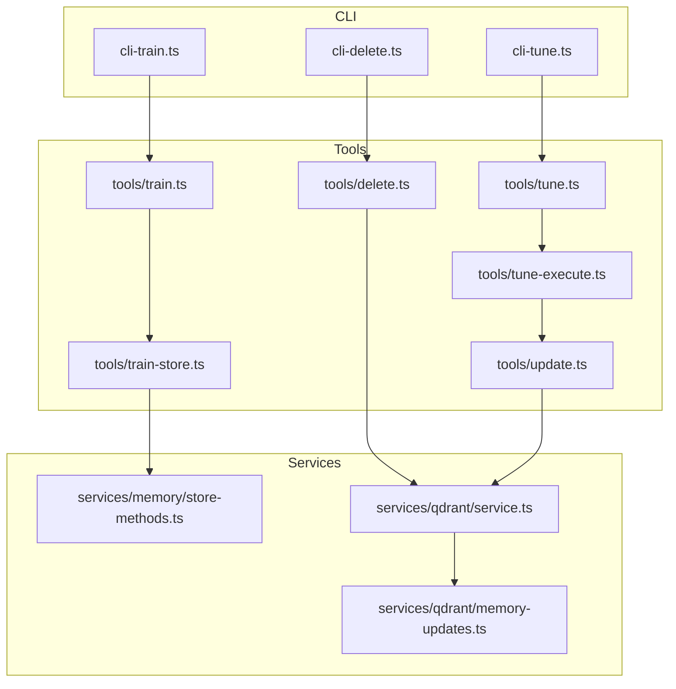
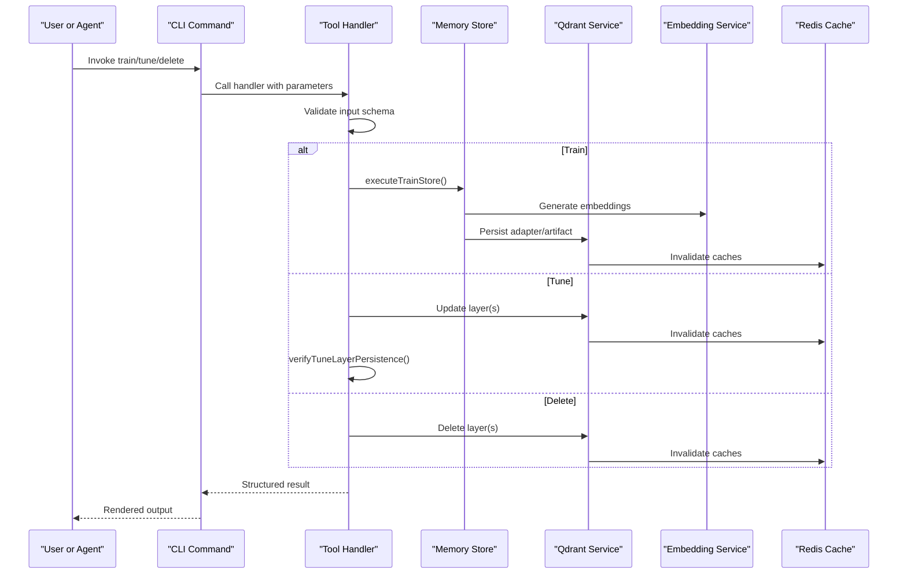
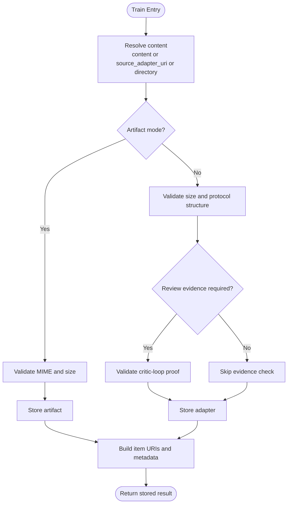
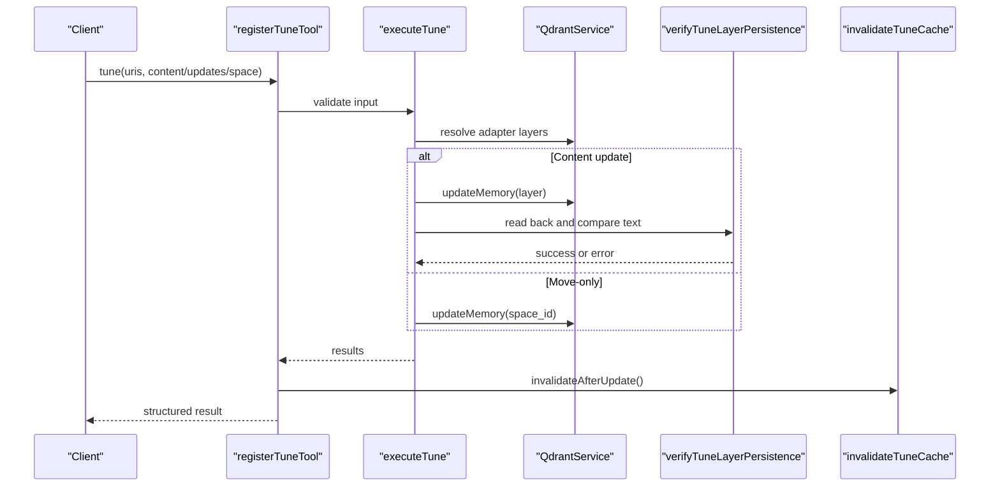
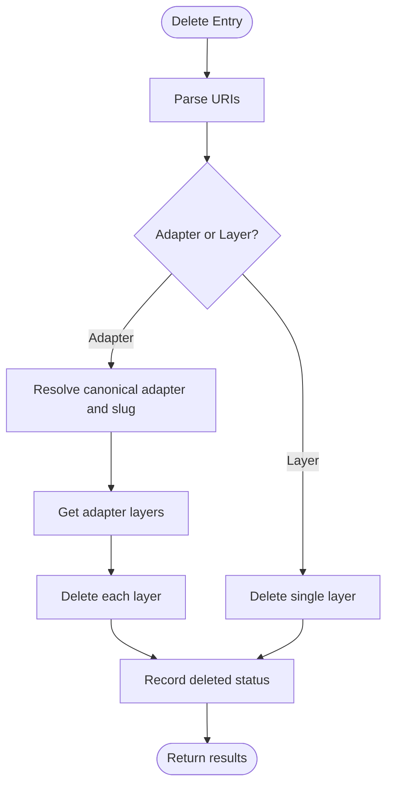
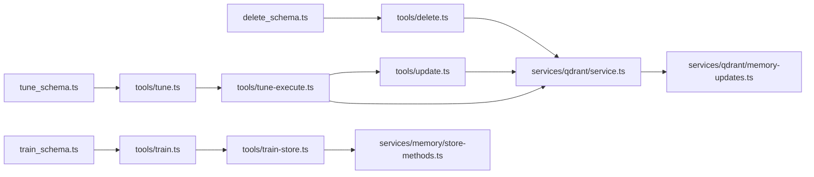

# Management Tools (Train, Tune, Delete)

<cite>
**Referenced Files in This Document**
- [train.ts](file://src/tools/train.ts)
- [train-store.ts](file://src/tools/train-store.ts)
- [train_schema.ts](file://src/tools/train_schema.ts)
- [tune.ts](file://src/tools/tune.ts)
- [tune-execute.ts](file://src/tools/tune-execute.ts)
- [tune-verify.ts](file://src/tools/tune-verify.ts)
- [tune-cache-invalidation.ts](file://src/tools/tune-cache-invalidation.ts)
- [tune_schema.ts](file://src/tools/tune_schema.ts)
- [delete.ts](file://src/tools/delete.ts)
- [delete_schema.ts](file://src/tools/delete_schema.ts)
- [update.ts](file://src/tools/update.ts)
- [cli-train.ts](file://src/cli/commands/cli-train.ts)
- [cli-tune.ts](file://src/cli/commands/tune.ts)
- [cli-delete.ts](file://src/cli/commands/delete.ts)
- [train-batch.ts](file://src/cli/train-batch.ts)
- [store-methods.ts](file://src/services/memory/store-methods.ts)
- [memory-updates.ts](file://src/services/qdrant/memory-updates.ts)
- [service.ts](file://src/services/qdrant/service.ts)
</cite>

## Table of Contents
1. [Introduction](#introduction)
2. [Project Structure](#project-structure)
3. [Core Components](#core-components)
4. [Architecture Overview](#architecture-overview)
5. [Detailed Component Analysis](#detailed-component-analysis)
6. [Dependency Analysis](#dependency-analysis)
7. [Performance Considerations](#performance-considerations)
8. [Troubleshooting Guide](#troubleshooting-guide)
9. [Conclusion](#conclusion)
10. [Appendices](#appendices)

## Introduction
This document explains the adapter lifecycle management tools train, tune, and delete. These tools provide:
- Adapter creation and artifact attachment through train.
- Safe content updates and space moves through tune.
- Deterministic cleanup of adapters or layers through delete.

The system uses Qdrant as the primary vector store, Redis for caching, and a memory store layer that parses markdown, validates protocol structure, generates embeddings, and persists data. Authentication is handled via Keycloak/OAuth/JWT, and authorization is enforced through tenant and space context.

## Project Structure
The management tools are implemented as MCP tool handlers with CLI wrappers:
- Tool handlers live under src/tools.
- CLI commands live under src/cli/commands.
- Storage and embedding logic lives under src/services/memory and src/services/qdrant.

**Diagram sources**
- [cli-train.ts:40-211](file://src/cli/commands/cli-train.ts#L40-L211)
- [cli-tune.ts:32-115](file://src/cli/commands/tune.ts#L32-L115)
- [cli-delete.ts:13-30](file://src/cli/commands/delete.ts#L13-L30)
- [train.ts:137-244](file://src/tools/train.ts#L137-L244)
- [train-store.ts:47-130](file://src/tools/train-store.ts#L47-L130)
- [tune.ts:19-69](file://src/tools/tune.ts#L19-L69)
- [tune-execute.ts:219-349](file://src/tools/tune-execute.ts#L219-L349)
- [delete.ts:12-71](file://src/tools/delete.ts#L12-L71)
- [update.ts:8-72](file://src/tools/update.ts#L8-L72)
- [store-methods.ts:25-268](file://src/services/memory/store-methods.ts#L25-L268)
- [service.ts:17-151](file://src/services/qdrant/service.ts#L17-L151)
- [memory-updates.ts:15-233](file://src/services/qdrant/memory-updates.ts#L15-L233)

**Section sources**
- [cli-train.ts:40-211](file://src/cli/commands/cli-train.ts#L40-L211)
- [cli-tune.ts:32-115](file://src/cli/commands/tune.ts#L32-L115)
- [cli-delete.ts:13-30](file://src/cli/commands/delete.ts#L13-L30)
- [train.ts:137-244](file://src/tools/train.ts#L137-L244)
- [tune.ts:19-69](file://src/tools/tune.ts#L19-L69)
- [delete.ts:12-71](file://src/tools/delete.ts#L12-L71)

## Core Components
- Train: Validates input, resolves content from markdown or source adapter, supports artifact mode, enforces review evidence, stores adapters or artifacts, and returns structured results.
- Tune: Updates adapter layers, supports move-only operations, validates structural constraints, performs post-write verification, and invalidates caches.
- Delete: Deletes adapter URIs by resolving all layers, or deletes individual layer URIs, returning per-resource status.

Key responsibilities:
- Input validation schemas define required fields and constraints.
- Store methods handle persistence, embedding generation, and cache invalidation.
- Qdrant service provides retrieval, update, and deletion primitives.

**Section sources**
- [train_schema.ts:54-177](file://src/tools/train_schema.ts#L54-L177)
- [train-store.ts:47-130](file://src/tools/train-store.ts#L47-L130)
- [tune_schema.ts:14-57](file://src/tools/tune_schema.ts#L14-L57)
- [tune-execute.ts:219-349](file://src/tools/tune-execute.ts#L219-L349)
- [delete_schema.ts:14-29](file://src/tools/delete_schema.ts#L14-L29)

## Architecture Overview
The tools follow a layered architecture:
- CLI layer parses arguments and calls backend APIs.
- Tool layer validates inputs, orchestrates workflows, and formats outputs.
- Service layer interacts with Qdrant and embedding services.
- Memory store handles adapter parsing, validation, and storage.

**Diagram sources**
- [train.ts:137-244](file://src/tools/train.ts#L137-L244)
- [train-store.ts:47-130](file://src/tools/train-store.ts#L47-L130)
- [store-methods.ts:121-260](file://src/services/memory/store-methods.ts#L121-L260)
- [memory-updates.ts:15-233](file://src/services/qdrant/memory-updates.ts#L15-L233)
- [tune-execute.ts:219-349](file://src/tools/tune-execute.ts#L219-L349)
- [tune-verify.ts:11-24](file://src/tools/tune-verify.ts#L11-L24)
- [tune-cache-invalidation.ts:9-12](file://src/tools/tune-cache-invalidation.ts#L9-L12)

## Detailed Component Analysis

### Train Tool
Purpose:
- Create new adapters from markdown.
- Attach text artifacts to existing adapters.
- Fork adapters from a source adapter URI.
- Batch train directories of markdown files.

Processing pipeline:
1. Resolve content:
   - Use provided content string, or export markdown from source_adapter_uri using dump.
   - If directory is provided, scan .md files and process each file.
2. Validate MIME and artifact mode:
   - Non-markdown MIME requires artifact_name and adapter_uri.
   - Relative path allowed only for artifact rows.
3. Enforce review evidence:
   - Required for markdown adapter trains; not required for artifacts or forks.
4. Store payload:
   - For artifacts: validate size and MIME, then storeArtifact.
   - For adapters: validate size and protocol structure, then storeAdapter.
5. Return structured items with URIs, labels, tags, and content types.

Validation rules:
- content or source_adapter_uri or directory must be present.
- artifact_name and adapter_uri required when MIME is non-markdown.
- relative_path must be skill-root-relative without .. segments.
- review_evidence required for markdown adapter trains.

Error handling:
- Normalizes duplicate key errors to DUPLICATE_ADAPTER.
- Detects similar adapter titles and suggests force_update.
- Provides next_action guidance to open guided creation flow.

Batch processing:
- Directory-based batch scans recursively if requested.
- Each .md file is trained independently.
- Returns a manifest with per-file status and optional error messages.

**Diagram sources**
- [train.ts:88-180](file://src/tools/train.ts#L88-L180)
- [train-store.ts:47-130](file://src/tools/train-store.ts#L47-L130)
- [train_schema.ts:54-177](file://src/tools/train_schema.ts#L54-L177)

API specification:
- Input schema: trainInputSchema
  - Fields: content, llm_model_id, force_update, protocol_version, space, source_adapter_uri, mime, artifact_name, adapter_uri, relative_path, review_evidence, directory, recursive.
  - Validation: presence checks, MIME inference, relative_path normalization, review_evidence requirement for markdown trains.
- Output schema: trainOutputSchema
  - Fields: items[], status="stored", batch_manifest[].
  - Item fields: uri, layer_uuid, artifact_uuid, adapter_uri, label, tags, content_type.

Authentication and authorization:
- Tenant ID is captured from context.
- Space resolution supports personal or group names.
- Protected spaces are enforced at write boundaries.

Concurrent operations:
- Directory batch processes files sequentially within the handler.
- Per-file failures do not abort the entire batch; manifest records failed entries.

Rollback capabilities:
- force_update allows overwriting existing adapters.
- No explicit transactional rollback; failures return structured errors.

Practical examples:
- Create an adapter from markdown:
  - Provide content, llm_model_id, and review_evidence.
  - Optionally set space and protocol_version.
- Attach an artifact:
  - Provide content, mime, artifact_name, adapter_uri, and llm_model_id.
  - Optional relative_path for skill-root-relative paths.
- Fork an adapter:
  - Provide source_adapter_uri and llm_model_id.
  - Optional space for target group.
- Batch train a directory:
  - Provide directory and recursive flag.
  - Manifest includes per-file status and optional URIs.

**Section sources**
- [train.ts:88-244](file://src/tools/train.ts#L88-L244)
- [train-store.ts:47-130](file://src/tools/train-store.ts#L47-L130)
- [train_schema.ts:54-177](file://src/tools/train_schema.ts#L54-L177)
- [cli-train.ts:40-211](file://src/cli/commands/cli-train.ts#L40-L211)
- [train-batch.ts:135-227](file://src/cli/train-batch.ts#L135-L227)

### Tune Tool
Purpose:
- Update adapter layer content safely.
- Move adapter layers between spaces.
- Apply advanced field updates.

Workflow:
1. Parse and validate input:
   - uris array must be non-empty.
   - content length must match uris length.
   - review_evidence required when content is provided.
2. Resolve target layers:
   - For adapter URIs, resolve canonical adapter and select head layer set.
   - For layer URIs, normalize execution IDs.
3. Perform updates:
   - Content updates parse markdown, rebuild header adapter, enforce layer count and title consistency, and update layers in place.
   - Advanced updates apply field changes via updateMemory.
   - Move-only operations reassign space_id across layers.
4. Verify persistence:
   - Post-write verification reads updated layers and compares text to expected values.
5. Invalidate caches:
   - After successful updates, invalidate Redis caches to prevent stale reads.

Change detection algorithms:
- Title-based adapter ID validation ensures H1 remains unchanged when tuning by adapter URI.
- Layer count mismatch prevents structural changes via tune; use train(force_update=true).
- Frontmatter version propagates protocol_version to layers.

Error handling:
- Writable space guard rejects protected spaces.
- Per-URI results include status and message.
- Space move failures after content updates mark the row as error and adjust counters.

**Diagram sources**
- [tune.ts:19-69](file://src/tools/tune.ts#L19-L69)
- [tune-execute.ts:219-349](file://src/tools/tune-execute.ts#L219-L349)
- [tune-verify.ts:11-24](file://src/tools/tune-verify.ts#L11-L24)
- [tune-cache-invalidation.ts:9-12](file://src/tools/tune-cache-invalidation.ts#L9-L12)

API specification:
- Input schema: tuneInputSchema
  - Fields: uris[], content[], updates{}, space, review_evidence.
  - Validation: uris non-empty, content length equals uris length, review_evidence required when content provided.
- Output schema: tuneOutputSchema
  - Fields: results[], total_updated, total_failed.
  - Result fields: uri, status="updated"|"error", message.

Authentication and authorization:
- Space parameter resolved against allowed spaces.
- Protected spaces cannot be tuned.

Concurrent operations:
- Iterates over URIs sequentially.
- Per-URI errors do not abort the entire operation; results capture failures.

Rollback capabilities:
- No explicit rollback; failures produce detailed per-URI messages.
- Post-write verification detects stale cache or write failure.

Practical examples:
- Update layer content:
  - Provide uris and content array matching URIs.
  - Include review_evidence for markdown body edits.
- Move layers to a space:
  - Provide uris and space without content.
- Apply advanced field updates:
  - Provide uris and updates object.

**Section sources**
- [tune.ts:19-69](file://src/tools/tune.ts#L19-L69)
- [tune-execute.ts:219-349](file://src/tools/tune-execute.ts#L219-L349)
- [tune-verify.ts:11-24](file://src/tools/tune-verify.ts#L11-L24)
- [tune-schema.ts:14-57](file://src/tools/tune_schema.ts#L14-L57)
- [cli-tune.ts:32-115](file://src/cli/commands/tune.ts#L32-L115)

### Delete Tool
Purpose:
- Delete adapter resources by resolving all layers.
- Delete individual layer resources directly.

Cleanup process:
1. Parse URIs:
   - Adapter URIs resolved to canonical form and slug lookup performed.
   - Layer URIDs parsed directly.
2. Resolve dependencies:
   - For adapter URIs, retrieve first layer UUID and fetch all adapter layers.
   - Iterate over layers and delete each one.
3. Record results:
   - Per-URI status indicates deleted or error.
   - Counters track total_deleted and total_failed.

Data integrity checks:
- Adapter not found errors thrown when slug lookup fails.
- Per-URI catch blocks record error messages without aborting the batch.

**Diagram sources**
- [delete.ts:12-71](file://src/tools/delete.ts#L12-L71)

API specification:
- Input schema: deleteInputSchema
  - Field: uris[] containing adapter or layer URIs.
- Output schema: deleteOutputSchema
  - Fields: results[], total_deleted, total_failed.
  - Result fields: uri, status="deleted"|"error", message.

Authentication and authorization:
- Uses shared qdrantService singleton.
- Authorization enforced by Qdrant service retrieval and deletion methods.

Concurrent operations:
- Iterates over URIs sequentially.
- Errors per URI are captured and reported.

Rollback capabilities:
- No explicit rollback; deletions are applied per resource.

Practical examples:
- Delete an adapter:
  - Provide squadrules://adapter/{slug}.
- Delete a layer:
  - Provide squadrules://layer/{uuid}.

**Section sources**
- [delete.ts:12-71](file://src/tools/delete.ts#L12-L71)
- [delete_schema.ts:14-29](file://src/tools/delete_schema.ts#L14-L29)
- [cli-delete.ts:13-30](file://src/cli/commands/delete.ts#L13-L30)

## Dependency Analysis
The tools depend on:
- Input validation schemas for type safety and user feedback.
- Qdrant service for persistence and retrieval.
- Memory store for adapter parsing and embedding generation.
- Redis cache for read performance and cache invalidation.

**Diagram sources**
- [train_schema.ts:54-177](file://src/tools/train_schema.ts#L54-L177)
- [tune_schema.ts:14-57](file://src/tools/tune_schema.ts#L14-L57)
- [delete_schema.ts:14-29](file://src/tools/delete_schema.ts#L14-L29)
- [train.ts:137-244](file://src/tools/train.ts#L137-L244)
- [tune.ts:19-69](file://src/tools/tune.ts#L19-L69)
- [delete.ts:12-71](file://src/tools/delete.ts#L12-L71)
- [train-store.ts:47-130](file://src/tools/train-store.ts#L47-L130)
- [tune-execute.ts:219-349](file://src/tools/tune-execute.ts#L219-L349)
- [update.ts:8-72](file://src/tools/update.ts#L8-L72)
- [store-methods.ts:25-268](file://src/services/memory/store-methods.ts#L25-L268)
- [service.ts:17-151](file://src/services/qdrant/service.ts#L17-L151)
- [memory-updates.ts:15-233](file://src/services/qdrant/memory-updates.ts#L15-L233)

**Section sources**
- [train_schema.ts:54-177](file://src/tools/train_schema.ts#L54-L177)
- [tune_schema.ts:14-57](file://src/tools/tune_schema.ts#L14-L57)
- [delete_schema.ts:14-29](file://src/tools/delete_schema.ts#L14-L29)
- [train.ts:137-244](file://src/tools/train.ts#L137-L244)
- [tune.ts:19-69](file://src/tools/tune.ts#L19-L69)
- [delete.ts:12-71](file://src/tools/delete.ts#L12-L71)
- [train-store.ts:47-130](file://src/tools/train-store.ts#L47-L130)
- [tune-execute.ts:219-349](file://src/tools/tune-execute.ts#L219-L349)
- [update.ts:8-72](file://src/tools/update.ts#L8-L72)
- [store-methods.ts:25-268](file://src/services/memory/store-methods.ts#L25-L268)
- [service.ts:17-151](file://src/services/qdrant/service.ts#L17-L151)
- [memory-updates.ts:15-233](file://src/services/qdrant/memory-updates.ts#L15-L233)

## Performance Considerations
- Embedding generation:
  - Occurs during adapter/artifact storage and layer updates when text changes.
  - Hybrid search uses multiple prefetch legs and fusion ranking in Qdrant.
- Caching:
  - Redis cache serves frequent reads; strict invalidation after writes prevents stale data.
- Batch operations:
  - Directory-based train processes files sequentially; consider splitting large batches.
- Concurrency:
  - Tools iterate URIs sequentially; avoid extremely large URI arrays in a single call.
- Vector dimensions:
  - Vector names depend on embedding dimension; ensure consistent embedding provider configuration.

[No sources needed since this section provides general guidance]

## Troubleshooting Guide
Common issues:
- Validation failures:
  - Missing content or source_adapter_uri in train.
  - Artifact mode missing artifact_name or adapter_uri.
  - review_evidence required for markdown adapter trains.
- Storage errors:
  - Duplicate adapter labels; use force_update to overwrite.
  - Similar adapter titles detected; inspect matches before forcing update.
  - Unsupported MIME types for artifacts; check allowlist.
- Tune errors:
  - Layer count mismatch; use train(force_update=true) for structural changes.
  - Protected space writes rejected; move to allowed space.
  - Post-write verification failures indicate stale cache or write failure.
- Delete errors:
  - Adapter not found; verify slug and canonical URI.
  - Per-URI failures recorded in results; check messages.

Operational tips:
- Inspect structured error payloads for next_action guidance.
- Use batch manifests to identify failing files in directory train.
- Monitor metrics for tool duration, input/output sizes, and error rates.

**Section sources**
- [train.ts:38-86](file://src/tools/train.ts#L38-L86)
- [train-store.ts:47-130](file://src/tools/train-store.ts#L47-L130)
- [tune-execute.ts:127-217](file://src/tools/tune-execute.ts#L127-L217)
- [delete.ts:21-71](file://src/tools/delete.ts#L21-L71)

## Conclusion
The train, tune, and delete tools provide a robust adapter lifecycle management surface:
- Train creates adapters and attaches artifacts with strong validation and review evidence requirements.
- Tune updates content safely with structural checks, space moves, and post-write verification.
- Delete removes adapters or layers deterministically with per-resource status reporting.

Together with Qdrant, Redis, and embedding services, these tools support scalable, auditable, and secure adapter operations suitable for agent-driven workflows.

[No sources needed since this section summarizes without analyzing specific files]

## Appendices

### API Reference Summary

#### Train
- Input:
  - content: string (optional)
  - llm_model_id: string (required)
  - force_update: boolean (optional)
  - protocol_version: string (optional)
  - space: string or "personal" (optional)
  - source_adapter_uri: string (optional)
  - mime: string (optional)
  - artifact_name: string (optional)
  - adapter_uri: string (optional)
  - relative_path: string (optional)
  - review_evidence: object (optional, required for markdown trains)
  - directory: string (optional)
  - recursive: boolean (optional)
- Output:
  - items: array of { uri, layer_uuid?, artifact_uuid?, adapter_uri?, label, tags, content_type? }
  - status: "stored"
  - batch_manifest?: array of { source_file, status, uri?, error? }

#### Tune
- Input:
  - uris: array of adapter or layer URIs (required)
  - content: array of strings (optional, length must match uris)
  - updates: object (optional)
  - space: string or "personal" (optional)
  - review_evidence: object (optional, required when content provided)
- Output:
  - results: array of { uri, status, message }
  - total_updated: number
  - total_failed: number

#### Delete
- Input:
  - uris: array of adapter or layer URIs (required)
- Output:
  - results: array of { uri, status, message }
  - total_deleted: number
  - total_failed: number

**Section sources**
- [train_schema.ts:54-196](file://src/tools/train_schema.ts#L54-L196)
- [tune_schema.ts:14-67](file://src/tools/tune_schema.ts#L14-L67)
- [delete_schema.ts:14-29](file://src/tools/delete_schema.ts#L14-L29)