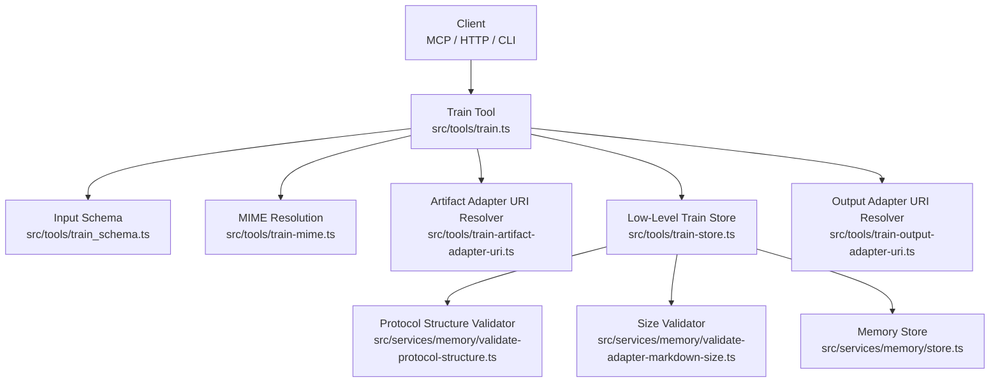
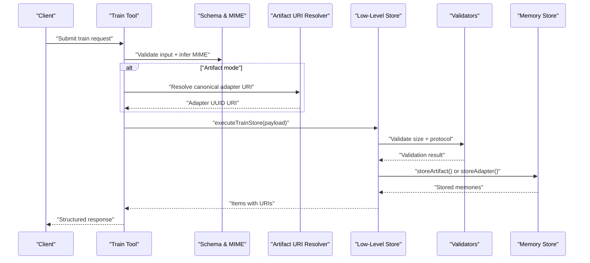
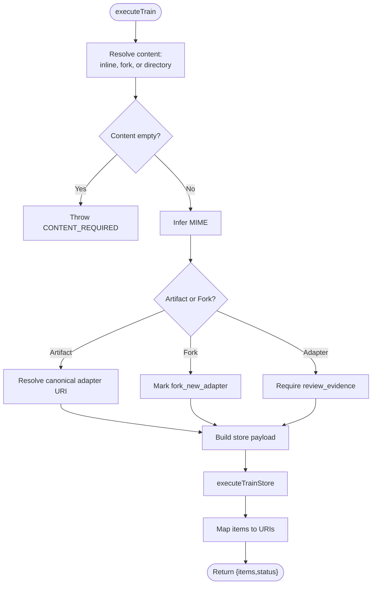
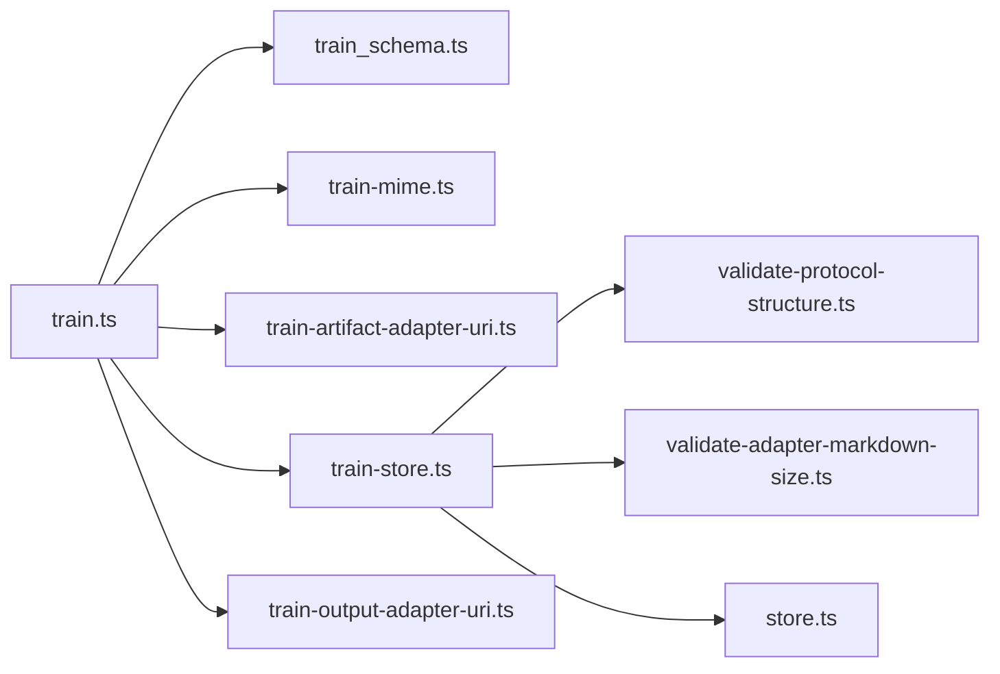

# Train Tool

<cite>
**Referenced Files in This Document**
- [train.ts](file://src/tools/train.ts)
- [train_schema.ts](file://src/tools/train_schema.ts)
- [train-store.ts](file://src/tools/train-store.ts)
- [cli-train.ts](file://src/cli/commands/cli-train.ts)
- [http-api-train-json.ts](file://src/http/http-api-train-json.ts)
- [http-api-train-raw.ts](file://src/http/http-api-train-raw.ts)
- [train-artifact-adapter-uri.ts](file://src/tools/train-artifact-adapter-uri.ts)
- [train-output-adapter-uri.ts](file://src/tools/train-output-adapter-uri.ts)
- [train-mime.ts](file://src/tools/train-mime.ts)
- [store.ts](file://src/services/memory/store.ts)
- [validate-protocol-structure.ts](file://src/services/memory/validate-protocol-structure.ts)
- [validate-adapter-markdown-size.ts](file://src/services/memory/validate-adapter-markdown-size.ts)
</cite>

## Table of Contents
1. [Introduction](#introduction)
2. [Project Structure](#project-structure)
3. [Core Components](#core-components)
4. [Architecture Overview](#architecture-overview)
5. [Detailed Component Analysis](#detailed-component-analysis)
6. [Dependency Analysis](#dependency-analysis)
7. [Performance Considerations](#performance-considerations)
8. [Troubleshooting Guide](#troubleshooting-guide)
9. [Conclusion](#conclusion)
10. [Appendices](#appendices)

## Introduction
The train tool is the central adapter authoring and training entry point for SquadRules. It accepts Markdown adapters, binary/text artifacts, forked adapters from existing storage, and batch directories, validates them against strict schema and protocol rules, stores them into the memory store, and returns stable URIs for layers, artifacts, and attached adapters. It is exposed through:
- MCP tool registration
- HTTP JSON endpoint
- HTTP raw Markdown endpoint
- CLI command

The pipeline enforces review evidence for Markdown adapters, MIME allowlisting for artifacts, size limits, protocol structure validation, space scoping, and versioning metadata. The output includes layer or artifact URIs, labels, tags, content types, and optional batch manifests.

## Project Structure
The train feature spans three layers:
- Transport layer: MCP tool registration, HTTP routes, CLI command
- Orchestration layer: input resolution, MIME inference, artifact URI resolution, fork handling, batch scanning
- Storage layer: low-level store logic, protocol validation, size checks, memory store calls

**Diagram sources**
- [train.ts:137-244](file://src/tools/train.ts#L137-L244)
- [train_schema.ts:54-177](file://src/tools/train_schema.ts#L54-L177)
- [train-mime.ts:4-20](file://src/tools/train-mime.ts#L4-L20)
- [train-artifact-adapter-uri.ts:5-35](file://src/tools/train-artifact-adapter-uri.ts#L5-L35)
- [train-store.ts:47-130](file://src/tools/train-store.ts#L47-L130)
- [validate-protocol-structure.ts:207-297](file://src/services/memory/validate-protocol-structure.ts#L207-L297)
- [validate-adapter-markdown-size.ts:31-124](file://src/services/memory/validate-adapter-markdown-size.ts#L31-L124)
- [store.ts:132-142](file://src/services/memory/store.ts#L132-L142)

**Section sources**
- [train.ts:246-382](file://src/tools/train.ts#L246-L382)
- [cli-train.ts:40-211](file://src/cli/commands/cli-train.ts#L40-L211)
- [http-api-train-json.ts:46-172](file://src/http/http-api-train-json.ts#L46-L172)
- [http-api-train-raw.ts:48-214](file://src/http/http-api-train-raw.ts#L48-L214)

## Core Components
- Train orchestration: resolves content, MIME, artifact adapter URIs, forks, and batch directories; delegates to low-level store; maps stored items to user-facing URIs.
- Input schema: Zod-based validation for all train inputs, including cross-field constraints for artifact mode, relative paths, and review evidence.
- Low-level store: enforces MIME allowlist, artifact size limits, Markdown size limits, protocol structure validation, and persists adapters or artifacts via the memory store.
- Transport bindings:
  - MCP tool registration with loose input parsing, metrics, error formatting, and directory batch support.
  - HTTP JSON route for structured payloads.
  - HTTP raw route for plain Markdown bodies with query/header parameters.
  - CLI command supporting single files, directories, artifact mode, and fork mode.

**Section sources**
- [train.ts:88-244](file://src/tools/train.ts#L88-L244)
- [train_schema.ts:54-199](file://src/tools/train_schema.ts#L54-L199)
- [train-store.ts:31-130](file://src/tools/train-store.ts#L31-L130)
- [cli-train.ts:40-211](file://src/cli/commands/cli-train.ts#L40-L211)
- [http-api-train-json.ts:46-172](file://src/http/http-api-train-json.ts#L46-L172)
- [http-api-train-raw.ts:48-214](file://src/http/http-api-train-raw.ts#L48-L214)

## Architecture Overview
The train pipeline follows a consistent flow across transports:

**Diagram sources**
- [train.ts:137-244](file://src/tools/train.ts#L137-L244)
- [train-schema.ts:54-177](file://src/tools/train_schema.ts#L54-L177)
- [train-artifact-adapter-uri.ts:5-35](file://src/tools/train-artifact-adapter-uri.ts#L5-L35)
- [train-store.ts:47-130](file://src/tools/train-store.ts#L47-L130)
- [validate-protocol-structure.ts:207-297](file://src/services/memory/validate-protocol-structure.ts#L207-L297)
- [validate-adapter-markdown-size.ts:31-124](file://src/services/memory/validate-adapter-markdown-size.ts#L31-L124)
- [store.ts:132-142](file://src/services/memory/store.ts#L132-L142)

## Detailed Component Analysis

### Train Orchestration (`train.ts`)
Responsibilities:
- Resolve content from inline Markdown, source adapter fork export, or directory scan.
- Determine artifact vs adapter mode using MIME inference.
- Enforce review evidence for non-artifact, non-fork Markdown trains.
- Normalize artifact relative paths and resolve canonical adapter URIs when attaching artifacts.
- Build store payload and call `executeTrainStore`.
- Map returned items to stable URIs (layer or artifact), derive adapter URIs, and return structured output.
- Register MCP tool with loose input parsing, metrics, error normalization, and directory batch processing.

Key behaviors:
- Forking requires Qdrant service availability; otherwise it fails with a clear directive.
- Directory batch scans `.md` files, trains each file independently, and aggregates results with per-file status.
- Error payloads are sanitized to safe keys and include actionable guidance.

**Diagram sources**
- [train.ts:88-244](file://src/tools/train.ts#L88-L244)

**Section sources**
- [train.ts:88-244](file://src/tools/train.ts#L88-L244)
- [train.ts:246-382](file://src/tools/train.ts#L246-L382)

### Input Schema and Validation (`train_schema.ts`)
Responsibilities:
- Define `trainInputSchema` with fields for content, model ID, force update, protocol version, space, source adapter URI, MIME, artifact name, adapter URI, relative path, review evidence, and directory batch options.
- Enforce cross-field constraints:
  - Non-Markdown MIME requires artifact name and adapter URI.
  - Inferred artifact mode requires both artifact name and adapter URI.
  - Relative path allowed only for artifact mode and must be skill-root-relative without traversal segments.
  - Review evidence required for Markdown adapter trains, not for artifacts or forks.
- Provide internal `trainStoreInputSchema` used by the low-level store after fork resolution.

Validation highlights:
- Rejects mixed contract fences and unknown artifact extensions without explicit MIME.
- Normalizes and validates relative paths for artifact storage.

**Section sources**
- [train_schema.ts:54-177](file://src/tools/train_schema.ts#L54-L177)
- [train_schema.ts:201-246](file://src/tools/train_schema.ts#L201-L246)

### Low-Level Train Store (`train-store.ts`)
Responsibilities:
- Normalize MIME and determine artifact vs adapter mode.
- For artifacts:
  - Enforce MIME allowlist.
  - Validate artifact content size.
  - Persist via `memoryStore.storeArtifact`.
- For adapters:
  - Remove author slug on fork to avoid collisions.
  - Validate Markdown size limits.
  - Validate protocol structure.
  - Persist via `memoryStore.storeAdapter`.
- Return normalized item records with URIs, labels, tags, and content type.

Error handling:
- Throws `TrainError` with codes such as `UNSUPPORTED_MIME`, `PROTOCOL_STRUCTURE_INVALID`, and size-related errors.

**Section sources**
- [train-store.ts:31-130](file://src/tools/train-store.ts#L31-L130)

### Protocol Structure Validation (`validate-protocol-structure.ts`)
Responsibilities:
- Ensure required Markdown sections: H1 title, Activation Patterns as first H2, Reward Signal as last H2.
- Require at least one JSON contract block and reject mixed fence usage.
- Validate contract types: shell, forward, user_input, comment, subagent.
- Enforce policy rules:
  - Shell contracts require an allowed interpreter.
  - Forward contracts must target another adapter URI.
  - Subagent MCP entries must have valid shape.

Complexity:
- Single-pass heading extraction and section splitting.
- Contract block scanning and per-type policy evaluation.

**Section sources**
- [validate-protocol-structure.ts:207-297](file://src/services/memory/validate-protocol-structure.ts#L207-L297)

### Size Validation (`validate-adapter-markdown-size.ts`)
Responsibilities:
- Enforce maximum total bytes, maximum line length, and maximum line count for Markdown adapters.
- Enforce maximum total bytes for artifact content.
- Return detailed diagnostics including limits and measured values.

**Section sources**
- [validate-adapter-markdown-size.ts:31-124](file://src/services/memory/validate-adapter-markdown-size.ts#L31-L124)

### Artifact and Output URI Helpers
- Artifact adapter URI resolver:
  - Validates adapter URI format.
  - Requires Qdrant service to resolve slug to UUID.
  - Returns canonical adapter URI or throws `TrainError`.
- Output adapter URI resolver:
  - Derives adapter URI from memory slug, item/input adapter URIs, adapter name, or fallback adapter ID.

**Section sources**
- [train-artifact-adapter-uri.ts:5-35](file://src/tools/train-artifact-adapter-uri.ts#L5-L35)
- [train-output-adapter-uri.ts:4-32](file://src/tools/train-output-adapter-uri.ts#L4-L32)

### MIME Resolution (`train-mime.ts`)
Responsibilities:
- Prefer explicit MIME.
- Otherwise infer MIME from artifact name when both artifact name and adapter URI are present.

**Section sources**
- [train-mime.ts:4-20](file://src/tools/train-mime.ts#L4-L20)

### Memory Store Integration (`store.ts`)
Responsibilities:
- Expose `storeAdapter` and `storeArtifact` methods used by the low-level store.
- Manage Qdrant client, collection aliasing, health checks, and backend-owned domain operations.

**Section sources**
- [store.ts:29-62](file://src/services/memory/store.ts#L29-L62)
- [store.ts:132-142](file://src/services/memory/store.ts#L132-L142)

## Dependency Analysis

**Diagram sources**
- [train.ts:137-244](file://src/tools/train.ts#L137-L244)
- [train_schema.ts:54-177](file://src/tools/train_schema.ts#L54-L177)
- [train-mime.ts:4-20](file://src/tools/train-mime.ts#L4-L20)
- [train-artifact-adapter-uri.ts:5-35](file://src/tools/train-artifact-adapter-uri.ts#L5-L35)
- [train-store.ts:47-130](file://src/tools/train-store.ts#L47-L130)
- [validate-protocol-structure.ts:207-297](file://src/services/memory/validate-protocol-structure.ts#L207-L297)
- [validate-adapter-markdown-size.ts:31-124](file://src/services/memory/validate-adapter-markdown-size.ts#L31-L124)
- [store.ts:132-142](file://src/services/memory/store.ts#L132-L142)
- [train-output-adapter-uri.ts:4-32](file://src/tools/train-output-adapter-uri.ts#L4-L32)

**Section sources**
- [train.ts:137-244](file://src/tools/train.ts#L137-L244)
- [train-store.ts:47-130](file://src/tools/train-store.ts#L47-L130)

## Performance Considerations
- Batch directory training processes files sequentially within the transport layer but aggregates results efficiently; consider parallelization at the caller level if needed.
- Size validators use single-pass checks to avoid excessive allocations.
- Protocol structure validation avoids regex-heavy passes by scanning headings and contract blocks once.
- HTTP raw endpoint enforces body size limits to prevent large payloads from consuming resources.
- Metrics instrumentation tracks call counts, durations, input/output sizes, and similar adapter occurrences for observability.

[No sources needed since this section provides general guidance]

## Troubleshooting Guide
Common errors and resolutions:
- Missing content: provide Markdown content, a source adapter URI, or a directory path.
- Invalid source adapter URI: ensure the URI matches the expected adapter slug format and that the Qdrant service is available.
- Unsupported MIME: use an allowed artifact MIME or omit MIME when the artifact name extension is recognized.
- Missing artifact fields: when MIME is non-Markdown or inferred, provide both artifact name and adapter URI.
- Invalid relative path: use forward slashes and no traversal segments; only allowed in artifact mode.
- Missing review evidence: required for Markdown adapter trains; run critic-loop and supply verdict proof.
- Protocol structure invalid: add required sections and a valid JSON contract block; follow guided creation flow.
- Duplicate adapter: use force update or choose a different label.
- Similar memory found: inspect similarity score and existing memory; overwrite only if intended.

Transport-specific notes:
- MCP tool returns structured error objects with sanitized details and next-action guidance.
- HTTP JSON route returns 400 for invalid input, 409 for duplicates/similar memory, and 500 for store failures.
- HTTP raw route also handles 413 for oversized payloads and normalizes error shapes.

**Section sources**
- [train.ts:38-86](file://src/tools/train.ts#L38-L86)
- [train.ts:334-379](file://src/tools/train.ts#L334-L379)
- [http-api-train-json.ts:51-172](file://src/http/http-api-train-json.ts#L51-L172)
- [http-api-train-raw.ts:53-214](file://src/http/http-api-train-raw.ts#L53-L214)

## Conclusion
The train tool provides a robust, validated pipeline for creating and training adapters and artifacts. It enforces schema, MIME allowlists, size limits, and protocol structure rules while exposing consistent interfaces across MCP, HTTP, and CLI. Outputs are stable URIs suitable for downstream activation and search workflows.

[No sources needed since this section summarizes without analyzing specific files]

## Appendices

### API Specifications

#### MCP Tool: train
- Purpose: Register a new adapter from Markdown, attach artifacts, fork existing adapters, or batch train directories.
- Input schema: see `trainInputSchema`.
- Output schema: see `trainOutputSchema`.
- Notes:
  - Loose input parsing is applied before schema validation.
  - Directory mode scans `.md` files and returns a batch manifest.
  - Errors are formatted with sanitized details and next-action guidance.

**Section sources**
- [train.ts:246-382](file://src/tools/train.ts#L246-L382)
- [train_schema.ts:54-199](file://src/tools/train_schema.ts#L54-L199)

#### HTTP JSON Endpoint: POST /api/train
- Purpose: Structured JSON payload for train operations.
- Request body: conforms to `trainInputSchema`.
- Response: structured object with items and status.
- Status codes:
  - 200: success
  - 400: invalid input or validation error
  - 409: duplicate adapter or similar memory found
  - 500: store failure

**Section sources**
- [http-api-train-json.ts:46-172](file://src/http/http-api-train-json.ts#L46-L172)
- [train_schema.ts:54-199](file://src/tools/train_schema.ts#L54-L199)

#### HTTP Raw Endpoint: POST /api/train/raw
- Purpose: Plain Markdown body with query/header parameters for model, force update, protocol version, space, and review evidence.
- Request body: UTF-8 Markdown string.
- Parameters:
  - Query/header: `llm_model_id`, `force`, `protocol_version`, `space`, `review_evidence`
- Response: structured object with items and status.
- Status codes:
  - 200: success
  - 400: invalid input or validation error
  - 413: payload too large
  - 409: duplicate adapter or similar memory found
  - 500: store failure

**Section sources**
- [http-api-train-raw.ts:48-214](file://src/http/http-api-train-raw.ts#L48-L214)

#### CLI Command: train
- Modes:
  - Single Markdown file
  - Artifact mode with adapter, artifact name, MIME, and optional relative path
  - Fork mode from existing adapter
  - Directory batch with recursive option
- Key options:
  - `--model`: LLM model ID
  - `--force`: force update
  - `--recursive`: scan subdirectories
  - `--source-adapter-uri`: fork from existing adapter
  - `--space`: target space
  - `--adapter`: parent adapter URI for artifacts
  - `--artifact-name`: artifact filename override
  - `--mime`: MIME override
  - `--relative-path`: skill-root-relative path for artifacts
  - `--allow-sensitive-upload`: allow sensitive content uploads

**Section sources**
- [cli-train.ts:40-211](file://src/cli/commands/cli-train.ts#L40-L211)

### Practical Examples

- Simple Markdown adapter:
  - Provide Markdown content and model ID.
  - Include review evidence unless running in artifact or fork mode.
  - Use space parameter to target personal or group space.

- Complex artifacts with scripts:
  - Set MIME explicitly or rely on recognized file extension.
  - Provide adapter URI and artifact name.
  - Optionally set relative path for skill export bundles.

- Batch operations:
  - Pass a directory path and optionally enable recursive scanning.
  - Each `.md` file is trained independently; results include per-file status and URIs.

- Error recovery:
  - For duplicate adapters, use force update or change label.
  - For similar memory, inspect similarity score and existing memory before overwriting.
  - For protocol structure errors, follow the guided creation flow suggestion.

[No sources needed since this section provides conceptual examples]

### Authentication, Authorization, Rate Limiting, and Security
- Authentication:
  - JWT tokens validate both human and agent requests.
  - Space context is resolved from request context; default write space can be overridden by the `space` parameter.
- Authorization:
  - Space resolution enforces writable spaces; read-only or missing spaces return explicit errors.
- Rate limiting:
  - MCP tool integrates rate limit error handling; HTTP routes surface appropriate status codes for upstream rate limit responses.
- Security:
  - Artifact MIME is allowlisted.
  - Markdown and artifact content sizes are enforced.
  - Review evidence is required for Markdown adapters to ensure critic-loop approval.

**Section sources**
- [http-api-train-json.ts:68-103](file://src/http/http-api-train-json.ts#L68-L103)
- [http-api-train-raw.ts:116-149](file://src/http/http-api-train-raw.ts#L116-L149)
- [train.ts:376-378](file://src/tools/train.ts#L376-L378)
- [train-store.ts:64-73](file://src/tools/train-store.ts#L64-L73)
- [validate-adapter-markdown-size.ts:31-124](file://src/services/memory/validate-adapter-markdown-size.ts#L31-L124)