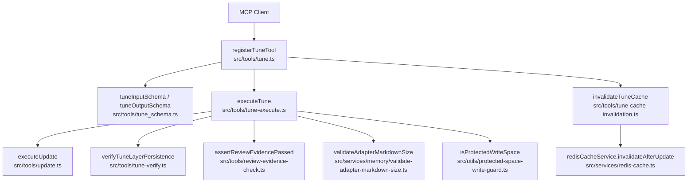
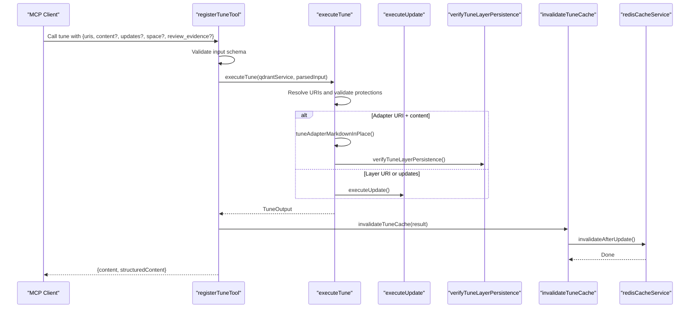
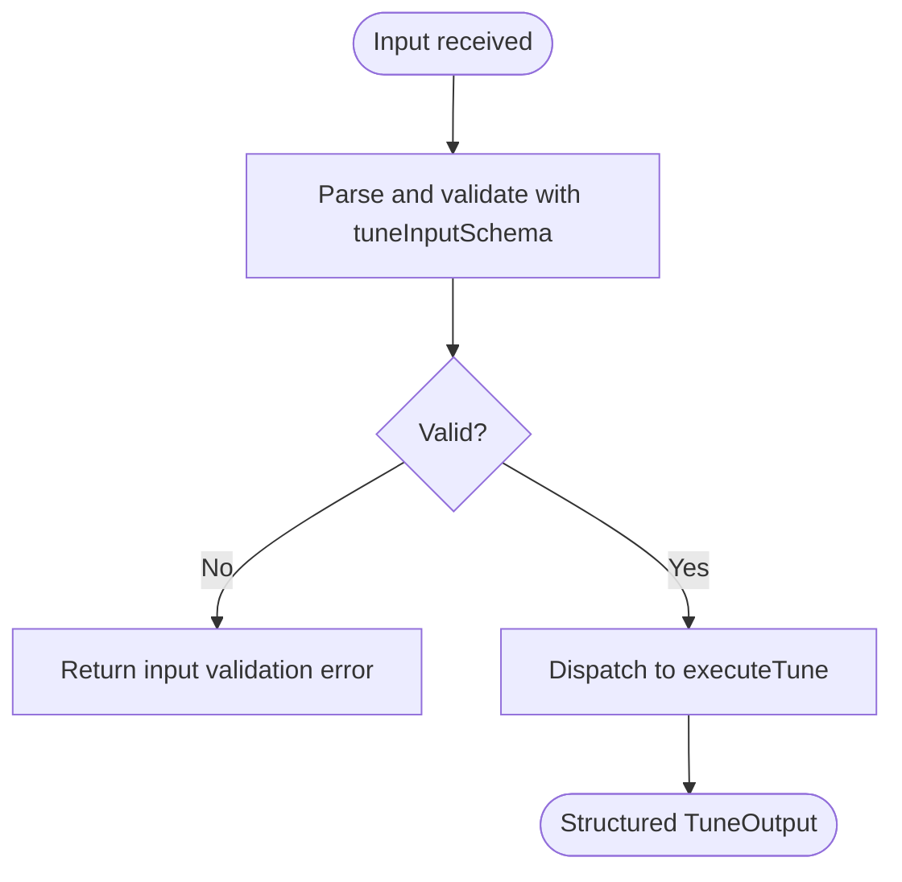
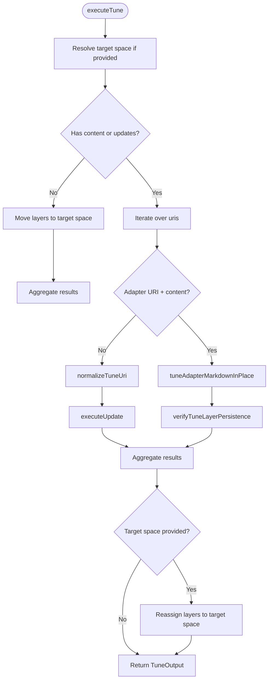
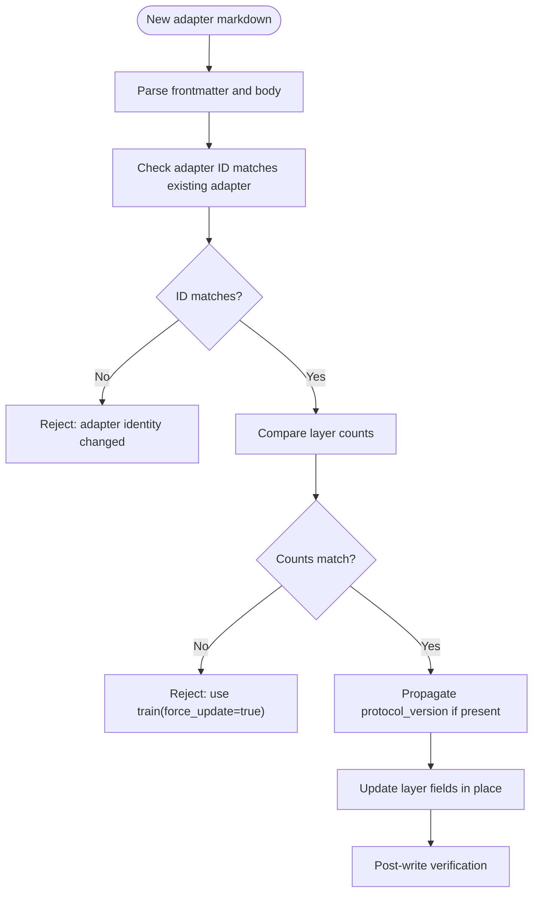
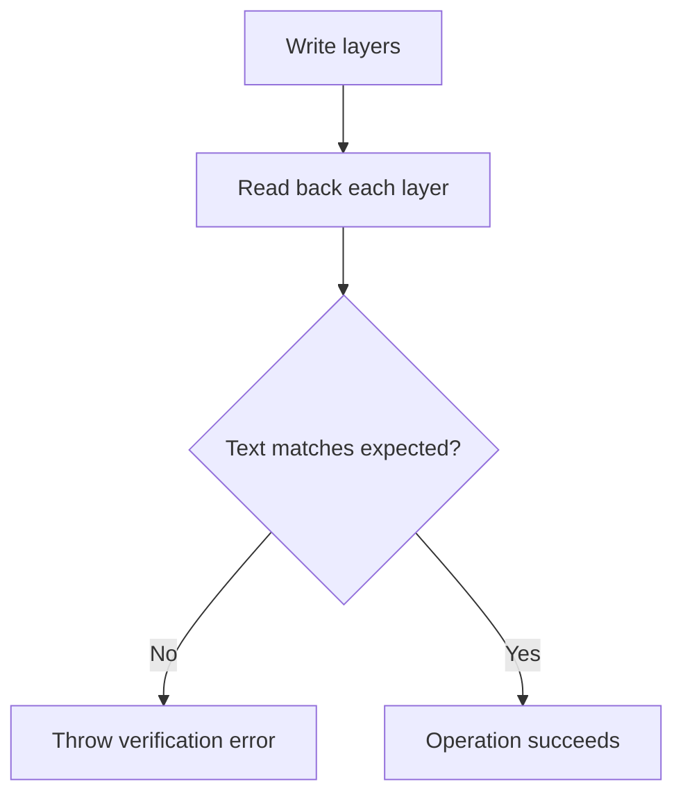
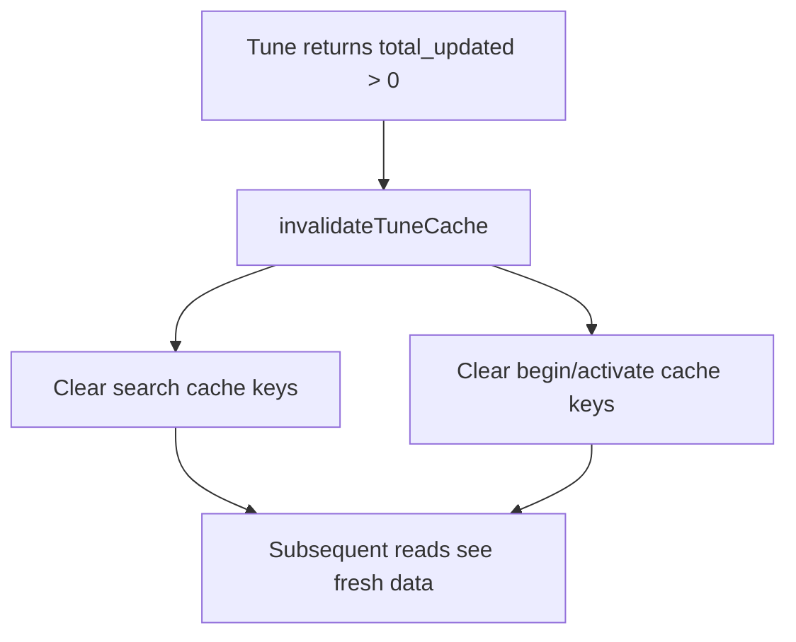
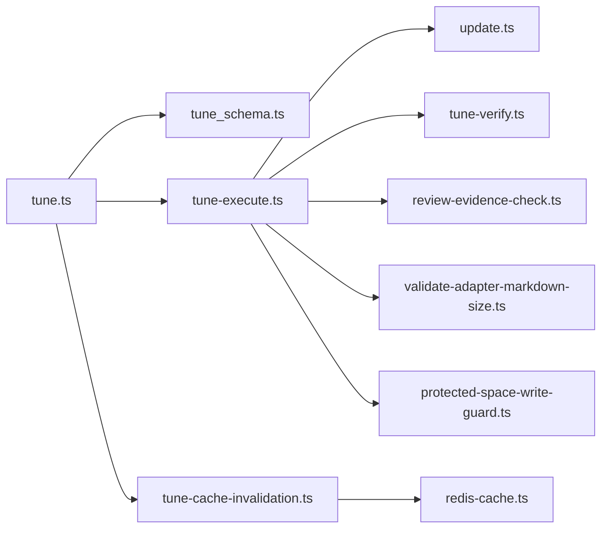

# Tune Tool

<cite>
**Referenced Files in This Document**
- [tune.ts](file://src/tools/tune.ts)
- [tune_schema.ts](file://src/tools/tune_schema.ts)
- [tune-execute.ts](file://src/tools/tune-execute.ts)
- [tune-messages.ts](file://src/tools/tune-messages.ts)
- [tune-verify.ts](file://src/tools/tune-verify.ts)
- [tune-cache-invalidation.ts](file://src/tools/tune-cache-invalidation.ts)
- [update.ts](file://src/tools/update.ts)
- [review-evidence-check.ts](file://src/tools/review-evidence-check.ts)
- [protected-space-write-guard.ts](file://src/utils/protected-space-write-guard.ts)
- [validate-adapter-markdown-size.ts](file://src/services/memory/validate-adapter-markdown-size.ts)
- [redis-cache.ts](file://src/services/redis-cache.ts)
- [tune.md](file://src/embed-docs/tools/tune.md)
</cite>

## Table of Contents
1. [Introduction](#introduction)
2. [Project Structure](#project-structure)
3. [Core Components](#core-components)
4. [Architecture Overview](#architecture-overview)
5. [Detailed Component Analysis](#detailed-component-analysis)
6. [Dependency Analysis](#dependency-analysis)
7. [Performance Considerations](#performance-considerations)
8. [Troubleshooting Guide](#troubleshooting-guide)
9. [Conclusion](#conclusion)

## Introduction
The tune tool updates existing adapter content and metadata without replacing the adapter identity. It is designed for safe, incremental edits to stored adapter layers, with strong validation, critic-loop review gating, protected-space guards, cache invalidation, and post-write verification.

Key responsibilities:
- Accept adapter or layer URIs and update their content or fields.
- Normalize adapter URIs to the correct head layer set.
- Enforce size limits, markdown structure rules, and review evidence.
- Optionally move all layers of an adapter into a target space.
- Invalidate caches so subsequent reads see fresh data.
- Return structured per-URI results with totals.

This tool is part of the SquadRules MCP toolchain, where agents primarily drive configuration through tools such as activate, forward, train, reward, and tune.

## Project Structure
The tune feature is implemented as a registered MCP tool that delegates to a focused execution pipeline:

**Diagram sources**
- [tune.ts:19-69](file://src/tools/tune.ts#L19-L69)
- [tune_schema.ts:14-67](file://src/tools/tune_schema.ts#L14-L67)
- [tune-execute.ts:116-349](file://src/tools/tune-execute.ts#L116-L349)
- [update.ts:8-72](file://src/tools/update.ts#L8-L72)
- [tune-verify.ts:11-24](file://src/tools/tune-verify.ts#L11-L24)
- [review-evidence-check.ts:20-43](file://src/tools/review-evidence-check.ts#L20-L43)
- [validate-adapter-markdown-size.ts:31-106](file://src/services/memory/validate-adapter-markdown-size.ts#L31-L106)
- [protected-space-write-guard.ts:5-16](file://src/utils/protected-space-write-guard.ts#L5-L16)
- [tune-cache-invalidation.ts:9-12](file://src/tools/tune-cache-invalidation.ts#L9-L12)
- [redis-cache.ts:245-252](file://src/services/redis-cache.ts#L245-L252)

**Section sources**
- [tune.ts:19-69](file://src/tools/tune.ts#L19-L69)
- [tune.md:1-24](file://src/embed-docs/tools/tune.md#L1-L24)

## Core Components
- Tool registration and input/output schema enforcement live in `tune.ts` and `tune_schema.ts`.
- The tuning execution engine lives in `tune-execute.ts`, orchestrating normalization, validation, persistence, optional space moves, and result aggregation.
- Message formatting and URI rewriting are handled by `tune-messages.ts`.
- Post-write persistence verification is implemented in `tune-verify.ts`.
- Cache invalidation after successful writes is implemented in `tune-cache-invalidation.ts`, backed by `redis-cache.ts`.
- Shared update logic for layer URIs is reused via `update.ts`.
- Review evidence validation is centralized in `review-evidence-check.ts`.
- Markdown safety checks are centralized in `validate-adapter-markdown-size.ts`.
- Protected-space write protection is centralized in `protected-space-write-guard.ts`.

**Section sources**
- [tune.ts:19-69](file://src/tools/tune.ts#L19-L69)
- [tune_schema.ts:14-67](file://src/tools/tune_schema.ts#L14-L67)
- [tune-execute.ts:116-349](file://src/tools/tune-execute.ts#L116-L349)
- [tune-messages.ts:7-22](file://src/tools/tune-messages.ts#L7-L22)
- [tune-verify.ts:11-24](file://src/tools/tune-verify.ts#L11-L24)
- [tune-cache-invalidation.ts:9-12](file://src/tools/tune-cache-invalidation.ts#L9-L12)
- [update.ts:8-72](file://src/tools/update.ts#L8-L72)
- [review-evidence-check.ts:20-43](file://src/tools/review-evidence-check.ts#L20-L43)
- [validate-adapter-markdown-size.ts:31-106](file://src/services/memory/validate-adapter-markdown-size.ts#L31-L106)
- [protected-space-write-guard.ts:5-16](file://src/utils/protected-space-write-guard.ts#L5-L16)

## Architecture Overview
The tune tool follows a layered request flow:

1. **Registration and validation**: The MCP server registers the `tune` tool with loose input wrapping around a strict Zod schema. Input is validated before execution.
2. **Execution orchestration**: `executeTune` resolves URIs, validates review evidence, enforces size limits, performs in-place adapter edits or field updates, optionally reassigns spaces, and aggregates results.
3. **Persistence and verification**: Layer updates go through Qdrant-backed memory operations; in-place adapter edits perform a post-write verification pass to detect stale-cache or no-op scenarios.
4. **Cache invalidation**: On successful updates, search and begin/activate caches are invalidated so downstream consumers see fresh data.

**Diagram sources**
- [tune.ts:30-66](file://src/tools/tune.ts#L30-L66)
- [tune-execute.ts:127-217](file://src/tools/tune-execute.ts#L127-L217)
- [tune-execute.ts:277-349](file://src/tools/tune-execute.ts#L277-L349)
- [update.ts:8-72](file://src/tools/update.ts#L8-L72)
- [tune-verify.ts:11-24](file://src/tools/tune-verify.ts#L11-L24)
- [tune-cache-invalidation.ts:9-12](file://src/tools/tune-cache-invalidation.ts#L9-L12)
- [redis-cache.ts:245-252](file://src/services/redis-cache.ts#L245-L252)

## Detailed Component Analysis

### Tune Tool Registration and Schema
The tool is registered under the name `tune` and exposes:
- A title and description resolved from embedded documentation.
- Loose input wrapping around a strict schema.
- Structured output schema describing per-URI results and totals.

Validation rules include:
- `uris` must be non-empty and contain valid adapter or layer URIs.
- `content` must match the length of `uris` when provided.
- At least one of `content`, `updates`, or `space` must be present.
- When `content` includes non-empty strings, `review_evidence` is required.

Output schema:
- `results`: array of `{uri, status, message}`.
- `total_updated`: number of successfully updated targets.
- `total_failed`: number of failed targets.

**Diagram sources**
- [tune.ts:22-41](file://src/tools/tune.ts#L22-L41)
- [tune_schema.ts:14-67](file://src/tools/tune_schema.ts#L14-L67)

**Section sources**
- [tune.ts:19-69](file://src/tools/tune.ts#L19-L69)
- [tune_schema.ts:14-67](file://src/tools/tune_schema.ts#L14-L67)

### Tuning Execution Engine
`executeTune` is the central workflow:

- Space resolution: If `space` is provided, it is resolved to a concrete space ID and checked against allowed spaces.
- Payload detection: Determines whether the call contains content, updates, or only a space move.
- Space-only mode: Moves all layers of each targeted adapter to the target space and returns per-URI results.
- Content or updates mode:
  - For adapter URIs with content, performs in-place editing while preserving adapter identity and layer count.
  - For layer URIs or updates, delegates to `executeUpdate`.
- Optional space reassignment: After successful content/updates, reassigns all layers to the target space if requested.
- Aggregation: Returns per-URI results with normalized layer URIs and human-readable messages.

**Diagram sources**
- [tune-execute.ts:219-349](file://src/tools/tune-execute.ts#L219-L349)

**Section sources**
- [tune-execute.ts:116-349](file://src/tools/tune-execute.ts#L116-L349)

### Change Detection and Version Management
The tune tool does not implement a generic diff algorithm. Instead, it uses structural and semantic change detection:

- Adapter identity preservation: When tuning by adapter URI, the H1-derived adapter ID must remain unchanged.
- Layer count stability: The number of layers parsed from the new markdown must match the existing layer count; otherwise, the operation requires `train(force_update=true)`.
- Protocol version propagation: If the frontmatter contains a `version`, it is propagated to `adapter.protocol_version` across all layers.
- Field-level updates: For layer URIs, `executeUpdate` applies either body text or arbitrary field updates.

Version management implications:
- There is no explicit version history table; versioning is represented by `adapter.protocol_version` and layer indices.
- Structural changes (H1 rename, layer count change) are intentionally rejected by tune and routed to `train`.

**Diagram sources**
- [tune-execute.ts:127-217](file://src/tools/tune-execute.ts#L127-L217)

**Section sources**
- [tune-execute.ts:127-217](file://src/tools/tune-execute.ts#L127-L217)

### Message Processing Pipeline
Result messages are normalized to improve readability and consistency:
- Generic references to “memory” are rewritten to “adapter layer”.
- Internal layer URIs in messages are replaced with canonical layer URIs returned by the operation.

This ensures callers receive stable, user-friendly messages even when underlying storage URIs differ.

**Section sources**
- [tune-messages.ts:7-22](file://src/tools/tune-messages.ts#L7-L22)

### Verification Mechanisms
Two verification mechanisms protect correctness:

1. **Post-write persistence verification**: After in-place adapter edits, the system re-reads each updated layer and compares its text with expected values. This catches silent no-ops caused by stale caches or backend issues.
2. **Protected-space guard**: Writes to protected app/system spaces are rejected, forcing forks into personal or group spaces.

**Diagram sources**
- [tune-verify.ts:11-24](file://src/tools/tune-verify.ts#L11-L24)

**Section sources**
- [tune-verify.ts:11-24](file://src/tools/tune-verify.ts#L11-L24)
- [protected-space-write-guard.ts:5-16](file://src/utils/protected-space-write-guard.ts#L5-L16)

### Cache Invalidation Strategies
After successful tune updates:
- `invalidateTuneCache` calls `redisCacheService.invalidateAfterUpdate`.
- This clears search caches and begin/activate caches.
- Memory resource caching has bounded TTLs to reduce staleness risk if invalidation fails.

**Diagram sources**
- [tune-cache-invalidation.ts:9-12](file://src/tools/tune-cache-invalidation.ts#L9-L12)
- [redis-cache.ts:81-105](file://src/services/redis-cache.ts#L81-L105)
- [redis-cache.ts:215-252](file://src/services/redis-cache.ts#L215-L252)

**Section sources**
- [tune-cache-invalidation.ts:9-12](file://src/tools/tune-cache-invalidation.ts#L9-L12)
- [redis-cache.ts:245-252](file://src/services/redis-cache.ts#L245-L252)

### Authentication and Authorization
Authentication and authorization are enforced at the MCP server level:
- Tenant context is extracted during tool execution.
- Space authorization is validated when moving adapters to a target space.
- Protected spaces cannot be overwritten directly; users must fork into allowed spaces.

Operational guidance:
- Ensure the caller’s tenant and space permissions allow writing to the target space.
- Use personal or group spaces for editable adapters.
- System and application spaces are protected from direct overwrite.

**Section sources**
- [tune.ts:31-33](file://src/tools/tune.ts#L31-L33)
- [tune-execute.ts:219-232](file://src/tools/tune-execute.ts#L219-L232)
- [protected-space-write-guard.ts:5-16](file://src/utils/protected-space-write-guard.ts#L5-L16)

## Dependency Analysis
The tune module depends on several cross-cutting services:

**Diagram sources**
- [tune.ts:1-12](file://src/tools/tune.ts#L1-L12)
- [tune-execute.ts:1-15](file://src/tools/tune-execute.ts#L1-L15)
- [tune-cache-invalidation.ts:1-12](file://src/tools/tune-cache-invalidation.ts#L1-L12)

**Section sources**
- [tune.ts:1-12](file://src/tools/tune.ts#L1-L12)
- [tune-execute.ts:1-15](file://src/tools/tune-execute.ts#L1-L15)
- [tune-cache-invalidation.ts:1-12](file://src/tools/tune-cache-invalidation.ts#L1-L12)

## Performance Considerations
- Single-pass markdown validation avoids expensive parsing until necessary.
- In-place adapter edits preserve layer identities and avoid full replacement, reducing vector store churn.
- Cache invalidation is broad but bounded by Redis key patterns and TTLs, minimizing read amplification after frequent updates.
- Space-only moves bypass content parsing and update logic, optimizing bulk relocation workflows.

Recommendations:
- Prefer layer URIs for targeted edits to minimize affected rows.
- Batch multiple URIs in a single tune call to reduce round-trips.
- Avoid changing H1 titles or layer counts in tune; use `train(force_update=true)` for structural changes.
- Monitor cache hit/miss metrics to assess the impact of frequent updates.

[No sources needed since this section provides general guidance]

## Troubleshooting Guide

Common issues and resolutions:

- Missing or invalid review evidence:
  - Symptom: Validation error requiring `review_evidence`.
  - Cause: Content updates require critic-loop proof.
  - Resolution: Run critic-loop via a subagent, then provide `verdict_file`, `exit_code: 0`, and stdout starting with PASS.

- Adapter identity mismatch:
  - Symptom: Error indicating adapter title resolves to a different ID.
  - Cause: H1 was changed when tuning by adapter URI.
  - Resolution: Keep the H1 unchanged; use `train(force_update=true)` to replace the adapter.

- Layer count mismatch:
  - Symptom: Error stating layer count differs between existing and new markdown.
  - Cause: Structural change attempted via tune.
  - Resolution: Use `train(force_update=true)` for adding/removing layers.

- Protected space write attempt:
  - Symptom: Error indicating protected app/system space.
  - Cause: Target adapter resides in a protected space.
  - Resolution: Fork the adapter into a personal or group space before tuning.

- Stale cache after update:
  - Symptom: Subsequent reads return old content despite successful tune.
  - Cause: Cache invalidation did not propagate.
  - Resolution: Retry the read; ensure Redis is configured and healthy. Tune automatically invalidates search and begin/activate caches after successful updates.

- Space move failure:
  - Symptom: Result indicates content updated but space reassignment failed.
  - Cause: Permission or space resolution issue during reassignment.
  - Resolution: Confirm the caller has access to the target space and retry.

**Section sources**
- [review-evidence-check.ts:20-43](file://src/tools/review-evidence-check.ts#L20-L43)
- [tune-execute.ts:156-171](file://src/tools/tune-execute.ts#L156-L171)
- [protected-space-write-guard.ts:5-16](file://src/utils/protected-space-write-guard.ts#L5-L16)
- [tune-cache-invalidation.ts:9-12](file://src/tools/tune-cache-invalidation.ts#L9-L12)
- [redis-cache.ts:245-252](file://src/services/redis-cache.ts#L245-L252)

## Conclusion
The tune tool provides a safe, validated pathway for updating adapter content and metadata. It emphasizes:
- Identity-preserving in-place edits.
- Strong review gating for content changes.
- Protection of system and application spaces.
- Post-write verification to catch stale-cache or no-op failures.
- Broad cache invalidation to keep downstream reads consistent.

For structural changes, prefer `train(force_update=true)`. For routine edits, tune offers a deterministic, auditable workflow aligned with the agent-first design of SquadRules.

[No sources needed since this section summarizes without analyzing specific files]