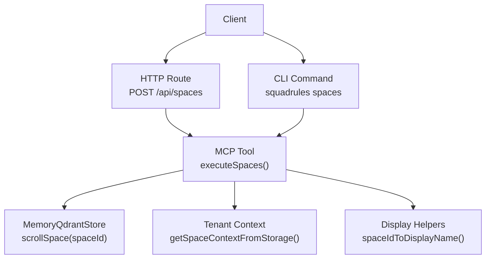
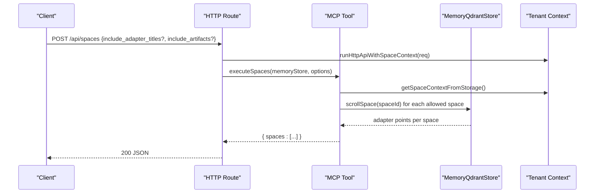
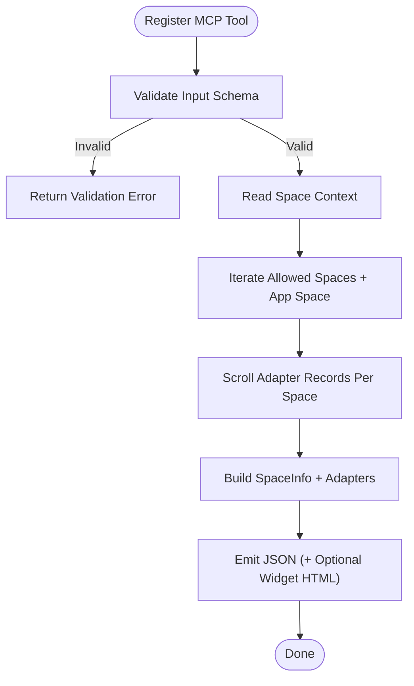
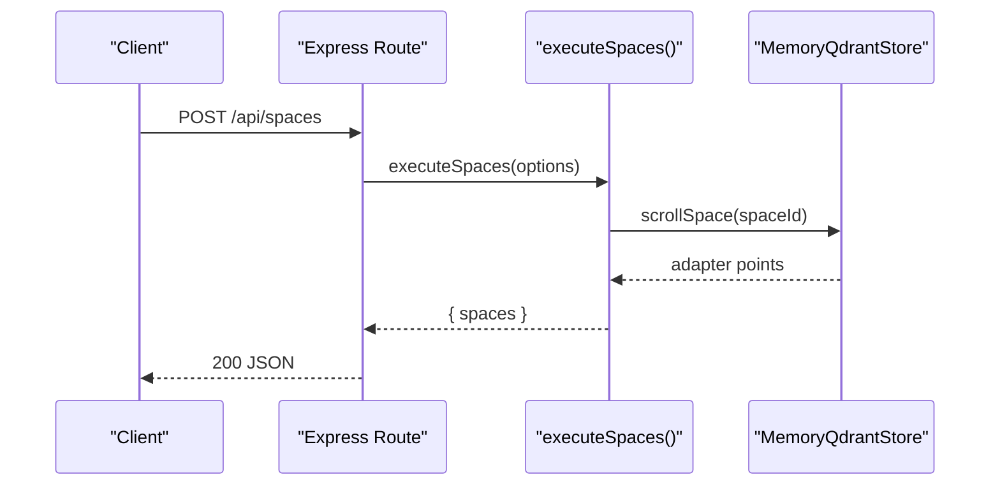
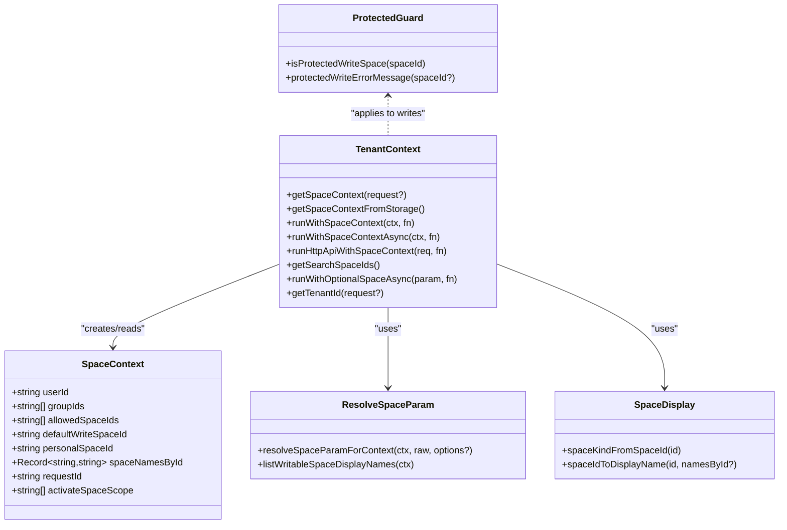
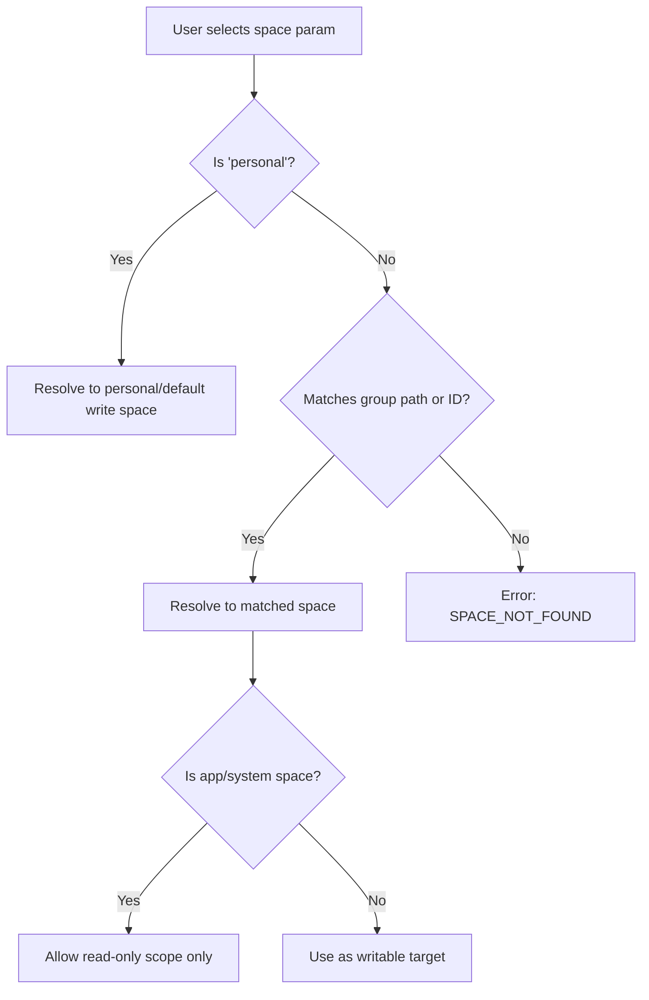
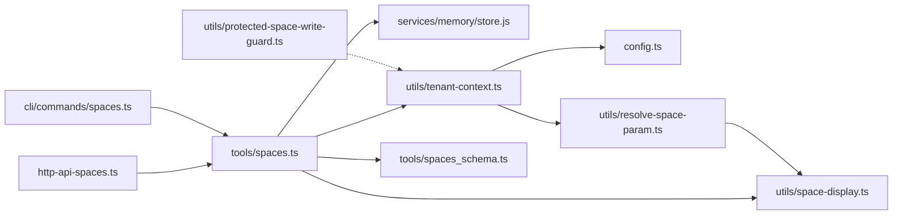

# System Tools (Spaces)

<cite>
**Referenced Files in This Document**   
- [spaces.ts](file://src/tools/spaces.ts)
- [spaces_schema.ts](file://src/tools/spaces_schema.ts)
- [http-api-spaces.ts](file://src/http/http-api-spaces.ts)
- [spaces.ts](file://src/cli/commands/spaces.ts)
- [tenant-context.ts](file://src/utils/tenant-context.ts)
- [space-display.ts](file://src/utils/space-display.ts)
- [resolve-space-param.ts](file://src/utils/resolve-space-param.ts)
- [protected-space-write-guard.ts](file://src/utils/protected-space-write-guard.ts)
- [config.ts](file://src/config.ts)
</cite>

## Table of Contents
1. [Introduction](#introduction)
2. [Project Structure](#project-structure)
3. [Core Components](#core-components)
4. [Architecture Overview](#architecture-overview)
5. [Detailed Component Analysis](#detailed-component-analysis)
6. [Dependency Analysis](#dependency-analysis)
7. [Performance Considerations](#performance-considerations)
8. [Troubleshooting Guide](#troubleshooting-guide)
9. [Conclusion](#conclusion)

## Introduction
This document explains the Spaces tool and its surrounding multi-tenant isolation model in SquadRules. It covers how spaces represent tenant-scoped workspaces, how access is derived from authentication, how resources are scoped to spaces, and how the Spaces tool lists available spaces and their adapters. It also documents API contracts, permission models, security boundaries, and operational guidance for large hierarchies and concurrent access.

Key concepts:
- A space is a tenant-scoped workspace identified by a canonical `space_id`.
- The current request’s allowed spaces and default write space come from authentication context or a safe default when authentication is disabled.
- The Spaces tool reads adapter metadata per space and returns structured results suitable for agents and UIs.
- Writes are restricted to writable spaces; system and app spaces are protected.

## Project Structure
The Spaces feature spans three layers:
- HTTP API route that exposes `/api/spaces`
- MCP tool implementation that lists spaces and adapters
- CLI command that calls the backend through a configured transport

**Diagram sources**
- [http-api-spaces.ts:11-31](file://src/http/http-api-spaces.ts#L11-L31)
- [spaces.ts:172-189](file://src/tools/spaces.ts#L172-L189)
- [spaces.ts:195-254](file://src/tools/spaces.ts#L195-L254)
- [spaces.ts:65-166](file://src/tools/spaces.ts#L65-L166)
- [tenant-context.ts:120-124](file://src/utils/tenant-context.ts#L120-L124)
- [space-display.ts:24-37](file://src/utils/space-display.ts#L24-L37)

**Section sources**
- [http-api-spaces.ts:11-31](file://src/http/http-api-spaces.ts#L11-L31)
- [spaces.ts:172-189](file://src/tools/spaces.ts#L172-L189)
- [spaces.ts:195-254](file://src/tools/spaces.ts#L195-L254)
- [spaces.ts:65-166](file://src/tools/spaces.ts#L65-L166)
- [tenant-context.ts:120-124](file://src/utils/tenant-context.ts#L120-L124)
- [space-display.ts:24-37](file://src/utils/space-display.ts#L24-L37)

## Core Components
- Spaces MCP tool: Lists spaces with adapter counts, optional adapter titles, and optional artifact metadata.
- HTTP endpoint: Wraps the tool with request context propagation and error handling.
- CLI command: Provides a user-facing interface to list spaces via the backend.
- Tenant context: Derives allowed spaces, default write space, personal space, and display names from authentication or defaults.
- Space helpers: Human-readable labels, kind classification, and parameter resolution for human-friendly inputs.
- Protected write guard: Prevents writes into system/app spaces.

Responsibilities:
- `executeSpaces()` computes per-space adapter summaries using the current request’s allowed spaces.
- `registerSpacesTool()` registers the MCP tool schema, validation, metrics, and optional HTML widget output.
- `setupSpacesRoute()` sets up the REST endpoint and ensures async context propagation.
- `spacesCommand()` wires the CLI options to the backend call and formats output.
- `getSpaceContextFromStorage()` provides the active space context across async boundaries.
- `spaceIdToDisplayName()` and `spaceKindFromSpaceId()` map IDs to readable labels and types.
- `resolveSpaceParamForContext()` resolves human-friendly space names to canonical IDs.
- `isProtectedWriteSpace()` blocks writes to protected spaces.

**Section sources**
- [spaces.ts:172-189](file://src/tools/spaces.ts#L172-L189)
- [spaces.ts:195-254](file://src/tools/spaces.ts#L195-L254)
- [http-api-spaces.ts:11-31](file://src/http/http-api-spaces.ts#L11-L31)
- [spaces.ts:12-35](file://src/cli/commands/spaces.ts#L12-L35)
- [tenant-context.ts:120-124](file://src/utils/tenant-context.ts#L120-L124)
- [space-display.ts:14-37](file://src/utils/space-display.ts#L14-L37)
- [resolve-space-param.ts:26-103](file://src/utils/resolve-space-param.ts#L26-L103)
- [protected-space-write-guard.ts:5-16](file://src/utils/protected-space-write-guard.ts#L5-L16)

## Architecture Overview
The Spaces feature enforces tenant isolation through an authenticated context that determines which spaces are visible and writable. The tool itself is read-only and reports adapter metadata per space.

**Diagram sources**
- [http-api-spaces.ts:11-31](file://src/http/http-api-spaces.ts#L11-L31)
- [spaces.ts:172-189](file://src/tools/spaces.ts#L172-L189)
- [tenant-context.ts:298-303](file://src/utils/tenant-context.ts#L298-L303)

## Detailed Component Analysis

### Spaces MCP Tool
The MCP tool:
- Validates input against a strict schema.
- Reads the current space context.
- Iterates over allowed spaces plus the Squadrules app space.
- Scans adapter records per space and aggregates counts and optional details.
- Emits structured JSON and optionally an HTML widget.

Input schema fields:
- `include_adapter_titles`: boolean, default false
- `include_widget_html`: boolean, default false
- `include_artifacts`: boolean, default false

Output schema:
- `spaces`: array of space objects with `name`, `space_id`, `type`, `adapter_count`, and optional `adapters[]`

Adapter object fields (when included):
- `adapter_id`, `title`, `layer_count`, `slug`, `uri`, optional `artifacts[]`

Artifact object fields:
- `name`, `slug`, `uri`, `uuid_uri`, `content_type`, `sha256`, `relative_path`

Error behavior:
- Input validation errors return a standardized MCP error result.
- Unexpected errors return an internal error payload and mark the response as an error.

**Diagram sources**
- [spaces.ts:195-254](file://src/tools/spaces.ts#L195-L254)
- [spaces.ts:172-189](file://src/tools/spaces.ts#L172-L189)
- [spaces.ts:65-166](file://src/tools/spaces.ts#L65-L166)

**Section sources**
- [spaces.ts:172-189](file://src/tools/spaces.ts#L172-L189)
- [spaces.ts:195-254](file://src/tools/spaces.ts#L195-L254)
- [spaces_schema.ts:3-52](file://src/tools/spaces_schema.ts#L3-L52)

### HTTP API Endpoint
The endpoint:
- Accepts `include_adapter_titles` and `include_artifacts` in the request body.
- Propagates the request’s space context across async handlers.
- Calls the tool and returns JSON.
- Returns a 500 error with a stable code on failures.

Request/response:
- Method: `POST`
- Path: `/api/spaces`
- Request body: `{ include_adapter_titles?: boolean; include_artifacts?: boolean }`
- Response: `{ spaces: [...] }`
- Errors: `{ error: "SPACES_FAILED", message: string }` with status 500

**Diagram sources**
- [http-api-spaces.ts:11-31](file://src/http/http-api-spaces.ts#L11-L31)
- [spaces.ts:172-189](file://src/tools/spaces.ts#L172-L189)

**Section sources**
- [http-api-spaces.ts:11-31](file://src/http/http-api-spaces.ts#L11-L31)

### CLI Command
The CLI command:
- Adds a `spaces` subcommand.
- Supports `--include-adapter-titles`.
- Calls the backend’s `spaces` method and emits formatted output.

Usage:
- `squadrules spaces --include-adapter-titles`

**Section sources**
- [spaces.ts:12-35](file://src/cli/commands/spaces.ts#L12-L35)

### Tenant Isolation and Access Control
Space identity and scope:
- Personal spaces: `user:{realm}:{uuid}`
- Group spaces: `group:{realm}:{uuid}`
- App/system spaces: `space:squadrules-app`, `space:system`, `space:squadrules-system`

Access derivation:
- When authentication is enabled, allowed spaces are derived from JWT claims (`sub`, `groups`, `realm`, `iss`).
- When authentication is disabled, a default single-tenant context is used.
- The default write space is typically the personal space.
- The Squadrules app space is included for read-only discovery and search scoping.

Security boundaries:
- Writes to protected spaces are blocked.
- Unauthenticated requests under AUTH_ENABLED use a sentinel space to avoid sharing data.

**Diagram sources**
- [tenant-context.ts:23-42](file://src/utils/tenant-context.ts#L23-L42)
- [tenant-context.ts:120-124](file://src/utils/tenant-context.ts#L120-L124)
- [tenant-context.ts:141-149](file://src/utils/tenant-context.ts#L141-L149)
- [tenant-context.ts:156-179](file://src/utils/tenant-context.ts#L156-L179)
- [tenant-context.ts:256-303](file://src/utils/tenant-context.ts#L256-L303)
- [space-display.ts:14-37](file://src/utils/space-display.ts#L14-L37)
- [resolve-space-param.ts:26-103](file://src/utils/resolve-space-param.ts#L26-L103)
- [protected-space-write-guard.ts:5-16](file://src/utils/protected-space-write-guard.ts#L5-L16)

**Section sources**
- [tenant-context.ts:23-42](file://src/utils/tenant-context.ts#L23-L42)
- [tenant-context.ts:120-124](file://src/utils/tenant-context.ts#L120-L124)
- [tenant-context.ts:141-149](file://src/utils/tenant-context.ts#L141-L149)
- [tenant-context.ts:156-179](file://src/utils/tenant-context.ts#L156-L179)
- [tenant-context.ts:256-303](file://src/utils/tenant-context.ts#L256-L303)
- [space-display.ts:14-37](file://src/utils/space-display.ts#L14-L37)
- [resolve-space-param.ts:26-103](file://src/utils/resolve-space-param.ts#L26-L103)
- [protected-space-write-guard.ts:5-16](file://src/utils/protected-space-write-guard.ts#L5-L16)

### Space Hierarchy and Inheritance
- Spaces are not hierarchical in storage; hierarchy is represented by group paths in the token.
- The system treats personal, group, app, and other spaces distinctly.
- Group membership maps to multiple group spaces; all are included in `allowedSpaceIds`.
- The Squadrules app space is always considered for read-only discovery and search scoping unless explicitly narrowed.

Inheritance patterns:
- There is no explicit inheritance of adapters between spaces.
- Sharing is achieved by placing adapters in shared group spaces and referencing them by URI.
- The app space is read-only for users; it cannot be written to.

**Section sources**
- [space-display.ts:14-37](file://src/utils/space-display.ts#L14-L37)
- [tenant-context.ts:217-248](file://src/utils/tenant-context.ts#L217-L248)
- [resolve-space-param.ts:56-67](file://src/utils/resolve-space-param.ts#L56-L67)

### Cross-Space Operations
- Listing spaces includes the app space for visibility even if the user does not own it.
- Search can be narrowed to a specific allowed space using optional parameters; this narrows both query and write targets appropriately.
- Writes remain scoped to the default write space unless explicitly resolved to another writable space.

**Diagram sources**
- [resolve-space-param.ts:26-103](file://src/utils/resolve-space-param.ts#L26-L103)
- [tenant-context.ts:156-179](file://src/utils/tenant-context.ts#L156-L179)

**Section sources**
- [resolve-space-param.ts:26-103](file://src/utils/resolve-space-param.ts#L26-L103)
- [tenant-context.ts:156-179](file://src/utils/tenant-context.ts#L156-L179)

### Authentication and Authorization
Authentication:
- OIDC/JWT via Keycloak.
- Token claims (`sub`, `groups`, `realm`, `iss`) determine space membership.
- When AUTH is enabled but no auth context exists, a sentinel space prevents accidental data sharing.

Authorization:
- Allowed spaces are derived from groups and personal identity.
- Default write space is personal unless overridden by narrow scoping.
- Protected spaces block writes.

Scopes:
- The Spaces tool requires at least read access to allowed spaces.
- Writable operations require write access to the target space.

**Section sources**
- [tenant-context.ts:256-303](file://src/utils/tenant-context.ts#L256-L303)
- [protected-space-write-guard.ts:5-16](file://src/utils/protected-space-write-guard.ts#L5-L16)
- [config.ts:163-195](file://src/config.ts#L163-L195)

### Audit Logging and Compliance
Audit logging configuration:
- `AUDIT_LOG_FILE` controls the audit log destination.
- `AUDIT_LOG_LEVEL` controls verbosity (metadata, args, response).

Compliance notes:
- Spaces enforce tenant isolation based on authentication.
- Protected spaces prevent accidental modification of system resources.
- Metrics capture tool usage and errors per tenant.

**Section sources**
- [config.ts:99-105](file://src/config.ts#L99-L105)
- [spaces.ts:208-218](file://src/tools/spaces.ts#L208-L218)
- [spaces.ts:242-250](file://src/tools/spaces.ts#L242-L250)

## Dependency Analysis
The following diagram shows key dependencies among Spaces-related modules.

**Diagram sources**
- [http-api-spaces.ts:1-31](file://src/http/http-api-spaces.ts#L1-L31)
- [spaces.ts:1-254](file://src/tools/spaces.ts#L1-L254)
- [spaces_schema.ts:1-52](file://src/tools/spaces_schema.ts#L1-L52)
- [tenant-context.ts:1-312](file://src/utils/tenant-context.ts#L1-L312)
- [space-display.ts:1-37](file://src/utils/space-display.ts#L1-L37)
- [resolve-space-param.ts:1-117](file://src/utils/resolve-space-param.ts#L1-L117)
- [protected-space-write-guard.ts:1-16](file://src/utils/protected-space-write-guard.ts#L1-L16)
- [config.ts:345-350](file://src/config.ts#L345-L350)

**Section sources**
- [http-api-spaces.ts:1-31](file://src/http/http-api-spaces.ts#L1-L31)
- [spaces.ts:1-254](file://src/tools/spaces.ts#L1-L254)
- [spaces_schema.ts:1-52](file://src/tools/spaces_schema.ts#L1-L52)
- [tenant-context.ts:1-312](file://src/utils/tenant-context.ts#L1-L312)
- [space-display.ts:1-37](file://src/utils/space-display.ts#L1-L37)
- [resolve-space-param.ts:1-117](file://src/utils/resolve-space-param.ts#L1-L117)
- [protected-space-write-guard.ts:1-16](file://src/utils/protected-space-write-guard.ts#L1-L16)
- [config.ts:345-350](file://src/config.ts#L345-L350)

## Performance Considerations
- The Spaces tool scrolls adapter records per space with a fixed limit to avoid unbounded payloads.
- Including adapter titles and artifacts increases memory and serialization costs.
- For large tenant hierarchies:
  - Prefer listing without adapter titles first.
  - Use `include_artifacts` sparingly.
  - Narrow scopes where possible to reduce iteration.
- Concurrency:
  - Each space is scrolled sequentially within the tool; ensure downstream consumers do not fan out excessive parallel calls.
  - Use rate limiting and backoff at the client layer.

[No sources needed since this section provides general guidance]

## Troubleshooting Guide
Common issues and resolutions:
- No spaces returned:
  - Verify authentication context and group membership.
  - Confirm that the user has at least one allowed space.
- Permission conflicts:
  - Ensure the target space is writable.
  - Avoid writing to app/system spaces; fork to personal or group space.
- Resource isolation failures:
  - Check that the request context is propagated correctly.
  - Confirm that AUTH mode and trusted issuers are configured properly.
- Slow responses:
  - Disable adapter titles and artifacts for initial listing.
  - Reduce the number of spaces or narrow the scope.

Operational checks:
- Validate environment variables for OIDC, Redis, and Qdrant.
- Inspect audit logs for failed operations.
- Review metrics for tool error rates and latency.

**Section sources**
- [protected-space-write-guard.ts:5-16](file://src/utils/protected-space-write-guard.ts#L5-L16)
- [tenant-context.ts:256-303](file://src/utils/tenant-context.ts#L256-L303)
- [config.ts:163-195](file://src/config.ts#L163-L195)
- [config.ts:99-105](file://src/config.ts#L99-L105)

## Conclusion
The Spaces tool provides a secure, auditable way to discover and understand tenant-scoped workspaces in SquadRules. It integrates tightly with authentication-derived contexts to enforce isolation, supports flexible scoping for search and activation workflows, and protects critical system resources from unintended writes. By following the recommended usage patterns and troubleshooting steps, teams can operate safely at scale while maintaining clear separation between personal, group, and application spaces.