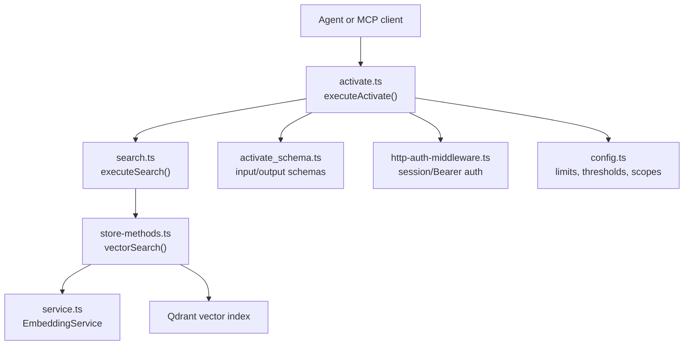
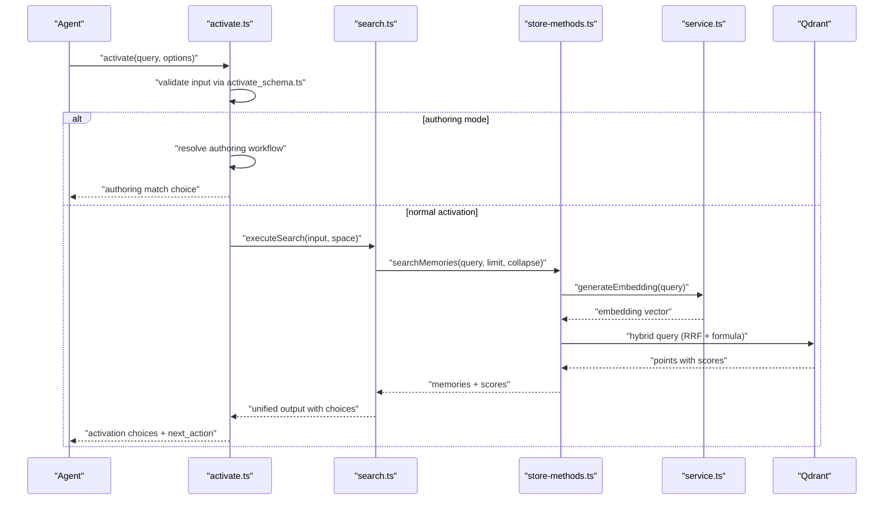
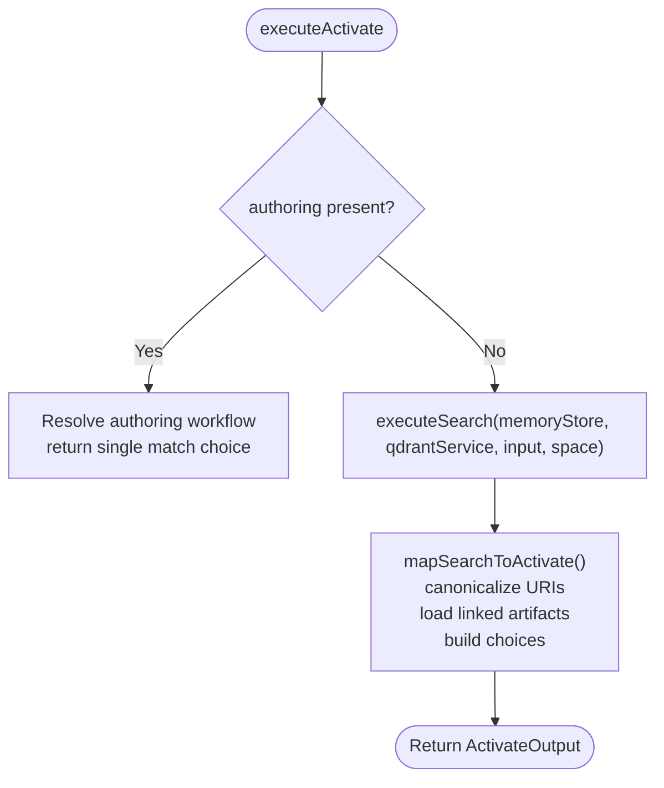
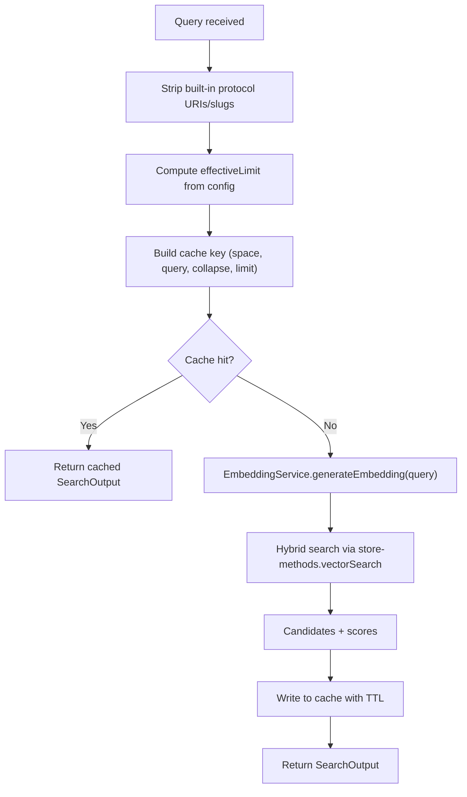
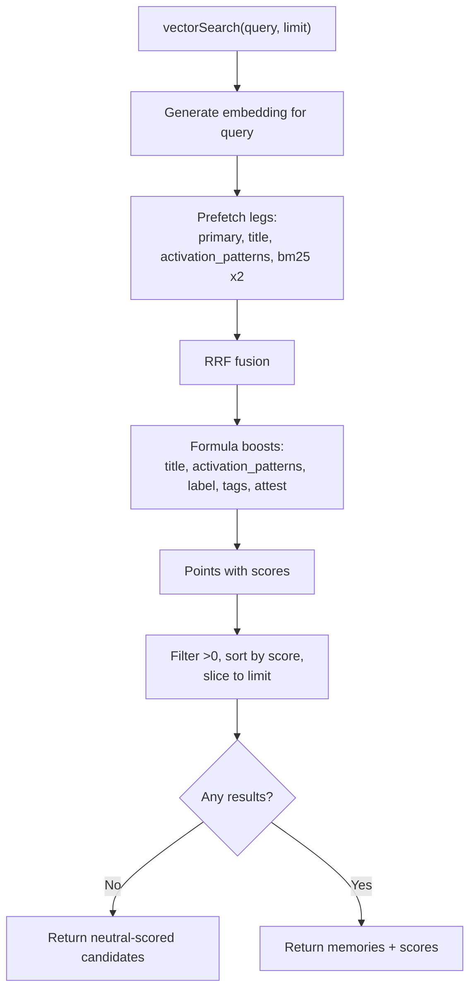
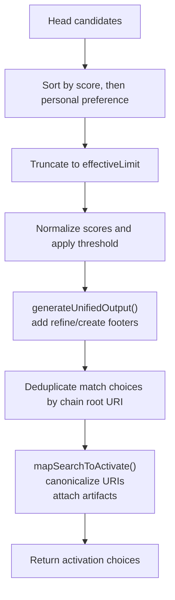
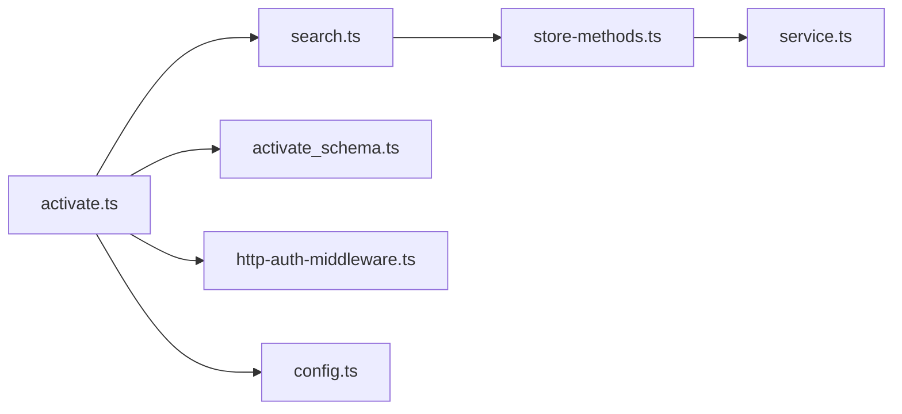

# Activate Tool

<cite>
**Referenced Files in This Document**
- [activate.ts](file://src/tools/activate.ts)
- [activate_schema.ts](file://src/tools/activate_schema.ts)
- [activate.md](file://src/embed-docs/tools/activate.md)
- [search.ts](file://src/tools/search.ts)
- [search_output.ts](file://src/tools/search_output.ts)
- [store-methods.ts](file://src/services/memory/store-methods.ts)
- [service.ts](file://src/services/embedding/service.ts)
- [config.ts](file://src/config.ts)
- [http-auth-middleware.ts](file://src/http/http-auth-middleware.ts)
</cite>

## Table of Contents
1. [Introduction](#introduction)
2. [Project Structure](#project-structure)
3. [Core Components](#core-components)
4. [Architecture Overview](#architecture-overview)
5. [Detailed Component Analysis](#detailed-component-analysis)
6. [Dependency Analysis](#dependency-analysis)
7. [Performance Considerations](#performance-considerations)
8. [Troubleshooting Guide](#troubleshooting-guide)
9. [Conclusion](#conclusion)

## Introduction
The activate tool is the entry point for adapter discovery in the SquadRules agent automation chain. It accepts a user intent, performs semantic search over stored adapters, ranks candidates, and returns structured activation choices that guide the next `forward` call. The tool also supports:
- Adapter authoring workflows through an explicit `authoring` input.
- Space-scoped searches for multi-tenant isolation.
- Refinement sequences using an `execution_id`.
- Artifact materialization instructions for adapters that ship scripts.

SquadRules follows the `activate → forward → reward` chain. Agents should always consult team knowledge before acting, even for familiar tasks.

## Project Structure
The activate tool lives under the tools layer and depends on shared search, memory store, embedding service, configuration, and HTTP authentication middleware.

**Diagram sources**
- [activate.ts:168-229](file://src/tools/activate.ts#L168-L229)
- [search.ts:192-253](file://src/tools/search.ts#L192-L253)
- [store-methods.ts:121-259](file://src/services/memory/store-methods.ts#L121-L259)
- [service.ts:48-127](file://src/services/embedding/service.ts#L48-L127)
- [activate_schema.ts:86-135](file://src/tools/activate_schema.ts#L86-L135)
- [http-auth-middleware.ts:172-327](file://src/http/http-auth-middleware.ts#L172-L327)
- [config.ts:100-127](file://src/config.ts#L100-L127)

**Section sources**
- [activate.ts:168-229](file://src/tools/activate.ts#L168-L229)
- [search.ts:192-253](file://src/tools/search.ts#L192-L253)
- [store-methods.ts:121-259](file://src/services/memory/store-methods.ts#L121-L259)
- [service.ts:48-127](file://src/services/embedding/service.ts#L48-L127)
- [activate_schema.ts:86-135](file://src/tools/activate_schema.ts#L86-L135)
- [http-auth-middleware.ts:172-327](file://src/http/http-auth-middleware.ts#L172-L327)
- [config.ts:100-127](file://src/config.ts#L100-L127)

## Core Components
- Activation entry point: validates input, routes to authoring workflow when requested, otherwise delegates to search and maps results into activation choices.
- Search pipeline: normalizes query, applies space filters, performs hybrid dense/sparse search, deduplicates candidates, and builds unified output with refine/create footers.
- Vector search implementation: generates embeddings, runs RRF fusion across multiple prefetch legs, applies formula boosts, and falls back to dense-only search if needed.
- Schemas: strict Zod-based validation for inputs and outputs, including choice roles, artifact metadata, and transport hints.
- Authentication and authorization: session cookies or Bearer tokens; optional OIDC bearer validation; space allowlists; group filtering.

**Section sources**
- [activate.ts:168-229](file://src/tools/activate.ts#L168-L229)
- [search.ts:93-186](file://src/tools/search.ts#L93-L186)
- [store-methods.ts:121-259](file://src/services/memory/store-methods.ts#L121-L259)
- [activate_schema.ts:86-135](file://src/tools/activate_schema.ts#L86-L135)
- [http-auth-middleware.ts:172-327](file://src/http/http-auth-middleware.ts#L172-L327)

## Architecture Overview
The activation workflow connects request handling, schema validation, tenant context, search, embedding generation, and result mapping.

**Diagram sources**
- [activate.ts:168-229](file://src/tools/activate.ts#L168-L229)
- [search.ts:192-253](file://src/tools/search.ts#L192-L253)
- [store-methods.ts:121-259](file://src/services/memory/store-methods.ts#L121-L259)
- [service.ts:48-127](file://src/services/embedding/service.ts#L48-L127)

## Detailed Component Analysis

### Activation Entry Point (`executeActivate`)
Responsibilities:
- Generate or accept an `execution_id` for refinement sequences.
- Route to authoring workflow when `authoring` is provided.
- Delegate to `executeSearch` for normal queries.
- Map search results into activation choices with `next_action`, artifacts, and transport hints.

Key behaviors:
- Refine footer visibility is controlled by refine count per execution.
- Canonical adapter URIs are enforced for stable routing.
- Linked artifacts are resolved for match/refine choices to support script materialization.

**Diagram sources**
- [activate.ts:168-229](file://src/tools/activate.ts#L168-L229)
- [activate.ts:44-166](file://src/tools/activate.ts#L44-L166)

**Section sources**
- [activate.ts:168-229](file://src/tools/activate.ts#L168-L229)
- [activate.ts:44-166](file://src/tools/activate.ts#L44-L166)

### Request and Response Schemas
Input schema highlights:
- `query`: required short intent summary.
- `execution_id`: optional UUID for refinement sequences.
- `space` / `space_id`: scope results to one space.
- `max_choices`: bounded by configured minimum and maximum limits.
- `authoring`: deterministic routing to create/review/update workflows.

Output schema highlights:
- `must_obey`: always true; pick one choice and follow its `next_action`.
- `choices`: discriminated union of `match`, `refine`, and `create` roles.
- `linked_artifacts`: artifact rows with `materialize` instructions for export and verification.
- `squadrules_local_artifact_dir`: ordered URI hints for local handoff directories.
- `transport`: indicates stdio vs http modes.

Validation and error handling:
- Input validation errors return a structured teaching response.
- Output is wrapped in MCP content and structured content envelopes.

**Section sources**
- [activate_schema.ts:86-135](file://src/tools/activate_schema.ts#L86-L135)
- [activate.ts:231-280](file://src/tools/activate.ts#L231-L280)
- [activate.md:39-78](file://src/embed-docs/tools/activate.md#L39-L78)

### Query Processing and Embedding Generation
Query processing steps:
- Normalize and strip built-in protocol URIs/slugs from the query.
- Compute effective limit based on configuration caps.
- Build cache key including space, normalized query, group collapse flag, and limit.
- Use Redis-backed cache for repeated identical searches within TTL.

Embedding generation:
- Provider selection is resolved at runtime (OpenAI, TEI, fastembed).
- Dimension checks ensure consistency between expected and actual vectors.
- Metrics and audit logs record provider, model, latency, dimension, and anomalies.

**Diagram sources**
- [search.ts:35-57](file://src/tools/search.ts#L35-L57)
- [search.ts:192-253](file://src/tools/search.ts#L192-L253)
- [service.ts:48-127](file://src/services/embedding/service.ts#L48-L127)

**Section sources**
- [search.ts:35-57](file://src/tools/search.ts#L35-L57)
- [search.ts:192-253](file://src/tools/search.ts#L192-L253)
- [service.ts:48-127](file://src/services/embedding/service.ts#L48-L127)

### Vector Similarity Search and Ranking
Hybrid search strategy:
- Dense vectors for primary, title, and activation pattern fields.
- BM25 sparse retrieval via indices/values.
- RRF fusion across prefetch legs.
- Formula boosting for title matches, activation patterns, label matches, tags, and attest boost.

Candidate aggregation and ranking:
- Two-pass candidate building with group collapse enabled initially.
- Tie-breaking prefers head-layer entries and personal/default write spaces.
- Public score normalization applied before threshold filtering.

Fallback behavior:
- If hybrid query fails, fall back to dense-only search.
- If no positive scores remain, return neutral-scored candidates excluding builtin footers.

**Diagram sources**
- [store-methods.ts:121-259](file://src/services/memory/store-methods.ts#L121-L259)

**Section sources**
- [store-methods.ts:121-259](file://src/services/memory/store-methods.ts#L121-L259)
- [search_output.ts:77-92](file://src/tools/search_output.ts#L77-L92)

### Best-Match Determination and Choice Mapping
Best-match logic:
- Candidate map merges duplicates preferring head-layer entries and personal default write spaces on ties.
- Head candidates sorted by score then personal preference; truncated to effective limit.
- Unified output adds refine and create meta footers and deduplicates matched choices by chain root URI.

Activation choice mapping:
- Canonical adapter URIs are enforced.
- Match/refine choices include `forward_first_call` and optional `linked_artifacts`.
- Create choices instruct training new adapters.
- Confidence percentage is computed from top match score for human-facing messages.

**Diagram sources**
- [search.ts:58-91](file://src/tools/search.ts#L58-L91)
- [search.ts:143-186](file://src/tools/search.ts#L143-L186)
- [search_output.ts:117-240](file://src/tools/search_output.ts#L117-L240)
- [activate.ts:44-166](file://src/tools/activate.ts#L44-L166)

**Section sources**
- [search.ts:58-91](file://src/tools/search.ts#L58-L91)
- [search.ts:143-186](file://src/tools/search.ts#L143-L186)
- [search_output.ts:117-240](file://src/tools/search_output.ts#L117-L240)
- [activate.ts:44-166](file://src/tools/activate.ts#L44-L166)

### Authentication and Authorization
Authentication:
- Session cookie or Bearer token required for protected paths when `AUTH_ENABLED`.
- Optional OIDC bearer validation against trusted issuers and allowed audiences.
- Browser GET requests may redirect to login; JSON-RPC MCP calls receive structured 401 errors.

Authorization:
- Space parameter validated against allowed spaces; forbidden if not permitted.
- Group allowlist filters groups carried in session/bearer payloads.
- Space context propagated into tenant context for search scoping.

Scopes:
- OIDC scopes supported can be configured explicitly.
- Groups allowlist supports exact names, path prefixes, and case-insensitive path matching.

**Section sources**
- [http-auth-middleware.ts:172-327](file://src/http/http-auth-middleware.ts#L172-L327)
- [config.ts:154-195](file://src/config.ts#L154-L195)

### Practical Activation Scenarios
- Simple text query: Provide a concise `query`; choose a `match` choice and copy `forward_first_call` into `forward`.
- Structured inputs: Include `execution_id` to refine across multiple activations; echo it back when refining.
- Space-scoped searches: Pass `space` or `space_id` to narrow results to a specific space.
- Multi-tenant isolation: Rely on session/Bearer auth and space allowlists; server enforces allowed spaces and group filtering.

Artifact handling:
- For adapters shipping scripts, follow `linked_artifacts[].materialize` to export, verify SHA-256, and set permissions before invoking shell contracts.
- If artifacts are missing, use `export` to obtain adapter files and inspect `artifacts/`.

**Section sources**
- [activate.md:39-78](file://src/embed-docs/tools/activate.md#L39-L78)
- [activate_schema.ts:26-50](file://src/tools/activate_schema.ts#L26-L50)

## Dependency Analysis
The activate tool composes several layers:
- Tools layer: `activate.ts` orchestrates input validation, authoring routing, search delegation, and output mapping.
- Search layer: `search.ts` handles caching, candidate aggregation, and unified output construction.
- Memory store methods: `store-methods.ts` implements hybrid search and fallback behavior.
- Embedding service: `service.ts` abstracts provider selection, dimension checks, and metrics.
- Configuration: `config.ts` defines limits, thresholds, and auth settings.
- HTTP middleware: `http-auth-middleware.ts` provides session/Bearer auth and space authorization.

**Diagram sources**
- [activate.ts:168-229](file://src/tools/activate.ts#L168-L229)
- [search.ts:192-253](file://src/tools/search.ts#L192-L253)
- [store-methods.ts:121-259](file://src/services/memory/store-methods.ts#L121-L259)
- [service.ts:48-127](file://src/services/embedding/service.ts#L48-L127)
- [activate_schema.ts:86-135](file://src/tools/activate_schema.ts#L86-L135)
- [http-auth-middleware.ts:172-327](file://src/http/http-auth-middleware.ts#L172-L327)
- [config.ts:100-127](file://src/config.ts#L100-L127)

**Section sources**
- [activate.ts:168-229](file://src/tools/activate.ts#L168-L229)
- [search.ts:192-253](file://src/tools/search.ts#L192-L253)
- [store-methods.ts:121-259](file://src/services/memory/store-methods.ts#L121-L259)
- [service.ts:48-127](file://src/services/embedding/service.ts#L48-L127)
- [activate_schema.ts:86-135](file://src/tools/activate_schema.ts#L86-L135)
- [http-auth-middleware.ts:172-327](file://src/http/http-auth-middleware.ts#L172-L327)
- [config.ts:100-127](file://src/config.ts#L100-L127)

## Performance Considerations
- Search caching: Activated search results are cached with a configurable TTL to reduce redundant work.
- Overfetch factor and max fetch: Control how aggressively candidates are gathered before ranking.
- Group collapse: Enables two-pass candidate building to improve recall while limiting initial cost.
- Effective limit caps: Prevent excessive resolve-head latency and downstream processing.
- Hybrid search: Uses RRF fusion and formula boosts to balance dense and sparse signals efficiently.
- Fallback dense-only search: Ensures resilience when hybrid query fails.

Recommended tuning:
- Adjust `SQUADRULES_SEARCH_LIMIT_MIN` and `SQUADRULES_SEARCH_LIMIT_CAP` to balance recall and performance.
- Tune `SCORE_THRESHOLD` to control how many candidates pass into choices.
- Enable or disable `SQUADRULES_ENABLE_GROUP_COLLAPSE` depending on dataset size and recall needs.

**Section sources**
- [search.ts:10-18](file://src/tools/search.ts#L10-L18)
- [search.ts:192-253](file://src/tools/search.ts#L192-L253)
- [store-methods.ts:121-259](file://src/services/memory/store-methods.ts#L121-L259)
- [config.ts:100-127](file://src/config.ts#L100-L127)
- [config.ts:284-295](file://src/config.ts#L284-L295)

## Troubleshooting Guide
Common issues and resolutions:
- Low relevance scores:
  - Review `query` specificity and consider refining via the `refine` choice.
  - Lower `SCORE_THRESHOLD` cautiously to admit more candidates.
  - Ensure adapter titles, labels, tags, and activation patterns are well-populated.
- Missing adapters:
  - Verify space scoping; ensure the target adapter exists in the selected space.
  - Confirm group allowlist and allowed spaces permit access.
  - Use `train` to create new adapters when no existing match is appropriate.
- Artifact materialization failures:
  - Follow `linked_artifacts[].materialize` exactly: call `export`, write to `out`, verify `sha256`, set `chmod`.
  - If artifacts are absent, run `export` for the adapter and inspect `artifacts/`.
- Authentication errors:
  - Ensure session cookie or Bearer token is valid.
  - Configure `AUTH_TRUSTED_ISSUERS` and `AUTH_ALLOWED_AUDIENCES` for OIDC bearer validation.
  - Check `AUTH_CALLBACK_BASE_URL` and session secret when enabling auth.
- Timeout management:
  - Health checks and external services may time out; monitor metrics and logs for duration spikes.
  - Reduce `max_choices` to limit downstream resolve-head latency.

Error handling patterns:
- Input validation errors return structured teaching responses.
- Rate limiting is detected and returned as a rate-limit error result.
- Embedding dimension mismatches and provider errors are audited and surfaced.

**Section sources**
- [activate.ts:231-280](file://src/tools/activate.ts#L231-L280)
- [service.ts:48-127](file://src/services/embedding/service.ts#L48-L127)
- [http-auth-middleware.ts:172-327](file://src/http/http-auth-middleware.ts#L172-L327)
- [activate.md:89-94](file://src/embed-docs/tools/activate.md#L89-L94)

## Conclusion
The activate tool provides a robust, configurable entry point for adapter discovery in SquadRules. It combines semantic search, hybrid ranking, and structured output to guide agents toward deterministic `forward` calls. With space-scoped searches, artifact materialization instructions, and strong authentication/authorization controls, it supports both simple and complex multi-tenant scenarios. Proper tuning of limits, thresholds, and provider configuration ensures reliable performance and high-quality matches.