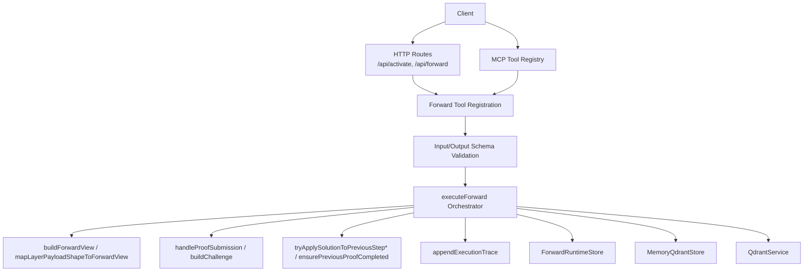
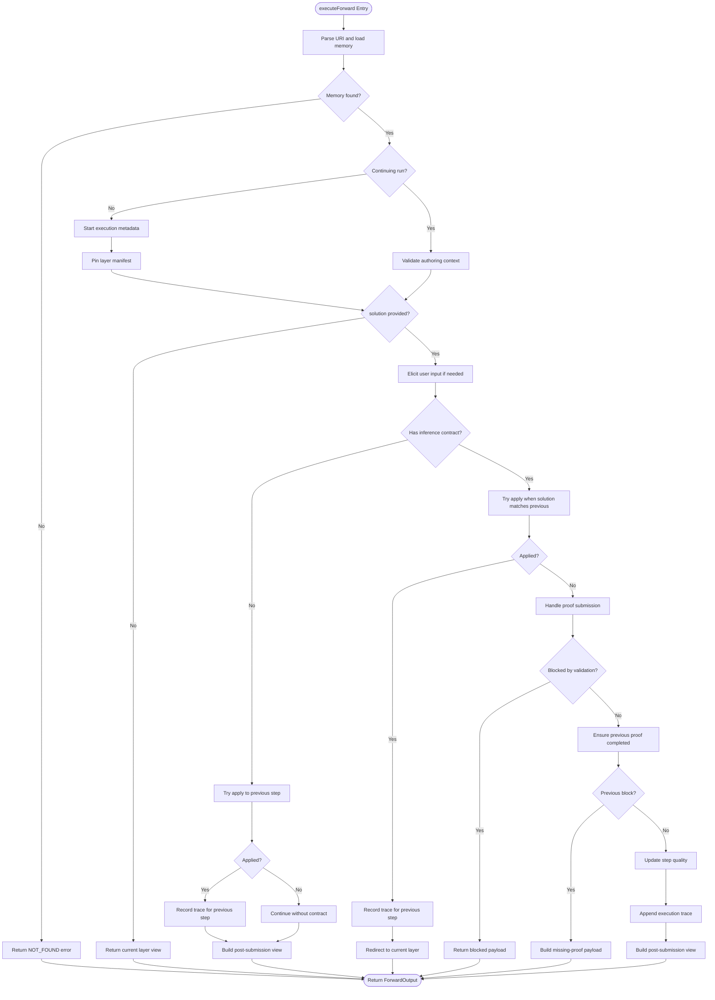
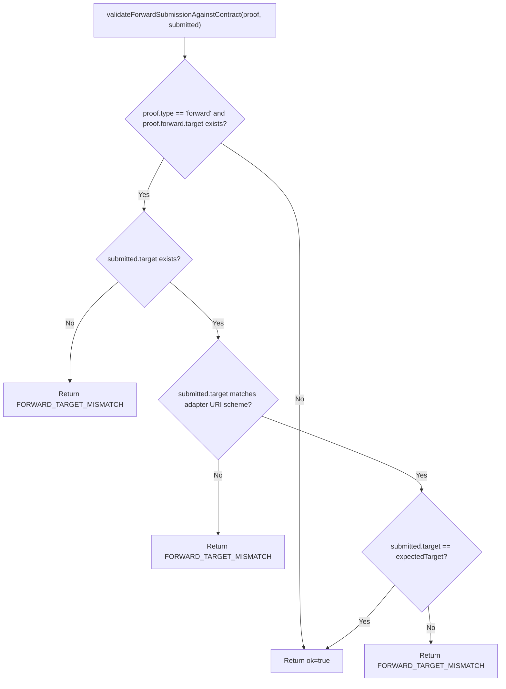
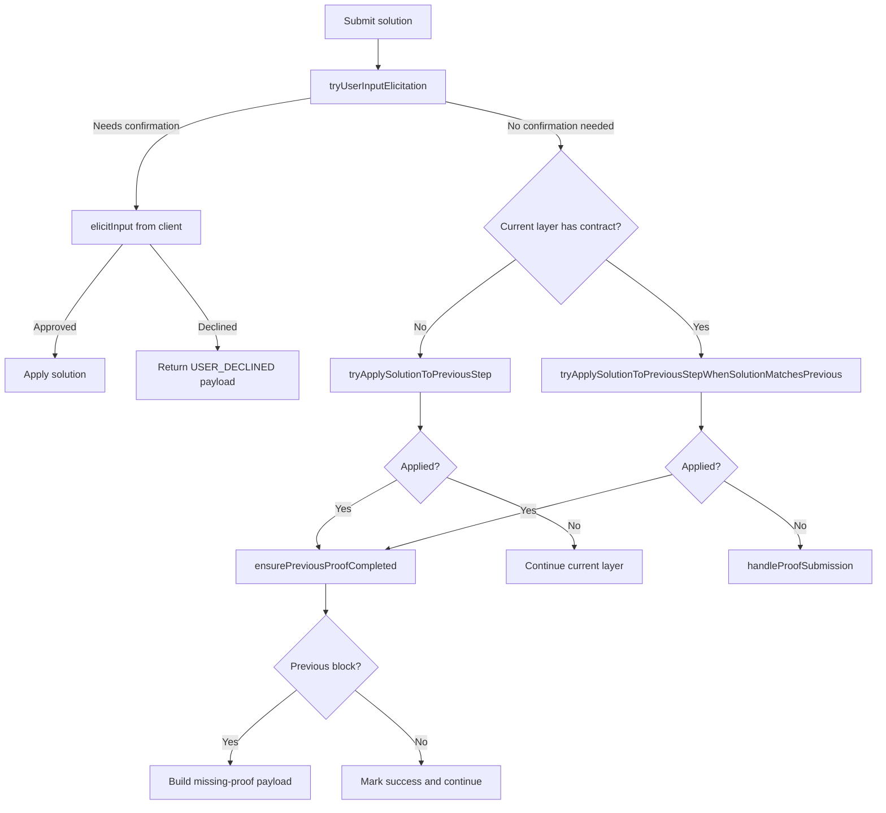
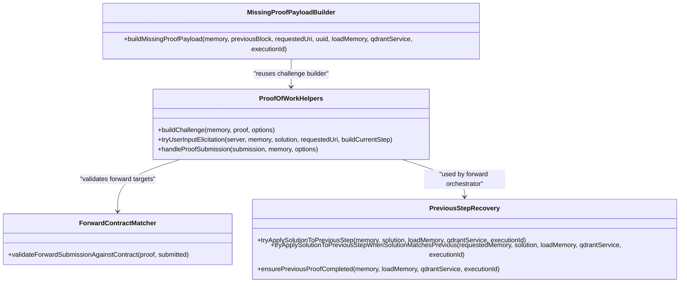
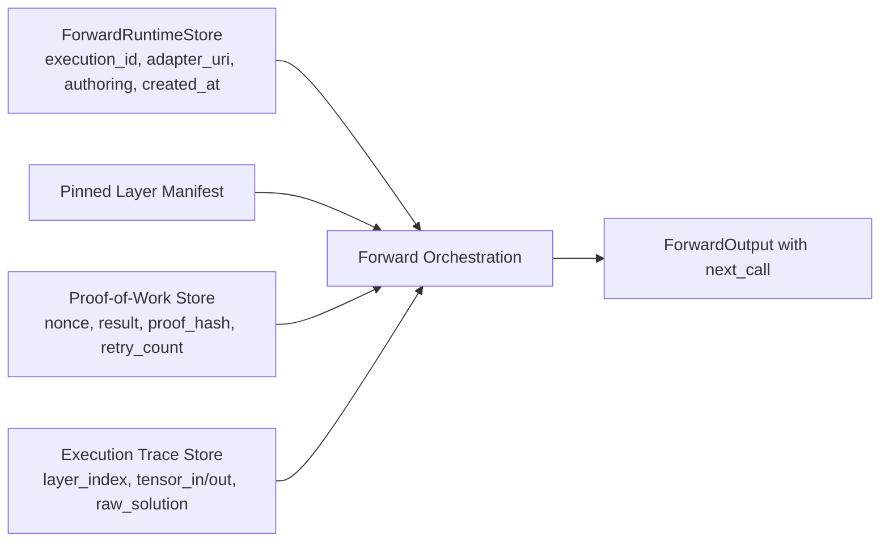
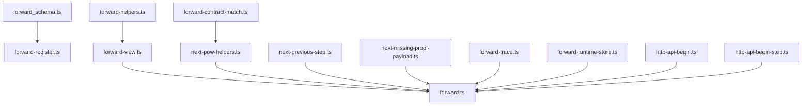

# Forward Tool

<cite>
**Referenced Files in This Document**
- [forward.ts](file://src/tools/forward.ts)
- [forward-contract-match.ts](file://src/tools/forward-contract-match.ts)
- [forward-helpers.ts](file://src/tools/forward-helpers.ts)
- [forward-register.ts](file://src/tools/forward-register.ts)
- [forward-view.ts](file://src/tools/forward-view.ts)
- [forward-trace.ts](file://src/tools/forward-trace.ts)
- [forward-tool-error.ts](file://src/tools/forward-tool-error.ts)
- [forward_schema.ts](file://src/tools/forward_schema.ts)
- [activate.ts](file://src/tools/activate.ts)
- [next-pow-helpers.ts](file://src/tools/next-pow-helpers.ts)
- [next-previous-step.ts](file://src/tools/next-previous-step.ts)
- [next-missing-proof-payload.ts](file://src/tools/next-missing-proof-payload.ts)
- [forward-runtime-store.ts](file://src/services/forward-runtime-store.ts)
- [http-api-begin.ts](file://src/http/http-api-begin.ts)
- [http-api-begin-step.ts](file://src/http/http-api-begin-step.ts)
- [adapter-example-forward.md](file://docs/examples/adapter-example-forward.md)
</cite>

## Table of Contents
1. [Introduction](#introduction)
2. [Project Structure](#project-structure)
3. [Core Components](#core-components)
4. [Architecture Overview](#architecture-overview)
5. [Detailed Component Analysis](#detailed-component-analysis)
6. [Dependency Analysis](#dependency-analysis)
7. [Performance Considerations](#performance-considerations)
8. [Troubleshooting Guide](#troubleshooting-guide)
9. [Conclusion](#conclusion)
10. [Appendices](#appendices)

## Introduction
The forward tool is the execution engine for adapter workflows. It loads an adapter or a specific layer, presents the current step’s instructions and contract, validates submitted solutions, generates or verifies proof-of-work challenges, collects evidence, advances to the next layer, and persists state across multiple steps. It works with both HTTP endpoints and MCP protocol methods.

The typical workflow is:
- Activate selects an adapter and returns a first call.
- Forward starts the selected adapter or continues a previous run using a layer URI with an execution ID.
- The engine may request user input, shell execution, comment verification, subagent delegation, or forwarding to another adapter.
- When all layers are complete, it instructs the caller to finalize through reward.

This document explains the orchestration logic, challenge-response patterns, proof generation, evidence collection, state persistence, contract matching, adaptive behavior, API specifications, examples, authentication/session considerations, timeouts, performance guidance, and troubleshooting.

## Project Structure
The forward tool is implemented as a layered set of modules:
- Registration and schema validation: `forward-register.ts`, `forward_schema.ts`
- Core orchestration: `forward.ts`
- View construction and UI hints: `forward-view.ts`
- Proof-of-work helpers and challenge handling: `next-pow-helpers.ts`
- Previous-step recovery and missing-proof flows: `next-previous-step.ts`, `next-missing-proof-payload.ts`
- Contract target validation: `forward-contract-match.ts`
- Execution tracing: `forward-trace.ts`
- Error formatting: `forward-tool-error.ts`
- Runtime metadata store: `forward-runtime-store.ts`
- HTTP routes: `http-api-begin.ts`, `http-api-begin-step.ts`
- Relationship with activation: `activate.ts`
- Example adapter contract: `adapter-example-forward.md`



**Diagram sources**
- [http-api-begin.ts:14-38](file://src/http/http-api-begin.ts#L14-L38)
- [http-api-begin-step.ts:13-38](file://src/http/http-api-begin-step.ts#L13-L38)
- [forward-register.ts:18-65](file://src/tools/forward-register.ts#L18-L65)
- [forward_schema.ts:234-314](file://src/tools/forward_schema.ts#L234-L314)
- [forward.ts:91-339](file://src/tools/forward.ts#L91-L339)
- [forward-view.ts:210-309](file://src/tools/forward-view.ts#L210-L309)
- [next-pow-helpers.ts:127-333](file://src/tools/next-pow-helpers.ts#L127-L333)
- [next-previous-step.ts:29-167](file://src/tools/next-previous-step.ts#L29-L167)
- [forward-trace.ts:64-87](file://src/tools/forward-trace.ts#L64-L87)
- [forward-runtime-store.ts:27-58](file://src/services/forward-runtime-store.ts#L27-L58)

**Section sources**
- [forward-register.ts:18-65](file://src/tools/forward-register.ts#L18-L65)
- [forward_schema.ts:234-314](file://src/tools/forward_schema.ts#L234-L314)
- [forward.ts:91-339](file://src/tools/forward.ts#L91-L339)
- [forward-view.ts:210-309](file://src/tools/forward-view.ts#L210-L309)
- [next-pow-helpers.ts:127-333](file://src/tools/next-pow-helpers.ts#L127-L333)
- [next-previous-step.ts:29-167](file://src/tools/next-previous-step.ts#L29-L167)
- [forward-trace.ts:64-87](file://src/tools/forward-trace.ts#L64-L87)
- [forward-runtime-store.ts:27-58](file://src/services/forward-runtime-store.ts#L27-L58)
- [http-api-begin.ts:14-38](file://src/http/http-api-begin.ts#L14-L38)
- [http-api-begin-step.ts:13-38](file://src/http/http-api-begin-step.ts#L13-L38)

## Core Components
- Forward registration and MCP binding: registers the `forward` tool, validates inputs, measures metrics, formats errors, and returns structured content.
- Input/output schemas: define adapters/layers URIs, solution envelopes, contracts, next-call shapes, and output fields.
- Orchestration engine: resolves memory, initializes or continues executions, handles authoring context, elicits user input, validates proofs, applies previous-step fixes, traces execution, and builds responses.
- View builder: constructs current-layer content, contract challenges, next-action guidance, finalization hints, and UI summaries.
- Proof-of-work helpers: generate nonces, validate submissions, enforce required types, handle shell/forward/user_input/comment/subagent payloads, and persist results.
- Previous-step recovery: detects when a solution belongs to the prior step and redirects accordingly; blocks progression until previous required proofs succeed.
- Missing-proof payload builder: produces retry-ready challenges for the previous step.
- Contract matcher: enforces that forward targets match the contracted adapter URI.
- Execution trace writer: records layer instructions, tensor I/O, raw solutions, and optional reasoning traces.
- Runtime store: persists execution metadata, pinned layer manifests, and supports cleanup.

**Section sources**
- [forward-register.ts:18-65](file://src/tools/forward-register.ts#L18-L65)
- [forward_schema.ts:16-45](file://src/tools/forward_schema.ts#L16-L45)
- [forward_schema.ts:99-123](file://src/tools/forward_schema.ts#L99-L123)
- [forward_schema.ts:182-216](file://src/tools/forward_schema.ts#L182-L216)
- [forward_schema.ts:234-314](file://src/tools/forward_schema.ts#L234-L314)
- [forward.ts:91-339](file://src/tools/forward.ts#L91-L339)
- [forward-view.ts:210-309](file://src/tools/forward-view.ts#L210-L309)
- [next-pow-helpers.ts:43-61](file://src/tools/next-pow-helpers.ts#L43-L61)
- [next-pow-helpers.ts:127-333](file://src/tools/next-pow-helpers.ts#L127-L333)
- [next-previous-step.ts:29-167](file://src/tools/next-previous-step.ts#L29-L167)
- [next-missing-proof-payload.ts:29-56](file://src/tools/next-missing-proof-payload.ts#L29-L56)
- [forward-contract-match.ts:17-53](file://src/tools/forward-contract-match.ts#L17-L53)
- [forward-trace.ts:17-87](file://src/tools/forward-trace.ts#L17-L87)
- [forward-runtime-store.ts:27-58](file://src/services/forward-runtime-store.ts#L27-L58)

## Architecture Overview
The forward tool participates in the activate → forward → reward chain. Activation finds adapters and returns a first call. Forward executes the first layer or continues a previous run. Reward finalizes the workflow.

```mermaid
sequenceDiagram
participant Agent as "Agent"
participant Activate as "activate tool"
participant Forward as "forward tool"
participant Store as "Runtime + Memory Stores"
participant POW as "Proof-of-Work Store"
participant Trace as "Execution Trace Store"
Agent->>Activate : "Query with intent"
Activate-->>Agent : "Choices with forward_first_call"
Agent->>Forward : "Start with adapter URI (no solution)"
Forward->>Store : "Create execution metadata"
Forward-->>Agent : "current_layer, contract, next_call"
Agent->>Forward : "Continue with layer URI + solution"
Forward->>POW : "Validate nonce/proof_hash"
Forward->>Store : "Persist execution trace"
alt Next layer exists
Forward-->>Agent : "Next layer view"
else Final layer
Forward-->>Agent : "Finalize with reward"
end
```

**Diagram sources**
- [activate.ts:168-229](file://src/tools/activate.ts#L168-L229)
- [forward.ts:133-152](file://src/tools/forward.ts#L133-L152)
- [forward.ts:332-338](file://src/tools/forward.ts#L332-L338)
- [forward-view.ts:210-274](file://src/tools/forward-view.ts#L210-L274)
- [next-pow-helpers.ts:127-333](file://src/tools/next-pow-helpers.ts#L127-L333)
- [forward-trace.ts:64-87](file://src/tools/forward-trace.ts#L64-L87)

## Detailed Component Analysis

### Forward Orchestration Engine
The core orchestrator performs:
- URI parsing and memory loading.
- Execution initialization or continuation based on whether the URI includes an execution ID.
- Authoring context validation and normalization.
- Solution elicitation for user-input contracts.
- Contract-less fallback to apply solutions to the previous step.
- Proof submission handling with nonce and proof-hash checks.
- Previous-step completion enforcement.
- Execution tracing and response building.



**Diagram sources**
- [forward.ts:91-339](file://src/tools/forward.ts#L91-L339)
- [next-previous-step.ts:29-167](file://src/tools/next-previous-step.ts#L29-L167)
- [next-missing-proof-payload.ts:29-56](file://src/tools/next-missing-proof-payload.ts#L29-L56)
- [forward-view.ts:210-309](file://src/tools/forward-view.ts#L210-L309)

**Section sources**
- [forward.ts:91-339](file://src/tools/forward.ts#L91-L339)

### Contract Matching System
The forward contract matcher ensures that a forward submission targets exactly the adapter specified by the contract. It rejects absent targets, invalid schemes, and mismatched slugs with a unified error code.

Key behaviors:
- Only `forward` type contracts with a `target` field are validated.
- Targets must be valid adapter URIs.
- Submitted targets must equal the contracted target.



**Diagram sources**
- [forward-contract-match.ts:17-53](file://src/tools/forward-contract-match.ts#L17-L53)

**Section sources**
- [forward-contract-match.ts:17-53](file://src/tools/forward-contract-match.ts#L17-L53)

### Step Validation and Adaptive Behavior
Adaptive behavior includes:
- User-input elicitation when the contract requires confirmation.
- Applying solutions to the previous step when the current step has no stored contract but the previous step requires proof.
- Detecting when a client submits a solution intended for the previous step while calling the next layer.
- Blocking progression until previous required proofs are successful.
- Providing retry counts and recovery guidance.



**Diagram sources**
- [forward.ts:154-339](file://src/tools/forward.ts#L154-L339)
- [next-pow-helpers.ts:63-125](file://src/tools/next-pow-helpers.ts#L63-L125)
- [next-previous-step.ts:29-167](file://src/tools/next-previous-step.ts#L29-L167)
- [next-missing-proof-payload.ts:29-56](file://src/tools/next-missing-proof-payload.ts#L29-L56)

**Section sources**
- [forward.ts:154-339](file://src/tools/forward.ts#L154-L339)
- [next-pow-helpers.ts:63-125](file://src/tools/next-pow-helpers.ts#L63-L125)
- [next-previous-step.ts:29-167](file://src/tools/next-previous-step.ts#L29-L167)
- [next-missing-proof-payload.ts:29-56](file://src/tools/next-missing-proof-payload.ts#L29-L56)

### Proof Generation and Evidence Collection
Proof generation and validation cover:
- Nonce rotation and reuse to prevent replay and support retries.
- Required proof types: shell, forward, user_input, comment, subagent.
- Honest verification: rejecting placeholder outputs and enforcing minimum comment length and semantic relevance.
- Forward target validation against the contract.
- Result persistence and proof hashing for chaining.



**Diagram sources**
- [next-pow-helpers.ts:43-61](file://src/tools/next-pow-helpers.ts#L43-L61)
- [next-pow-helpers.ts:127-333](file://src/tools/next-pow-helpers.ts#L127-L333)
- [forward-contract-match.ts:17-53](file://src/tools/forward-contract-match.ts#L17-L53)
- [next-previous-step.ts:29-167](file://src/tools/next-previous-step.ts#L29-L167)
- [next-missing-proof-payload.ts:29-56](file://src/tools/next-missing-proof-payload.ts#L29-L56)

**Section sources**
- [next-pow-helpers.ts:43-61](file://src/tools/next-pow-helpers.ts#L43-L61)
- [next-pow-helpers.ts:127-333](file://src/tools/next-pow-helpers.ts#L127-L333)
- [forward-contract-match.ts:17-53](file://src/tools/forward-contract-match.ts#L17-L53)
- [next-previous-step.ts:29-167](file://src/tools/next-previous-step.ts#L29-L167)
- [next-missing-proof-payload.ts:29-56](file://src/tools/next-missing-proof-payload.ts#L29-L56)

### State Persistence Across Steps
State persistence includes:
- Execution metadata: adapter identity, authoring context, merge depth, creation time, and slug disambiguation notes.
- Pinned layer manifests to avoid UUID churn during an execution.
- Proof-of-work results, nonces, retry counters, and proof hashes.
- Execution traces capturing layer instructions, tensor inputs/outputs, raw solutions, and optional reasoning traces.



**Diagram sources**
- [forward-runtime-store.ts:27-58](file://src/services/forward-runtime-store.ts#L27-L58)
- [forward.ts:133-152](file://src/tools/forward.ts#L133-L152)
- [forward-trace.ts:64-87](file://src/tools/forward-trace.ts#L64-L87)
- [next-pow-helpers.ts:307-333](file://src/tools/next-pow-helpers.ts#L307-L333)

**Section sources**
- [forward-runtime-store.ts:27-58](file://src/services/forward-runtime-store.ts#L27-L58)
- [forward.ts:133-152](file://src/tools/forward.ts#L133-L152)
- [forward-trace.ts:64-87](file://src/tools/forward-trace.ts#L64-L87)
- [next-pow-helpers.ts:307-333](file://src/tools/next-pow-helpers.ts#L307-L333)

### Relationship with Activate
Activation finds adapters and returns choices with `forward_first_call`. Forward continues the workflow initiated by activation by:
- Accepting the same authoring context when present.
- Reusing the execution ID when continuing a refine flow.
- Returning guidance to call forward with the returned `forward_first_call`.

```mermaid
sequenceDiagram
participant Agent as "Agent"
participant Activate as "activate"
participant Forward as "forward"
Agent->>Activate : "Search query"
Activate-->>Agent : "Choices with forward_first_call"
Agent->>Forward : "Call forward with forward_first_call.uri"
Forward-->>Agent : "First layer view"
Agent->>Forward : "Continue with solution"
Forward-->>Agent : "Next layer or finalize"
```

**Diagram sources**
- [activate.ts:168-229](file://src/tools/activate.ts#L168-L229)
- [forward.ts:113-131](file://src/tools/forward.ts#L113-L131)
- [forward-view.ts:210-274](file://src/tools/forward-view.ts#L210-L274)

**Section sources**
- [activate.ts:168-229](file://src/tools/activate.ts#L168-L229)
- [forward.ts:113-131](file://src/tools/forward.ts#L113-L131)
- [forward-view.ts:210-274](file://src/tools/forward-view.ts#L210-L274)

## Dependency Analysis
The forward tool depends on:
- Schema definitions for strict input/output validation.
- Memory and Qdrant services for adapter resolution and layer navigation.
- Proof-of-work store for nonces, results, and hashes.
- Execution trace store for auditability.
- Runtime store for long-lived execution state.
- Helpers for challenge building, user elicitation, and previous-step recovery.



**Diagram sources**
- [forward_schema.ts:234-314](file://src/tools/forward_schema.ts#L234-L314)
- [forward-register.ts:18-65](file://src/tools/forward-register.ts#L18-L65)
- [forward-view.ts:210-309](file://src/tools/forward-view.ts#L210-L309)
- [forward-helpers.ts:11-38](file://src/tools/forward-helpers.ts#L11-L38)
- [next-pow-helpers.ts:127-333](file://src/tools/next-pow-helpers.ts#L127-L333)
- [next-previous-step.ts:29-167](file://src/tools/next-previous-step.ts#L29-L167)
- [next-missing-proof-payload.ts:29-56](file://src/tools/next-missing-proof-payload.ts#L29-L56)
- [forward-contract-match.ts:17-53](file://src/tools/forward-contract-match.ts#L17-L53)
- [forward-trace.ts:64-87](file://src/tools/forward-trace.ts#L64-L87)
- [forward-runtime-store.ts:27-58](file://src/services/forward-runtime-store.ts#L27-L58)
- [http-api-begin.ts:14-38](file://src/http/http-api-begin.ts#L14-L38)
- [http-api-begin-step.ts:13-38](file://src/http/http-api-begin-step.ts#L13-L38)

**Section sources**
- [forward_schema.ts:234-314](file://src/tools/forward_schema.ts#L234-L314)
- [forward-register.ts:18-65](file://src/tools/forward-register.ts#L18-L65)
- [forward-view.ts:210-309](file://src/tools/forward-view.ts#L210-L309)
- [forward-helpers.ts:11-38](file://src/tools/forward-helpers.ts#L11-L38)
- [next-pow-helpers.ts:127-333](file://src/tools/next-pow-helpers.ts#L127-L333)
- [next-previous-step.ts:29-167](file://src/tools/next-previous-step.ts#L29-L167)
- [next-missing-proof-payload.ts:29-56](file://src/tools/next-missing-proof-payload.ts#L29-L56)
- [forward-contract-match.ts:17-53](file://src/tools/forward-contract-match.ts#L17-L53)
- [forward-trace.ts:64-87](file://src/tools/forward-trace.ts#L64-L87)
- [forward-runtime-store.ts:27-58](file://src/services/forward-runtime-store.ts#L27-L58)
- [http-api-begin.ts:14-38](file://src/http/http-api-begin.ts#L14-L38)
- [http-api-begin-step.ts:13-38](file://src/http/http-api-begin-step.ts#L13-L38)

## Performance Considerations
- Long-running workflows benefit from pinned layer manifests to reduce UUID churn and stabilize references.
- Execution traces are appended asynchronously to avoid blocking the main flow; failures are logged but do not fail the operation.
- Comment semantic validation uses a timeout to avoid blocking on embedding providers; failures fall open to allow length-valid comments.
- Nonce rotation prevents unrecoverable mismatch loops and reduces repeated failed attempts.
- Retry counters provide bounded recovery guidance for challenging steps.

[No sources needed since this section provides general guidance]

## Troubleshooting Guide
Common issues and resolutions:
- Step failures due to shell command errors: check exit codes and stderr; use the diagnostic message and recovery guidance returned by proof validation.
- Contract mismatches: ensure solution.type matches contract.type and evidence fields match the contract shape.
- Forward target mismatches: submit evidence.target equal to the contracted adapter URI.
- Missing proof for previous step: complete the previous required proof before continuing; use the returned current_step and challenge.
- Nonce mismatch: rotate nonce and use the retry_nonce from the latest response.
- Proof hash mismatch: echo proof_hash from the previous response or current contract.
- Placeholder evidence: replace template placeholders with real stdout/stderr from your run.
- Authoring context mismatch: keep the same authoring parameters for the entire execution; do not change them mid-run.

**Section sources**
- [next-pow-helpers.ts:167-195](file://src/tools/next-pow-helpers.ts#L167-L195)
- [next-pow-helpers.ts:208-229](file://src/tools/next-pow-helpers.ts#L208-L229)
- [next-pow-helpers.ts:231-254](file://src/tools/next-pow-helpers.ts#L231-L254)
- [next-pow-helpers.ts:265-298](file://src/tools/next-pow-helpers.ts#L265-L298)
- [forward-contract-match.ts:17-53](file://src/tools/forward-contract-match.ts#L17-L53)
- [next-previous-step.ts:119-167](file://src/tools/next-previous-step.ts#L119-L167)
- [forward.ts:113-131](file://src/tools/forward.ts#L113-L131)

## Conclusion
The forward tool is a robust, auditable execution engine for adapter workflows. It coordinates multi-step orchestration, enforces contracts, manages proof-of-work challenges, adapts to previous-step requirements, and persists state across runs. Together with activation and reward, it enables deterministic, verifiable agent-driven tasks.

[No sources needed since this section summarizes without analyzing specific files]

## Appendices

### API Specifications

#### HTTP Endpoints

- POST `/api/activate`
  - Purpose: Find the best adapter for the current input and return ranked activation choices.
  - Request body: Validated by `activateInputSchema`.
  - Response: Activation output including choices and guidance to call forward.
  - Errors: Returns `INVALID_INPUT` for malformed requests; otherwise logs and returns route-level errors.

- POST `/api/forward`
  - Purpose: Start or continue an adapter workflow.
  - Request body: Validated by `forwardInputSchema`.
  - Response: Forward output including current layer, contract, next action, and next call.
  - Errors: Returns `INVALID_INPUT` for malformed requests; otherwise logs and returns route-level errors.

**Section sources**
- [http-api-begin.ts:14-38](file://src/http/http-api-begin.ts#L14-L38)
- [http-api-begin-step.ts:13-38](file://src/http/http-api-begin-step.ts#L13-L38)
- [activate.ts:168-229](file://src/tools/activate.ts#L168-L229)
- [forward_schema.ts:234-314](file://src/tools/forward_schema.ts#L234-L314)

#### MCP Protocol Methods

- Tool: `forward`
  - Title: Load adapter instructions and advance workflow state.
  - Description: Run the first or next adapter layer. Omit `solution` on the first call in a run.
  - Input schema: `forwardMcpWireInputSchema`
  - Output schema: `forwardOutputSchema`
  - Behavior: Validates input, calls `executeForward`, records metrics, and returns structured content.

**Section sources**
- [forward-register.ts:18-65](file://src/tools/forward-register.ts#L18-L65)
- [forward_schema.ts:282-314](file://src/tools/forward_schema.ts#L282-L314)
- [forward.ts:91-339](file://src/tools/forward.ts#L91-L339)

### Request/Response Schemas

#### Forward Input
- Fields:
  - `authoring`: Optional authoring context carried from activation.
  - `uri`: Adapter or layer URI. Use adapter or layer without execution_id to start; use layer with execution_id to continue.
  - `solution`: Only for continuation calls; omit on start. Must include solution.type and proof payload (prefer v2: outcome + evidence).

Validation rules:
- Starting a new run forbids providing `solution`.
- Continuing a run requires `solution`.

**Section sources**
- [forward_schema.ts:234-258](file://src/tools/forward_schema.ts#L234-L258)

#### Forward Solution
- Preferred v2 envelope:
  - `type`: One of shell, forward, user_input, comment, subagent.
  - `outcome`: success, failure, or skipped.
  - `evidence`: Type-specific proof object.
  - `nonce`: Echo nonce from contract for proof-based layers.
  - `proof_hash`: Echo proof_hash from previous layer when required.
  - `trace`: Optional reasoning trace stored with the execution trace.

Legacy fields are still accepted but normalized into the envelope.

**Section sources**
- [forward_schema.ts:182-216](file://src/tools/forward_schema.ts#L182-L216)
- [forward_schema.ts:260-280](file://src/tools/forward_schema.ts#L260-L280)

#### Forward Contract
- Supported types: shell, forward, user_input, comment, subagent.
- Shell: interpreter, cmd, timeout_seconds, flags, args, workdir, invocation_display.
- Forward: target adapter URI and optional expected_result.
- User input: optional prompt.
- Comment: optional min_length.
- Subagent: context and optional mcp tool list.

**Section sources**
- [forward_schema.ts:16-45](file://src/tools/forward_schema.ts#L16-L45)

#### Forward Output
- Fields:
  - `authoring`: Optional authoring context.
  - `must_obey`: Boolean indicating mandatory adherence.
  - `current_layer`: Current step URI, markdown content, and MIME type.
  - `contract`: Challenge contract for the current step.
  - `next_action`: Human-readable guidance.
  - `proof_hash`: Optional proof hash from previous layer.
  - `execution_id`: Execution identifier for continuation.
  - `message`: Optional contextual message.
  - `error_code`: Optional error code for blocked submissions.
  - `retry_count`: Optional retry counter.
  - `slug_disambiguation_note`: Optional note explaining ambiguous slug selection.
  - `next_call`: Discriminated union of forward or reward next call.
  - UI summary fields: activation_space_name, context_adapter_name, current_layer_label, adapter_layer_index, adapter_layer_count.
  - Artifact directories: squadrules_local_artifact_dir.

**Section sources**
- [forward_schema.ts:295-314](file://src/tools/forward_schema.ts#L295-L314)
- [forward-view.ts:210-274](file://src/tools/forward-view.ts#L210-L274)

### Practical Examples

#### Multi-step Workflow
- Start with activation to select an adapter.
- Call forward with the adapter URI to load the first layer and receive a contract.
- Submit a solution matching the contract type and evidence shape.
- Continue calling forward with the returned layer URI including execution_id until the final layer.
- Finalize with reward as instructed by the final next_call.

**Section sources**
- [activate.ts:168-229](file://src/tools/activate.ts#L168-L229)
- [forward-view.ts:210-274](file://src/tools/forward-view.ts#L210-L274)

#### Conditional Branching
- If the current layer has no contract, the engine tries applying the solution to the previous step.
- If the previous step is required and incomplete, the engine returns a missing-proof payload with guidance.
- If the solution matches the previous step’s contract, the engine applies it and redirects to the current layer.

**Section sources**
- [forward.ts:172-241](file://src/tools/forward.ts#L172-L241)
- [next-previous-step.ts:29-117](file://src/tools/next-previous-step.ts#L29-L117)
- [next-missing-proof-payload.ts:29-56](file://src/tools/next-missing-proof-payload.ts#L29-L56)

#### Error Recovery
- For shell failures, the engine provides diagnostics and recovery guidance.
- For forward target mismatches, the engine returns a clear error message and expected target.
- For nonce or proof-hash mismatches, the engine rotates nonces and instructs the caller to use values from the latest response.

**Section sources**
- [next-pow-helpers.ts:167-195](file://src/tools/next-pow-helpers.ts#L167-L195)
- [next-pow-helpers.ts:208-229](file://src/tools/next-pow-helpers.ts#L208-L229)
- [next-pow-helpers.ts:231-254](file://src/tools/next-pow-helpers.ts#L231-L254)

#### State Management
- Execution metadata is persisted at the start of a run.
- Layer manifests are pinned once per execution to avoid UUID churn.
- Execution traces record each step’s inputs, outputs, and raw solutions.

**Section sources**
- [forward.ts:133-152](file://src/tools/forward.ts#L133-L152)
- [forward-runtime-store.ts:27-58](file://src/services/forward-runtime-store.ts#L27-L58)
- [forward-trace.ts:64-87](file://src/tools/forward-trace.ts#L64-L87)

### Authentication, Sessions, and Timeouts
- Authentication: The system uses Keycloak and Google IdP for OAuth2/JWT. JWT tokens validate both human and agent requests.
- Session handling: Execution metadata is stored with a default TTL of seven days.
- Timeouts: Shell contracts specify timeout_seconds; comment semantic validation has a configurable timeout.

**Section sources**
- [forward-runtime-store.ts:5-6](file://src/services/forward-runtime-store.ts#L5-L6)
- [forward_schema.ts:22-30](file://src/tools/forward_schema.ts#L22-L30)
- [next-pow-helpers.ts:275-295](file://src/tools/next-pow-helpers.ts#L275-L295)

### Example Adapter Contract
A forward-link example demonstrates a two-step adapter:
- Step 1: Shell contract to perform linting.
- Step 2: Forward contract linking to another adapter.
- Completion: Final layer after both steps succeed.

**Section sources**
- [adapter-example-forward.md:1-61](file://docs/examples/adapter-example-forward.md#L1-L61)