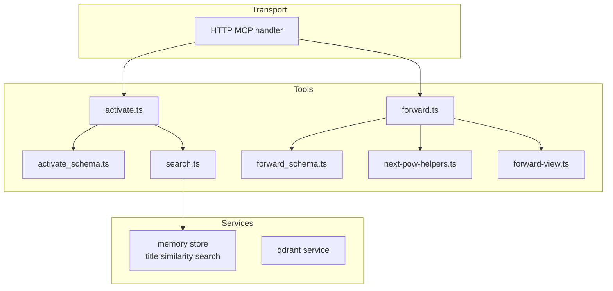
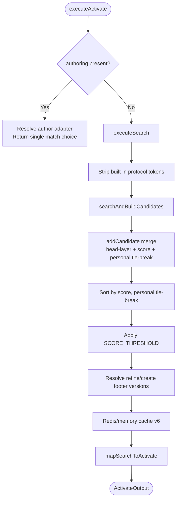
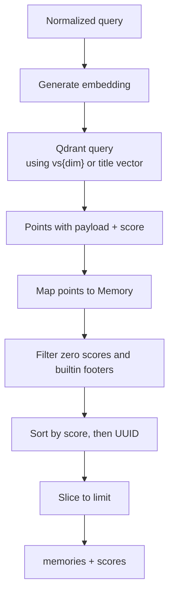
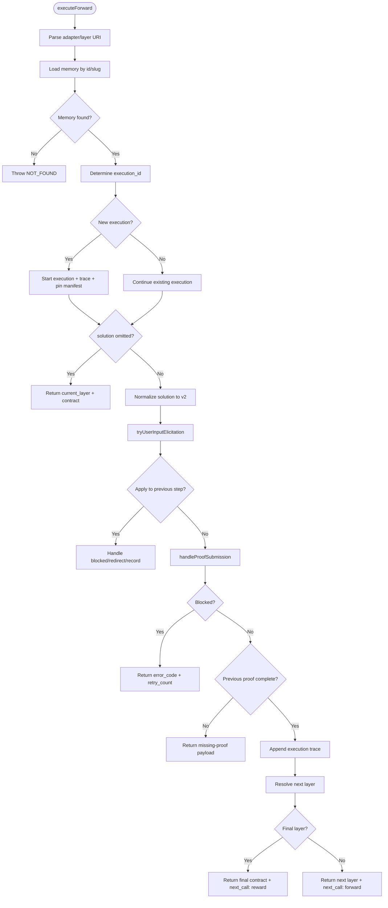
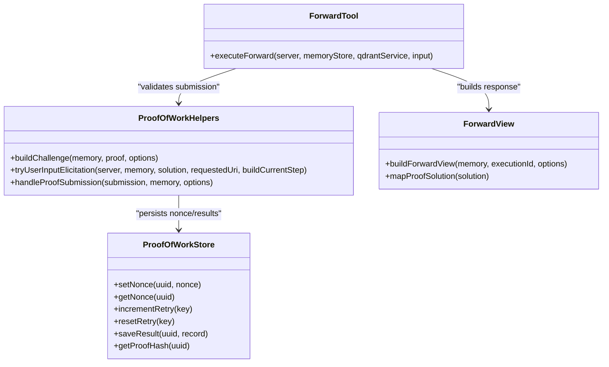
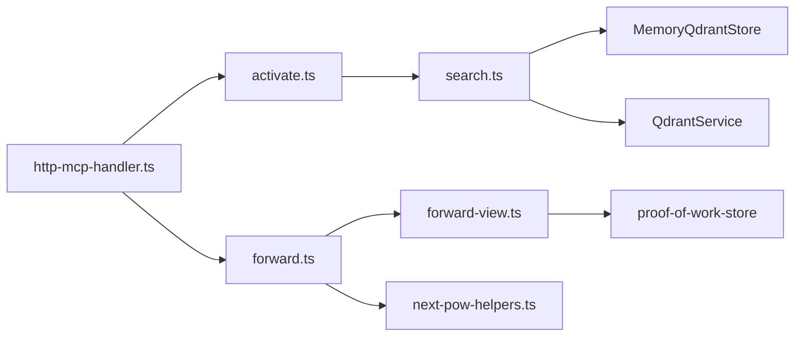

# Workflow Tools (Activate & Forward)

<cite>
**Referenced Files in This Document**
- [activate.ts](file://src/tools/activate.ts)
- [activate_schema.ts](file://src/tools/activate_schema.ts)
- [search.ts](file://src/tools/search.ts)
- [store-title-similarity-search.ts](file://src/services/memory/store-title-similarity-search.ts)
- [forward.ts](file://src/tools/forward.ts)
- [forward_schema.ts](file://src/tools/forward_schema.ts)
- [next-pow-helpers.ts](file://src/tools/next-pow-helpers.ts)
- [forward-view.ts](file://src/tools/forward-view.ts)
- [http-mcp-handler.ts](file://src/http/http-mcp-handler.ts)
</cite>

## Table of Contents
1. [Introduction](#introduction)
2. [Project Structure](#project-structure)
3. [Core Components](#core-components)
4. [Architecture Overview](#architecture-overview)
5. [Detailed Component Analysis](#detailed-component-analysis)
6. [Dependency Analysis](#dependency-analysis)
7. [Performance Considerations](#performance-considerations)
8. [Troubleshooting Guide](#troubleshooting-guide)
9. [Conclusion](#conclusion)

## Introduction
This document explains the two foundational workflow tools that drive SquadRules agent automation: `activate` and `forward`. Together they implement the canonical agent loop:

1. **Activate**: Given a natural-language query, select the best adapter or protocol from stored memory using semantic search, ranking, and space-aware filtering. It returns ranked choices with instructions for the next step.
2. **Forward**: Execute an adapter’s layered workflow. It loads a contract, validates challenge-response submissions, generates proofs, collects evidence, advances layers, and signals when to call `reward`.

The system is designed for AI agents as primary users. Humans configure preferences through agents; adapters provide deterministic, auditable task execution. The runtime uses Redis for sessions and rate limiting, Qdrant or LanceDB for vector search, and filesystem storage for configuration and artifacts. Authentication uses Keycloak + Google IdP OAuth2/JWT, validating both human and agent requests.

## Project Structure
The core workflow lives under `src/tools`, with supporting services under `src/services` and HTTP/MCP transport under `src/http`.



**Diagram sources**
- [activate.ts:168-229](file://src/tools/activate.ts#L168-L229)
- [search.ts:192-253](file://src/tools/search.ts#L192-L253)
- [forward.ts:91-339](file://src/tools/forward.ts#L91-L339)
- [http-mcp-handler.ts:115-308](file://src/http/http-mcp-handler.ts#L115-L308)

**Section sources**
- [activate.ts:1-281](file://src/tools/activate.ts#L1-L281)
- [forward.ts:1-340](file://src/tools/forward.ts#L1-L340)
- [http-mcp-handler.ts:115-348](file://src/http/http-mcp-handler.ts#L115-L348)

## Core Components
- **Activate tool**: Validates input, optionally enters authoring mode, runs semantic search, maps results into activation choices, and returns structured guidance including `execution_id`, `choices`, and artifact materialization hints.
- **Search pipeline**: Normalizes queries, caches results, builds candidate maps with head-layer preference and personal-space tie-breaking, applies score thresholds, and produces unified output with refine/create footers.
- **Forward tool**: Resolves adapter or layer URIs, starts or continues an execution, handles user-input elicitation, validates proof submissions, enforces previous-step ordering, records traces, and returns the next layer or final reward instruction.
- **Proof-of-work helpers**: Build challenges, rotate nonces, validate shell/forward/user_input/comment/subagent submissions, compute proof hashes, and return blocked payloads with retry counts.
- **Forward view builder**: Converts memory and contracts into user-facing forward responses, computes next calls, and normalizes solution shapes.

**Section sources**
- [activate.ts:168-229](file://src/tools/activate.ts#L168-L229)
- [search.ts:93-186](file://src/tools/search.ts#L93-L186)
- [forward.ts:91-339](file://src/tools/forward.ts#L91-L339)
- [next-pow-helpers.ts:127-333](file://src/tools/next-pow-helpers.ts#L127-L333)
- [forward-view.ts:210-309](file://src/tools/forward-view.ts#L210-L309)

## Architecture Overview
The activate→forward chain is implemented as MCP tools exposed over HTTP JSON-RPC.

```mermaid
sequenceDiagram
participant Client as "MCP Client"
participant Http as "HTTP MCP Handler"
participant Activate as "activate.executeActivate"
participant Search as "search.executeSearch"
participant Memory as "MemoryQdrantStore"
participant Qdrant as "QdrantService"
participant Forward as "forward.executeForward"
participant Proof as "handleProofSubmission"
participant View as "buildForwardView"
Client->>Http : POST /mcp {method : "tools/call", params : {name : "activate"}}
Http->>Activate : executeActivate(input)
Activate->>Search : executeSearch(memoryStore, qdrantService, input)
Search->>Memory : searchMemories(query, limit, collapse)
Memory-->>Search : memories + scores
Search-->>Activate : SearchOutput
Activate-->>Client : ActivateOutput{choices, execution_id}
Client->>Http : POST /mcp {method : "tools/call", params : {name : "forward", uri,...}}
Http->>Forward : executeForward(server, memoryStore, qdrantService, input)
Forward->>View : buildContractResponse(...)
View-->>Forward : contract + current_layer
alt continuation with solution
Forward->>Proof : handleProofSubmission(solution, memory)
Proof-->>Forward : HandleProofResult
Forward->>View : buildForwardView(next or final)
else start without solution
Forward->>View : buildForwardView(contract only)
end
Forward-->>Client : ForwardOutput{contract, next_call, execution_id}
```

**Diagram sources**
- [http-mcp-handler.ts:115-308](file://src/http/http-mcp-handler.ts#L115-L308)
- [activate.ts:168-229](file://src/tools/activate.ts#L168-L229)
- [search.ts:192-253](file://src/tools/search.ts#L192-L253)
- [forward.ts:91-339](file://src/tools/forward.ts#L91-L339)
- [forward-view.ts:210-309](file://src/tools/forward-view.ts#L210-L309)
- [next-pow-helpers.ts:127-333](file://src/tools/next-pow-helpers.ts#L127-L333)

## Detailed Component Analysis

### Activate Tool
The activate tool selects the best adapter for a query and returns actionable choices.

#### Input Schema
- `query`: Required activation query string.
- `authoring`: Optional authoring context for create/review/update workflows.
- `execution_id`: Optional UUID for refinement sequences; echo it back when refining.
- `space` / `space_id`: Optional scope filter.
- `max_choices`: Optional integer bounded by configured minimum and maximum limits.

#### Output Schema
- `must_obey`: Always true; pick one choice and follow its `next_action`.
- `message`: Human-readable guidance, including grounding reminder and match count.
- `next_action`: Global directive to pick a choice.
- `execution_id`: Server-issued ID for refinement tracking.
- `query`: Echoed request query.
- `choices`: Array of discriminated union entries with roles `match`, `refine`, or `create`.
- `squadrules_local_artifact_dir`: Ordered URI hints for local handoff directories.
- `transport`: Indicates stdio or http transport mode.

#### Adapter Selection Algorithm
1. **Authoring shortcut**: If `authoring` is provided, route to the built-in author adapter and return a single match choice with `forward_first_call`.
2. **Query normalization**: Strip built-in protocol URIs and slugs so they do not influence search or cache keys.
3. **Candidate building**:
   - Perform initial semantic search with a dynamic first limit based on `max_choices`.
   - Optionally perform a second pass without group collapse if candidates are insufficient.
   - Merge candidates by adapter key, preferring head layers (`layer_index === 1`) and higher scores.
   - Break ties by preferring the default write space when scores are equal within epsilon.
4. **Ranking and thresholding**:
   - Sort by descending score, then prefer personal/default-write space on ties.
   - Slice to effective limit.
   - Apply a score threshold when creating results.
5. **Footer protocols**: Resolve refine and create protocol versions; include them in unified output.
6. **Caching**: Cache unified search output keyed by space, normalized query, group-collapse flag, and effective limit.
7. **Choice mapping**: Convert search results into activation choices, attaching linked artifacts, labels, tags, version, space name, slug, and `forward_first_call` where applicable.



**Diagram sources**
- [activate.ts:44-166](file://src/tools/activate.ts#L44-L166)
- [search.ts:35-186](file://src/tools/search.ts#L35-L186)
- [search.ts:192-253](file://src/tools/search.ts#L192-L253)

**Section sources**
- [activate.ts:30-166](file://src/tools/activate.ts#L30-L166)
- [activate.ts:168-229](file://src/tools/activate.ts#L168-L229)
- [activate_schema.ts:86-135](file://src/tools/activate_schema.ts#L86-L135)
- [search.ts:35-186](file://src/tools/search.ts#L35-L186)
- [search.ts:192-253](file://src/tools/search.ts#L192-L253)

### Semantic Search and Ranking
The search pipeline provides the foundation for adapter selection.

- **Embedding generation**: Queries are embedded via the embedding service.
- **Vector search**: Qdrant performs similarity search against adapter title vectors or main vectors depending on the path.
- **Space filtering**: Built-in refine/create protocols are excluded; space filters restrict results to allowed spaces.
- **Group collapse**: When enabled, the pipeline prefers head layers and may run a fallback search without collapse.
- **Tie-breaking**: Personal/default-write space wins ties; otherwise insertion order or UUID comparison is used.
- **Anomaly logging**: Result count, query length, and top score are logged for monitoring.



**Diagram sources**
- [store-title-similarity-search.ts:9-60](file://src/services/memory/store-title-similarity-search.ts#L9-L60)

**Section sources**
- [search.ts:93-186](file://src/tools/search.ts#L93-L186)
- [store-title-similarity-search.ts:9-60](file://src/services/memory/store-title-similarity-search.ts#L9-L60)

### Forward Tool Execution Engine
The forward tool drives step-by-step execution of adapter layers.

#### Input Schema
- `uri`: Adapter or layer URI.
- `solution`: Optional; required only for continuation calls with `?execution_id=...`.
- `authoring`: Optional authoring context copied from activate; fixed per execution.

#### Output Schema
- `current_layer`: Layer URI and markdown content.
- `contract`: Challenge definition describing required proof type and fields.
- `next_call`: Discriminated union indicating whether to call `forward` again or `reward`.
- `execution_id`: Execution identifier.
- `proof_hash`: Optional hash of accepted proof.
- `error_code`, `retry_count`: Present when a submission is blocked.
- UI metadata: Activation space name, context adapter name, current layer label, layer index/count.
- Artifact directory hints.

#### Step-by-Step Flow
1. **URI parsing and loading**:
   - Parse adapter or layer URI.
   - Load memory; throw NOT_FOUND if missing.
   - Determine execution ID; start new execution if needed.
2. **Authoring validation**:
   - Validate authoring operation and target adapter.
   - Enforce fixed authoring context across continuations.
3. **Execution state**:
   - Start execution record and trace.
   - Pin layer manifest to prevent UUID churn.
4. **First call without solution**:
   - Return current layer and contract; no solution accepted.
5. **Solution processing**:
   - Normalize solution shape to v2 envelope with `type`, `outcome`, and `evidence`.
   - Attempt user-input elicitation if contract requires confirmation.
   - Try applying solution to previous step when appropriate.
   - Validate proof submission: nonce, proof hash, type, field presence, placeholder detection, forward target matching, comment relevance.
   - Record result and compute proof hash.
   - Check previous proof completion; if missing, return missing-proof payload.
   - Append execution trace.
   - Resolve next layer or mark final.
6. **Final response**:
   - Return final contract instructing reward with outcome template derived from stored proof status.



**Diagram sources**
- [forward.ts:91-339](file://src/tools/forward.ts#L91-L339)
- [forward-view.ts:210-309](file://src/tools/forward-view.ts#L210-L309)
- [next-pow-helpers.ts:127-333](file://src/tools/next-pow-helpers.ts#L127-L333)

**Section sources**
- [forward.ts:91-339](file://src/tools/forward.ts#L91-L339)
- [forward_schema.ts:234-314](file://src/tools/forward_schema.ts#L234-L314)
- [forward-view.ts:131-150](file://src/tools/forward-view.ts#L131-L150)
- [forward-view.ts:210-309](file://src/tools/forward-view.ts#L210-L309)

### Challenge-Response Patterns and Proof Generation
Proof handling ensures adapters produce auditable, verifiable work.

- **Challenge construction**: Generates nonce, attaches contract shape, and persists nonce for replay protection.
- **Nonce rotation**: On mismatch, rotates nonce to avoid unrecoverable loops and returns fresh challenge.
- **Proof hash chaining**: Requires `proof_hash` when expected; mismatches block submission.
- **Type enforcement**: Submission type must match contract type.
- **Shell proof**: Rejects placeholder stdout/stderr; records exit code and optional duration.
- **Forward proof**: Validates target matches contract; rejects missing or mismatched targets.
- **User input proof**: Supports elicitation flow; records confirmation and timestamp.
- **Comment proof**: Enforces minimum length and optional semantic relevance check against step content.
- **Subagent proof**: Requires delegation report; mandatory delegation instruction appended.
- **Result persistence**: Saves result, computes canonical proof hash, resets retry counter on success.



**Diagram sources**
- [next-pow-helpers.ts:43-125](file://src/tools/next-pow-helpers.ts#L43-L125)
- [next-pow-helpers.ts:127-333](file://src/tools/next-pow-helpers.ts#L127-L333)
- [forward.ts:91-339](file://src/tools/forward.ts#L91-L339)
- [forward-view.ts:67-124](file://src/tools/forward-view.ts#L67-L124)

**Section sources**
- [next-pow-helpers.ts:43-125](file://src/tools/next-pow-helpers.ts#L43-L125)
- [next-pow-helpers.ts:127-333](file://src/tools/next-pow-helpers.ts#L127-L333)

### API Specifications

#### HTTP Endpoint
- **Method**: `POST`
- **Path**: `/mcp`
- **Content-Type**: `application/json`
- **Authentication**: Bearer JWT token validated against trusted issuers and audiences when auth is enabled.
- **Request body**: JSON-RPC 2.0 object with `id`, `method`, and `params`.
- **Supported methods**:
  - `tools/call`: Call MCP tools such as `activate` and `forward`.
  - `listOfferingsForUI`: Discover available offerings for UI clients.

**Request schema (tools/call)**
- `id`: Request identifier.
- `method`: `"tools/call"`.
- `params`:
  - `name`: Tool name (`activate` or `forward`).
  - `arguments`: Tool-specific parameters defined below.

**Response schema**
- JSON-RPC 2.0 object with `jsonrpc`, `result`, or `error`.
- Errors include `code`, `message`, and `data.error_code` plus `retry_hint`.

**Section sources**
- [http-mcp-handler.ts:115-348](file://src/http/http-mcp-handler.ts#L115-L348)

#### MCP Protocol Methods

##### activate
- **Purpose**: Find the best adapter for the current input and return ranked activation choices.
- **Input**:
  - `query`: String.
  - `authoring`: Optional authoring context.
  - `execution_id`: Optional UUID.
  - `space`: Optional space name or id alias.
  - `space_id`: Alias for space.
  - `max_choices`: Optional integer within configured bounds.
- **Output**:
  - `must_obey`: Boolean.
  - `message`: String.
  - `next_action`: String.
  - `execution_id`: Optional UUID.
  - `query`: String.
  - `choices`: Array of match/refine/create choices.
  - `squadrules_local_artifact_dir`: Optional array of URI hints.
  - `transport`: Optional enum `stdio` or `http`.

**Section sources**
- [activate_schema.ts:86-135](file://src/tools/activate_schema.ts#L86-L135)
- [activate.ts:231-281](file://src/tools/activate.ts#L231-L281)

##### forward
- **Purpose**: Start or continue an adapter workflow by submitting solutions to contracts.
- **Input**:
  - `uri`: Adapter or layer URI.
  - `solution`: Optional v2 solution envelope with `type`, `outcome`, and `evidence`; omit on start calls.
  - `authoring`: Optional authoring context.
- **Output**:
  - `current_layer`: Object with `uri`, `content`, `mimeType`.
  - `contract`: Challenge definition.
  - `next_call`: Discriminated union with `kind` `forward` or `reward`.
  - `execution_id`: Optional UUID.
  - `proof_hash`: Optional string.
  - `message`, `error_code`, `retry_count`: Optional diagnostic fields.
  - UI metadata: `activation_space_name`, `context_adapter_name`, `current_layer_label`, `adapter_layer_index`, `adapter_layer_count`.
  - `squadrules_local_artifact_dir`: Optional array of URI hints.

**Section sources**
- [forward_schema.ts:234-314](file://src/tools/forward_schema.ts#L234-L314)
- [forward.ts:91-339](file://src/tools/forward.ts#L91-L339)

### Practical Examples

#### Activate → Forward Chain
1. **Call activate**:
   - Provide `query` describing the desired workflow.
   - Optionally provide `space` or `space_id` to scope results.
   - Receive `choices` with `role`, `label`, `activation_score`, `tags`, `next_action`, and `forward_first_call`.
2. **Pick a choice**:
   - For `match` or `refine`, copy `forward_first_call.uri` and any `authoring` into the forward call.
   - Follow `next_action` to call forward with no solution to load the contract.
3. **Call forward (start)**:
   - Use adapter URI or layer URI without `execution_id`.
   - Omit `solution`.
   - Receive `contract` and `next_call.forward.args.solution_template`.
4. **Call forward (continue)**:
   - Use layer URI with `?execution_id={uuid}`.
   - Include `solution.type`, `outcome`, and `evidence` matching the contract.
   - Echo `nonce` and `proof_hash` when present.
5. **Repeat until final**:
   - Final response includes `next_call.kind === 'reward'`.
   - Call reward with outcome and feedback.

#### Parameter Combinations
- **Activate with space scoping**: Provide `space` or `space_id` to limit results to a specific space.
- **Activate refinement**: Re-run activate with the same `execution_id` and refined `query` to improve selection.
- **Forward authoring workflow**: Copy `authoring` from activate’s `forward_first_call` into forward; the server enforces fixed authoring context per execution.
- **Forward with user input**: If contract requires user confirmation, the server may elicit confirmation before proceeding.

#### Expected Outputs
- **Activate**: Ranked choices with clear next actions and artifact materialization instructions when linked artifacts exist.
- **Forward**: Contract-driven steps with evidence requirements, retry guidance, and final reward instruction.

**Section sources**
- [activate.ts:44-166](file://src/tools/activate.ts#L44-L166)
- [forward-view.ts:210-309](file://src/tools/forward-view.ts#L210-L309)
- [forward_schema.ts:234-314](file://src/tools/forward_schema.ts#L234-L314)

## Dependency Analysis
The tools depend on shared services for memory access, vector search, proof persistence, and transport handling.



**Diagram sources**
- [activate.ts:168-229](file://src/tools/activate.ts#L168-L229)
- [search.ts:192-253](file://src/tools/search.ts#L192-L253)
- [forward.ts:91-339](file://src/tools/forward.ts#L91-L339)
- [forward-view.ts:210-309](file://src/tools/forward-view.ts#L210-L309)
- [http-mcp-handler.ts:115-308](file://src/http/http-mcp-handler.ts#L115-L308)

**Section sources**
- [activate.ts:168-229](file://src/tools/activate.ts#L168-L229)
- [search.ts:192-253](file://src/tools/search.ts#L192-L253)
- [forward.ts:91-339](file://src/tools/forward.ts#L91-L339)
- [http-mcp-handler.ts:115-308](file://src/http/http-mcp-handler.ts#L115-L308)

## Performance Considerations
- **Semantic search caching**: Activate search results are cached with a TTL; cache keys include space, normalized query, group-collapse flag, and effective limit.
- **Vector search efficiency**: Qdrant queries use quantization rescore and filtered space constraints; title-vector search excludes builtin footers and head-layer-only queries.
- **Concurrent request limiting**: MCP handler enforces a maximum concurrent request limit; excess requests receive 503 with Retry-After.
- **Trace persistence**: Execution traces are persisted fire-and-forget to avoid blocking the main flow.
- **Artifact materialization**: Linked artifacts require client-side export and verification; this shifts heavy I/O to the agent/client side.

[No sources needed since this section provides general guidance]

## Troubleshooting Guide

### Common Issues
- **Adapter conflicts or ambiguous slugs**:
  - Symptom: Multiple adapters match a slug; forward returns a disambiguation note.
  - Resolution: Use the exact layer URI returned by activate or forward; avoid ambiguous slugs.
- **Nonce mismatch**:
  - Symptom: Error code indicates nonce mismatch; response includes a fresh nonce.
  - Resolution: Use the `retry_nonce` from the latest challenge; do not reuse stale nonces.
- **Proof hash mismatch**:
  - Symptom: Error code indicates proof hash mismatch.
  - Resolution: Echo `proof_hash` from the previous response or contract.
- **Missing proof for previous step**:
  - Symptom: Response indicates missing proof; includes current step and retry guidance.
  - Resolution: Submit the required proof for the previous step before continuing.
- **Placeholder evidence**:
  - Symptom: Shell proof rejected because stdout/stderr still contain template placeholders.
  - Resolution: Replace placeholders with actual command output.
- **Forward target mismatch**:
  - Symptom: Forward proof rejected due to target mismatch.
  - Resolution: Submit evidence.target matching the contracted target URI.
- **Comment too short or irrelevant**:
  - Symptom: Comment proof rejected for length or low semantic similarity.
  - Resolution: Provide a longer, relevant summary engaging with the step content.
- **User declined confirmation**:
  - Symptom: Elicitation failed or user declined.
  - Resolution: Retry with updated solution or adjust user interaction flow.

### Error Handling Patterns
- **SquadrulesError**: Structured errors with code, message, and optional details; mapped to JSON-RPC error responses with `error_code` and `retry_hint`.
- **Rate limiting**: Activate tool wraps errors with rate-limit helper; MCP handler returns 503 when overloaded.
- **Validation errors**: Input schemas enforce types, ranges, and relationships; invalid inputs return teaching-friendly error results.

**Section sources**
- [forward.ts:91-152](file://src/tools/forward.ts#L91-L152)
- [next-pow-helpers.ts:143-195](file://src/tools/next-pow-helpers.ts#L143-L195)
- [next-pow-helpers.ts:208-333](file://src/tools/next-pow-helpers.ts#L208-L333)
- [http-mcp-handler.ts:74-105](file://src/http/http-mcp-handler.ts#L74-L105)
- [http-mcp-handler.ts:168-192](file://src/http/http-mcp-handler.ts#L168-L192)
- [activate.ts:247-278](file://src/tools/activate.ts#L247-L278)

## Conclusion
The `activate` and `forward` tools form the backbone of SquadRules agent automation. Activate performs semantic search and ranking to select the best adapter, while forward executes layered workflows with robust challenge-response validation, proof generation, and evidence collection. Together they enable deterministic, auditable automation driven by AI agents, with clear APIs for both HTTP and MCP protocols, strong error handling, and performance-conscious design.

[No sources needed since this section summarizes without analyzing specific files]