# Tool Development Guide

<cite>
**Referenced Files in This Document**
- [tool-registry.ts](file://src/tools/tool-registry.ts)
- [activate_schema.ts](file://src/tools/activate_schema.ts)
- [forward_schema.ts](file://src/tools/forward_schema.ts)
- [reward_schema.ts](file://src/tools/reward_schema.ts)
- [train_schema.ts](file://src/tools/train_schema.ts)
- [tune_schema.ts](file://src/tools/tune_schema.ts)
- [delete_schema.ts](file://src/tools/delete_schema.ts)
- [export_schema.ts](file://src/tools/export_schema.ts)
- [spaces_schema.ts](file://src/tools/spaces_schema.ts)
- [activate.ts](file://src/tools/activate.ts)
- [forward-register.ts](file://src/tools/forward-register.ts)
- [reward.ts](file://src/tools/reward.ts)
- [train.ts](file://src/tools/train.ts)
- [tune.ts](file://src/tools/tune.ts)
- [delete.ts](file://src/tools/delete.ts)
- [export.ts](file://src/tools/export.ts)
- [spaces.ts](file://src/tools/spaces.ts)
</cite>

## Table of Contents
1. [Introduction](#introduction)
2. [Project Structure](#project-structure)
3. [Core Components](#core-components)
4. [Architecture Overview](#architecture-overview)
5. [Detailed Component Analysis](#detailed-component-analysis)
6. [Dependency Analysis](#dependency-analysis)
7. [Performance Considerations](#performance-considerations)
8. [Troubleshooting Guide](#troubleshooting-guide)
9. [Conclusion](#conclusion)
10. [Appendices](#appendices)

## Introduction
This guide explains how to design, implement, register, and maintain custom SquadRules tools that integrate with the existing MCP tool ecosystem. The repository implements an agent-first workflow where AI agents drive execution through a deterministic chain: activate → forward → reward. Adapters are stored as layered protocols, and tools expose typed contracts using Zod schemas. The canonical tool surface is defined once and reused by MCP registration, HTTP routes, CLI commands, and UI bindings.

Key principles for custom tools:
- Define strict input/output contracts with Zod.
- Keep business logic separate from transport wiring.
- Register tools through the same pattern used by built-ins.
- Use the canonical registry for parity across surfaces.
- Enforce security boundaries around URIs, spaces, artifacts, and storage paths.
- Emit telemetry consistently and handle errors predictably.

## Project Structure
The SquadRules tool layer lives under `src/tools`. Each tool typically has:
- A schema file describing Zod input/output contracts.
- An implementation file exporting both an executor function and a registration helper.
- Optional helpers for validation, artifact handling, or domain logic.

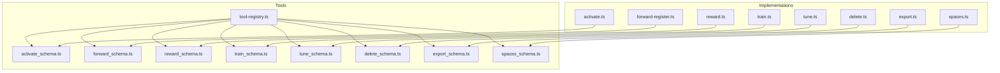

**Diagram sources**
- [tool-registry.ts:25-91](file://src/tools/tool-registry.ts#L25-L91)
- [activate_schema.ts:86-139](file://src/tools/activate_schema.ts#L86-L139)
- [forward_schema.ts:234-318](file://src/tools/forward_schema.ts#L234-L318)
- [reward_schema.ts:10-53](file://src/tools/reward_schema.ts#L10-L53)
- [train_schema.ts:54-246](file://src/tools/train_schema.ts#L54-L246)
- [tune_schema.ts:14-72](file://src/tools/tune_schema.ts#L14-L72)
- [delete_schema.ts:14-33](file://src/tools/delete_schema.ts#L14-L33)
- [export_schema.ts:44-162](file://src/tools/export_schema.ts#L44-L162)
- [spaces_schema.ts:3-53](file://src/tools/spaces_schema.ts#L3-L53)

**Section sources**
- [tool-registry.ts:16-24](file://src/tools/tool-registry.ts#L16-L24)

## Core Components
The core components for building custom tools are:
- Schema definitions: Zod-based contracts for inputs and outputs.
- Executor functions: Pure or side-effecting logic that transforms validated inputs into outputs.
- Registration helpers: Transport wiring that validates, measures, and invokes executors.
- Canonical registry: Central list of tool names, descriptions, and schema references.

Schema design principles:
- Prefer discriminated unions for polymorphic payloads (for example, activation choices).
- Normalize legacy formats before validation when backward compatibility is required.
- Validate URIs against canonical patterns.
- Add descriptive messages for human-readable error guidance.
- Export TypeScript types inferred from Zod schemas.

Executor responsibilities:
- Perform tenant and space scoping.
- Call downstream services (memory store, Qdrant service, trace stores).
- Return structured output matching the output schema.
- Throw typed errors for recoverable vs non-recoverable failures.

Registration responsibilities:
- Wrap the executor with input parsing, metrics, and error handling.
- Return MCP-compatible content and structuredContent.
- Provide UI metadata when applicable.

**Section sources**
- [activate_schema.ts:86-139](file://src/tools/activate_schema.ts#L86-L139)
- [forward_schema.ts:234-318](file://src/tools/forward_schema.ts#L234-L318)
- [reward_schema.ts:10-53](file://src/tools/reward_schema.ts#L10-L53)
- [train_schema.ts:54-246](file://src/tools/train_schema.ts#L54-L246)
- [tune_schema.ts:14-72](file://src/tools/tune_schema.ts#L14-L72)
- [delete_schema.ts:14-33](file://src/tools/delete_schema.ts#L14-L33)
- [export_schema.ts:44-162](file://src/tools/export_schema.ts#L44-L162)
- [spaces_schema.ts:3-53](file://src/tools/spaces_schema.ts#L3-L53)

## Architecture Overview
The SquadRules tool architecture follows a consistent pattern:
- MCP clients call tools via MCP or HTTP.
- The server resolves the tool name and dispatches to the registered handler.
- The handler parses and validates input using Zod.
- The handler calls an executor function.
- The executor performs domain work and returns structured output.
- Metrics and telemetry are recorded around each call.

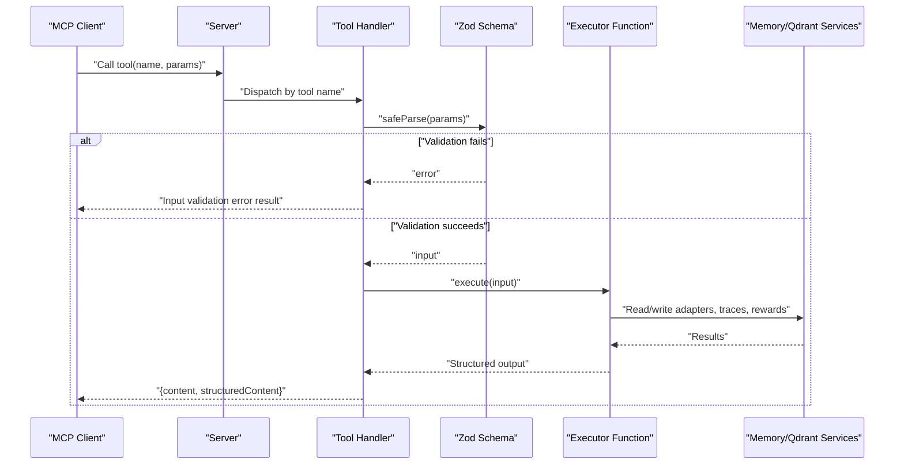

**Diagram sources**
- [activate.ts:231-281](file://src/tools/activate.ts#L231-L281)
- [forward-register.ts:18-66](file://src/tools/forward-register.ts#L18-L66)
- [reward.ts:132-176](file://src/tools/reward.ts#L132-L176)
- [train.ts:246-382](file://src/tools/train.ts#L246-L382)
- [tune.ts:19-70](file://src/tools/tune.ts#L19-L70)
- [delete.ts:73-116](file://src/tools/delete.ts#L73-L116)
- [export.ts:347-391](file://src/tools/export.ts#L347-L391)
- [spaces.ts:195-255](file://src/tools/spaces.ts#L195-L255)

## Detailed Component Analysis

### Tool Registry System
The canonical registry defines all available tools, their titles, descriptions, UI metadata, and schema references. It is the single source of truth for MCP tools/list, HTTP routes, and CLI commands.

Key behaviors:
- Exports a constant array of tool descriptors.
- References Zod schemas for strict input and output contracts.
- Resolves documentation dynamically.
- Provides a union type for tool names and a readonly list of names.

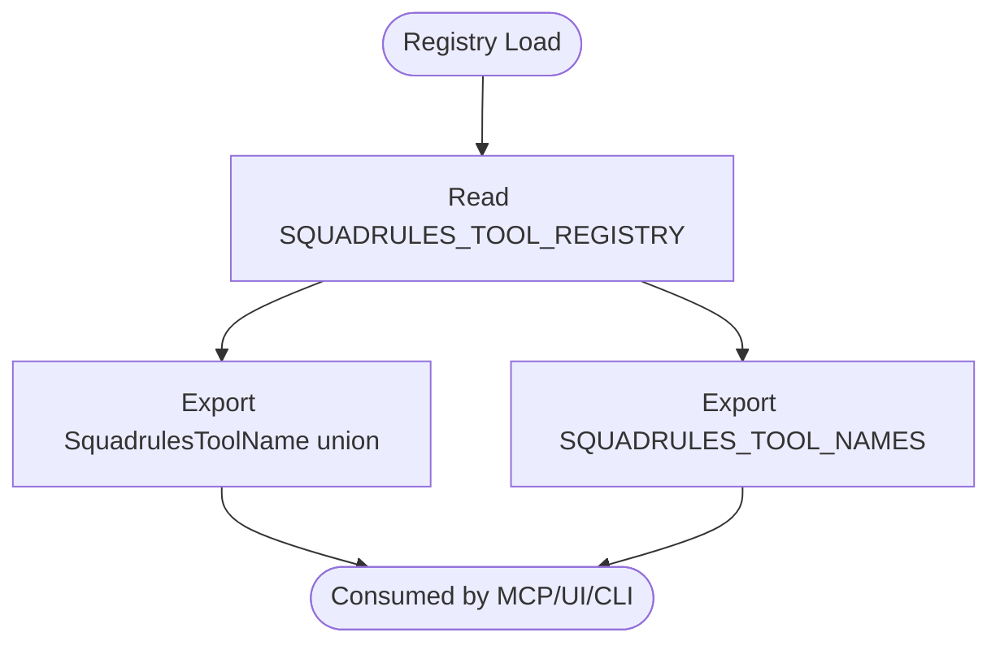

**Diagram sources**
- [tool-registry.ts:25-99](file://src/tools/tool-registry.ts#L25-L99)

**Section sources**
- [tool-registry.ts:16-24](file://src/tools/tool-registry.ts#L16-L24)
- [tool-registry.ts:25-99](file://src/tools/tool-registry.ts#L25-L99)

### Activate Tool
Purpose:
- Selects the best adapter for a query.
- Supports authoring workflows, refinement sequences, and linked artifact instructions.

Contract highlights:
- Input includes query, optional authoring context, execution_id, space scoping, and choice limits.
- Output includes must_obey, next_action, choices with discriminated roles, and local artifact directory hints.

Execution flow:
- Normalizes URIs and enriches choices with artifact information.
- Routes authoring requests to a dedicated adapter workflow.
- Emits telemetry and structured results.

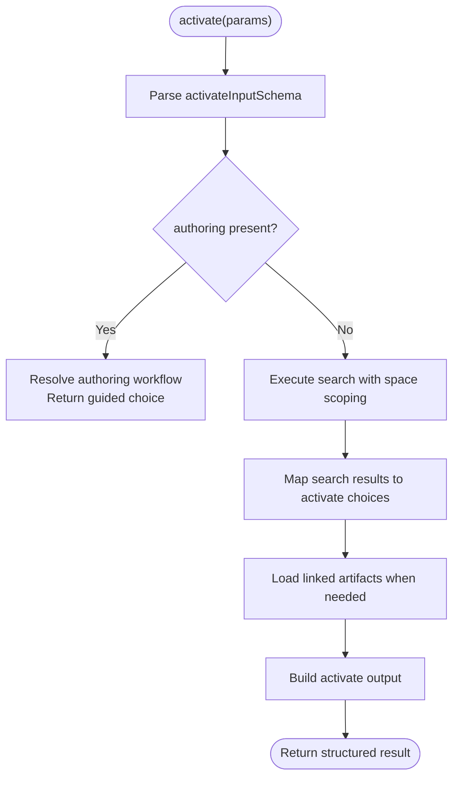

**Diagram sources**
- [activate.ts:44-166](file://src/tools/activate.ts#L44-L166)
- [activate.ts:168-229](file://src/tools/activate.ts#L168-L229)
- [activate_schema.ts:86-139](file://src/tools/activate_schema.ts#L86-L139)

**Section sources**
- [activate.ts:231-281](file://src/tools/activate.ts#L231-L281)
- [activate_schema.ts:86-139](file://src/tools/activate_schema.ts#L86-L139)

### Forward Tool
Purpose:
- Loads adapter contract and advances workflow state.
- Supports multiple layer types: shell, forward, user_input, comment, subagent.
- Normalizes legacy solution shapes into v2 envelopes.

Contract highlights:
- Input accepts adapter or layer URIs; solution is required only on continuation calls.
- Output includes current layer, contract, next_action, proof_hash, execution_id, and next_call.

Validation strategy:
- Preprocesses solution payloads to normalize evidence and outcome fields.
- Enforces forbidden combinations (for example, sending solution on start calls).

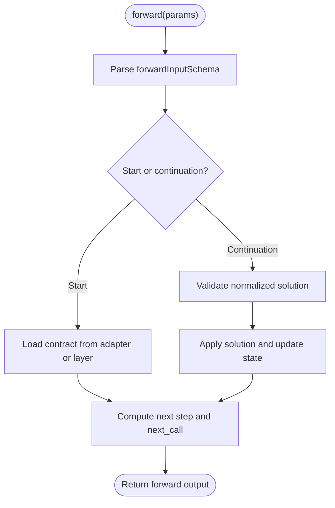

**Diagram sources**
- [forward_schema.ts:234-318](file://src/tools/forward_schema.ts#L234-L318)
- [forward-register.ts:18-66](file://src/tools/forward-register.ts#L18-L66)

**Section sources**
- [forward_schema.ts:234-318](file://src/tools/forward_schema.ts#L234-L318)
- [forward-register.ts:18-66](file://src/tools/forward-register.ts#L18-L66)

### Reward Tool
Purpose:
- Records execution outcomes and scores for training and preference datasets.
- Guards against recording success when the last stored proof failed.

Contract highlights:
- Input requires layer URI, outcome, and optional score, feedback, rater, rubric_version, llm_model_id.
- Output includes per-result evaluation details, eligibility flags, blockers, and counts.

Execution flow:
- Validates layer URI and conflicts with stored proofs.
- Evaluates reward quality and persists metrics and trace data.

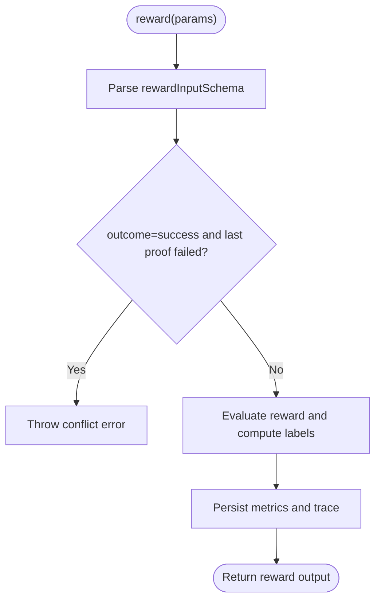

**Diagram sources**
- [reward.ts:28-130](file://src/tools/reward.ts#L28-L130)
- [reward_schema.ts:10-53](file://src/tools/reward_schema.ts#L10-L53)

**Section sources**
- [reward.ts:132-176](file://src/tools/reward.ts#L132-L176)
- [reward_schema.ts:10-53](file://src/tools/reward_schema.ts#L10-L53)

### Train Tool
Purpose:
- Stores new adapters or artifacts.
- Supports fork-from-source, batch directory train, MIME inference, and review evidence requirements.

Contract highlights:
- Input supports content, source_adapter_uri, directory, mime, artifact_name, adapter_uri, relative_path, and review_evidence.
- Output includes stored items, status, and optional batch manifest.

Validation strategy:
- Enforces content selection rules, artifact mode constraints, and review evidence requirements.
- Normalizes artifact relative paths and infers MIME types.

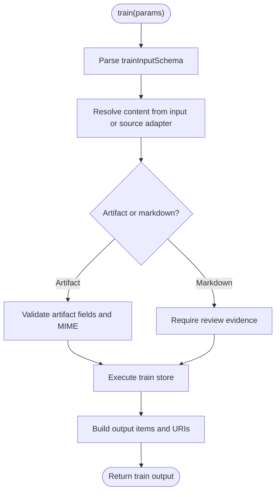

**Diagram sources**
- [train.ts:88-244](file://src/tools/train.ts#L88-L244)
- [train_schema.ts:54-246](file://src/tools/train_schema.ts#L54-L246)

**Section sources**
- [train.ts:246-382](file://src/tools/train.ts#L246-L382)
- [train_schema.ts:54-246](file://src/tools/train_schema.ts#L54-L246)

### Tune Tool
Purpose:
- Updates adapter content or advanced field updates.
- Requires review evidence when content changes.

Contract highlights:
- Input accepts arrays of URIs, optional content, updates, space movement, and review evidence.
- Output reports per-URI results and totals.

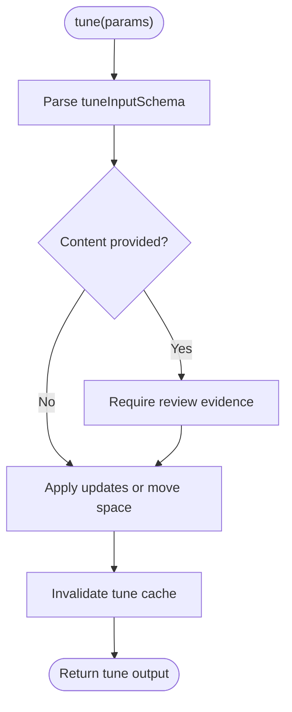

**Diagram sources**
- [tune.ts:19-70](file://src/tools/tune.ts#L19-L70)
- [tune_schema.ts:14-72](file://src/tools/tune_schema.ts#L14-L72)

**Section sources**
- [tune.ts:19-70](file://src/tools/tune.ts#L19-L70)
- [tune_schema.ts:14-72](file://src/tools/tune_schema.ts#L14-L72)

### Delete Tool
Purpose:
- Deletes adapters or layers by URI.

Contract highlights:
- Input accepts a non-empty array of adapter or layer URIs.
- Output reports per-URI status and totals.

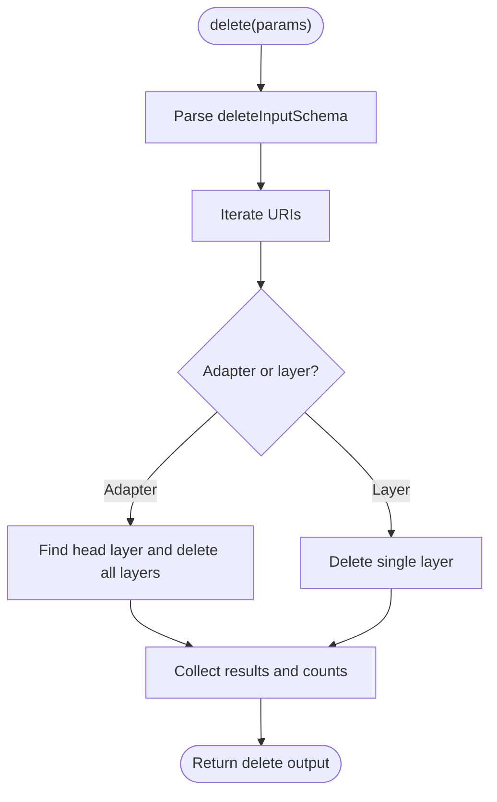

**Diagram sources**
- [delete.ts:12-71](file://src/tools/delete.ts#L12-L71)
- [delete_schema.ts:14-33](file://src/tools/delete_schema.ts#L14-L33)

**Section sources**
- [delete.ts:73-116](file://src/tools/delete.ts#L73-L116)
- [delete_schema.ts:14-33](file://src/tools/delete_schema.ts#L14-L33)

### Export Tool
Purpose:
- Exports adapters, training datasets, skill trees, or ZIP bundles.
- Supports directory-based bulk export and download capability URLs.

Contract highlights:
- Input supports uri, adapters, all_adapters, format, delivery, include_reward, and directory.
- Output varies by format but includes content_type, item_count, and optional manifests or download references.

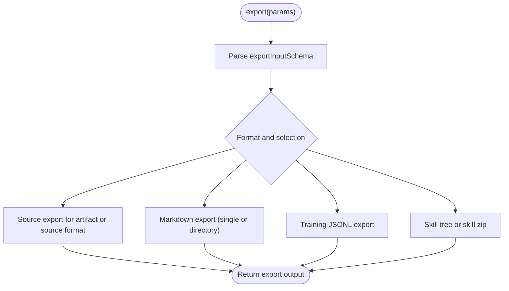

**Diagram sources**
- [export.ts:67-345](file://src/tools/export.ts#L67-L345)
- [export_schema.ts:44-162](file://src/tools/export_schema.ts#L44-L162)

**Section sources**
- [export.ts:347-391](file://src/tools/export.ts#L347-L391)
- [export_schema.ts:44-162](file://src/tools/export_schema.ts#L44-L162)

### Spaces Tool
Purpose:
- Lists available spaces with adapter counts and optional adapter titles and artifacts.

Contract highlights:
- Input toggles inclusion of adapter titles, widget HTML, and artifacts.
- Output includes space info with adapter summaries.

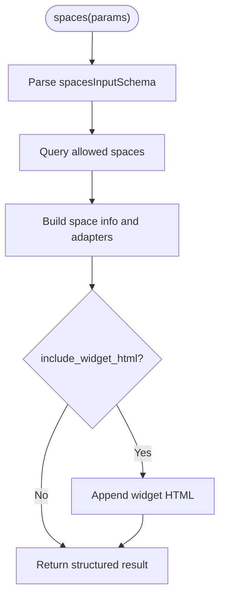

**Diagram sources**
- [spaces.ts:172-189](file://src/tools/spaces.ts#L172-L189)
- [spaces.ts:195-255](file://src/tools/spaces.ts#L195-L255)
- [spaces_schema.ts:3-53](file://src/tools/spaces_schema.ts#L3-L53)

**Section sources**
- [spaces.ts:195-255](file://src/tools/spaces.ts#L195-L255)
- [spaces_schema.ts:3-53](file://src/tools/spaces_schema.ts#L3-L53)

## Dependency Analysis
Custom tools depend on:
- Zod schemas for contract enforcement.
- Tenant and space context utilities for authorization and scoping.
- Memory and Qdrant services for persistence and retrieval.
- Telemetry and metrics modules for observability.
- Error helpers for consistent MCP error responses.

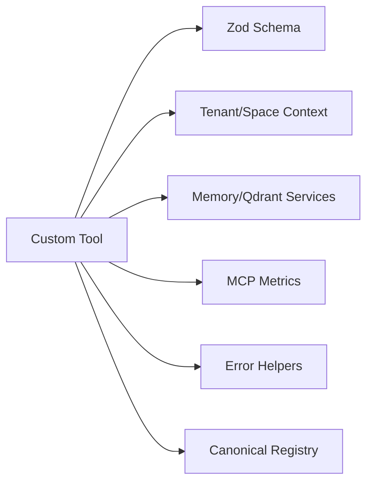

**Diagram sources**
- [activate.ts:1-24](file://src/tools/activate.ts#L1-L24)
- [forward-register.ts:1-12](file://src/tools/forward-register.ts#L1-L12)
- [reward.ts:1-14](file://src/tools/reward.ts#L1-L14)
- [train.ts:1-28](file://src/tools/train.ts#L1-L28)
- [tune.ts:1-11](file://src/tools/tune.ts#L1-L11)
- [delete.ts:1-10](file://src/tools/delete.ts#L1-L10)
- [export.ts:1-27](file://src/tools/export.ts#L1-L27)
- [spaces.ts:1-21](file://src/tools/spaces.ts#L1-L21)

**Section sources**
- [tool-registry.ts:25-99](file://src/tools/tool-registry.ts#L25-L99)

## Performance Considerations
- Avoid heavy computation inside registration; keep it lazy.
- Batch operations where possible (for example, directory-based train/export).
- Use streaming or download references for large exports (for example, skill_zip).
- Limit search and enumeration sizes through schema constraints.
- Cache invalidation after mutations (for example, tune cache invalidation).
- Observe input/output sizes and durations via metrics.

[No sources needed since this section provides general guidance]

## Troubleshooting Guide
Common issues and resolutions:
- Input validation errors: Inspect Zod error path and message; ensure required fields and URIs match expected patterns.
- Forbidden solution on start: Omit solution when starting a run; include it only on continuation calls with execution_id.
- Reward success conflict: Cannot record success if the last stored proof failed; fix the step and retry.
- Duplicate adapter or similar memory: Use force_update or adjust title; follow next_action guidance.
- Space not found or read-only: Validate space parameter and permissions; use allowed space IDs.
- Directory access errors: Ensure absolute paths, no traversal segments, and allowlisted directories.

Debugging techniques:
- Log parsed input and output sizes.
- Inspect structuredContent alongside text content.
- Use tenant and space context to reproduce environment-specific behavior.
- Check error codes and details returned by executors.

**Section sources**
- [forward-schema.ts:231-258](file://src/tools/forward_schema.ts#L231-L258)
- [reward.ts:19-54](file://src/tools/reward.ts#L19-L54)
- [train.ts:38-86](file://src/tools/train.ts#L38-L86)
- [train.ts:295-382](file://src/tools/train.ts#L295-L382)
- [spaces.ts:207-255](file://src/tools/spaces.ts#L207-L255)

## Conclusion
To build custom SquadRules tools:
- Define clear Zod schemas for inputs and outputs.
- Implement pure executors that perform domain logic.
- Register tools using the established pattern with metrics and error handling.
- Align with the canonical registry for consistency across MCP, HTTP, CLI, and UI.
- Follow security and audit guidelines for URIs, spaces, artifacts, and storage paths.
- Test thoroughly and debug using structured logs, metrics, and error payloads.

[No sources needed since this section summarizes without analyzing specific files]

## Appendices

### Step-by-Step Example: Building a Complex Tool with Nested Workflows
Goal:
- Create a tool that orchestrates activate → forward → reward with external service integration and custom validation.

Steps:
1. Define Zod schemas for input and output.
   - Model nested objects and discriminated unions.
   - Validate URIs and enforce business rules.
2. Implement an executor function.
   - Parse and validate input.
   - Call activate to select an adapter.
   - Call forward with normalized solutions.
   - Integrate external service securely (for example, authenticated API call).
   - Record reward with outcome and optional score.
3. Register the tool.
   - Wrap executor with safeParse, metrics, and error handling.
   - Return structuredContent and text content.
4. Add telemetry and audit logging.
   - Emit tool duration, input/output size, and status.
   - Log audit events for sensitive operations.
5. Test strategies.
   - Unit test executor with mocked services.
   - Integration test registration and MCP response shape.
   - Contract tests against Zod schemas.
6. Debug execution issues.
   - Inspect Zod errors and structured error payloads.
   - Verify URIs, spaces, and artifact permissions.
   - Check metrics and audit logs for anomalies.

[No sources needed since this section provides conceptual guidance]