# Tool Ecosystem

<cite>
**Referenced Files in This Document**
- [tool-registry.ts](file://src/tools/tool-registry.ts)
- [activate.ts](file://src/tools/activate.ts)
- [forward.ts](file://src/tools/forward.ts)
- [train.ts](file://src/tools/train.ts)
- [reward.ts](file://src/tools/reward.ts)
- [tune.ts](file://src/tools/tune.ts)
- [delete.ts](file://src/tools/delete.ts)
- [export.ts](file://src/tools/export.ts)
- [spaces.ts](file://src/tools/spaces.ts)
- [activate_schema.ts](file://src/tools/activate_schema.ts)
- [forward_schema.ts](file://src/tools/forward_schema.ts)
- [train_schema.ts](file://src/tools/train_schema.ts)
- [reward_schema.ts](file://src/tools/reward_schema.ts)
- [tune_schema.ts](file://src/tools/tune_schema.ts)
- [delete_schema.ts](file://src/tools/delete_schema.ts)
- [export_schema.ts](file://src/tools/export_schema.ts)
- [spaces_schema.ts](file://src/tools/spaces_schema.ts)
</cite>

## Table of Contents
1. [Introduction](#introduction)
2. [Project Structure](#project-structure)
3. [Core Components](#core-components)
4. [Architecture Overview](#architecture-overview)
5. [Detailed Component Analysis](#detailed-component-analysis)
6. [Dependency Analysis](#dependency-analysis)
7. [Performance Considerations](#performance-considerations)
8. [Troubleshooting Guide](#troubleshooting-guide)
9. [Conclusion](#conclusion)
10. [Appendices](#appendices)

## Introduction
This document explains the SquadRules tool ecosystem: the built-in MCP tools, their schemas, execution flow, error handling, telemetry, and guidelines for developing custom tools. The core lifecycle is activate → forward → reward. Adapters are deterministic, auditable workflows that agents can select, execute, update, export, or remove. Spaces provide multi-tenant isolation. The tool registry is the single source of truth for tool names, descriptions, input/output contracts, and UI metadata.

## Project Structure
The tool ecosystem lives under `src/tools`. Each built-in tool has:
- A registration function exposing the MCP surface.
- An executable function implementing business logic.
- A schema module defining Zod-based input and output contracts.
- Optional helpers for tracing, artifacts, storage, and metrics.

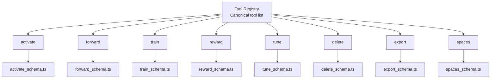

**Diagram sources**
- [tool-registry.ts:25-91](file://src/tools/tool-registry.ts#L25-L91)
- [activate.ts:231-280](file://src/tools/activate.ts#L231-L280)
- [forward.ts:91-339](file://src/tools/forward.ts#L91-L339)
- [train.ts:246-381](file://src/tools/train.ts#L246-L381)
- [reward.ts:132-175](file://src/tools/reward.ts#L132-L175)
- [tune.ts:19-69](file://src/tools/tune.ts#L19-L69)
- [delete.ts:73-115](file://src/tools/delete.ts#L73-L115)
- [export.ts:347-390](file://src/tools/export.ts#L347-L390)
- [spaces.ts:195-254](file://src/tools/spaces.ts#L195-L254)

**Section sources**
- [tool-registry.ts:16-24](file://src/tools/tool-registry.ts#L16-L24)

## Core Components
SquadRules exposes eight canonical tools:

| Tool | Purpose | Key Contract Highlights |
|---|---|---|
| activate | Selects the best adapter for a query and returns ranked choices with next actions. | Input includes query, optional authoring context, space scoping, and refinement execution id. Output includes choices, guidance, and local artifact directory hints. |
| forward | Executes an adapter layer or continues a run. Handles proof-of-work, user input elicitation, previous-step application, and trace recording. | Input accepts adapter or layer URIs; continuation requires solution matching contract type. Output includes current layer view, contract, next call, and optional proof hash. |
| train | Registers new adapters or artifacts. Supports markdown adapters, artifact attachments, fork-from-source, and batch directory training. | Requires review evidence for markdown adapters unless artifact mode. Returns stored items with URIs and labels. |
| reward | Records outcome feedback after adapter execution. Validates success against failed proofs and persists evaluation metadata. | Layer URI required. Output includes eligibility flags, blockers, and rated-at timestamp. |
| tune | Updates adapter content or moves adapters between spaces. Requires critic-loop evidence when editing content. | Accepts multiple URIs with parallel updates and per-result status. |
| delete | Deletes adapters (all layers) or individual layers by URI. | Batch deletes with per-URI result and totals. |
| export | Exports adapters as markdown, skill bundles, training JSONL, or raw source. Supports directory writes and download references. | Selection modes: single uri, adapters list, or all_adapters with space_name. |
| spaces | Lists available spaces with adapter counts and optional titles/artifacts. | Can return widget HTML and artifact metadata. |

**Section sources**
- [tool-registry.ts:25-91](file://src/tools/tool-registry.ts#L25-L91)
- [activate_schema.ts:86-139](file://src/tools/activate_schema.ts#L86-L139)
- [forward_schema.ts:234-318](file://src/tools/forward_schema.ts#L234-L318)
- [train_schema.ts:54-199](file://src/tools/train_schema.ts#L54-L199)
- [reward_schema.ts:10-51](file://src/tools/reward_schema.ts#L10-L51)
- [tune_schema.ts:14-70](file://src/tools/tune_schema.ts#L14-L70)
- [delete_schema.ts:14-32](file://src/tools/delete_schema.ts#L14-L32)
- [export_schema.ts:44-161](file://src/tools/export_schema.ts#L44-L161)
- [spaces_schema.ts:3-52](file://src/tools/spaces_schema.ts#L3-L52)

## Architecture Overview
The system follows a layered architecture:
- MCP tool surface: each tool registers via `registerXxxTool`, which validates inputs, emits telemetry, and delegates to an executable function.
- Business logic: pure functions like `executeActivate`, `executeForward`, `executeTrain`, etc., implement domain behavior.
- Storage and services: memory store, Qdrant service, Redis-backed stores, and proof-of-work store support persistence and orchestration.
- Telemetry and audit: metrics capture calls, durations, input/output sizes, and errors per tenant.

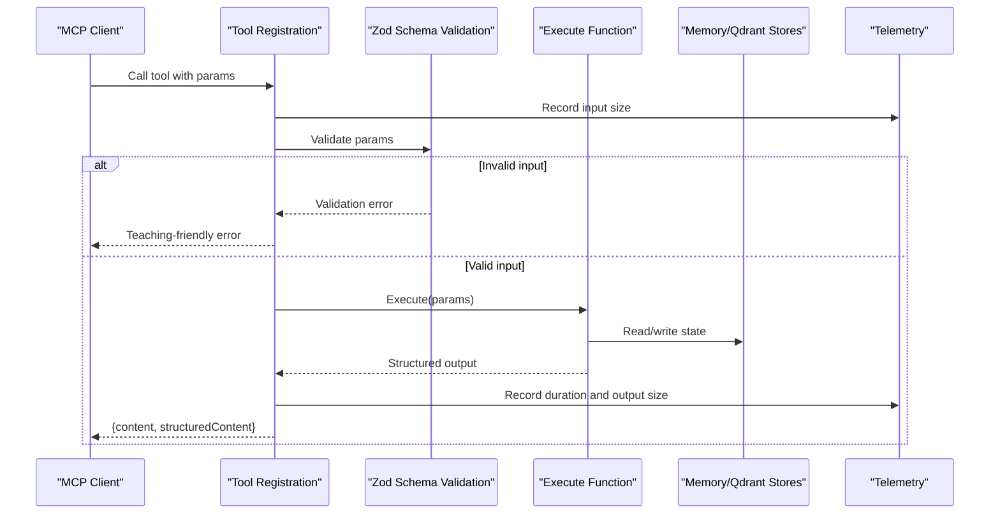

**Diagram sources**
- [activate.ts:231-280](file://src/tools/activate.ts#L231-L280)
- [forward.ts:91-339](file://src/tools/forward.ts#L91-L339)
- [train.ts:246-381](file://src/tools/train.ts#L246-L381)
- [reward.ts:132-175](file://src/tools/reward.ts#L132-L175)
- [tune.ts:19-69](file://src/tools/tune.ts#L19-L69)
- [delete.ts:73-115](file://src/tools/delete.ts#L73-L115)
- [export.ts:347-390](file://src/tools/export.ts#L347-L390)
- [spaces.ts:195-254](file://src/tools/spaces.ts#L195-L254)

## Detailed Component Analysis

### activate: Best Adapter Selection
activate performs semantic search over adapters, maps results to activation choices, enriches linked artifacts, and guides the agent toward the correct forward call. It supports authoring workflows and refinement sequences through execution ids.

Key behaviors:
- Canonicalizes adapter URIs and resolves linked artifacts.
- Produces match/refine/create choices with next_action instructions.
- Includes local artifact directory hints and transport mode.
- Tracks refine count to control refine footer visibility.

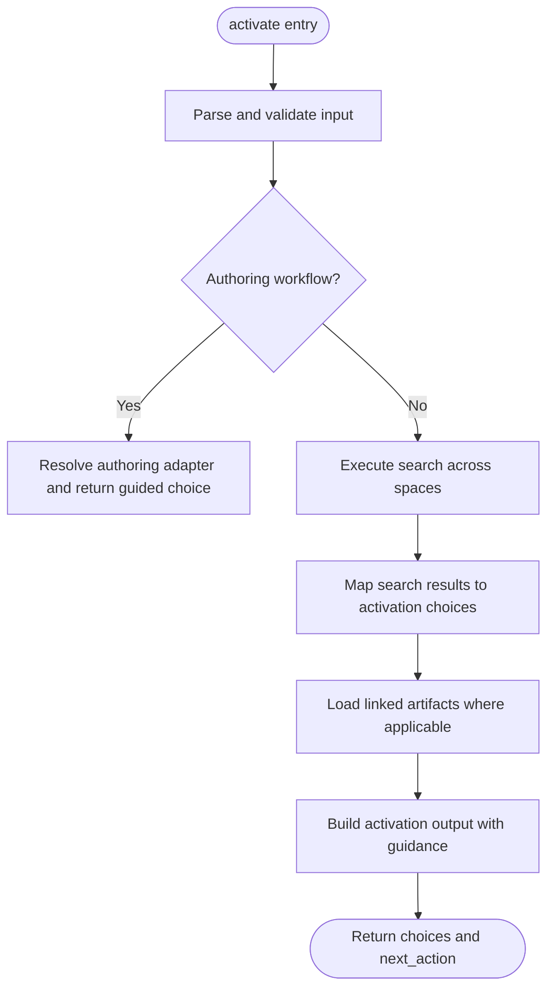

**Diagram sources**
- [activate.ts:44-166](file://src/tools/activate.ts#L44-L166)
- [activate.ts:168-229](file://src/tools/activate.ts#L168-L229)
- [activate_schema.ts:86-139](file://src/tools/activate_schema.ts#L86-L139)

**Section sources**
- [activate.ts:30-42](file://src/tools/activate.ts#L30-L42)
- [activate.ts:44-166](file://src/tools/activate.ts#L44-L166)
- [activate.ts:168-229](file://src/tools/activate.ts#L168-L229)
- [activate_schema.ts:86-139](file://src/tools/activate_schema.ts#L86-L139)

### forward: Adapter Execution Flow
forward orchestrates adapter layer execution, including:
- Starting or continuing runs via adapter or layer URIs.
- Handling authoring context constraints.
- Eliciting user input when required by contract.
- Applying solutions to previous steps when appropriate.
- Managing proof-of-work challenges and missing proofs.
- Recording execution traces and updating step quality.

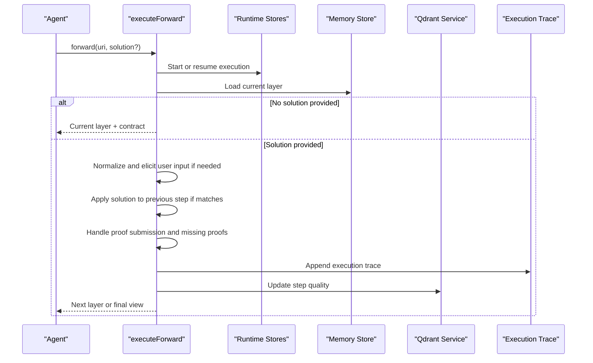

**Diagram sources**
- [forward.ts:91-339](file://src/tools/forward.ts#L91-L339)
- [forward_schema.ts:234-318](file://src/tools/forward_schema.ts#L234-L318)

**Section sources**
- [forward.ts:43-59](file://src/tools/forward.ts#L43-L59)
- [forward.ts:61-89](file://src/tools/forward.ts#L61-L89)
- [forward.ts:91-339](file://src/tools/forward.ts#L91-L339)
- [forward_schema.ts:234-318](file://src/tools/forward_schema.ts#L234-L318)

### train: New Adapter Registration
train supports:
- Markdown adapter creation with critic-loop review evidence.
- Artifact attachment with MIME inference and relative paths.
- Forking from an existing adapter’s exported markdown.
- Batch directory training scanning `.md` files.

Error handling normalizes internal codes into user-friendly payloads and suggests next actions.

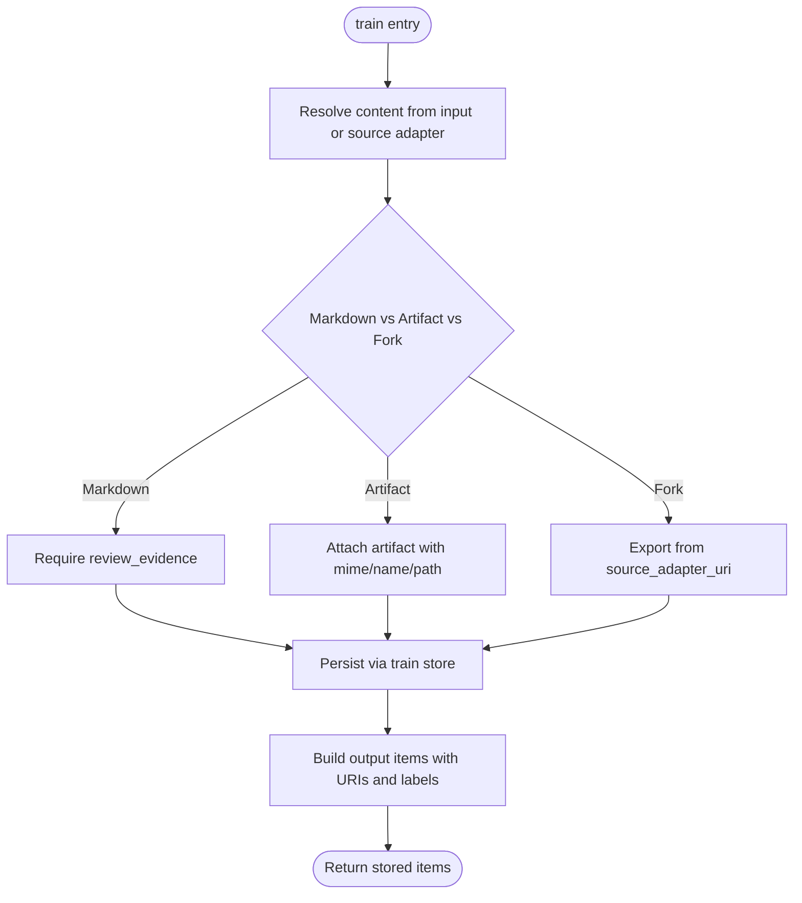

**Diagram sources**
- [train.ts:88-135](file://src/tools/train.ts#L88-L135)
- [train.ts:137-244](file://src/tools/train.ts#L137-L244)
- [train_schema.ts:54-199](file://src/tools/train_schema.ts#L54-L199)

**Section sources**
- [train.ts:34-86](file://src/tools/train.ts#L34-L86)
- [train.ts:88-135](file://src/tools/train.ts#L88-L135)
- [train.ts:137-244](file://src/tools/train.ts#L137-L244)
- [train_schema.ts:54-199](file://src/tools/train_schema.ts#L54-L199)

### reward: Performance Feedback
reward records outcome feedback and evaluates eligibility for SFT and preference datasets. It prevents rewarding success on layers whose last proof failed.

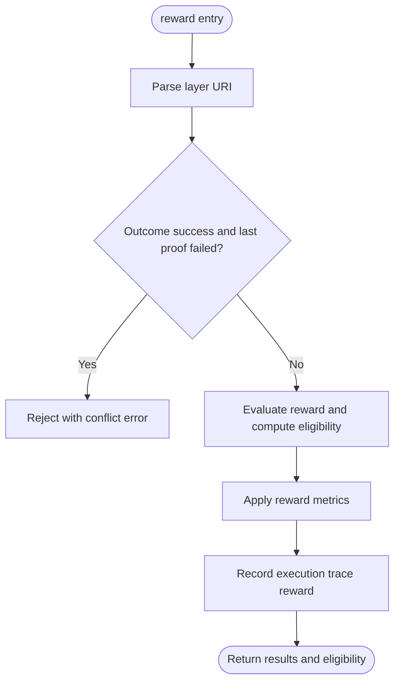

**Diagram sources**
- [reward.ts:28-130](file://src/tools/reward.ts#L28-L130)
- [reward_schema.ts:10-51](file://src/tools/reward_schema.ts#L10-L51)

**Section sources**
- [reward.ts:19-26](file://src/tools/reward.ts#L19-L26)
- [reward.ts:28-130](file://src/tools/reward.ts#L28-L130)
- [reward_schema.ts:10-51](file://src/tools/reward_schema.ts#L10-L51)

### tune: Content Updates
tune updates adapter content or moves adapters between spaces. When content is edited, critic-loop review evidence is required. After successful updates, caches are invalidated so subsequent reads reflect changes.

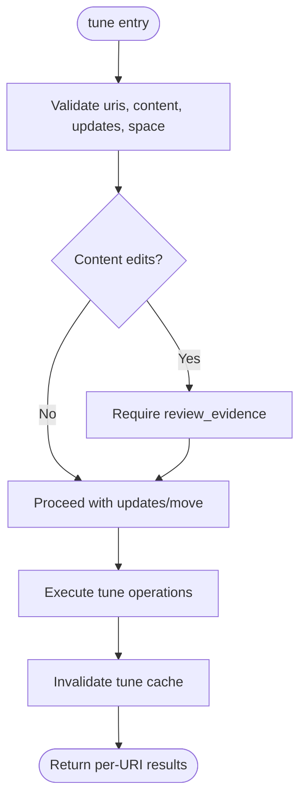

**Diagram sources**
- [tune.ts:19-69](file://src/tools/tune.ts#L19-L69)
- [tune_schema.ts:14-70](file://src/tools/tune_schema.ts#L14-L70)

**Section sources**
- [tune.ts:19-69](file://src/tools/tune.ts#L19-L69)
- [tune_schema.ts:14-70](file://src/tools/tune_schema.ts#L14-L70)

### delete: Adapter Removal
delete removes adapters (all layers) or individual layers. It returns per-URI results and totals.

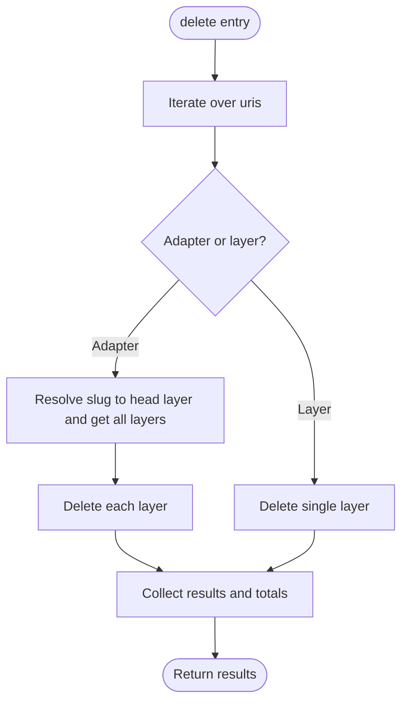

**Diagram sources**
- [delete.ts:12-71](file://src/tools/delete.ts#L12-L71)
- [delete_schema.ts:14-32](file://src/tools/delete_schema.ts#L14-L32)

**Section sources**
- [delete.ts:12-71](file://src/tools/delete.ts#L12-L71)
- [delete_schema.ts:14-32](file://src/tools/delete_schema.ts#L14-L32)

### export: Data Portability
export supports multiple formats:
- Markdown for single adapters or directory-based bulk exports.
- Training JSONL variants: trace, reward, sft, preference.
- Source export for artifacts.
- Skill tree and skill zip bundles with optional base64 delivery or download reference.

Directory-based export writes per-adapter markdown files and returns a manifest.

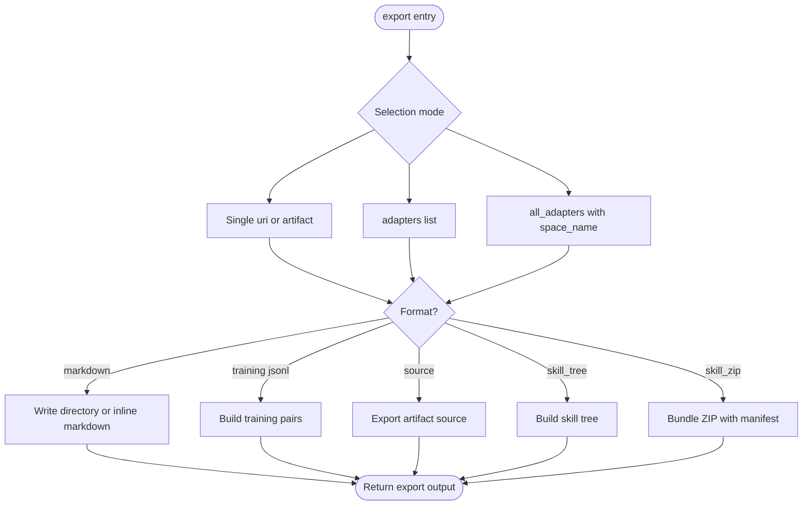

**Diagram sources**
- [export.ts:67-345](file://src/tools/export.ts#L67-L345)
- [export_schema.ts:44-161](file://src/tools/export_schema.ts#L44-L161)

**Section sources**
- [export.ts:67-345](file://src/tools/export.ts#L67-L345)
- [export_schema.ts:44-161](file://src/tools/export_schema.ts#L44-L161)

### spaces: Multi-Tenant Management
spaces lists available spaces with adapter counts and optionally adapter titles and artifacts. It can also render widget HTML for UI integration.

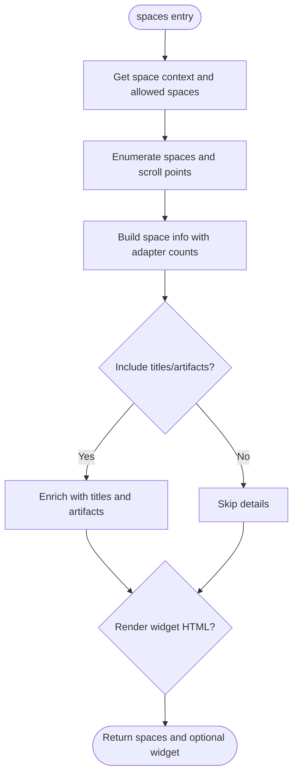

**Diagram sources**
- [spaces.ts:59-189](file://src/tools/spaces.ts#L59-L189)
- [spaces.ts:195-254](file://src/tools/spaces.ts#L195-L254)
- [spaces_schema.ts:3-52](file://src/tools/spaces_schema.ts#L3-L52)

**Section sources**
- [spaces.ts:59-189](file://src/tools/spaces.ts#L59-L189)
- [spaces.ts:195-254](file://src/tools/spaces.ts#L195-L254)
- [spaces_schema.ts:3-52](file://src/tools/spaces_schema.ts#L3-L52)

## Dependency Analysis
The tool registry centralizes tool definitions and references schema modules. Each tool’s registration function depends on its schema module and may depend on services such as memory store, Qdrant service, and runtime stores.

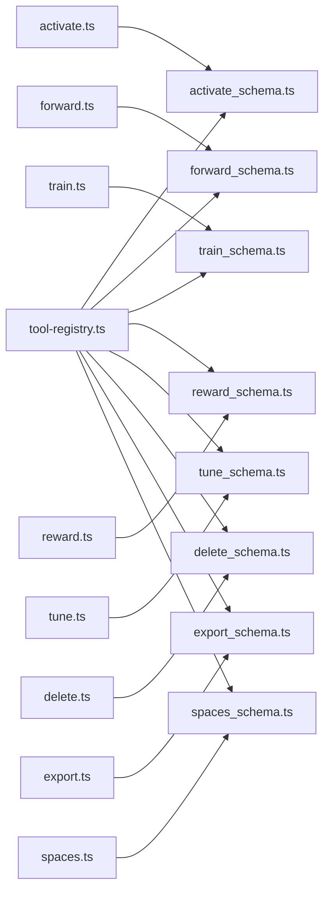

**Diagram sources**
- [tool-registry.ts:1-14](file://src/tools/tool-registry.ts#L1-L14)
- [activate.ts:1-23](file://src/tools/activate.ts#L1-L23)
- [forward.ts:1-38](file://src/tools/forward.ts#L1-L38)
- [train.ts:1-28](file://src/tools/train.ts#L1-L28)
- [reward.ts:1-13](file://src/tools/reward.ts#L1-L13)
- [tune.ts:1-10](file://src/tools/tune.ts#L1-L10)
- [delete.ts:1-9](file://src/tools/delete.ts#L1-L9)
- [export.ts:1-27](file://src/tools/export.ts#L1-L27)
- [spaces.ts:1-20](file://src/tools/spaces.ts#L1-L20)

**Section sources**
- [tool-registry.ts:1-14](file://src/tools/tool-registry.ts#L1-L14)

## Performance Considerations
- Telemetry: Every tool measures input size, duration, output size, call counts, and error counts per tenant. Use these metrics to monitor latency and throughput.
- Caching: tune invalidates caches after updates to ensure consistency.
- Batch operations: train directory mode and export directory mode process multiple items while tracking per-item status.
- Artifact handling: export skill_zip can deliver large bundles via download references to avoid oversized responses.

[No sources needed since this section provides general guidance]

## Troubleshooting Guide
Common issues and resolutions:

- Activation selection problems:
  - Ensure the query is specific and scoped to the correct space.
  - If refine choices appear, follow the refine footer guidance and re-run activate with the returned execution_id.

- Forward execution failures:
  - Missing proof: Follow the missing proof payload and retry with the required challenge.
  - Previous step blocked: Review the blocked payload and fix the prior step before continuing.
  - Authoring context mismatch: Use the exact next_call returned by activate or start a new run.

- Train validation errors:
  - Duplicate adapter or similar title: Inspect similarity details and use force_update with the same adapter id to replace.
  - Missing review evidence: Run critic-loop and include verdict file, exit code, and stdout.

- Reward conflicts:
  - Cannot record success for a layer whose last proof failed: Fix the step and rerun, or record failure with reason.

- Export format mismatches:
  - Training JSONL requires a single adapter uri.
  - Markdown bulk export requires directory path.
  - Skill zip delivery must specify delivery mode.

- Spaces listing errors:
  - Widget rendering issues: Ensure include_widget_html is set and adapter titles are included.

**Section sources**
- [forward.ts:113-131](file://src/tools/forward.ts#L113-L131)
- [forward.ts:171-316](file://src/tools/forward.ts#L171-L316)
- [train.ts:38-86](file://src/tools/train.ts#L38-L86)
- [reward.ts:19-54](file://src/tools/reward.ts#L19-L54)
- [export.ts:111-156](file://src/tools/export.ts#L111-L156)
- [spaces.ts:222-251](file://src/tools/spaces.ts#L222-L251)

## Conclusion
The SquadRules tool ecosystem provides a robust, schema-enforced surface for selecting, executing, updating, exporting, and managing adapters. The activate→forward→reward chain ensures deterministic, auditable workflows with strong input/output contracts. The registry centralizes tool definitions, while telemetry and error handling make the system observable and resilient. Custom tool development should follow the established patterns: define Zod schemas, register via server.registerTool, validate inputs, emit telemetry, and delegate to a pure execute function.

[No sources needed since this section summarizes without analyzing specific files]

## Appendices

### Tool Development Guidelines
- Define schemas: Create input and output Zod schemas in a dedicated `_schema.ts` file.
- Implement execute function: Keep business logic pure and testable.
- Register tool: Use `server.registerTool` with loose input wrapper and strict output schema.
- Telemetry: Observe input size, duration, output size, and errors per tenant.
- Error handling: Return teaching-friendly validation errors and structured error payloads.
- Integration: Depend only on necessary services (memory store, Qdrant service, runtime stores).

**Section sources**
- [activate.ts:231-280](file://src/tools/activate.ts#L231-L280)
- [forward.ts:91-339](file://src/tools/forward.ts#L91-L339)
- [train.ts:246-381](file://src/tools/train.ts#L246-L381)
- [reward.ts:132-175](file://src/tools/reward.ts#L132-L175)
- [tune.ts:19-69](file://src/tools/tune.ts#L19-L69)
- [delete.ts:73-115](file://src/tools/delete.ts#L73-L115)
- [export.ts:347-390](file://src/tools/export.ts#L347-L390)
- [spaces.ts:195-254](file://src/tools/spaces.ts#L195-L254)

### Advanced Usage Patterns
- Chaining activate → forward → reward:
  - Use activate to pick an adapter and follow next_action.
  - Call forward with the returned layer URI and solution matching contract.type.
  - Record reward with the final layer URI and outcome.

- Orchestration strategies:
  - For complex workflows, compose multiple forward calls across layers.
  - Use spaces to scope operations and export to bundle skills for portability.

- Artifact materialization:
  - Follow linked_artifacts instructions to export artifacts, verify SHA-256, and set permissions before running shell contracts.

**Section sources**
- [activate.ts:44-166](file://src/tools/activate.ts#L44-L166)
- [forward.ts:91-339](file://src/tools/forward.ts#L91-L339)
- [reward.ts:28-130](file://src/tools/reward.ts#L28-L130)
- [export.ts:250-345](file://src/tools/export.ts#L250-L345)