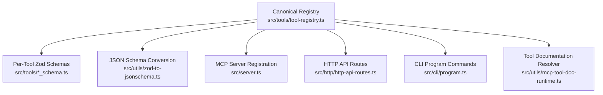
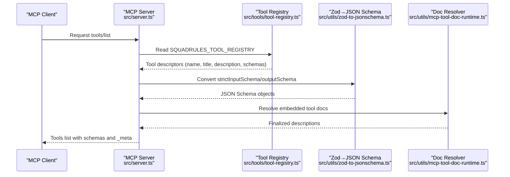
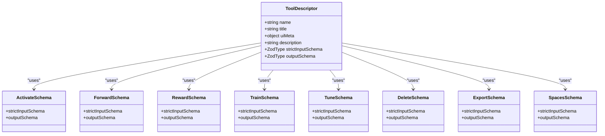
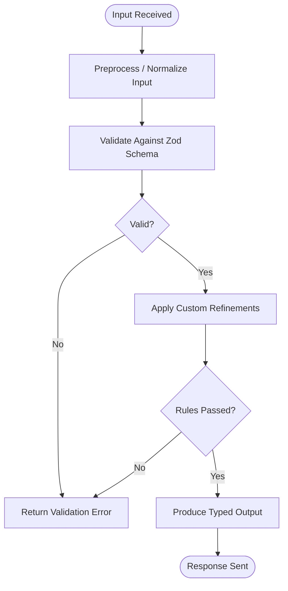
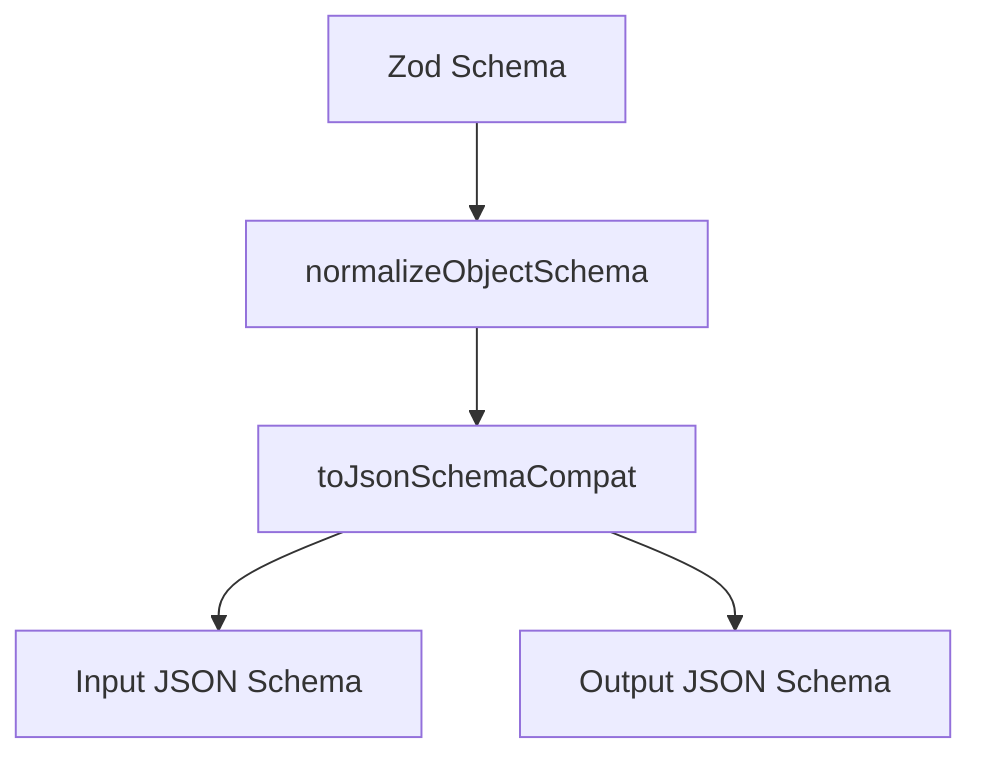
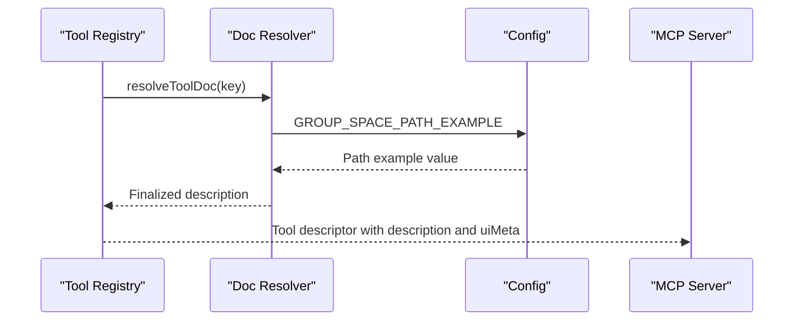
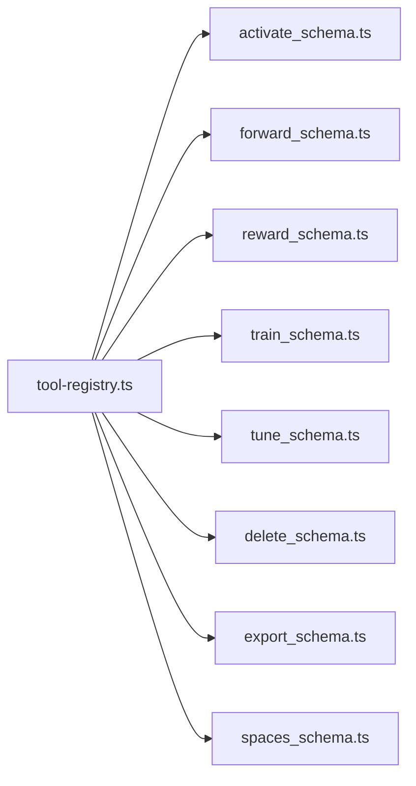
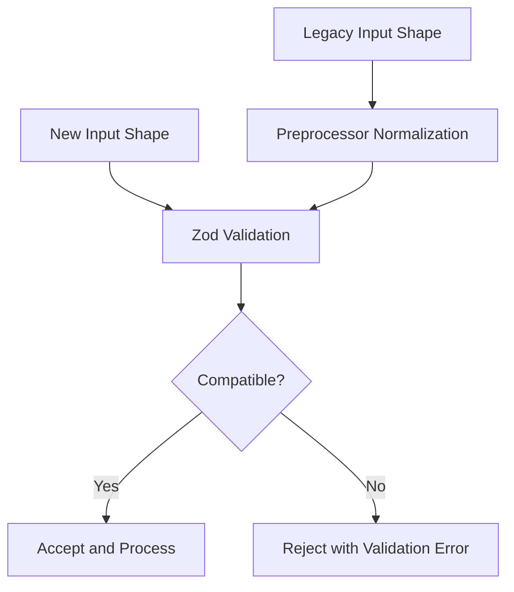
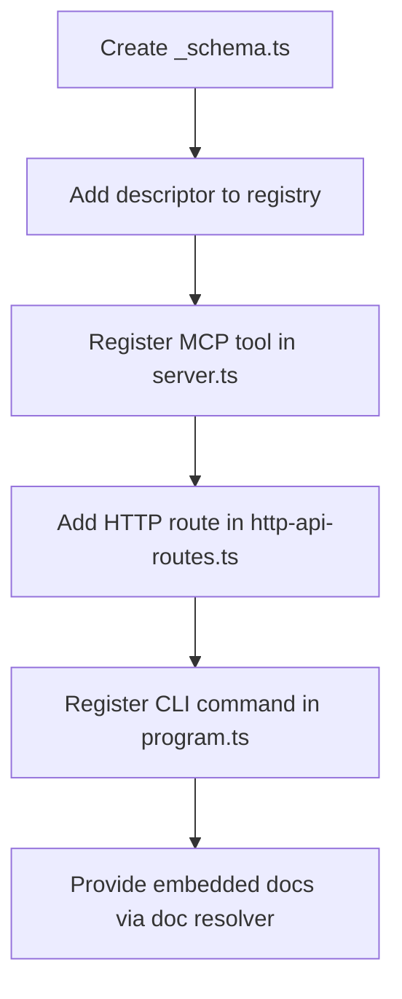
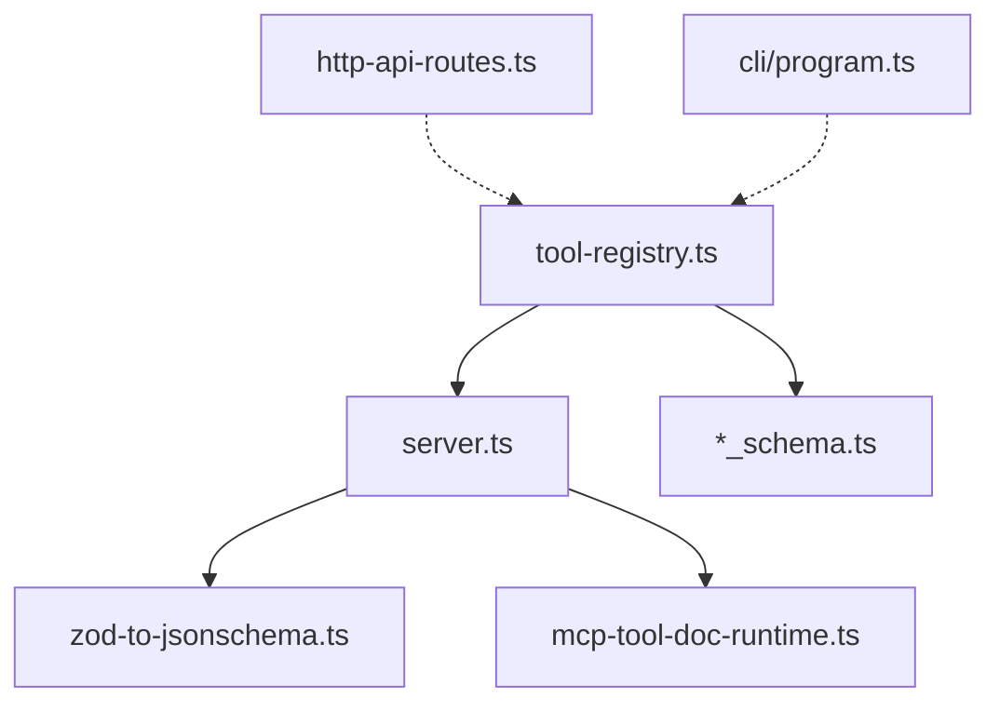

# Tool Registry & Schema System

<cite>
**Referenced Files in This Document**
- [tool-registry.ts](file://src/tools/tool-registry.ts)
- [server.ts](file://src/server.ts)
- [http-api-routes.ts](file://src/http/http-api-routes.ts)
- [program.ts](file://src/cli/program.ts)
- [mcp-tool-doc-runtime.ts](file://src/utils/mcp-tool-doc-runtime.ts)
- [zod-to-jsonschema.ts](file://src/utils/zod-to-jsonschema.ts)
- [activate_schema.ts](file://src/tools/activate_schema.ts)
- [forward_schema.ts](file://src/tools/forward_schema.ts)
- [reward_schema.ts](file://src/tools/reward_schema.ts)
- [train_schema.ts](file://src/tools/train_schema.ts)
- [tune_schema.ts](file://src/tools/tune_schema.ts)
- [delete_schema.ts](file://src/tools/delete_schema.ts)
- [export_schema.ts](file://src/tools/export_schema.ts)
- [spaces_schema.ts](file://src/tools/spaces_schema.ts)
</cite>

## Table of Contents
1. [Introduction](#introduction)
2. [Project Structure](#project-structure)
3. [Core Components](#core-components)
4. [Architecture Overview](#architecture-overview)
5. [Detailed Component Analysis](#detailed-component-analysis)
6. [Dependency Analysis](#dependency-analysis)
7. [Performance Considerations](#performance-considerations)
8. [Troubleshooting Guide](#troubleshooting-guide)
9. [Conclusion](#conclusion)
10. [Appendices](#appendices)

## Introduction
This document explains the SquadRules tool registry and schema validation system that acts as the single source of truth for all MCP tool definitions. The canonical registry drives three surfaces simultaneously:
- MCP `tools/list` registration
- HTTP `/api/<tool>` routes
- CLI commands

The system uses Zod schemas to define strict input and output contracts, generates JSON Schema for MCP clients, and performs runtime validation. It also includes a metadata and documentation resolution layer that provides UI hints, descriptions, and localized tool documentation.

## Project Structure
The tool surface is organized around one canonical registry and per-tool schema modules:
- Canonical registry: `src/tools/tool-registry.ts`
- Per-tool schemas: `*_schema.ts` files under `src/tools/`
- MCP server wiring: `src/server.ts`
- HTTP route setup: `src/http/http-api-routes.ts`
- CLI command wiring: `src/cli/program.ts`
- Documentation resolver: `src/utils/mcp-tool-doc-runtime.ts`
- JSON Schema conversion utilities: `src/utils/zod-to-jsonschema.ts`

**Diagram sources**
- [tool-registry.ts:16-24](file://src/tools/tool-registry.ts#L16-L24)
- [server.ts:29-41](file://src/server.ts#L29-L41)
- [http-api-routes.ts:22-35](file://src/http/http-api-routes.ts#L22-L35)
- [program.ts:63-75](file://src/cli/program.ts#L63-L75)
- [mcp-tool-doc-runtime.ts:10-15](file://src/utils/mcp-tool-doc-runtime.ts#L10-L15)
- [zod-to-jsonschema.ts:10-26](file://src/utils/zod-to-jsonschema.ts#L10-L26)

**Section sources**
- [tool-registry.ts:16-24](file://src/tools/tool-registry.ts#L16-L24)
- [server.ts:29-41](file://src/server.ts#L29-L41)
- [http-api-routes.ts:22-35](file://src/http/http-api-routes.ts#L22-L35)
- [program.ts:63-75](file://src/cli/program.ts#L63-L75)

## Core Components
- Canonical tool registry: A typed array of tool descriptors containing name, title, optional UI metadata, description, strict input schema, and output schema.
- Zod-based schemas: Each tool has paired `strictInputSchema` and `outputSchema` modules with rich validation, normalization, and type inference.
- JSON Schema generation: Zod schemas are converted to MCP-compatible JSON Schema using SDK compatibility helpers.
- Documentation resolution: Tool descriptions can be resolved from embedded markdown resources with environment-specific placeholders replaced at runtime.
- Multi-surface exposure: The same registry powers MCP tools/list, HTTP routes, and CLI commands.

Key responsibilities by file:
- `src/tools/tool-registry.ts`: Defines the canonical list of tools and their schemas.
- `src/utils/zod-to-jsonschema.ts`: Converts Zod schemas to JSON Schema for MCP clients.
- `src/utils/mcp-tool-doc-runtime.ts`: Resolves embedded tool documentation with runtime substitution.
- `src/server.ts`: Registers MCP tools and installs a strict `tools/list` handler.
- `src/http/http-api-routes.ts`: Sets up HTTP endpoints for each tool.
- `src/cli/program.ts`: Registers CLI subcommands aligned with the tool surface.

**Section sources**
- [tool-registry.ts:25-91](file://src/tools/tool-registry.ts#L25-L91)
- [zod-to-jsonschema.ts:10-26](file://src/utils/zod-to-jsonschema.ts#L10-L26)
- [mcp-tool-doc-runtime.ts:10-15](file://src/utils/mcp-tool-doc-runtime.ts#L10-L15)
- [server.ts:29-41](file://src/server.ts#L29-L41)
- [http-api-routes.ts:22-35](file://src/http/http-api-routes.ts#L22-L35)
- [program.ts:63-75](file://src/cli/program.ts#L63-L75)

## Architecture Overview
The architecture centers on a single registry that exports tool descriptors. Consumers derive their behavior from this registry rather than duplicating definitions.

**Diagram sources**
- [server.ts:29-41](file://src/server.ts#L29-L41)
- [tool-registry.ts:25-91](file://src/tools/tool-registry.ts#L25-L91)
- [zod-to-jsonschema.ts:10-26](file://src/utils/zod-to-jsonschema.ts#L10-L26)
- [mcp-tool-doc-runtime.ts:10-15](file://src/utils/mcp-tool-doc-runtime.ts#L10-L15)

## Detailed Component Analysis

### Canonical Tool Registry
The registry defines the authoritative set of tools: activate, forward, train, reward, tune, delete, export, spaces. Each entry references Zod schemas and may include UI metadata and a description resolved from embedded documentation.

**Diagram sources**
- [tool-registry.ts:25-91](file://src/tools/tool-registry.ts#L25-L91)
- [activate_schema.ts:86-139](file://src/tools/activate_schema.ts#L86-L139)
- [forward_schema.ts:234-318](file://src/tools/forward_schema.ts#L234-L318)
- [reward_schema.ts:10-53](file://src/tools/reward_schema.ts#L10-L53)
- [train_schema.ts:54-199](file://src/tools/train_schema.ts#L54-L199)
- [tune_schema.ts:14-72](file://src/tools/tune_schema.ts#L14-L72)
- [delete_schema.ts:14-33](file://src/tools/delete_schema.ts#L14-L33)
- [export_schema.ts:44-162](file://src/tools/export_schema.ts#L44-L162)
- [spaces_schema.ts:3-53](file://src/tools/spaces_schema.ts#L3-L53)

**Section sources**
- [tool-registry.ts:25-91](file://src/tools/tool-registry.ts#L25-L91)

### Zod-Based Schema System
Each tool exposes paired schemas:
- `strictInputSchema`: Validates client inputs with strict object shape rules, regex constraints, numeric ranges, and custom refinements.
- `outputSchema`: Describes the tool’s response contract, including nested structures, enums, and optional fields.

Examples of patterns:
- URI validation via regex patterns for adapter, layer, and artifact URIs.
- Discriminated unions for role-based choices (for example, activation choices).
- Preprocessing and normalization (for example, forward solution format normalization).
- Custom refinement logic enforcing business rules (for example, requiring evidence or matching field counts).

**Diagram sources**
- [forward_schema.ts:149-180](file://src/tools/forward_schema.ts#L149-L180)
- [forward_schema.ts:234-258](file://src/tools/forward_schema.ts#L234-L258)
- [train_schema.ts:100-177](file://src/tools/train_schema.ts#L100-L177)
- [tune_schema.ts:32-57](file://src/tools/tune_schema.ts#L32-L57)
- [export_schema.ts:55-117](file://src/tools/export_schema.ts#L55-L117)

**Section sources**
- [activate_schema.ts:86-139](file://src/tools/activate_schema.ts#L86-L139)
- [forward_schema.ts:16-45](file://src/tools/forward_schema.ts#L16-L45)
- [forward_schema.ts:149-180](file://src/tools/forward_schema.ts#L149-L180)
- [forward_schema.ts:234-318](file://src/tools/forward_schema.ts#L234-L318)
- [reward_schema.ts:10-53](file://src/tools/reward_schema.ts#L10-L53)
- [train_schema.ts:54-199](file://src/tools/train_schema.ts#L54-L199)
- [tune_schema.ts:14-72](file://src/tools/tune_schema.ts#L14-L72)
- [delete_schema.ts:14-33](file://src/tools/delete_schema.ts#L14-L33)
- [export_schema.ts:44-162](file://src/tools/export_schema.ts#L44-L162)
- [spaces_schema.ts:3-53](file://src/tools/spaces_schema.ts#L3-L53)

### JSON Schema Generation
The registry’s Zod schemas are converted into JSON Schema for MCP clients:
- Input schemas use `pipeStrategy: 'input'`.
- Output schemas use `pipeStrategy: 'output'`.
- Union handling uses `strictUnions: true`.

This ensures MCP clients receive accurate request/response contracts derived from the canonical Zod definitions.

**Diagram sources**
- [zod-to-jsonschema.ts:10-26](file://src/utils/zod-to-jsonschema.ts#L10-L26)

**Section sources**
- [zod-to-jsonschema.ts:10-26](file://src/utils/zod-to-jsonschema.ts#L10-L26)

### Tool Metadata and Documentation Resolution
Descriptions are resolved from embedded documentation resources. Placeholders such as group space path examples are substituted at runtime based on configuration. UI metadata (`uiMeta`) is attached to select tools and surfaced through MCP `_meta`.

**Diagram sources**
- [mcp-tool-doc-runtime.ts:10-15](file://src/utils/mcp-tool-doc-runtime.ts#L10-L15)
- [tool-registry.ts:25-91](file://src/tools/tool-registry.ts#L25-L91)
- [server.ts:29-41](file://src/server.ts#L29-L41)

**Section sources**
- [mcp-tool-doc-runtime.ts:10-15](file://src/utils/mcp-tool-doc-runtime.ts#L10-L15)
- [tool-registry.ts:25-91](file://src/tools/tool-registry.ts#L25-L91)
- [server.ts:29-41](file://src/server.ts#L29-L41)

### Relationship Between Tool Definitions and Schema Files
Each tool descriptor imports its corresponding schema module:
- `activate` → `activate_schema.ts`
- `forward` → `forward_schema.ts`
- `reward` → `reward_schema.ts`
- `train` → `train_schema.ts`
- `tune` → `tune_schema.ts`
- `delete` → `delete_schema.ts`
- `export` → `export_schema.ts`
- `spaces` → `spaces_schema.ts`

This keeps the registry lean and delegates complex validation logic to dedicated schema modules.

**Diagram sources**
- [tool-registry.ts:1-9](file://src/tools/tool-registry.ts#L1-L9)

**Section sources**
- [tool-registry.ts:1-9](file://src/tools/tool-registry.ts#L1-L9)

### Versioning Strategies and Backward Compatibility
Versioning and compatibility are expressed primarily through schemas and tool behavior:
- Adapter versioning: `protocol_version` in training inputs allows semantic version tags.
- Solution format evolution: Forward supports both legacy type-specific fields and a normalized v2 envelope with `outcome` and `evidence`, with preprocessing to normalize older formats.
- Field deprecation: Deprecated fields remain accepted but are mapped to canonical shapes.
- Strictness: Many schemas use `.strict()` to reject unknown properties, ensuring forward compatibility.

**Diagram sources**
- [forward_schema.ts:149-180](file://src/tools/forward_schema.ts#L149-L180)
- [forward_schema.ts:234-318](file://src/tools/forward_schema.ts#L234-L318)
- [train_schema.ts:54-199](file://src/tools/train_schema.ts#L54-L199)

**Section sources**
- [forward_schema.ts:149-180](file://src/tools/forward_schema.ts#L149-L180)
- [forward_schema.ts:234-318](file://src/tools/forward_schema.ts#L234-L318)
- [train_schema.ts:54-199](file://src/tools/train_schema.ts#L54-L199)

### Extending the Registry with New Tools
To add a new tool consistently across all surfaces:
1. Create a new schema module `src/tools/<tool>_schema.ts` exporting `strictInputSchema` and `outputSchema`.
2. Add a descriptor to `SQUADRULES_TOOL_REGISTRY` in `src/tools/tool-registry.ts`, referencing the schemas and providing title, description, and optional `uiMeta`.
3. Wire the tool implementation into the MCP server registration in `src/server.ts`.
4. Register an HTTP endpoint in `src/http/http-api-routes.ts` if exposing via REST.
5. Add a CLI subcommand in `src/cli/program.ts` to align the CLI surface.
6. Optionally provide embedded documentation via the doc resolver and reference it in the registry description.

**Diagram sources**
- [tool-registry.ts:25-91](file://src/tools/tool-registry.ts#L25-L91)
- [server.ts:60-68](file://src/server.ts#L60-L68)
- [http-api-routes.ts:22-35](file://src/http/http-api-routes.ts#L22-L35)
- [program.ts:63-75](file://src/cli/program.ts#L63-L75)
- [mcp-tool-doc-runtime.ts:10-15](file://src/utils/mcp-tool-doc-runtime.ts#L10-L15)

**Section sources**
- [tool-registry.ts:25-91](file://src/tools/tool-registry.ts#L25-L91)
- [server.ts:60-68](file://src/server.ts#L60-L68)
- [http-api-routes.ts:22-35](file://src/http/http-api-routes.ts#L22-L35)
- [program.ts:63-75](file://src/cli/program.ts#L63-L75)
- [mcp-tool-doc-runtime.ts:10-15](file://src/utils/mcp-tool-doc-runtime.ts#L10-L15)

## Dependency Analysis
The registry is the central dependency hub. Consumers import only what they need:
- MCP server imports the registry and converts schemas to JSON Schema.
- HTTP routes register tool handlers; while not directly importing the registry, they mirror the same tool names.
- CLI program registers commands aligned with the tool surface.

**Diagram sources**
- [tool-registry.ts:1-9](file://src/tools/tool-registry.ts#L1-L9)
- [server.ts:26-27](file://src/server.ts#L26-L27)
- [http-api-routes.ts:22-35](file://src/http/http-api-routes.ts#L22-L35)
- [program.ts:63-75](file://src/cli/program.ts#L63-L75)

**Section sources**
- [tool-registry.ts:1-9](file://src/tools/tool-registry.ts#L1-L9)
- [server.ts:26-27](file://src/server.ts#L26-L27)
- [http-api-routes.ts:22-35](file://src/http/http-api-routes.ts#L22-L35)
- [program.ts:63-75](file://src/cli/program.ts#L63-L75)

## Performance Considerations
- Schema conversion occurs at server startup when registering tools; avoid heavy computation inside schema preprocessors.
- Use strict schemas to fail fast on invalid inputs, reducing downstream processing.
- Keep embedded documentation minimal and rely on runtime resolution to avoid bloating payloads.
- Prefer discriminated unions and precise enums to reduce branching complexity during validation.

[No sources needed since this section provides general guidance]

## Troubleshooting Guide
Common issues and resolutions:
- Invalid URI formats: Ensure URIs match expected patterns for adapters, layers, and artifacts.
- Missing required fields: Check `review_evidence` requirements for adapter training and tuning operations.
- Inconsistent arrays: For multi-target operations like tune, ensure content arrays match the number of URIs.
- Selection mode conflicts: For export, ensure exactly one selection mode is used (`uri`, `adapters`, or `all_adapters`).
- Delivery format restrictions: `delivery` is only valid with `format: skill_zip`.

Validation error messages are defined within the respective schema modules and should guide callers to correct inputs.

**Section sources**
- [train_schema.ts:100-177](file://src/tools/train_schema.ts#L100-L177)
- [tune_schema.ts:32-57](file://src/tools/tune_schema.ts#L32-L57)
- [export_schema.ts:55-117](file://src/tools/export_schema.ts#L55-L117)

## Conclusion
The SquadRules tool registry provides a single source of truth for tool definitions, powering MCP, HTTP, and CLI surfaces consistently. Zod schemas enforce strict contracts, generate JSON Schema for clients, and support backward compatibility through normalization. Embedded documentation and UI metadata enhance discoverability and usability. Following the extension process ensures schema consistency across interfaces and maintains robust validation throughout the system.

[No sources needed since this section summarizes without analyzing specific files]

## Appendices

### Tool Surface Summary
- MCP tools: activate, forward, train, reward, tune, delete, export, spaces
- HTTP routes: /api/activate, /api/forward, /api/reward, /api/tune, /api/delete, plus additional routes for training and other features
- CLI commands: activate, forward, train, spaces, tune, delete, reward, export, serve, login, logout, token

**Section sources**
- [tool-registry.ts:25-91](file://src/tools/tool-registry.ts#L25-L91)
- [http-api-routes.ts:22-35](file://src/http/http-api-routes.ts#L22-L35)
- [program.ts:63-75](file://src/cli/program.ts#L63-L75)