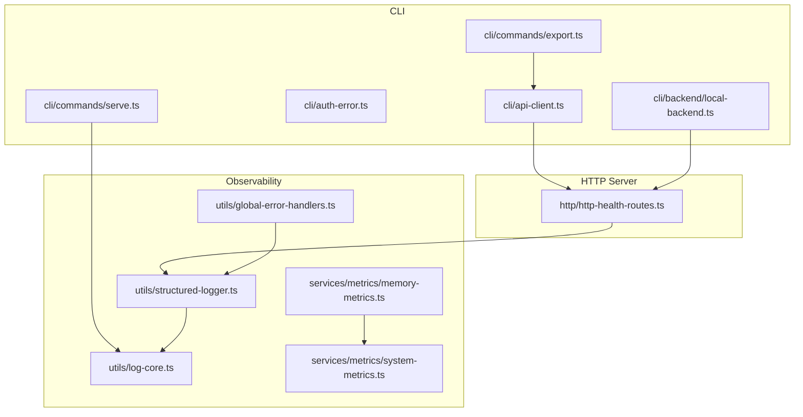
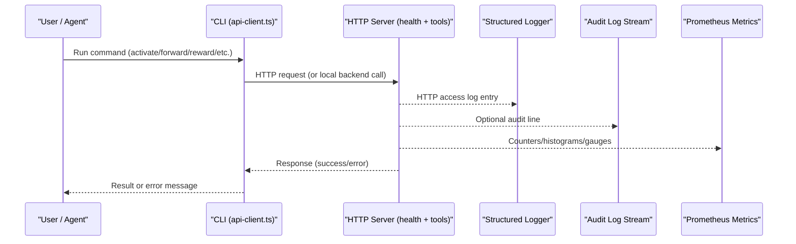
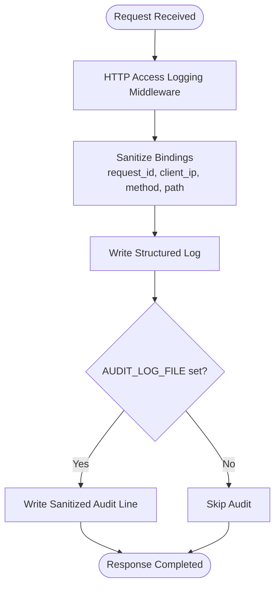
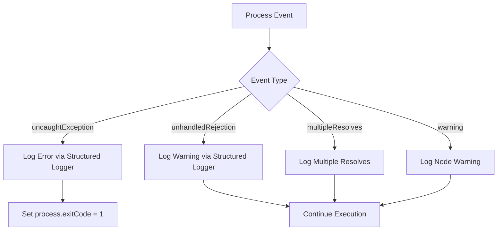
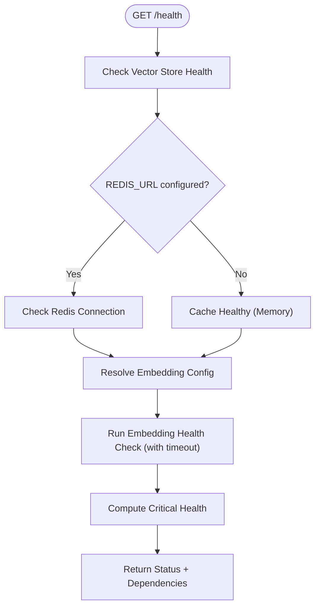
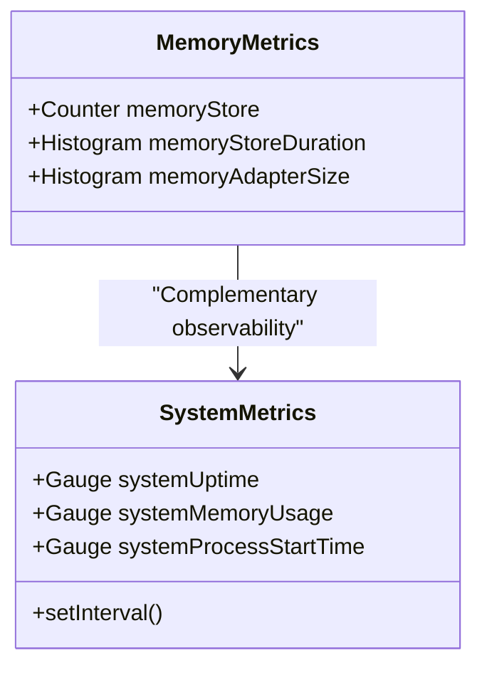
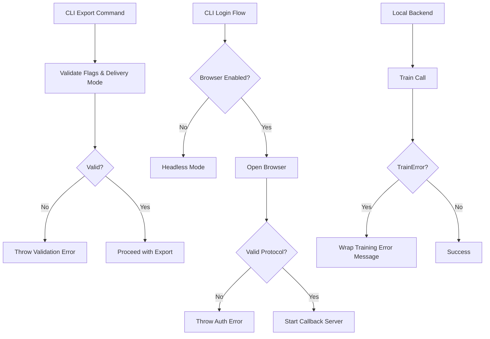
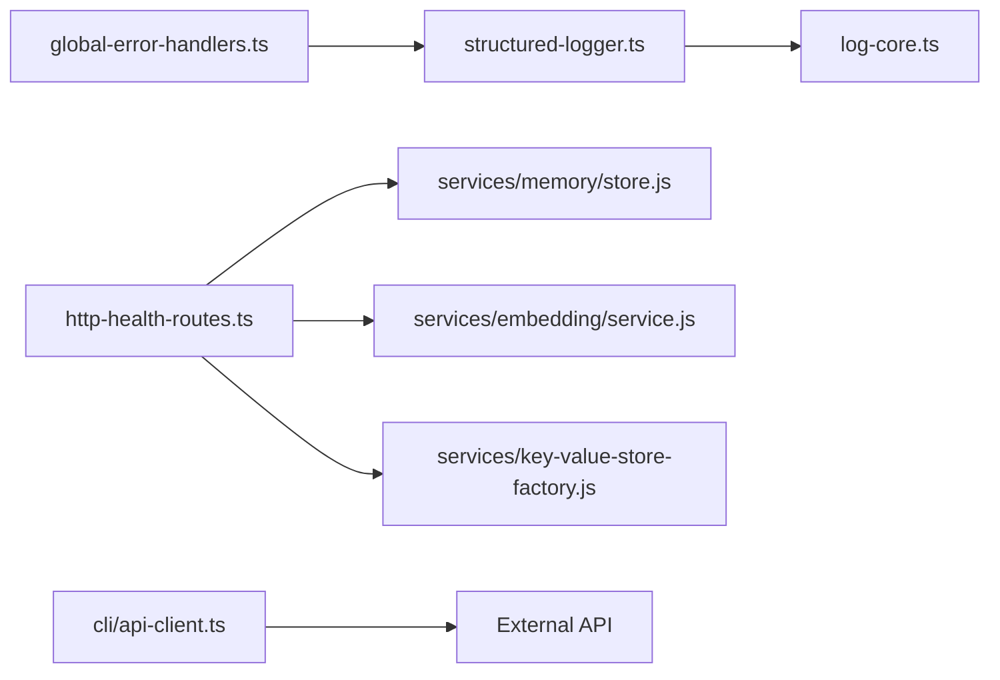

# Troubleshooting and FAQ

<cite>
**Referenced Files in This Document**
- [known-issues-and-limitations.md](file://docs/known-issues-and-limitations.md)
- [incident-runbook.md](file://docs/security/incident-runbook.md)
- [global-error-handlers.ts](file://src/utils/global-error-handlers.ts)
- [log-core.ts](file://src/utils/log-core.ts)
- [structured-logger.ts](file://src/utils/structured-logger.ts)
- [memory-metrics.ts](file://src/services/metrics/memory-metrics.ts)
- [system-metrics.ts](file://src/services/metrics/system-metrics.ts)
- [http-health-routes.ts](file://src/http/http-health-routes.ts)
- [api-client.ts](file://src/cli/api-client.ts)
- [auth-error.ts](file://src/cli/auth-error.ts)
- [local-backend.ts](file://src/cli/backend/local-backend.ts)
- [export.ts](file://src/cli/commands/export.ts)
- [serve.ts](file://src/cli/commands/serve.ts)
</cite>

## Table of Contents
1. [Introduction](#introduction)
2. [Project Structure](#project-structure)
3. [Core Components](#core-components)
4. [Architecture Overview](#architecture-overview)
5. [Detailed Component Analysis](#detailed-component-analysis)
6. [Dependency Analysis](#dependency-analysis)
7. [Performance Considerations](#performance-considerations)
8. [Troubleshooting Guide](#troubleshooting-guide)
9. [Conclusion](#conclusion)
10. [Appendices](#appendices)

## Introduction
This document provides comprehensive troubleshooting guidance for SquadRules MCP. It focuses on diagnosing runtime issues, interpreting logs and metrics, handling authentication and transport errors, investigating performance and memory behavior, and answering frequently asked questions about configuration, deployment, and usage patterns. The guidance is grounded in the repository’s logging, health, metrics, CLI, and security incident response implementations.

## Project Structure
SquadRules MCP exposes both HTTP and stdio transports. Observability is centralized through structured logging, audit logging, Prometheus metrics, and a health endpoint. CLI commands surface user-facing validation errors and connect to either a local backend or an HTTP API. Security incidents are investigated using request tracing, tenant isolation checks, and focused playbooks.

**Diagram sources**
- [api-client.ts](file://src/cli/api-client.ts)
- [auth-error.ts](file://src/cli/auth-error.ts)
- [local-backend.ts](file://src/cli/backend/local-backend.ts)
- [export.ts](file://src/cli/commands/export.ts)
- [serve.ts](file://src/cli/commands/serve.ts)
- [http-health-routes.ts](file://src/http/http-health-routes.ts)
- [log-core.ts](file://src/utils/log-core.ts)
- [structured-logger.ts](file://src/utils/structured-logger.ts)
- [global-error-handlers.ts](file://src/utils/global-error-handlers.ts)
- [memory-metrics.ts](file://src/services/metrics/memory-metrics.ts)
- [system-metrics.ts](file://src/services/metrics/system-metrics.ts)

**Section sources**
- [http-health-routes.ts:13-91](file://src/http/http-health-routes.ts#L13-L91)
- [structured-logger.ts:149-183](file://src/utils/structured-logger.ts#L149-L183)
- [log-core.ts:21-32](file://src/utils/log-core.ts#L21-L32)

## Core Components
- Structured logging and audit logging: Centralized Pino-based logger with redaction, sanitization, HTTP access logs, and optional append-only audit stream.
- Global error handlers: Capture uncaught exceptions, unhandled rejections, multiple resolves, and Node warnings; forward them to structured logging.
- Health endpoints: Validate Qdrant/LanceDB vector store, Redis cache, and embedding provider status with timeouts.
- Metrics: Prometheus counters/histograms/gauges for memory operations and system resource usage.
- CLI error surfaces: Validation errors for export options, login/browser behavior, and API connectivity.

**Section sources**
- [structured-logger.ts:1-45](file://src/utils/structured-logger.ts#L1-L45)
- [structured-logger.ts:149-183](file://src/utils/structured-logger.ts#L149-L183)
- [global-error-handlers.ts:11-61](file://src/utils/global-error-handlers.ts#L11-L61)
- [http-health-routes.ts:13-91](file://src/http/http-health-routes.ts#L13-L91)
- [memory-metrics.ts:11-31](file://src/services/metrics/memory-metrics.ts#L11-L31)
- [system-metrics.ts:10-41](file://src/services/metrics/system-metrics.ts#L10-L41)

## Architecture Overview
The operational flow for diagnostics spans CLI requests, HTTP server responses, structured logs, audit logs, and metrics.

**Diagram sources**
- [api-client.ts](file://src/cli/api-client.ts)
- [http-health-routes.ts](file://src/http/http-health-routes.ts)
- [structured-logger.ts](file://src/utils/structured-logger.ts)
- [memory-metrics.ts](file://src/services/metrics/memory-metrics.ts)

## Detailed Component Analysis

### Logging and Audit Diagnostics
- Redaction paths protect sensitive headers and cookies from being written to logs.
- Stdio vs HTTP transport determines whether logs go to stderr or stdout to keep data channels clean.
- HTTP middleware attaches request_id, client IP, duration, and status to every request lifecycle event.
- Audit logging writes sanitized JSON lines to a configured file when enabled.

**Diagram sources**
- [structured-logger.ts:149-183](file://src/utils/structured-logger.ts#L149-L183)
- [structured-logger.ts:134-148](file://src/utils/structured-logger.ts#L134-L148)
- [log-core.ts:21-32](file://src/utils/log-core.ts#L21-L32)

**Section sources**
- [log-core.ts:12-19](file://src/utils/log-core.ts#L12-L19)
- [log-core.ts:21-32](file://src/utils/log-core.ts#L21-L32)
- [structured-logger.ts:149-183](file://src/utils/structured-logger.ts#L149-L183)
- [structured-logger.ts:134-148](file://src/utils/structured-logger.ts#L134-L148)

### Global Error Handling
- Uncaught exceptions mark the process non-zero but do not force immediate exit, allowing supervisors to decide.
- Unhandled promise rejections and multiple resolves are logged with stack traces where available.
- Node warnings (experimental/deprecation) are captured and forwarded to structured logging.

**Diagram sources**
- [global-error-handlers.ts:11-61](file://src/utils/global-error-handlers.ts#L11-L61)

**Section sources**
- [global-error-handlers.ts:11-61](file://src/utils/global-error-handlers.ts#L11-L61)

### Health Checks and Dependency Readiness
- The health endpoint validates vector store (Qdrant or embedded LanceDB), Redis cache, and embedding provider.
- Embedding provider health check is bounded by a short timeout to keep the endpoint responsive.
- Dependencies reported include active backend type and configuration details.

**Diagram sources**
- [http-health-routes.ts:13-91](file://src/http/http-health-routes.ts#L13-L91)

**Section sources**
- [http-health-routes.ts:13-91](file://src/http/http-health-routes.ts#L13-L91)

### Metrics and Resource Utilization
- Memory operation metrics track counts and durations for store operations, plus adapter layer sizes.
- System metrics expose uptime, process start time, and memory usage gauges updated periodically.

**Diagram sources**
- [memory-metrics.ts:11-31](file://src/services/metrics/memory-metrics.ts#L11-L31)
- [system-metrics.ts:10-41](file://src/services/metrics/system-metrics.ts#L10-L41)

**Section sources**
- [memory-metrics.ts:11-31](file://src/services/metrics/memory-metrics.ts#L11-L31)
- [system-metrics.ts:10-41](file://src/services/metrics/system-metrics.ts#L10-L41)

### CLI Error Surfaces and Transport Behavior
- Export command validates mutually exclusive flags and delivery modes, surfacing clear errors for misuse.
- Login flow supports headless mode and configurable callback ports; invalid browser protocols and control characters are rejected.
- Local backend wraps training errors into user-friendly messages.
- Serve command sets environment variables controlling log transport and diagnostic context.

**Diagram sources**
- [export.ts](file://src/cli/commands/export.ts)
- [auth-error.ts](file://src/cli/auth-error.ts)
- [local-backend.ts](file://src/cli/backend/local-backend.ts)
- [serve.ts](file://src/cli/commands/serve.ts)

**Section sources**
- [export.ts:57-122](file://src/cli/commands/export.ts#L57-L122)
- [auth-error.ts:54-58](file://src/cli/auth-error.ts#L54-L58)
- [local-backend.ts:130-139](file://src/cli/backend/local-backend.ts#L130-L139)
- [serve.ts:168-170](file://src/cli/commands/serve.ts#L168-L170)

## Dependency Analysis
Key diagnostic dependencies:
- Structured logger depends on Pino and shared config for level/format/transport.
- Health route depends on memory store, embedding service, key-value store factory, and build version utility.
- CLI API client throws explicit errors for timeouts and malformed responses.
- Global error handlers depend on structured logger for consistent output.

**Diagram sources**
- [structured-logger.ts](file://src/utils/structured-logger.ts)
- [log-core.ts](file://src/utils/log-core.ts)
- [http-health-routes.ts](file://src/http/http-health-routes.ts)
- [global-error-handlers.ts](file://src/utils/global-error-handlers.ts)
- [api-client.ts](file://src/cli/api-client.ts)

**Section sources**
- [structured-logger.ts:1-45](file://src/utils/structured-logger.ts#L1-L45)
- [http-health-routes.ts:13-91](file://src/http/http-health-routes.ts#L13-L91)
- [global-error-handlers.ts:11-61](file://src/utils/global-error-handlers.ts#L11-L61)
- [api-client.ts:147-188](file://src/cli/api-client.ts#L147-L188)

## Performance Considerations
- Monitor memory store duration histograms and total counts to detect slow storage operations.
- Track system memory usage gauges (RSS, heapTotal, heapUsed) and uptime to identify leaks or long-running processes.
- Use health endpoint dependency reporting to confirm vector store and embedding provider readiness under load.
- Keep audit log size bounded; large payloads may be truncated or omitted to avoid blocking request paths.

[No sources needed since this section provides general guidance]

## Troubleshooting Guide

### Common Issues and Solutions

#### Service appears unhealthy
- Symptom: GET /health returns unhealthy or 503.
- Likely causes:
  - Vector store (Qdrant or embedded LanceDB) unreachable.
  - Redis configured but connection failed.
  - Embedding provider disabled or health check failed/timed out.
- Actions:
  - Inspect dependencies object in /health response.
  - Verify REDIS_URL and embedding provider configuration.
  - Review embedding health check timeout and provider-specific errors.

**Section sources**
- [http-health-routes.ts:13-91](file://src/http/http-health-routes.ts#L13-L91)

#### Authentication and browser login failures
- Symptom: Login fails due to unsupported protocol or invalid URL.
- Likely causes:
  - Custom URL scheme not supported.
  - Control characters in redirect URL.
  - Headless mode misconfiguration.
- Actions:
  - Ensure standard http/https schemes.
  - Set SQUADRULES_NO_BROWSER=1 for headless environments.
  - Configure SQUADRULES_LOGIN_CALLBACK_PORT if port conflicts occur.

**Section sources**
- [auth-error.ts:54-58](file://src/cli/auth-error.ts#L54-L58)
- [serve.ts:168-170](file://src/cli/commands/serve.ts#L168-L170)

#### CLI export flag conflicts
- Symptom: Errors indicating incompatible flags or delivery modes.
- Likely causes:
  - Combining --directory with zip or markdown-only options incorrectly.
  - Using --to with multi-adapter selections or skill_zip.
  - Invalid --delivery values.
- Actions:
  - Align flags with supported combinations.
  - Use --zip-out for skill bundles; use --directory only for markdown exports.
  - Validate --delivery against allowed values.

**Section sources**
- [export.ts:57-122](file://src/cli/commands/export.ts#L57-L122)

#### Network timeouts and malformed responses
- Symptom: Requests time out or fail to parse.
- Likely causes:
  - Target API unreachable or slow.
  - Non-JSON response body.
- Actions:
  - Increase timeout via CLI options or environment variables.
  - Validate API endpoint and response format.

**Section sources**
- [api-client.ts:147-188](file://src/cli/api-client.ts#L147-L188)

#### Unexpected process exits or warnings
- Symptom: Process exits with non-zero code or emits warnings.
- Likely causes:
  - Uncaught exception or unhandled rejection.
  - Node deprecation/experimental warnings.
- Actions:
  - Inspect structured logs for uncaught exception and rejection entries.
  - Address underlying code paths causing exceptions.
  - Suppress or update deprecated APIs as appropriate.

**Section sources**
- [global-error-handlers.ts:11-61](file://src/utils/global-error-handlers.ts#L11-L61)

### Log Analysis Techniques
- Filter logs by request_id to trace a single request across components.
- Use category fields to isolate tool operations, timeouts, and errors.
- Confirm transport type and log format to ensure correct parsing (stdio vs HTTP).
- For audit logs, query by tenant_id and category to investigate cross-tenant risks.

**Section sources**
- [structured-logger.ts:149-183](file://src/utils/structured-logger.ts#L149-L183)
- [log-core.ts:21-32](file://src/utils/log-core.ts#L21-L32)
- [incident-runbook.md:47-64](file://docs/security/incident-runbook.md#L47-L64)

### Debugging Strategies
- Enable debug-level logging in development to capture detailed stacks.
- Use child loggers to scope logs by component/module.
- Correlate HTTP access logs with audit logs using request_id.
- Validate environment variables controlling transport, log format, and audit output.

**Section sources**
- [structured-logger.ts:211-235](file://src/utils/structured-logger.ts#L211-L235)
- [log-core.ts:59-91](file://src/utils/log-core.ts#L59-L91)

### Performance Troubleshooting
- Observe memory store duration histogram to identify slow operations.
- Watch system memory usage gauges for growth trends indicating leaks.
- Check adapter layer size distribution to understand complexity of stored adapters.
- Use health endpoint to ensure external dependencies are healthy before scaling.

**Section sources**
- [memory-metrics.ts:11-31](file://src/services/metrics/memory-metrics.ts#L11-L31)
- [system-metrics.ts:10-41](file://src/services/metrics/system-metrics.ts#L10-L41)
- [http-health-routes.ts:13-91](file://src/http/http-health-routes.ts#L13-L91)

### Memory Leaks and Resource Utilization
- Symptoms:
  - Increasing heapUsed over time without corresponding workload increase.
  - Elevated RSS relative to heap usage.
  - Long process uptime with degraded performance.
- Investigation steps:
  - Compare heapTotal/heapUsed trends against request volume.
  - Correlate with memory store operations and adapter sizes.
  - Review global error handler logs for repeated unhandled rejections.
  - Validate that external stores (Qdrant/Redis) are healthy and not causing backpressure.

**Section sources**
- [system-metrics.ts:10-41](file://src/services/metrics/system-metrics.ts#L10-L41)
- [memory-metrics.ts:11-31](file://src/services/metrics/memory-metrics.ts#L11-L31)
- [global-error-handlers.ts:11-61](file://src/utils/global-error-handlers.ts#L11-L61)

### Frequently Asked Questions

#### How do I determine which vector store is active?
- Check the dependencies object returned by /health; it reports qdrant or vectorStore based on configuration.

**Section sources**
- [http-health-routes.ts:59-76](file://src/http/http-health-routes.ts#L59-L76)

#### Why does npm warn about a deprecated tokenizers package?
- The warning is transitive via fastembed and expected; changing overrides here does not affect consumers’ installs.

**Section sources**
- [known-issues-and-limitations.md:7-58](file://docs/known-issues-and-limitations.md#L7-L58)

#### How can I run login in headless mode?
- Set SQUADRULES_NO_BROWSER=1 or pass the no-browser option to the CLI.

**Section sources**
- [auth-error.ts:24](file://src/cli/auth-error.ts#L24)
- [serve.ts:168-170](file://src/cli/commands/serve.ts#L168-L170)

#### What should I do if export flags conflict?
- Align flags according to supported combinations; avoid mixing directory-only markdown options with zip outputs.

**Section sources**
- [export.ts:57-122](file://src/cli/commands/export.ts#L57-L122)

#### How do I trace a request end-to-end?
- Use request_id from HTTP access logs and correlate with audit logs and tool operation logs.

**Section sources**
- [structured-logger.ts:149-183](file://src/utils/structured-logger.ts#L149-L183)
- [incident-runbook.md:47-64](file://docs/security/incident-runbook.md#L47-L64)

### Known Limitations and Workarounds
- Deprecated tokenizers warning is expected and cannot be eliminated by local overrides alone.
- Embedding provider health checks are intentionally bounded by a timeout to keep health endpoints responsive.

**Section sources**
- [known-issues-and-limitations.md:7-58](file://docs/known-issues-and-limitations.md#L7-L58)
- [http-health-routes.ts:23-44](file://src/http/http-health-routes.ts#L23-L44)

### Community Resources and Incident Response
- Use the incident runbook for severity classification, evidence collection, and containment procedures.
- Focus on embedding abuse, data poisoning, and cross-tenant isolation risks during investigations.

**Section sources**
- [incident-runbook.md:1-45](file://docs/security/incident-runbook.md#L1-L45)
- [incident-runbook.md:66-115](file://docs/security/incident-runbook.md#L66-L115)

## Conclusion
Effective troubleshooting for SquadRules MCP relies on structured logs, audit trails, health checks, and metrics. By correlating request_id across components, validating dependencies via /health, and monitoring memory and system metrics, operators can quickly diagnose configuration issues, transport problems, performance bottlenecks, and potential security incidents. When encountering known limitations such as the tokenizers deprecation notice, treat them as expected behavior and follow the documented workarounds.

[No sources needed since this section summarizes without analyzing specific files]

## Appendices

### Diagnostic Checklist
- Verify /health dependencies and embedding provider status.
- Inspect structured logs for errors, warnings, and tool operations.
- Confirm audit log stream is writing sanitized records when configured.
- Review Prometheus metrics for memory store duration and system memory usage.
- Validate CLI flags and environment variables for transport and authentication.

**Section sources**
- [http-health-routes.ts:13-91](file://src/http/http-health-routes.ts#L13-L91)
- [structured-logger.ts:149-183](file://src/utils/structured-logger.ts#L149-L183)
- [memory-metrics.ts:11-31](file://src/services/metrics/memory-metrics.ts#L11-L31)
- [system-metrics.ts:10-41](file://src/services/metrics/system-metrics.ts#L10-L41)