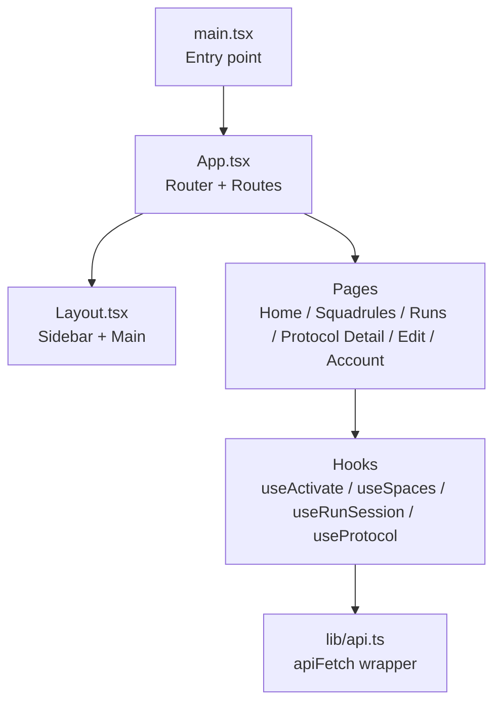
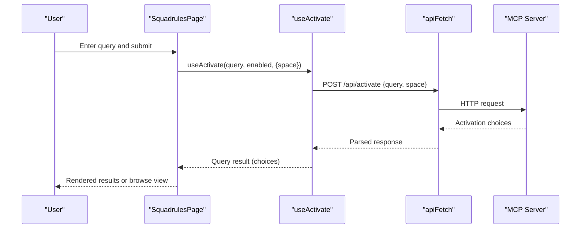
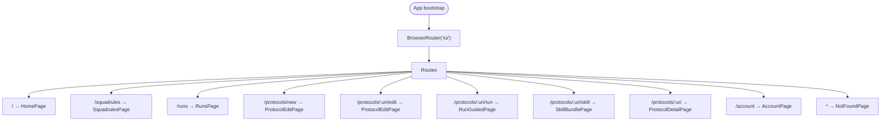
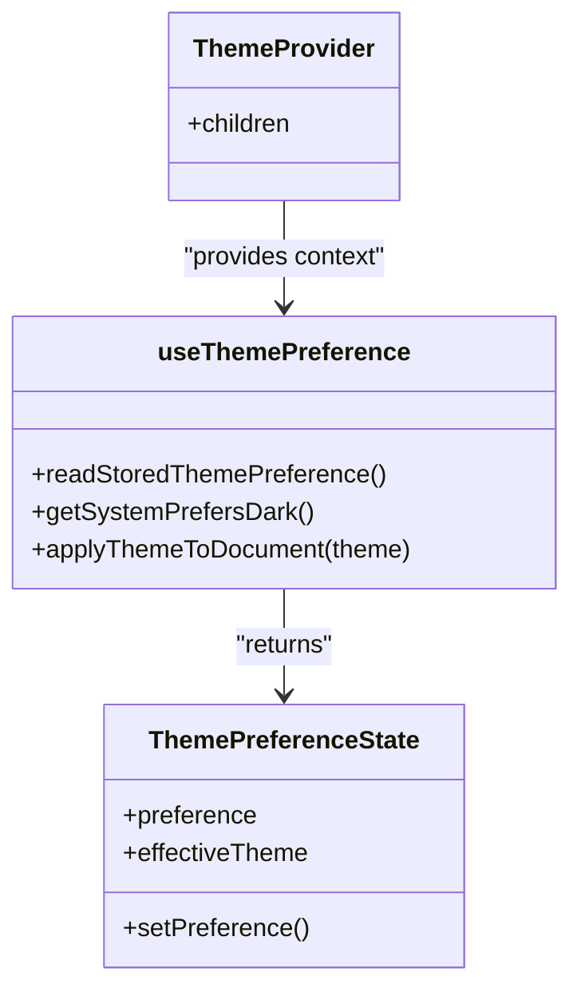
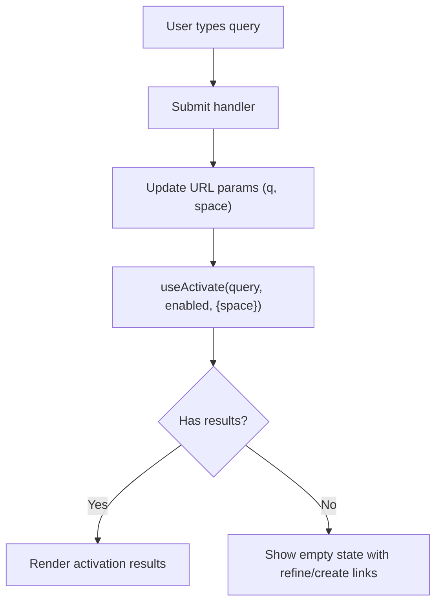
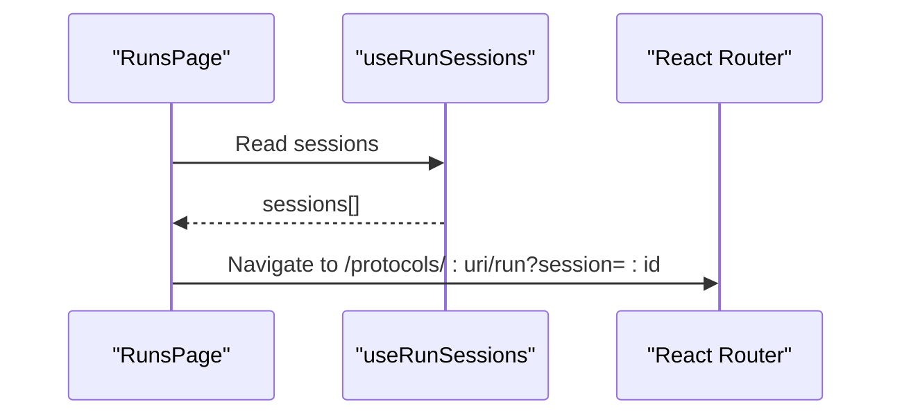
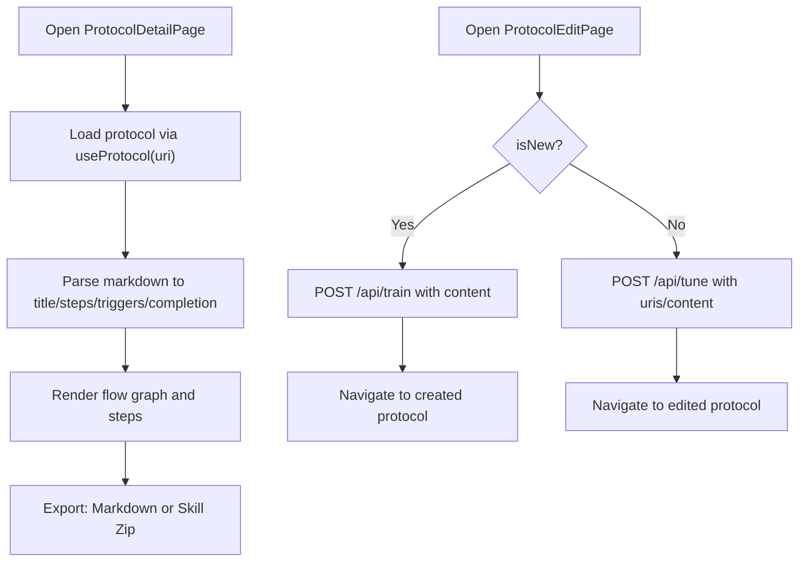
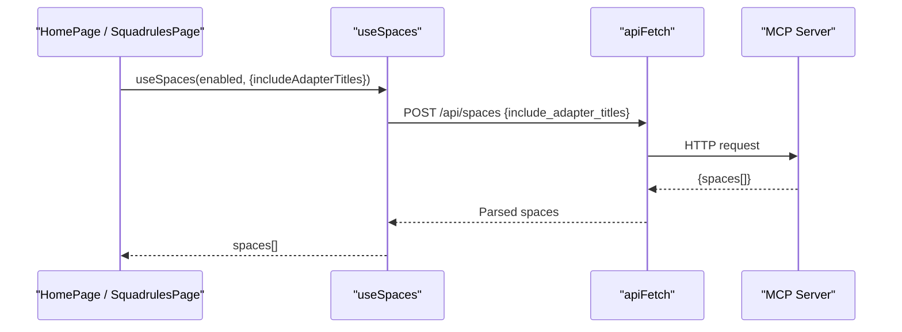
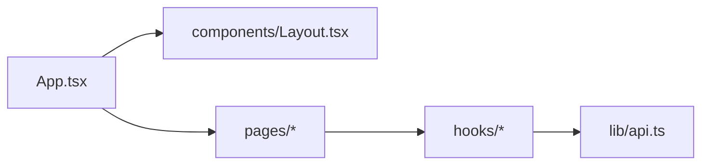

# Web Interface

<cite>
**Referenced Files in This Document**
- [main.tsx](file://src/ui/main.tsx)
- [App.tsx](file://src/ui/App.tsx)
- [Layout.tsx](file://src/ui/components/Layout.tsx)
- [useThemePreference.tsx](file://src/ui/hooks/useThemePreference.tsx)
- [api.ts](file://src/ui/lib/api.ts)
- [HomePage.tsx](file://src/ui/pages/HomePage.tsx)
- [SquadrulesPage.tsx](file://src/ui/pages/SquadrulesPage.tsx)
- [RunsPage.tsx](file://src/ui/pages/RunsPage.tsx)
- [ProtocolDetailPage.tsx](file://src/ui/pages/ProtocolDetailPage.tsx)
- [ProtocolEditPage.tsx](file://src/ui/pages/ProtocolEditPage.tsx)
- [useActivate.ts](file://src/ui/hooks/useActivate.ts)
- [useSpaces.ts](file://src/ui/hooks/useSpaces.ts)
</cite>

## Table of Contents
1. [Introduction](#introduction)
2. [Project Structure](#project-structure)
3. [Core Components](#core-components)
4. [Architecture Overview](#architecture-overview)
5. [Detailed Component Analysis](#detailed-component-analysis)
6. [Dependency Analysis](#dependency-analysis)
7. [Performance Considerations](#performance-considerations)
8. [Troubleshooting Guide](#troubleshooting-guide)
9. [Conclusion](#conclusion)
10. [Appendices](#appendices)

## Introduction
This document describes the React-based web interface for SquadRules MCP. It explains how the UI is structured, how state and data are managed, and how it integrates with the MCP backend to display protocol executions, memory searches, and administrative functions. It also covers theming, responsive design, accessibility, widget embedding, customization, build and deployment considerations.

Key goals:
- Provide a clear mental model of the UI architecture and component hierarchy.
- Explain how search, runs, protocols, and account features work end-to-end.
- Show how to customize themes, add components, and extend functionality.
- Describe how the UI embeds into other applications via widgets.

## Project Structure
The web interface is a React application built with Vite, using React Router for navigation, TanStack Query for server state, and i18n for internationalization. The entry point initializes providers (QueryClient, ThemeProvider), then renders the app shell with routes.

**Diagram sources**
- [main.tsx:1-20](file://src/ui/main.tsx#L1-L20)
- [App.tsx:1-133](file://src/ui/App.tsx#L1-L133)
- [Layout.tsx:1-109](file://src/ui/components/Layout.tsx#L1-L109)
- [api.ts:1-14](file://src/ui/lib/api.ts#L1-L14)

**Section sources**
- [main.tsx:1-20](file://src/ui/main.tsx#L1-L20)
- [App.tsx:1-133](file://src/ui/App.tsx#L1-L133)

## Core Components
- App shell and routing:
  - App defines lazy-loaded route-level code splitting and a base path for the UI.
  - Layout provides the sidebar navigation, version footer, and main content area with responsive width rules.
- Pages:
  - HomePage: orientation card, search form, quick actions, space stats.
  - SquadrulesPage: search and browse adapters, optional space scoping, activation results.
  - RunsPage: list of local run sessions with resume/remove actions.
  - ProtocolDetailPage: view steps, flow graph, export options (markdown/skill zip).
  - ProtocolEditPage: create/edit protocols, import/export, validation, save to backend.
- Hooks:
  - useActivate: fetches activation choices from /api/activate with optional space scope.
  - useSpaces: fetches spaces and optionally adapter titles from /api/spaces.
- API client:
  - apiFetch wraps fetch with JSON headers and same-origin credentials.

**Section sources**
- [App.tsx:1-133](file://src/ui/App.tsx#L1-L133)
- [Layout.tsx:1-109](file://src/ui/components/Layout.tsx#L1-L109)
- [HomePage.tsx:1-132](file://src/ui/pages/HomePage.tsx#L1-L132)
- [SquadrulesPage.tsx:1-219](file://src/ui/pages/SquadrulesPage.tsx#L1-L219)
- [RunsPage.tsx:1-57](file://src/ui/pages/RunsPage.tsx#L1-L57)
- [ProtocolDetailPage.tsx:1-214](file://src/ui/pages/ProtocolDetailPage.tsx#L1-L214)
- [ProtocolEditPage.tsx:1-338](file://src/ui/pages/ProtocolEditPage.tsx#L1-L338)
- [useActivate.ts:1-41](file://src/ui/hooks/useActivate.ts#L1-L41)
- [useSpaces.ts:1-48](file://src/ui/hooks/useSpaces.ts#L1-L48)
- [api.ts:1-14](file://src/ui/lib/api.ts#L1-L14)

## Architecture Overview
The UI follows a layered pattern:
- Presentation layer: Pages and shared components render user interfaces.
- State layer: Local component state plus TanStack Query-managed server state.
- Data access layer: Hooks encapsulate API calls through apiFetch.
- Backend integration: HTTP endpoints (/api/*) provided by the MCP server.

**Diagram sources**
- [SquadrulesPage.tsx:20-79](file://src/ui/pages/SquadrulesPage.tsx#L20-L79)
- [useActivate.ts:11-39](file://src/ui/hooks/useActivate.ts#L11-L39)
- [api.ts:3-13](file://src/ui/lib/api.ts#L3-L13)

## Detailed Component Analysis

### Routing and Shell
- App sets up BrowserRouter with basename "/ui", enabling server-side serving under a subpath.
- Route tree uses Suspense and lazy imports to keep initial bundle small.
- Layout renders a fixed-width sidebar, skip-link for accessibility, and a responsive main area.

**Diagram sources**
- [App.tsx:1-133](file://src/ui/App.tsx#L1-L133)

**Section sources**
- [App.tsx:1-133](file://src/ui/App.tsx#L1-L133)
- [Layout.tsx:1-109](file://src/ui/components/Layout.tsx#L1-L109)

### Theming and Preferences
- ThemeProvider wraps the app and exposes preference state (light/dark/system).
- Effective theme is computed based on stored preference and system color scheme.
- Theme is applied by setting data-theme attribute and colorScheme on the document root.
- Preference persists in localStorage and syncs across tabs via storage events.

**Diagram sources**
- [useThemePreference.tsx:1-149](file://src/ui/hooks/useThemePreference.tsx#L1-L149)

**Section sources**
- [useThemePreference.tsx:1-149](file://src/ui/hooks/useThemePreference.tsx#L1-L149)

### Search and Memory Activation
- SquadrulesPage manages query and optional space scope, updates URL search params, and triggers activation.
- Results are sorted by role priority and activation score; empty states provide refine/create actions.
- useActivate encapsulates the /api/activate call and returns normalized results.

**Diagram sources**
- [SquadrulesPage.tsx:20-79](file://src/ui/pages/SquadrulesPage.tsx#L20-L79)
- [useActivate.ts:11-39](file://src/ui/hooks/useActivate.ts#L11-L39)

**Section sources**
- [SquadrulesPage.tsx:1-219](file://src/ui/pages/SquadrulesPage.tsx#L1-L219)
- [useActivate.ts:1-41](file://src/ui/hooks/useActivate.ts#L1-L41)

### Runs and Execution Sessions
- RunsPage lists local run sessions with status, last message, step count, and actions to resume or remove.
- Resuming navigates to the guided run page with session ID.

**Diagram sources**
- [RunsPage.tsx:1-57](file://src/ui/pages/RunsPage.tsx#L1-L57)

**Section sources**
- [RunsPage.tsx:1-57](file://src/ui/pages/RunsPage.tsx#L1-L57)

### Protocols: View and Edit
- ProtocolDetailPage displays parsed protocol steps, flow graph, triggers/completion sections, and export options (markdown download, skill zip bundle).
- ProtocolEditPage supports creating new protocols or editing existing ones, importing markdown, validating schema, saving via /api/train or /api/tune, and previewing structure.

**Diagram sources**
- [ProtocolDetailPage.tsx:1-214](file://src/ui/pages/ProtocolDetailPage.tsx#L1-L214)
- [ProtocolEditPage.tsx:120-187](file://src/ui/pages/ProtocolEditPage.tsx#L120-L187)

**Section sources**
- [ProtocolDetailPage.tsx:1-214](file://src/ui/pages/ProtocolDetailPage.tsx#L1-L214)
- [ProtocolEditPage.tsx:1-338](file://src/ui/pages/ProtocolEditPage.tsx#L1-L338)

### Spaces and Browse
- useSpaces fetches spaces and optionally includes adapter titles for browsing.
- HomePage shows space cards with counts and type badges.
- SquadrulesPage uses spaces to populate the SpaceSelect filter.

**Diagram sources**
- [useSpaces.ts:24-47](file://src/ui/hooks/useSpaces.ts#L24-L47)
- [HomePage.tsx:10-23](file://src/ui/pages/HomePage.tsx#L10-L23)
- [SquadrulesPage.tsx:34-40](file://src/ui/pages/SquadrulesPage.tsx#L34-L40)

**Section sources**
- [useSpaces.ts:1-48](file://src/ui/hooks/useSpaces.ts#L1-L48)
- [HomePage.tsx:1-132](file://src/ui/pages/HomePage.tsx#L1-L132)
- [SquadrulesPage.tsx:1-219](file://src/ui/pages/SquadrulesPage.tsx#L1-L219)

## Dependency Analysis
- Client-side dependencies:
  - React Router for navigation and route-level code splitting.
  - TanStack Query for caching and background refetching of server state.
  - i18next for translations.
- Internal module dependencies:
  - Pages depend on hooks for data fetching.
  - Hooks depend on lib/api.ts for HTTP requests.
  - Layout depends on react-router and i18n.

**Diagram sources**
- [App.tsx:1-133](file://src/ui/App.tsx#L1-L133)
- [Layout.tsx:1-109](file://src/ui/components/Layout.tsx#L1-L109)
- [api.ts:1-14](file://src/ui/lib/api.ts#L1-L14)

**Section sources**
- [App.tsx:1-133](file://src/ui/App.tsx#L1-L133)
- [api.ts:1-14](file://src/ui/lib/api.ts#L1-L14)

## Performance Considerations
- Route-level code splitting reduces initial payload size.
- TanStack Query caches responses and avoids redundant network calls.
- Skeleton loaders improve perceived performance during data loading.
- Responsive CSS variables and utility classes minimize layout shifts.

[No sources needed since this section provides general guidance]

## Troubleshooting Guide
Common issues and resolutions:
- Authentication and CORS:
  - Ensure the server serves the UI under the configured base path ("/ui") and that cookies/same-origin credentials are allowed.
  - Verify that the server’s CORS configuration permits the frontend origin when hosted separately.
- API errors:
  - Check error messages returned by /api/activate, /api/spaces, /api/train, /api/tune.
  - Use the ErrorAlert components to surface server errors and retry actions.
- Theme not applying:
  - Confirm that data-theme is set on the document root and that CSS tokens are loaded.
  - Validate localStorage availability; if blocked, preference remains in-memory only.
- Navigation issues:
  - When running behind a reverse proxy, ensure the base path matches the router’s basename.

**Section sources**
- [api.ts:3-13](file://src/ui/lib/api.ts#L3-L13)
- [useThemePreference.tsx:53-60](file://src/ui/hooks/useThemePreference.tsx#L53-L60)

## Conclusion
The web interface provides a modular, accessible, and customizable React application for interacting with the SquadRules MCP backend. It separates concerns between pages, hooks, and shared components, leverages TanStack Query for efficient data management, and supports theming, localization, and responsive layouts. The widget system enables embedding core functionalities into external applications.

[No sources needed since this section summarizes without analyzing specific files]

## Appendices

### Widget System and Embedding
- The MCP server exposes widget resources for activating, forwarding, and listing offerings within an embedded UI.
- Widgets can be injected inline (HTML/CSS/JS) or served as standalone HTML pages.
- Resources include:
  - Activate widget HTML and inline assets.
  - Forward widget HTML and inline assets.
  - Spaces widget HTML and resources.
  - Offering listings for the UI.
  - Capability registration for server-provided UI features.

Use cases:
- Embed activation/search flows in partner dashboards.
- Embed forward execution views for real-time monitoring.
- Embed spaces management for administrators.

**Section sources**
- [mcp-widget-chrome-inline-css.ts](file://src/mcp-apps/mcp-widget-chrome-inline-css.ts)
- [activate-widget-html.ts](file://src/mcp-apps/activate-widget-html.ts)
- [activate-widget-inline-css.ts](file://src/mcp-apps/activate-widget-inline-css.ts)
- [activate-widget-inline-script.ts](file://src/mcp-apps/activate-widget-inline-script.ts)
- [forward-widget-html.ts](file://src/mcp-apps/forward-widget-html.ts)
- [forward-widget-inline-css.ts](file://src/mcp-apps/forward-widget-inline-css.ts)
- [forward-widget-inline-script.ts](file://src/mcp-apps/forward-widget-inline-script.ts)
- [spaces-widget-html.ts](file://src/mcp-apps/spaces-widget-html.ts)
- [spaces-mcp-app-widget-html.ts](file://src/mcp-apps/spaces-mcp-app-widget-html.ts)
- [list-offerings-for-ui.ts](file://src/mcp-apps/list-offerings-for-ui.ts)
- [register-activate-ui-resources.ts](file://src/mcp-apps/register-activate-ui-resources.ts)
- [register-forward-ui-resources.ts](file://src/mcp-apps/register-forward-ui-resources.ts)
- [register-spaces-ui-resources.ts](file://src/mcp-apps/register-spaces-ui-resources.ts)
- [squadrules-server-ui-capability.ts](file://src/mcp-apps/squadrules-server-ui-capability.ts)

### Customizing the UI
- Themes:
  - Add or modify CSS tokens in theme files to adjust colors, spacing, and typography.
  - Toggle themes via the ThemeProvider context or integrate a theme switcher component.
- Components:
  - Extend shared components (e.g., SurfaceCard, RichTextEditor) to introduce new behaviors.
  - Create new pages under pages/ and register routes in App.tsx.
- Internationalization:
  - Add translation keys in i18n/en.json and reference them via useTranslation.

**Section sources**
- [useThemePreference.tsx:1-149](file://src/ui/hooks/useThemePreference.tsx#L1-L149)
- [App.tsx:1-133](file://src/ui/App.tsx#L1-L133)

### Build, Development, and Deployment
- Build:
  - npm run build compiles TypeScript and React UI assets.
- Development:
  - Use the development server to serve the UI alongside the MCP backend.
  - Ensure environment variables (e.g., VITE_SQUADRULES_VERSION) are available at runtime.
- Deployment:
  - Serve the built UI under the configured base path ("/ui").
  - Configure reverse proxies to preserve paths and cookies for authentication.

**Section sources**
- [App.tsx:126-133](file://src/ui/App.tsx#L126-L133)
- [Layout.tsx:27-27](file://src/ui/components/Layout.tsx#L27-L27)