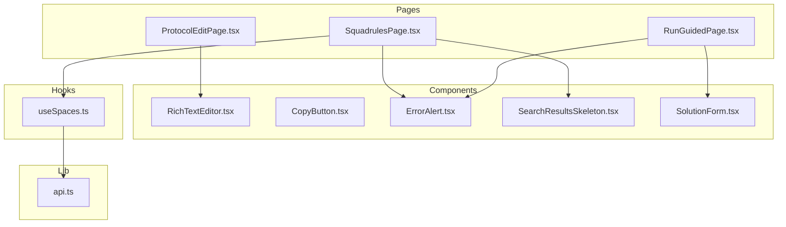
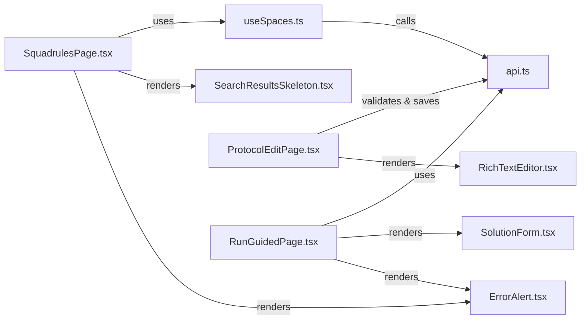
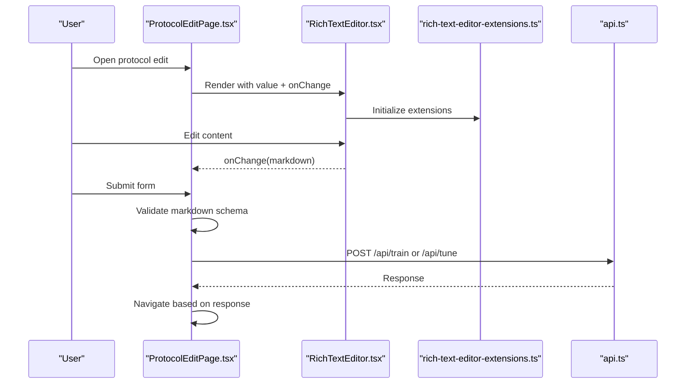
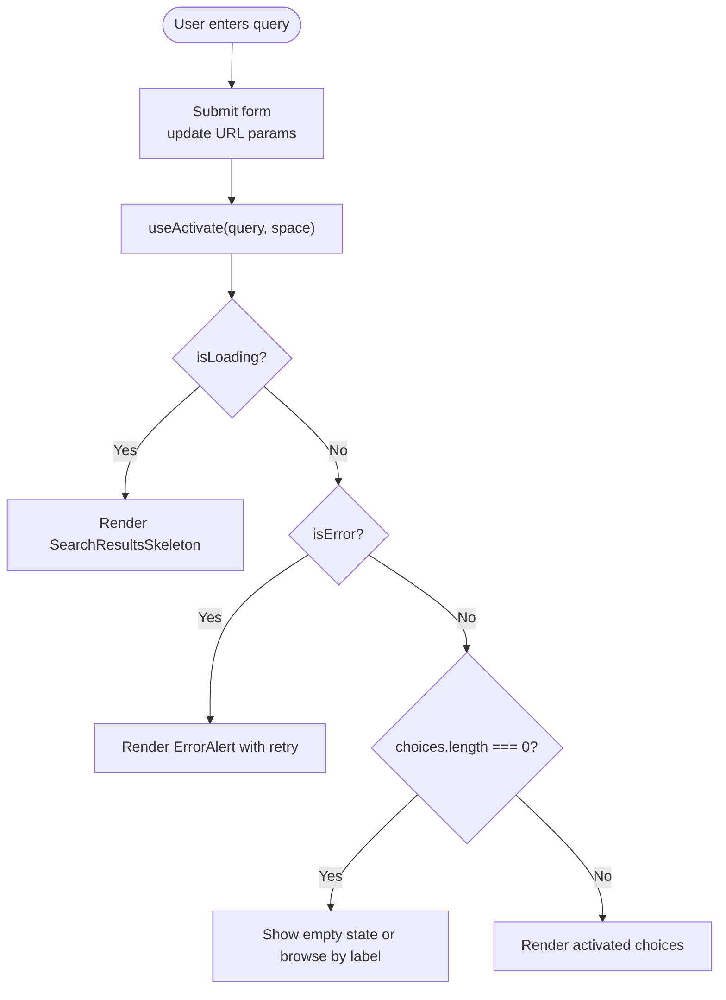
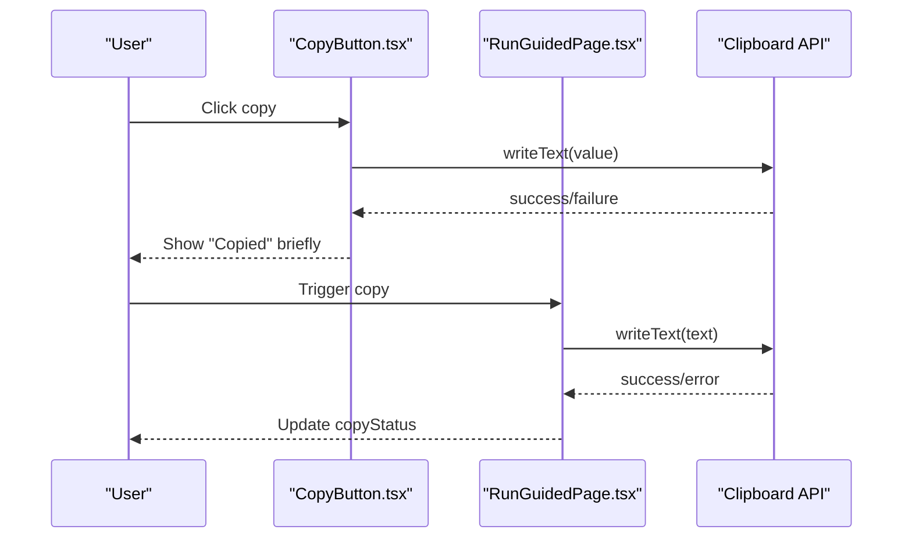
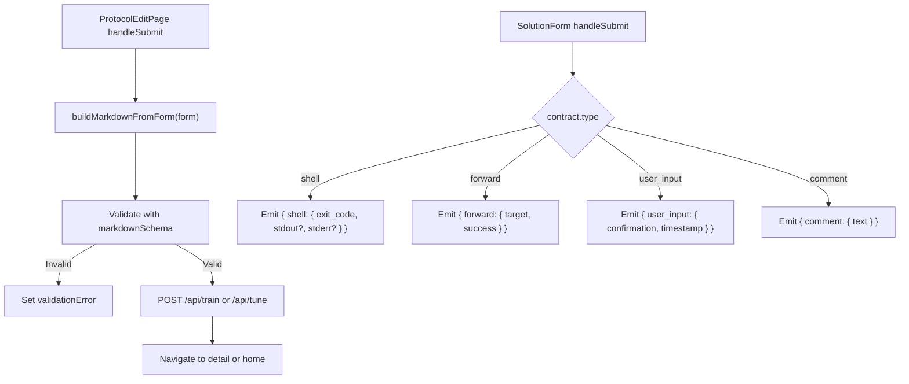
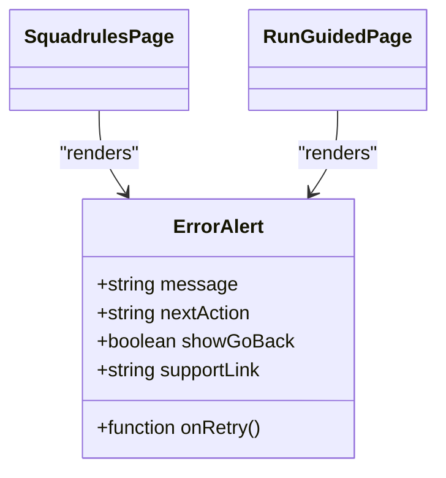
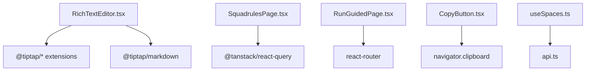

# Interactive Components and Forms

<cite>
**Referenced Files in This Document**
- [RichTextEditor.tsx](file://src/ui/components/RichTextEditor.tsx)
- [rich-text-editor-extensions.ts](file://src/ui/utils/rich-text-editor-extensions.ts)
- [CopyButton.tsx](file://src/ui/components/CopyButton.tsx)
- [ErrorAlert.tsx](file://src/ui/components/ErrorAlert.tsx)
- [SearchResultsSkeleton.tsx](file://src/ui/components/SearchResultsSkeleton.tsx)
- [ProtocolEditPage.tsx](file://src/ui/pages/ProtocolEditPage.tsx)
- [SquadrulesPage.tsx](file://src/ui/pages/SquadrulesPage.tsx)
- [RunGuidedPage.tsx](file://src/ui/pages/RunGuidedPage.tsx)
- [SolutionForm.tsx](file://src/ui/components/run/SolutionForm.tsx)
- [useSpaces.ts](file://src/ui/hooks/useSpaces.ts)
- [api.ts](file://src/ui/lib/api.ts)
</cite>

## Table of Contents
1. [Introduction](#introduction)
2. [Project Structure](#project-structure)
3. [Core Components](#core-components)
4. [Architecture Overview](#architecture-overview)
5. [Detailed Component Analysis](#detailed-component-analysis)
6. [Dependency Analysis](#dependency-analysis)
7. [Performance Considerations](#performance-considerations)
8. [Troubleshooting Guide](#troubleshooting-guide)
9. [Conclusion](#conclusion)

## Introduction
This document explains the interactive UI components used in the SquadRules web interface, focusing on:
- Rich text editor for protocol authoring
- Form handling patterns and validation
- Search result rendering and skeleton loading
- Copy-to-clipboard functionality
- Error display mechanisms
It also provides component APIs, props interfaces, event handlers, customization options, usage examples, and integration patterns to help you build new interactive features consistently with the existing codebase.

## Project Structure
The relevant UI code is organized under src/ui:
- Components: reusable UI pieces (editor, buttons, alerts, skeletons, cards)
- Pages: route-level views that compose components and orchestrate data flows
- Hooks: data fetching and state management utilities
- Lib: shared helpers like API client wrappers

**Diagram sources**
- [ProtocolEditPage.tsx:1-338](file://src/ui/pages/ProtocolEditPage.tsx#L1-L338)
- [SquadrulesPage.tsx:1-219](file://src/ui/pages/SquadrulesPage.tsx#L1-L219)
- [RunGuidedPage.tsx:1-240](file://src/ui/pages/RunGuidedPage.tsx#L1-L240)
- [RichTextEditor.tsx:1-265](file://src/ui/components/RichTextEditor.tsx#L1-L265)
- [CopyButton.tsx:1-39](file://src/ui/components/CopyButton.tsx#L1-L39)
- [ErrorAlert.tsx:1-71](file://src/ui/components/ErrorAlert.tsx#L1-L71)
- [SearchResultsSkeleton.tsx:1-24](file://src/ui/components/SearchResultsSkeleton.tsx#L1-L24)
- [SolutionForm.tsx:1-230](file://src/ui/components/run/SolutionForm.tsx#L1-L230)
- [useSpaces.ts:1-48](file://src/ui/hooks/useSpaces.ts#L1-L48)
- [api.ts:1-14](file://src/ui/lib/api.ts#L1-L14)

**Section sources**
- [ProtocolEditPage.tsx:1-338](file://src/ui/pages/ProtocolEditPage.tsx#L1-L338)
- [SquadrulesPage.tsx:1-219](file://src/ui/pages/SquadrulesPage.tsx#L1-L219)
- [RunGuidedPage.tsx:1-240](file://src/ui/pages/RunGuidedPage.tsx#L1-L240)
- [RichTextEditor.tsx:1-265](file://src/ui/components/RichTextEditor.tsx#L1-L265)
- [CopyButton.tsx:1-39](file://src/ui/components/CopyButton.tsx#L1-L39)
- [ErrorAlert.tsx:1-71](file://src/ui/components/ErrorAlert.tsx#L1-L71)
- [SearchResultsSkeleton.tsx:1-24](file://src/ui/components/SearchResultsSkeleton.tsx#L1-L24)
- [SolutionForm.tsx:1-230](file://src/ui/components/run/SolutionForm.tsx#L1-L230)
- [useSpaces.ts:1-48](file://src/ui/hooks/useSpaces.ts#L1-L48)
- [api.ts:1-14](file://src/ui/lib/api.ts#L1-L14)

## Core Components
This section documents the primary interactive components and their contracts.

### Rich Text Editor
A Markdown-safe rich text editor built on Tiptap, exposing a controlled value/onChange pair as Markdown strings. It includes a focused toolbar for paragraph, bold, italic, lists, link, quote, inline code, code block, and table insertion.

- Props
  - value: string — current Markdown content
  - onChange: (markdown: string) => void — emits updated Markdown
  - label?: string — optional label for accessibility
  - hint?: string — optional helper text below the editor
  - id?: string — input id for label association
  - contentKey?: string — when changed, forces editor remount with new value (e.g., after file upload)
- Behavior
  - Uses Tiptap extensions configured for Markdown, GFM, and tables
  - Toolbar commands update editor state; link insertion uses a prompt
  - Syncs external value changes into the editor without triggering redundant updates
- Customization
  - Extensions are centralized; modify createRichTextEditorExtensions to adjust capabilities
  - Styling via CSS classes and theme variables

**Section sources**
- [RichTextEditor.tsx:1-265](file://src/ui/components/RichTextEditor.tsx#L1-L265)
- [rich-text-editor-extensions.ts:1-28](file://src/ui/utils/rich-text-editor-extensions.ts#L1-L28)

### Copy Button
A small accessible button that copies provided text to the clipboard and shows a temporary “copied” state.

- Props
  - value: string — text to copy
  - label: string — accessible label and tooltip
  - className?: string — optional additional class
- Behavior
  - Uses navigator.clipboard.writeText
  - Shows localized “Copied” feedback briefly

**Section sources**
- [CopyButton.tsx:1-39](file://src/ui/components/CopyButton.tsx#L1-L39)

### Error Alert
A consistent error banner with optional retry action, back navigation, and support link.

- Props
  - message: string — main error message
  - nextAction?: string — optional guidance text
  - onRetry?: () => void — optional retry handler
  - showGoBack?: boolean — toggle home link
  - supportLink?: string — optional external support link
- Behavior
  - Accessible alert region
  - Integrates with React Router Link for navigation

**Section sources**
- [ErrorAlert.tsx:1-71](file://src/ui/components/ErrorAlert.tsx#L1-L71)

### Search Results Skeleton
A lightweight placeholder list shown while search or spaces data loads to avoid layout shift.

- Usage
  - Render conditionally while isLoading is true
  - No props required

**Section sources**
- [SearchResultsSkeleton.tsx:1-24](file://src/ui/components/SearchResultsSkeleton.tsx#L1-L24)

### Solution Form
A dynamic form that adapts to the contract type (shell, forward, user_input, comment), validates inputs, and submits structured solutions.

- Props
  - contract: RunContract — describes the challenge type and fields
  - disabled?: boolean — disables all inputs and submit
  - onSubmit: (draft) => void — receives validated solution draft
- Validation
  - shell: exit code must be numeric
  - forward: target must be non-empty
  - user_input: confirmation must be non-empty
  - comment: length must meet minimum length
- Behavior
  - Resets errors and fields when contract changes
  - Emits typed payloads per contract type

**Section sources**
- [SolutionForm.tsx:1-230](file://src/ui/components/run/SolutionForm.tsx#L1-L230)

## Architecture Overview
The pages orchestrate data fetching, user interactions, and component composition. The following diagram maps key page-to-component relationships and data flows.

**Diagram sources**
- [SquadrulesPage.tsx:1-219](file://src/ui/pages/SquadrulesPage.tsx#L1-L219)
- [ProtocolEditPage.tsx:1-338](file://src/ui/pages/ProtocolEditPage.tsx#L1-L338)
- [RunGuidedPage.tsx:1-240](file://src/ui/pages/RunGuidedPage.tsx#L1-L240)
- [ErrorAlert.tsx:1-71](file://src/ui/components/ErrorAlert.tsx#L1-L71)
- [SearchResultsSkeleton.tsx:1-24](file://src/ui/components/SearchResultsSkeleton.tsx#L1-L24)
- [RichTextEditor.tsx:1-265](file://src/ui/components/RichTextEditor.tsx#L1-L265)
- [SolutionForm.tsx:1-230](file://src/ui/components/run/SolutionForm.tsx#L1-L230)
- [useSpaces.ts:1-48](file://src/ui/hooks/useSpaces.ts#L1-L48)
- [api.ts:1-14](file://src/ui/lib/api.ts#L1-L14)

## Detailed Component Analysis

### Rich Text Editor Integration in Protocol Editing
Protocol editing composes multiple RichTextEditor instances for triggers and completion sections, plus step editors within step cards. The page manages form state, uploads, validation, and persistence.

**Diagram sources**
- [ProtocolEditPage.tsx:120-187](file://src/ui/pages/ProtocolEditPage.tsx#L120-L187)
- [RichTextEditor.tsx:210-248](file://src/ui/components/RichTextEditor.tsx#L210-L248)
- [rich-text-editor-extensions.ts:8-27](file://src/ui/utils/rich-text-editor-extensions.ts#L8-L27)
- [api.ts:3-13](file://src/ui/lib/api.ts#L3-L13)

**Section sources**
- [ProtocolEditPage.tsx:21-80](file://src/ui/pages/ProtocolEditPage.tsx#L21-L80)
- [ProtocolEditPage.tsx:120-187](file://src/ui/pages/ProtocolEditPage.tsx#L120-L187)
- [RichTextEditor.tsx:200-265](file://src/ui/components/RichTextEditor.tsx#L200-L265)
- [rich-text-editor-extensions.ts:1-28](file://src/ui/utils/rich-text-editor-extensions.ts#L1-L28)

### Search Flow and Result Rendering
The Squadrules page handles query submission, scopes by space, displays skeletons during load, and renders results or browse-by-label sections. Errors are surfaced through ErrorAlert.

**Diagram sources**
- [SquadrulesPage.tsx:51-79](file://src/ui/pages/SquadrulesPage.tsx#L51-L79)
- [SquadrulesPage.tsx:145-173](file://src/ui/pages/SquadrulesPage.tsx#L145-L173)
- [SearchResultsSkeleton.tsx:1-24](file://src/ui/components/SearchResultsSkeleton.tsx#L1-L24)
- [ErrorAlert.tsx:1-71](file://src/ui/components/ErrorAlert.tsx#L1-L71)

**Section sources**
- [SquadrulesPage.tsx:20-79](file://src/ui/pages/SquadrulesPage.tsx#L20-L79)
- [SquadrulesPage.tsx:90-173](file://src/ui/pages/SquadrulesPage.tsx#L90-L173)
- [SearchResultsSkeleton.tsx:1-24](file://src/ui/components/SearchResultsSkeleton.tsx#L1-L24)
- [ErrorAlert.tsx:1-71](file://src/ui/components/ErrorAlert.tsx#L1-L71)

### Copy-to-Clipboard Patterns
Two patterns exist:
- Reusable CopyButton component for simple copy actions
- Inline handleCopy in RunGuidedPage for contextual copying with status feedback

**Diagram sources**
- [CopyButton.tsx:13-36](file://src/ui/components/CopyButton.tsx#L13-L36)
- [RunGuidedPage.tsx:83-92](file://src/ui/pages/RunGuidedPage.tsx#L83-L92)

**Section sources**
- [CopyButton.tsx:1-39](file://src/ui/components/CopyButton.tsx#L1-L39)
- [RunGuidedPage.tsx:83-92](file://src/ui/pages/RunGuidedPage.tsx#L83-L92)

### Form Handling and Validation Patterns
- Protocol editing:
  - Controlled fields for label, triggers, steps, and completion
  - Build Markdown from form state, validate with schema, then call backend endpoints
  - Supports import/upload of Markdown, with error handling and reset
- Guided run:
  - SolutionForm validates per contract type and emits typed payloads
  - RunGuidedPage orchestrates start, step submission, and reward flows

**Diagram sources**
- [ProtocolEditPage.tsx:120-187](file://src/ui/pages/ProtocolEditPage.tsx#L120-L187)
- [SolutionForm.tsx:44-102](file://src/ui/components/run/SolutionForm.tsx#L44-L102)

**Section sources**
- [ProtocolEditPage.tsx:101-187](file://src/ui/pages/ProtocolEditPage.tsx#L101-L187)
- [SolutionForm.tsx:44-102](file://src/ui/components/run/SolutionForm.tsx#L44-L102)

### Error Display Mechanisms
- Global ErrorAlert component standardizes error banners with optional retry and navigation
- Pages render ErrorAlert for network errors, missing parameters, and runtime failures
- Localized messages via i18n keys

**Diagram sources**
- [ErrorAlert.tsx:4-71](file://src/ui/components/ErrorAlert.tsx#L4-L71)
- [SquadrulesPage.tsx:145-159](file://src/ui/pages/SquadrulesPage.tsx#L145-L159)
- [RunGuidedPage.tsx:167-218](file://src/ui/pages/RunGuidedPage.tsx#L167-L218)

**Section sources**
- [ErrorAlert.tsx:1-71](file://src/ui/components/ErrorAlert.tsx#L1-L71)
- [SquadrulesPage.tsx:145-159](file://src/ui/pages/SquadrulesPage.tsx#L145-L159)
- [RunGuidedPage.tsx:167-218](file://src/ui/pages/RunGuidedPage.tsx#L167-L218)

## Dependency Analysis
The UI depends on:
- Tiptap and Markdown extensions for rich editing
- React Query for data fetching and caching
- React Router for navigation
- i18n for localization
- Clipboard API for copy operations

**Diagram sources**
- [RichTextEditor.tsx:7-9](file://src/ui/components/RichTextEditor.tsx#L7-L9)
- [rich-text-editor-extensions.ts:1-6](file://src/ui/utils/rich-text-editor-extensions.ts#L1-L6)
- [SquadrulesPage.tsx:1-11](file://src/ui/pages/SquadrulesPage.tsx#L1-L11)
- [RunGuidedPage.tsx:1-12](file://src/ui/pages/RunGuidedPage.tsx#L1-L12)
- [CopyButton.tsx:1-2](file://src/ui/components/CopyButton.tsx#L1-L2)
- [useSpaces.ts:1-3](file://src/ui/hooks/useSpaces.ts#L1-L3)
- [api.ts:1-14](file://src/ui/lib/api.ts#L1-L14)

**Section sources**
- [RichTextEditor.tsx:1-265](file://src/ui/components/RichTextEditor.tsx#L1-L265)
- [rich-text-editor-extensions.ts:1-28](file://src/ui/utils/rich-text-editor-extensions.ts#L1-L28)
- [SquadrulesPage.tsx:1-219](file://src/ui/pages/SquadrulesPage.tsx#L1-L219)
- [RunGuidedPage.tsx:1-240](file://src/ui/pages/RunGuidedPage.tsx#L1-L240)
- [CopyButton.tsx:1-39](file://src/ui/components/CopyButton.tsx#L1-L39)
- [useSpaces.ts:1-48](file://src/ui/hooks/useSpaces.ts#L1-L48)
- [api.ts:1-14](file://src/ui/lib/api.ts#L1-L14)

## Performance Considerations
- Rich Text Editor
  - Avoid unnecessary re-renders by using refs for value and onChange to prevent stale closures
  - Use contentKey to force controlled remount only when needed (e.g., after file upload)
  - Keep toolbar minimal to reduce command overhead
- Search and Data Fetching
  - Use react-query hooks to cache and deduplicate requests
  - Show skeletons during loading to improve perceived performance
- Clipboard Operations
  - Wrap clipboard calls in try/catch and provide fallback UX
- Forms
  - Validate locally before network calls to reduce round trips
  - Debounce heavy computations if added later (e.g., large previews)

[No sources needed since this section provides general guidance]

## Troubleshooting Guide
- Rich Text Editor not updating
  - Ensure contentKey changes when external content changes to force remount
  - Verify onChange is passed correctly and not replaced by stale closure
- Markdown validation fails
  - Check that buildMarkdownFromForm produces valid structure expected by markdownSchema
  - Inspect validationError message for details
- Copy button does nothing
  - Confirm browser supports clipboard API and has permissions
  - Check for silent catch blocks and add logging in development
- ErrorAlert not showing
  - Ensure isError flag is set and message is provided
  - Verify onRetry is wired to refetch or appropriate handler
- SolutionForm disabled unexpectedly
  - Check isValid logic for the specific contract type
  - Ensure required fields are filled according to rules

**Section sources**
- [RichTextEditor.tsx:210-248](file://src/ui/components/RichTextEditor.tsx#L210-L248)
- [ProtocolEditPage.tsx:120-187](file://src/ui/pages/ProtocolEditPage.tsx#L120-L187)
- [CopyButton.tsx:17-25](file://src/ui/components/CopyButton.tsx#L17-L25)
- [ErrorAlert.tsx:17-71](file://src/ui/components/ErrorAlert.tsx#L17-L71)
- [SolutionForm.tsx:44-102](file://src/ui/components/run/SolutionForm.tsx#L44-L102)

## Conclusion
The SquadRules UI provides a cohesive set of interactive components for rich editing, robust form handling, clear error presentation, and efficient search experiences. By following the documented APIs and patterns—controlled editor value/onChange, schema-based validation, skeleton loading, and standardized error alerts—you can extend the interface with new interactive features that integrate seamlessly with existing pages and data flows.