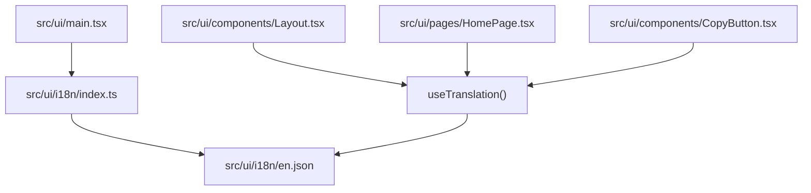
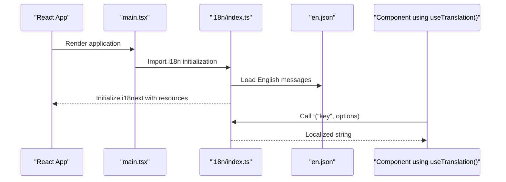
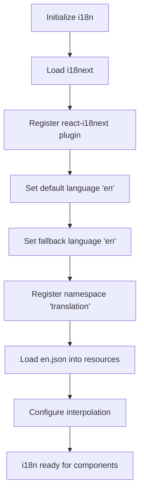
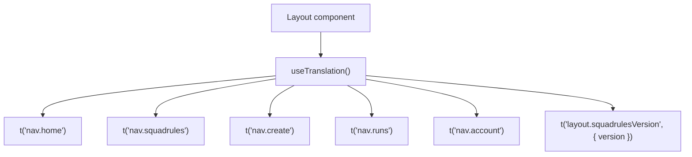
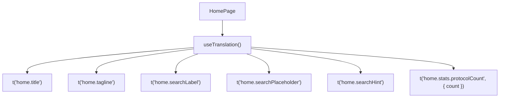
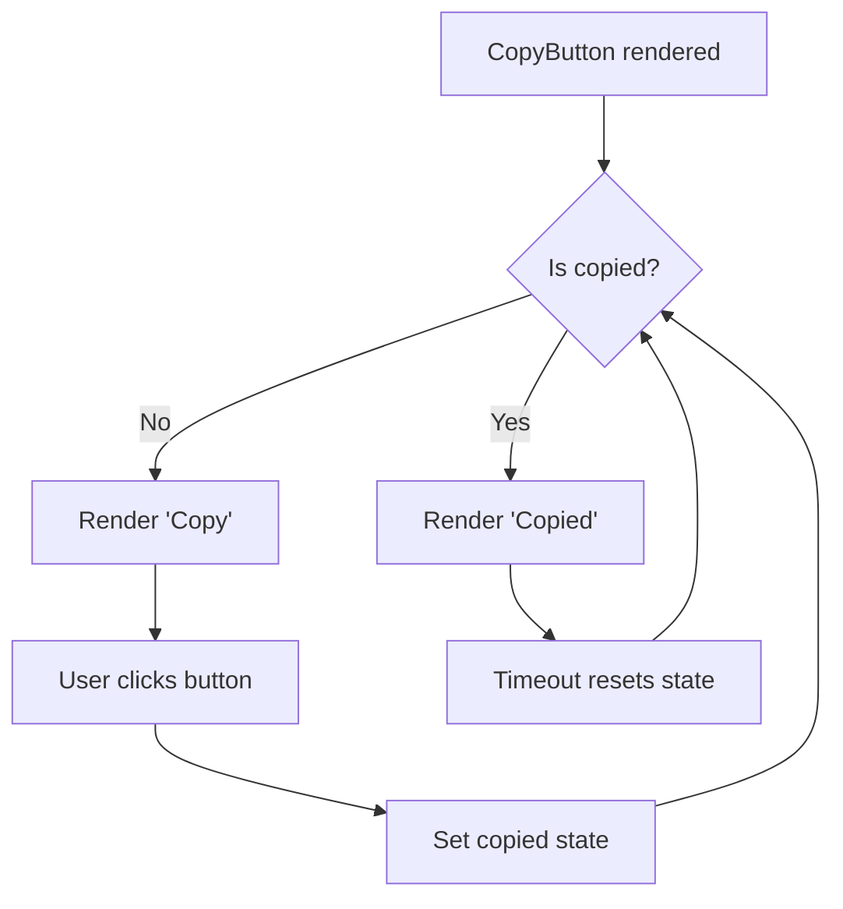
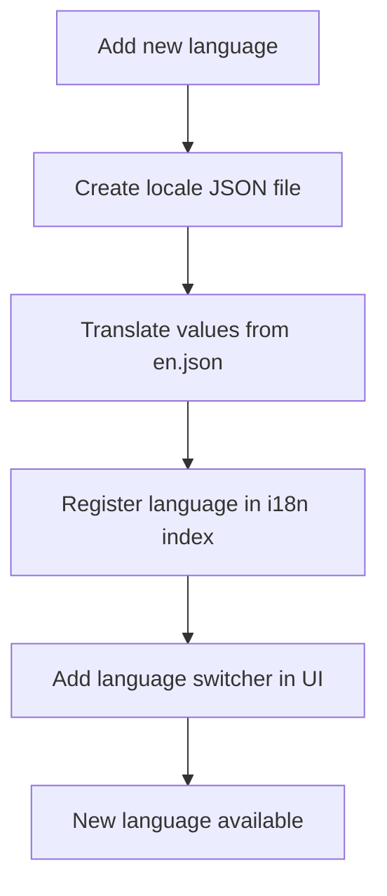
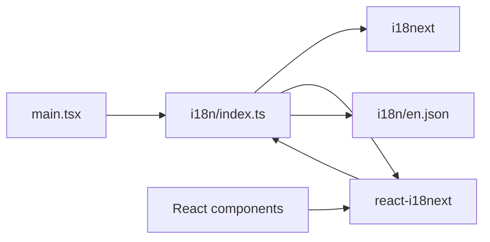

# Internationalization (i18n)

<cite>
**Referenced Files in This Document**
- [index.ts](file://src/ui/i18n/index.ts)
- [en.json](file://src/ui/i18n/en.json)
- [main.tsx](file://src/ui/main.tsx)
- [Layout.tsx](file://src/ui/components/Layout.tsx)
- [HomePage.tsx](file://src/ui/pages/HomePage.tsx)
- [CopyButton.tsx](file://src/ui/components/CopyButton.tsx)
</cite>

## Table of Contents
1. [Introduction](#introduction)
2. [Project Structure](#project-structure)
3. [Core Components](#core-components)
4. [Architecture Overview](#architecture-overview)
5. [Detailed Component Analysis](#detailed-component-analysis)
6. [Adding a New Language](#adding-a-new-language)
7. [Updating Existing Translations](#updating-existing-translations)
8. [Dynamic Content Localization](#dynamic-content-localization)
9. [Translation Workflow and Best Practices](#translation-workflow-and-best-practices)
10. [Dependency Analysis](#dependency-analysis)
11. [Performance Considerations](#performance-considerations)
12. [Troubleshooting Guide](#troubleshooting-guide)
13. [Conclusion](#conclusion)

## Introduction
This document explains the internationalization system used by the SquadRules web interface. The UI uses `i18next` with `react-i18next` to render user-facing text, navigation labels, form hints, error messages, and dynamic content such as pluralized counts. All visible English strings are centralized in a JSON message file, and components access translations through the `useTranslation` hook.

The current implementation is intentionally simple: it initializes i18n once at application startup, loads the English namespace, and renders localized text throughout React components.

## Project Structure
The i18n setup lives under the frontend source tree:

- `src/ui/i18n/index.ts`: Initializes `i18next`, registers the default language, namespace, and resources.
- `src/ui/i18n/en.json`: Contains all English translation keys and values.
- `src/ui/main.tsx`: Imports the i18n initialization module so translations are available before the app renders.
- Pages and components import `useTranslation` from `react-i18next` and call `t("key")` for user-visible text.

**Diagram sources**
- [main.tsx:1-1](file://src/ui/main.tsx#L1-L1)
- [index.ts:1-12](file://src/ui/i18n/index.ts#L1-L12)
- [en.json:1-273](file://src/ui/i18n/en.json#L1-L273)
- [Layout.tsx:1-109](file://src/ui/components/Layout.tsx#L1-L109)
- [HomePage.tsx:1-132](file://src/ui/pages/HomePage.tsx#L1-L132)
- [CopyButton.tsx:1-39](file://src/ui/components/CopyButton.tsx#L1-L39)

**Section sources**
- [index.ts:1-12](file://src/ui/i18n/index.ts#L1-L12)
- [en.json:1-273](file://src/ui/i18n/en.json#L1-L273)
- [main.tsx:1-19](file://src/ui/main.tsx#L1-L19)

## Core Components
The i18n system has two primary parts:

| Part | Responsibility | Location |
|---|---|---|
| i18n initialization | Configures `i18next`, sets default language, fallback language, namespace, interpolation settings, and loaded resources. | `src/ui/i18n/index.ts` |
| Translation messages | Stores all user-facing English strings organized by semantic key groups. | `src/ui/i18n/en.json` |

Key configuration details:

- Default language: `en`.
- Fallback language: `en`.
- Namespace: `translation`.
- Default namespace: `translation`.
- Interpolation: enabled with `escapeValue: false`, allowing template variables like `{{version}}` and `{{count}}` without HTML escaping.
- Resources: English messages are imported directly from `en.json` and registered under the `translation` namespace.

Components consume translations using `useTranslation()` and call `t(key, options)` to render localized text.

**Section sources**
- [index.ts:1-12](file://src/ui/i18n/index.ts#L1-L12)
- [en.json:1-273](file://src/ui/i18n/en.json#L1-L273)

## Architecture Overview
At runtime, the UI follows this flow:

1. `main.tsx` imports the i18n initialization module.
2. The initialization module loads `i18next` and `react-i18next`.
3. It registers the English resource bundle from `en.json`.
4. React components use `useTranslation()` to access the `t` function.
5. The `t` function resolves keys from the active language and returns localized strings.

**Diagram sources**
- [main.tsx:1-19](file://src/ui/main.tsx#L1-L19)
- [index.ts:1-12](file://src/ui/i18n/index.ts#L1-L12)
- [en.json:1-273](file://src/ui/i18n/en.json#L1-L273)

## Detailed Component Analysis

### i18n Initialization
The initialization file configures how translations are loaded and resolved.

- Uses `i18next` as the core engine.
- Integrates with React via `initReactI18next`.
- Sets the default and fallback language to English.
- Registers the `translation` namespace.
- Loads English messages from `en.json`.
- Disables automatic value escaping for interpolation.

**Diagram sources**
- [index.ts:1-12](file://src/ui/i18n/index.ts#L1-L12)

**Section sources**
- [index.ts:1-12](file://src/ui/i18n/index.ts#L1-L12)

### Message File Structure
The English message file organizes keys by feature area:

| Key Group | Purpose | Examples |
|---|---|---|
| Navigation | Sidebar and top-level navigation labels | `nav.home`, `nav.squadrules`, `nav.create`, `nav.runs`, `nav.account` |
| Layout | Global layout text and version display | `layout.squadrulesVersion`, `skipToMain` |
| Home Page | Orientation, search, cards, and space statistics | `home.title`, `home.searchLabel`, `home.stats.protocolCount` |
| Browse / Squadrules | Protocol discovery, activation query, results, and actions | `squadrules.search`, `squadrules.loading`, `squadrules.empty` |
| Spaces | Space filtering and type labels | `spaces.filterAll`, `spaces.type.personal`, `spaces.type.group` |
| Protocol View | Protocol metadata, export, steps, and usage guidance | `protocol.uri`, `protocol.download`, `protocol.steps` |
| Test Run | Guided run progress, challenges, reward, and history | `runs.title`, `run.start`, `run.reward.submit` |
| Protocol Editor | Editing, preview, skill bundle, and save actions | `protocolEdit.save`, `protocolEdit.previewTitle`, `skill.downloadAsSkill` |
| Account | Authentication state, profile fields, theme preference, logout | `account.title`, `account.themePreferenceLabel`, `account.logOut` |
| Error and Not Found | Generic error states and navigation fallbacks | `error.title`, `notFound.title` |

Pluralization is supported through `_plural` suffixes, for example:

- `home.stats.protocolCount`
- `home.stats.protocolCount_plural`

Template interpolation supports variables such as:

- `{{version}}`
- `{{count}}`
- `{{title}}`
- `{{letter}}`

**Section sources**
- [en.json:1-273](file://src/ui/i18n/en.json#L1-L273)

### Component Usage Patterns

#### Layout Navigation
The layout component uses `useTranslation()` to localize navigation links and the Squadrules version footer.

- Navigation labels come from `nav.*` keys.
- Version text uses interpolation with `layout.squadrulesVersion`.
- Accessibility includes a skip-to-main link localized through `skipToMain`.

**Diagram sources**
- [Layout.tsx:1-109](file://src/ui/components/Layout.tsx#L1-L109)

**Section sources**
- [Layout.tsx:1-109](file://src/ui/components/Layout.tsx#L1-L109)

#### Home Page
The home page demonstrates common localization patterns:

- Static labels and headings.
- Form labels, placeholders, and helper text.
- Pluralized protocol counts.
- Action buttons and navigation links.

**Diagram sources**
- [HomePage.tsx:1-132](file://src/ui/pages/HomePage.tsx#L1-L132)

**Section sources**
- [HomePage.tsx:1-132](file://src/ui/pages/HomePage.tsx#L1-L132)

#### Copy Button
The copy button shows dynamic state-based localization:

- When not copied, it displays the generic copy label.
- After copying, it switches to a localized “Copied” message.
- The accessible label also updates based on state.

**Diagram sources**
- [CopyButton.tsx:1-39](file://src/ui/components/CopyButton.tsx#L1-L39)

**Section sources**
- [CopyButton.tsx:1-39](file://src/ui/components/CopyButton.tsx#L1-L39)

## Adding a New Language
To add a new language, follow these steps:

1. Create a new JSON file under `src/ui/i18n/` named after the locale code, for example `fr.json` for French.
2. Copy the structure from `en.json` and translate each value while keeping keys unchanged.
3. Update `src/ui/i18n/index.ts` to register the new language in the `resources` object.
4. If needed, update the default or fallback language configuration.
5. Add a language switcher in the UI if you want users to select languages manually.

Important rules:

- Keep all translation keys identical across languages.
- Do not change key names when translating; only translate values.
- Preserve interpolation variables like `{{version}}` and `{{count}}`.
- Preserve pluralization keys such as `_plural`.

[No sources needed since this section provides procedural guidance]

## Updating Existing Translations
When updating existing translations:

1. Open `src/ui/i18n/en.json`.
2. Find the relevant key group.
3. Update the value for the affected key.
4. If adding new UI text, add a new key following the existing naming convention.
5. Use the same key in every component that needs the text.
6. Avoid embedding raw strings directly in JSX; always use `t("key")`.

Best practices:

- Use descriptive, hierarchical keys such as `page.feature.element`.
- Keep related keys grouped together.
- Prefer short, clear phrases over long sentences where possible.
- Use interpolation for dynamic data instead of concatenating strings.

**Section sources**
- [en.json:1-273](file://src/ui/i18n/en.json#L1-L273)

## Dynamic Content Localization
The UI localizes dynamic content in three main ways:

| Pattern | Example | Explanation |
|---|---|---|
| Template interpolation | `layout.squadrulesVersion` with `{{version}}` | Inserts runtime values into localized strings. |
| Pluralization | `home.stats.protocolCount` and `home.stats.protocolCount_plural` | Handles singular and plural forms. |
| State-driven messages | `run.copy` vs `run.copied` | Changes displayed text based on component state. |

Recommended approach:

- Define one key per logical message.
- Pass dynamic values as interpolation options.
- Use pluralization keys for counts.
- Avoid constructing messages in JavaScript unless absolutely necessary.

**Section sources**
- [en.json:1-273](file://src/ui/i18n/en.json#L1-L273)
- [Layout.tsx:1-109](file://src/ui/components/Layout.tsx#L1-L109)
- [HomePage.tsx:1-132](file://src/ui/pages/HomePage.tsx#L1-L132)
- [CopyButton.tsx:1-39](file://src/ui/components/CopyButton.tsx#L1-L39)

## Translation Workflow and Best Practices

### Text Extraction
Currently, there is no automated extraction tool configured in the analyzed files. The recommended workflow is:

- Treat `en.json` as the single source of truth for English UI text.
- Scan components for hardcoded strings during code review.
- Replace hardcoded strings with `t("new.key")`.
- Add the new key to `en.json` before merging UI changes.

### Translation Management
- Maintain one JSON file per language under `src/ui/i18n/`.
- Keep keys stable; rename keys only when necessary and coordinate across all languages.
- Review missing keys when adding new UI features.
- Validate that pluralization and interpolation keys exist for all languages.

### Maintaining Consistency
- Use consistent terminology across pages.
- Prefer consistent key prefixes such as `home.*`, `protocol.*`, `run.*`, `account.*`.
- Avoid mixing formal and informal tone within the same feature.
- Keep placeholder text, hints, and error messages aligned in style.

[No sources needed since this section provides general guidance]

## Dependency Analysis
The i18n dependency chain is straightforward:

- `main.tsx` imports the i18n initialization module.
- The initialization module depends on `i18next` and `react-i18next`.
- The initialization module imports `en.json`.
- Components depend on `react-i18next` to access `useTranslation`.
- Components do not directly import `en.json`; they resolve keys through the i18n runtime.

**Diagram sources**
- [main.tsx:1-19](file://src/ui/main.tsx#L1-L19)
- [index.ts:1-12](file://src/ui/i18n/index.ts#L1-L12)
- [en.json:1-273](file://src/ui/i18n/en.json#L1-L273)
- [Layout.tsx:1-109](file://src/ui/components/Layout.tsx#L1-L109)
- [HomePage.tsx:1-132](file://src/ui/pages/HomePage.tsx#L1-L132)
- [CopyButton.tsx:1-39](file://src/ui/components/CopyButton.tsx#L1-L39)

**Section sources**
- [main.tsx:1-19](file://src/ui/main.tsx#L1-L19)
- [index.ts:1-12](file://src/ui/i18n/index.ts#L1-L12)

## Performance Considerations
- The current setup loads all English messages at startup because `en.json` is statically imported.
- For small applications, this is acceptable and keeps behavior predictable.
- If the number of languages or message size grows significantly, consider lazy-loading namespaces or splitting message files by feature.
- Avoid heavy computation inside translation functions; keep `t()` calls lightweight.
- Re-rendering occurs when the active language changes; ensure components only re-render when necessary.

[No sources needed since this section provides general guidance]

## Troubleshooting Guide

| Problem | Likely Cause | Resolution |
|---|---|---|
| A key renders as the raw key name | The key is missing from the active language resource | Add the key to the appropriate JSON file. |
| Interpolation variables appear unresolved | Missing or incorrect interpolation options | Pass the expected variables to `t("key", options)`. |
| Pluralization does not work | Missing `_plural` key or incorrect count | Add the plural key and pass a numeric `count`. |
| New language does not appear | Language not registered in i18n initialization | Add the language to the `resources` object. |
| UI text is inconsistent | Hardcoded strings remain in components | Replace hardcoded strings with `t("key")`. |
| Version or dynamic text is empty | Environment variable or runtime value is undefined | Check environment configuration and component props. |

Common checks:

1. Verify that `src/ui/main.tsx` imports the i18n initialization module.
2. Confirm that `src/ui/i18n/index.ts` registers the correct language and namespace.
3. Ensure `en.json` contains the requested key.
4. Check that components call `useTranslation()` and use `t("key")`.
5. Validate interpolation syntax and pluralization keys.

**Section sources**
- [main.tsx:1-19](file://src/ui/main.tsx#L1-L19)
- [index.ts:1-12](file://src/ui/i18n/index.ts#L1-L12)
- [en.json:1-273](file://src/ui/i18n/en.json#L1-L273)

## Conclusion
The SquadRules UI internationalization system is built on `i18next` and `react-i18next`. It currently supports English through a centralized JSON message file and exposes translations to React components via `useTranslation()`. The design is simple, explicit, and easy to extend. To support additional languages, create new locale JSON files, register them in the i18n initialization, and maintain consistent keys across all languages. Following the outlined workflows and best practices will help keep translations accurate, maintainable, and consistent across the application.