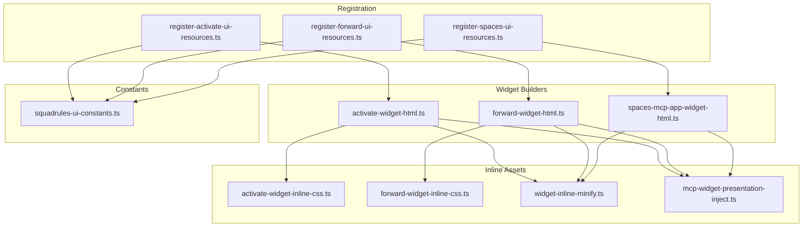
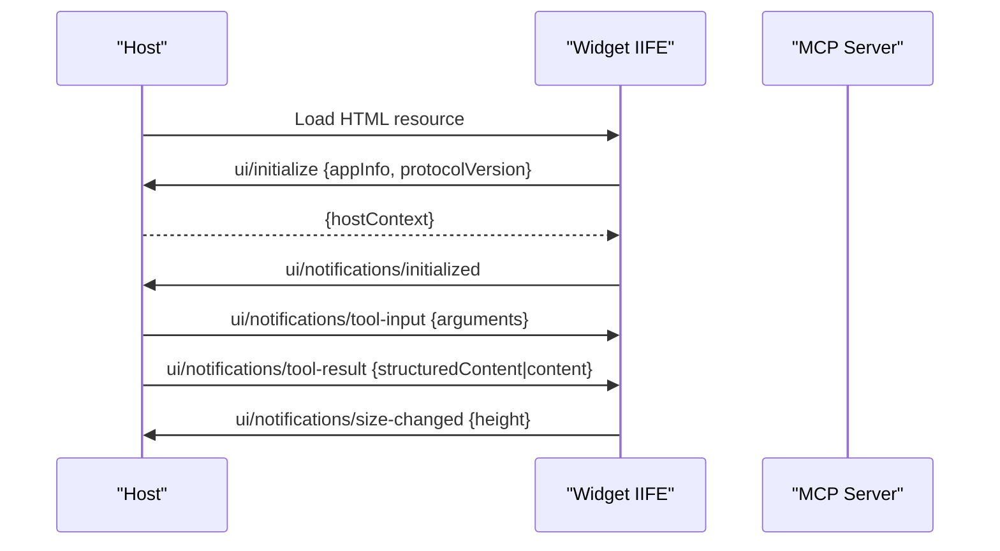
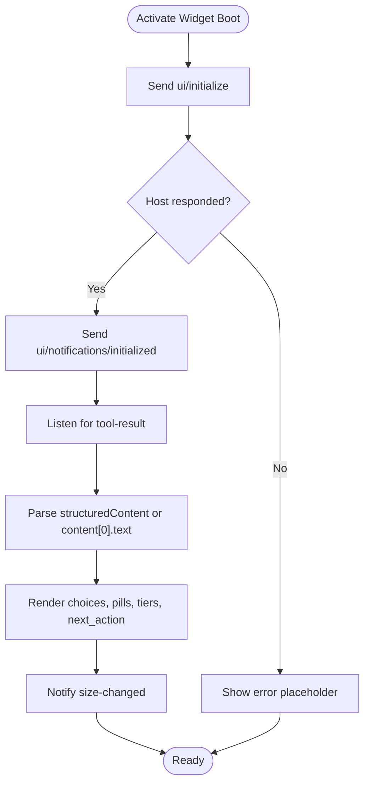
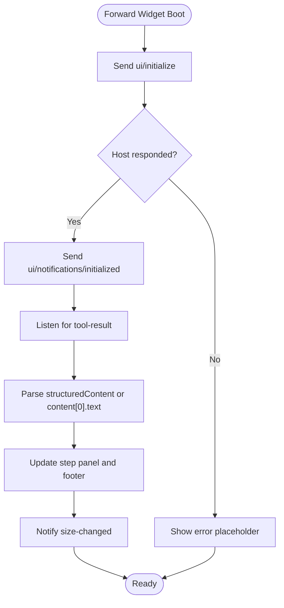
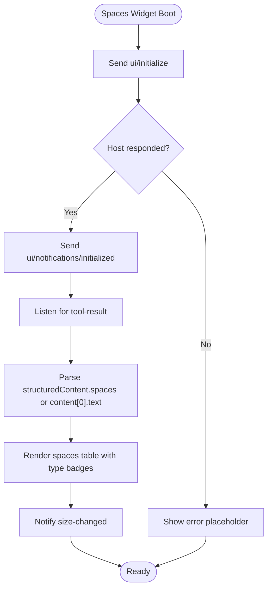
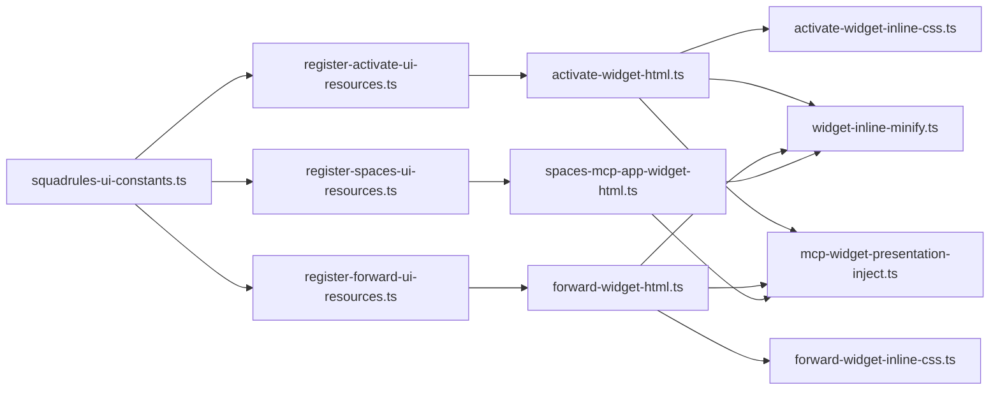

# MCP Widget Integration

<cite>
**Referenced Files in This Document**   
- [README.md](file://src/mcp-apps/README.md)
- [squadrules-ui-constants.ts](file://src/mcp-apps/squadrules-ui-constants.ts)
- [register-activate-ui-resources.ts](file://src/mcp-apps/register-activate-ui-resources.ts)
- [register-forward-ui-resources.ts](file://src/mcp-apps/register-forward-ui-resources.ts)
- [register-spaces-ui-resources.ts](file://src/mcp-apps/register-spaces-ui-resources.ts)
- [activate-widget-html.ts](file://src/mcp-apps/activate-widget-html.ts)
- [forward-widget-html.ts](file://src/mcp-apps/forward-widget-html.ts)
- [spaces-mcp-app-widget-html.ts](file://src/mcp-apps/spaces-mcp-app-widget-html.ts)
- [spaces-widget-html.ts](file://src/mcp-apps/spaces-widget-html.ts)
- [activate-widget-inline-css.ts](file://src/mcp-apps/activate-widget-inline-css.ts)
- [forward-widget-inline-css.ts](file://src/mcp-apps/forward-widget-inline-css.ts)
- [mcp-widget-presentation-inject.ts](file://src/mcp-apps/mcp-widget-presentation-inject.ts)
- [widget-inline-minify.ts](file://src/mcp-apps/widget-inline-minify.ts)
</cite>

## Table of Contents
1. [Introduction](#introduction)
2. [Project Structure](#project-structure)
3. [Core Components](#core-components)
4. [Architecture Overview](#architecture-overview)
5. [Detailed Component Analysis](#detailed-component-analysis)
6. [Dependency Analysis](#dependency-analysis)
7. [Performance Considerations](#performance-considerations)
8. [Troubleshooting Guide](#troubleshooting-guide)
9. [Conclusion](#conclusion)
10. [Appendices](#appendices)

## Introduction
This document explains how SquadRules integrates interactive MCP Apps widgets into the web interface for the `activate`, `forward`, and `spaces` tools. It covers the widget lifecycle, HTML injection patterns, resource registration mechanisms, CSS/JS strategies, host communication, user interaction handling, and guidance for creating custom widgets.

MCP Apps let an MCP server deliver interactive HTML UIs alongside tool results. The host renders the HTML inside a sandboxed iframe and bridges data to it via `postMessage`. Each widget is composed of:
- A tool that returns structured content and declares `_meta.ui.resourceUri`.
- A resource that serves an HTML fragment containing inline CSS and JS.
- A client-side IIFE that performs the MCP Apps handshake, receives tool results, and renders them.

The three active widgets are:
- Activate widget: shows ranked adapter choices, roles, and next actions.
- Forward widget: shows the current step, progress segments, and error summaries.
- Spaces widget: lists spaces, types, and adapter counts with optional adapter details.

**Section sources**
- [README.md:8-20](file://src/mcp-apps/README.md#L8-L20)
- [README.md:49-72](file://src/mcp-apps/README.md#L49-L72)
- [README.md:74-104](file://src/mcp-apps/README.md#L74-L104)

## Project Structure
The MCP widget implementation lives under `src/mcp-apps/`. For each widget, there is a consistent set of files:
- `{name}-widget-html.ts`: Assembles the HTML fragment (root div, style, script).
- `{name}-widget-inline-css.ts`: Widget-specific CSS plus shared chrome tokens.
- `{name}-widget-inline-script.ts`: Self-contained IIFE implementing the MCP Apps lifecycle.
- `register-{name}-ui-resources.ts`: Registers both MCP App and Skybridge HTML resources.

Shared modules include:
- `squadrules-ui-constants.ts`: URIs, MIME types, and tool UI metadata.
- `mcp-widget-chrome-inline-css.ts`: Shared theme tokens and layout.
- `mcp-widget-presentation-inject.ts`: Injects presentation-only mode flag.
- `widget-inline-minify.ts`: Lightweight minification helpers.

**Diagram sources**
- [activate-widget-html.ts:1-29](file://src/mcp-apps/activate-widget-html.ts#L1-L29)
- [forward-widget-html.ts:1-34](file://src/mcp-apps/forward-widget-html.ts#L1-L34)
- [spaces-mcp-app-widget-html.ts:1-18](file://src/mcp-apps/spaces-mcp-app-widget-html.ts#L1-L18)
- [activate-widget-inline-css.ts:1-188](file://src/mcp-apps/activate-widget-inline-css.ts#L1-L188)
- [forward-widget-inline-css.ts:1-173](file://src/mcp-apps/forward-widget-inline-css.ts#L1-L173)
- [widget-inline-minify.ts:1-21](file://src/mcp-apps/widget-inline-minify.ts#L1-L21)
- [mcp-widget-presentation-inject.ts:1-13](file://src/mcp-apps/mcp-widget-presentation-inject.ts#L1-L13)
- [register-activate-ui-resources.ts:1-41](file://src/mcp-apps/register-activate-ui-resources.ts#L1-L41)
- [register-forward-ui-resources.ts:1-41](file://src/mcp-apps/register-forward-ui-resources.ts#L1-L41)
- [register-spaces-ui-resources.ts:1-41](file://src/mcp-apps/register-spaces-ui-resources.ts#L1-L41)
- [squadrules-ui-constants.ts:1-71](file://src/mcp-apps/squadrules-ui-constants.ts#L1-L71)

**Section sources**
- [README.md:86-104](file://src/mcp-apps/README.md#L86-L104)
- [README.md:121-131](file://src/mcp-apps/README.md#L121-L131)

## Core Components
- Resource registration functions register two HTML resources per widget:
  - MCP Apps profile: `text/html;profile=mcp-app`.
  - Skybridge profile: `text/html+skybridge`.
- Each builder composes a minimal HTML fragment with:
  - A root container element.
  - Inline CSS combining shared chrome and widget-specific styles.
  - Inline JS IIFE that implements the MCP Apps handshake and rendering logic.
- Constants define URIs, MIME types, and tool UI metadata used by tools and registrations.

Key responsibilities:
- `register-*-ui-resources.ts`: Expose resources to hosts.
- `*-widget-html.ts`: Build the final HTML fragment.
- `*-widget-inline-css.ts`: Provide scoped styling.
- `*-widget-inline-script.ts`: Handle host bridge, theme, and rendering.

**Section sources**
- [register-activate-ui-resources.ts:10-40](file://src/mcp-apps/register-activate-ui-resources.ts#L10-L40)
- [register-forward-ui-resources.ts:10-40](file://src/mcp-apps/register-forward-ui-resources.ts#L10-L40)
- [register-spaces-ui-resources.ts:10-40](file://src/mcp-apps/register-spaces-ui-resources.ts#L10-L40)
- [squadrules-ui-constants.ts:10-71](file://src/mcp-apps/squadrules-ui-constants.ts#L10-L71)

## Architecture Overview
The widget architecture follows the MCP Apps specification:
- Host creates an iframe and loads the resource HTML.
- Widget sends `ui/initialize` request with app info and protocol version.
- Host responds with `hostContext` (theme, fonts, CSS variables).
- Widget sends `ui/notifications/initialized`.
- Host sends `ui/notifications/tool-input` and then `ui/notifications/tool-result`.
- Widget renders structured content or JSON text and notifies size changes.

**Diagram sources**
- [README.md:49-72](file://src/mcp-apps/README.md#L49-L72)
- [spaces-mcp-app-widget-html.ts:183-407](file://src/mcp-apps/spaces-mcp-app-widget-html.ts#L183-L407)

## Detailed Component Analysis

### Activate Widget
Purpose:
- Displays ranked activation choices, role pills, match tiers, and next action hints.
- Uses a compact header with brand logo and protocol label.
- Renders a list of choices with expandable “more” sections when needed.

HTML template composition:
- Root container with brand row and header title.
- Output area for choices and JSON summary/details.
- Inline CSS includes shared chrome and activate-specific styles.
- Inline script handles handshake, message routing, and rendering.

CSS strategy:
- Combines shared chrome tokens with activate-specific rules.
- Uses CSS variables for colors, typography, and dark mode.
- Avoids fixed heights on main containers to allow natural flow.

JS behavior:
- Implements JSON-RPC over `postMessage`.
- Handles both `ui/notifications/tool-result` and legacy `notifications/tool-result`.
- Applies host context theme and font updates.
- Emits `ui/notifications/size-changed` after render.

Resource registration:
- Registers MCP App and Skybridge profiles for `ui://squadrules/activate-result` and `ui://open-ai/squadrules/activate-result`.

**Diagram sources**
- [activate-widget-html.ts:11-29](file://src/mcp-apps/activate-widget-html.ts#L11-L29)
- [activate-widget-inline-css.ts:7-188](file://src/mcp-apps/activate-widget-inline-css.ts#L7-L188)
- [register-activate-ui-resources.ts:17-40](file://src/mcp-apps/register-activate-ui-resources.ts#L17-L40)

**Section sources**
- [activate-widget-html.ts:1-29](file://src/mcp-apps/activate-widget-html.ts#L1-L29)
- [activate-widget-inline-css.ts:1-188](file://src/mcp-apps/activate-widget-inline-css.ts#L1-L188)
- [register-activate-ui-resources.ts:1-41](file://src/mcp-apps/register-activate-ui-resources.ts#L1-L41)

### Forward Widget
Purpose:
- Shows the current forward step, step name, retrying state, and reward readiness.
- Provides a footer with progress segments and step count.
- Highlights errors and provides actionable next steps.

HTML template composition:
- Brand header with logo and protocol label.
- Output panel showing step status and messages.
- Footer with progress segments and step label.
- Inline CSS defines step panels, progress segments, and error states.
- Inline script manages lifecycle and rendering.

CSS strategy:
- Transparent background for iframe integration.
- Step panel highlights using color-mix with theme variables.
- Progress segments use pending/current/done/issue states.

JS behavior:
- Follows the same handshake and message pattern as other widgets.
- Updates step visuals and footer based on structured content.
- Emits size notifications after rendering.

Resource registration:
- Registers MCP App and Skybridge profiles for `ui://squadrules/forward-result` and `ui://open-ai/squadrules/forward-result`.

**Diagram sources**
- [forward-widget-html.ts:11-34](file://src/mcp-apps/forward-widget-html.ts#L11-L34)
- [forward-widget-inline-css.ts:5-173](file://src/mcp-apps/forward-widget-inline-css.ts#L5-L173)
- [register-forward-ui-resources.ts:17-40](file://src/mcp-apps/register-forward-ui-resources.ts#L17-L40)

**Section sources**
- [forward-widget-html.ts:1-35](file://src/mcp-apps/forward-widget-html.ts#L1-L35)
- [forward-widget-inline-css.ts:1-173](file://src/mcp-apps/forward-widget-inline-css.ts#L1-L173)
- [register-forward-ui-resources.ts:1-41](file://src/mcp-apps/register-forward-ui-resources.ts#L1-L41)

### Spaces Widget
Purpose:
- Lists spaces with display names, types, and adapter counts.
- Optionally expands adapter details when provided.
- Provides guidance on using space names in other tools.

HTML template composition:
- Brand header with logo and title.
- Output area for table and hints.
- Inline CSS defines responsive tables, badges, and theme-aware colors.
- Inline script parses structured content and renders a table.

CSS strategy:
- Theme-aware backgrounds and borders.
- Personal space highlighting with left border accent.
- Type badges styled per category.

JS behavior:
- Parses structured content or JSON string from content array.
- Escapes untrusted strings before insertion.
- Handles host context changes and applies theme variables.

Resource registration:
- Registers MCP App and Skybridge profiles for `ui://squadrules/spaces-result` and `ui://open-ai/squadrules/spaces-result`.

**Diagram sources**
- [spaces-mcp-app-widget-html.ts:16-409](file://src/mcp-apps/spaces-mcp-app-widget-html.ts#L16-L409)
- [register-spaces-ui-resources.ts:17-40](file://src/mcp-apps/register-spaces-ui-resources.ts#L17-L40)

**Section sources**
- [spaces-mcp-app-widget-html.ts:1-410](file://src/mcp-apps/spaces-mcp-app-widget-html.ts#L1-L410)
- [register-spaces-ui-resources.ts:1-41](file://src/mcp-apps/register-spaces-ui-resources.ts#L1-L41)

### Optional Spaces HTML Summary
There is also a standalone HTML renderer for hosts that render HTML directly from tool content. It produces a compact table with type badges and expandable adapter lists. All dynamic text is escaped to avoid injection.

**Section sources**
- [spaces-widget-html.ts:1-83](file://src/mcp-apps/spaces-widget-html.ts#L1-L83)

## Dependency Analysis
The widget system has clear separation between builders, assets, registration, and constants:
- Builders depend on embedded logo, inline CSS, minification, and presentation token substitution.
- Registration depends on constants and builders.
- Constants centralize URIs, MIME types, and tool UI metadata.

**Diagram sources**
- [squadrules-ui-constants.ts:10-71](file://src/mcp-apps/squadrules-ui-constants.ts#L10-L71)
- [register-activate-ui-resources.ts:1-41](file://src/mcp-apps/register-activate-ui-resources.ts#L1-L41)
- [register-forward-ui-resources.ts:1-41](file://src/mcp-apps/register-forward-ui-resources.ts#L1-L41)
- [register-spaces-ui-resources.ts:1-41](file://src/mcp-apps/register-spaces-ui-resources.ts#L1-L41)
- [activate-widget-html.ts:1-29](file://src/mcp-apps/activate-widget-html.ts#L1-L29)
- [forward-widget-html.ts:1-34](file://src/mcp-apps/forward-widget-html.ts#L1-L34)
- [spaces-mcp-app-widget-html.ts:1-18](file://src/mcp-apps/spaces-mcp-app-widget-html.ts#L1-L18)
- [activate-widget-inline-css.ts:1-188](file://src/mcp-apps/activate-widget-inline-css.ts#L1-L188)
- [forward-widget-inline-css.ts:1-173](file://src/mcp-apps/forward-widget-inline-css.ts#L1-L173)
- [widget-inline-minify.ts:1-21](file://src/mcp-apps/widget-inline-minify.ts#L1-L21)
- [mcp-widget-presentation-inject.ts:1-13](file://src/mcp-apps/mcp-widget-presentation-inject.ts#L1-L13)

**Section sources**
- [README.md:106-131](file://src/mcp-apps/README.md#L106-L131)

## Performance Considerations
- Inline CSS and JS are minified at build time to reduce payload size.
- Widgets avoid heavy DOM operations; they update only necessary elements.
- Host context changes are applied incrementally to minimize reflows.
- Sizing notifications are throttled via `requestAnimationFrame` to ensure stable measurements.
- Presentation-only mode disables all `postMessage` calls for static testing.

[No sources needed since this section provides general guidance]

## Troubleshooting Guide
Common issues and resolutions:
- CSP restrictions: Do not rely on network requests from widget JS; use `postMessage` or DOM-based debugging.
- Structured content delivery paths: Always handle both `structuredContent` and `content[0].text`.
- Older host compatibility: Handle both `ui/notifications/tool-result` and `notifications/tool-result`.
- Presentation-only mode: Set environment flag to disable bridge calls and show placeholders.
- ESLint enforcement: Ensure handshake strings exist in widget scripts; use presentation-only flag instead of removing handshake.

**Section sources**
- [README.md:272-295](file://src/mcp-apps/README.md#L272-L295)
- [README.md:214-229](file://src/mcp-apps/README.md#L214-L229)
- [mcp-widget-presentation-inject.ts:1-13](file://src/mcp-apps/mcp-widget-presentation-inject.ts#L1-L13)

## Conclusion
SquadRules’ MCP widget integration provides a consistent, host-compatible way to render interactive UIs for `activate`, `forward`, and `spaces`. The design emphasizes:
- Clear separation of concerns across builders, assets, registration, and constants.
- Dual MIME profiles for broad host support.
- Robust lifecycle handling with theme and sizing awareness.
- Safe, minimal, and testable inline scripts.

Extending the system involves following the established file layout, adhering to the IIFE pattern, registering both profiles, and wiring tool metadata.

[No sources needed since this section summarizes without analyzing specific files]

## Appendices

### Creating a Custom Widget
Steps:
1. Create three files:
   - `{name}-widget-inline-css.ts` (import shared chrome; avoid hard `max-height`).
   - `{name}-widget-inline-script.ts` (IIFE with handshake, message routing, and `notifySize()`).
   - `{name}-widget-html.ts` (assemble with presentation token substitution).
2. Create registration file:
   - `register-{name}-ui-resources.ts` (register both MCP App and Skybridge).
3. Add constants:
   - URIs and tool UI metadata in `squadrules-ui-constants.ts`.
4. Wire into the tool:
   - Add `_meta` to `registerTool` call.
   - Call registration function in server setup.
5. Add to offerings:
   - Include builder functions in the offerings listing module.
6. Test:
   - Unit test HTML builder output.
   - Integration test `tools/list` includes `_meta` and resource is readable.
   - Manual test in Cursor / Claude Desktop.

**Section sources**
- [README.md:230-254](file://src/mcp-apps/README.md#L230-L254)

### Widget Script Pattern Reference
Every inline script should:
- Define DOM refs and JSON-RPC constants.
- Maintain pending requests and host context state.
- Listen for messages and route JSON-RPC 2.0 calls.
- Implement `applyToolResult()` to parse and render data.
- Boot by sending `ui/initialize` and notifying initialization.
- Emit size changes after every render path.

**Section sources**
- [README.md:132-193](file://src/mcp-apps/README.md#L132-L193)