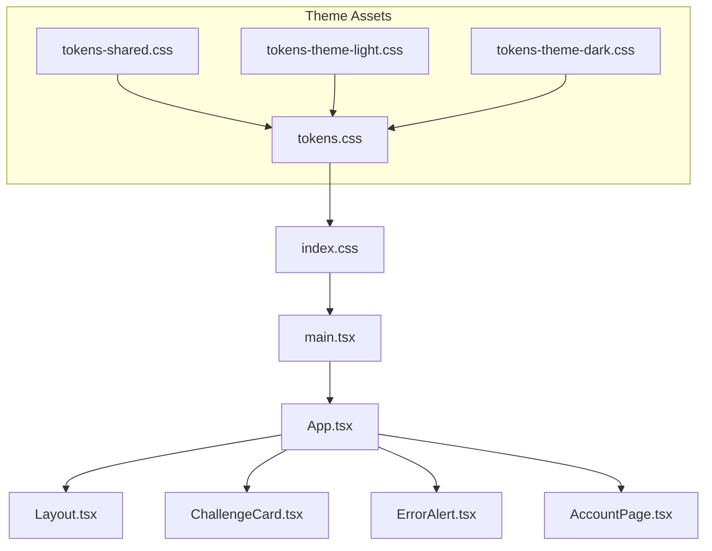
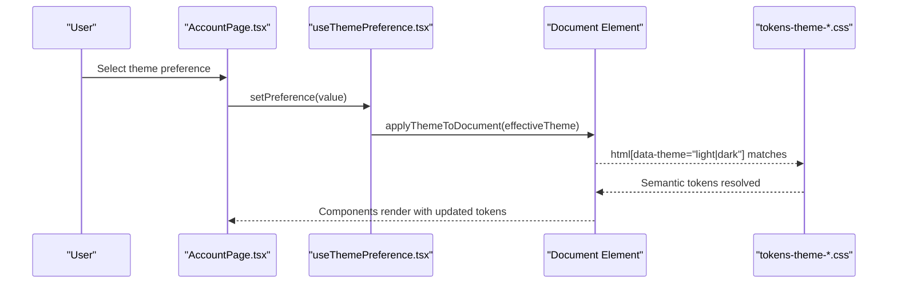
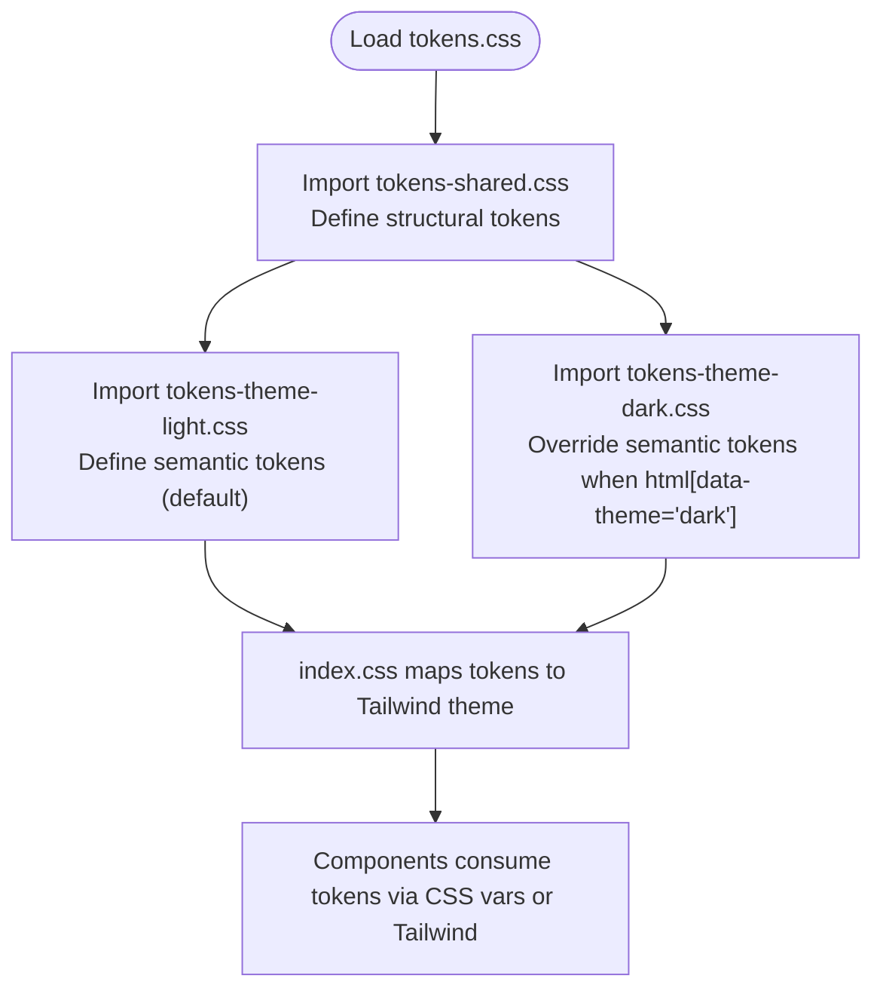
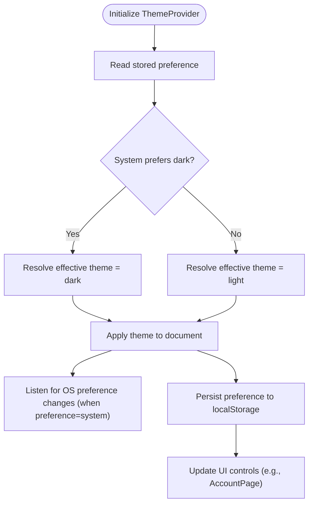
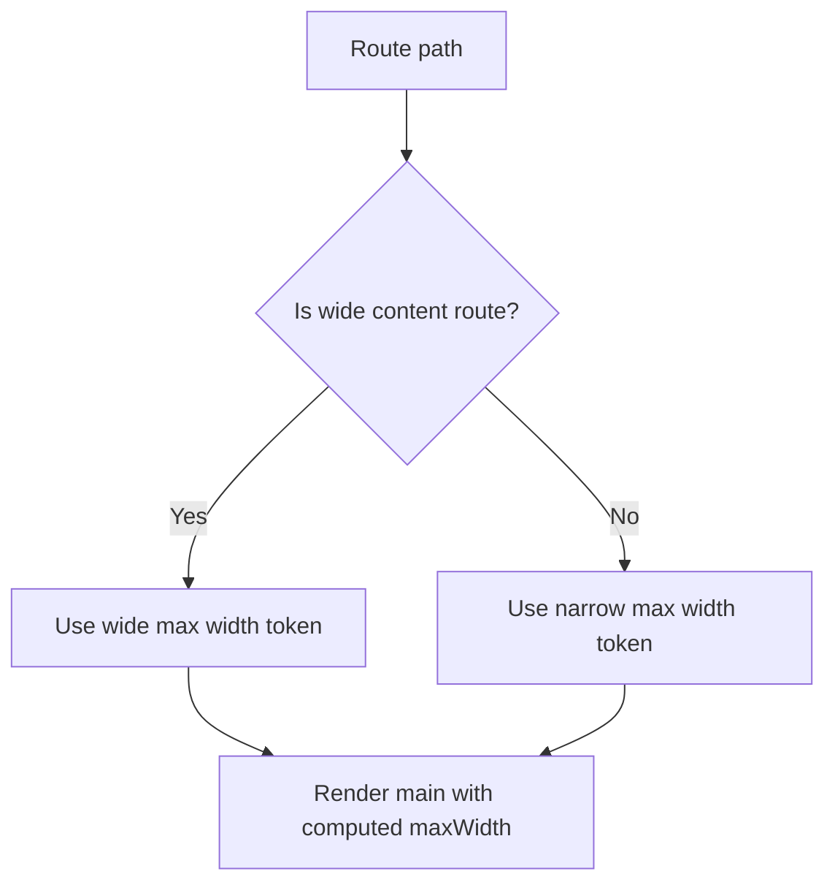
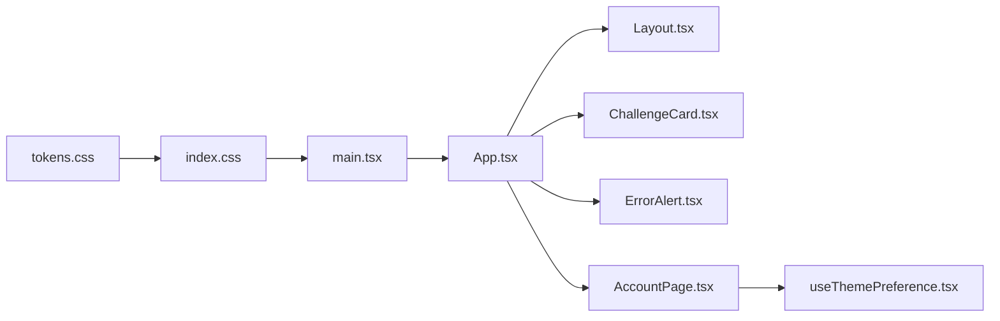

# Theming and Styling System

<cite>
**Referenced Files in This Document**
- [tokens.css](file://src/ui/theme/tokens.css)
- [tokens-shared.css](file://src/ui/theme/tokens-shared.css)
- [tokens-theme-light.css](file://src/ui/theme/tokens-theme-light.css)
- [tokens-theme-dark.css](file://src/ui/theme/tokens-theme-dark.css)
- [index.css](file://src/ui/index.css)
- [useThemePreference.tsx](file://src/ui/hooks/useThemePreference.tsx)
- [main.tsx](file://src/ui/main.tsx)
- [App.tsx](file://src/ui/App.tsx)
- [Layout.tsx](file://src/ui/components/Layout.tsx)
- [ChallengeCard.tsx](file://src/ui/components/ChallengeCard.tsx)
- [ErrorAlert.tsx](file://src/ui/components/ErrorAlert.tsx)
- [AccountPage.tsx](file://src/ui/pages/AccountPage.tsx)
</cite>

## Table of Contents
1. [Introduction](#introduction)
2. [Project Structure](#project-structure)
3. [Core Components](#core-components)
4. [Architecture Overview](#architecture-overview)
5. [Detailed Component Analysis](#detailed-component-analysis)
6. [Dependency Analysis](#dependency-analysis)
7. [Performance Considerations](#performance-considerations)
8. [Troubleshooting Guide](#troubleshooting-guide)
9. [Conclusion](#conclusion)
10. [Appendices](#appendices)

## Introduction
This document explains the SquadRules theming and styling system. It covers the CSS custom properties architecture, design tokens, theme switching mechanism, light and dark themes, color palettes, typography scales, spacing system, responsive patterns, component styling approaches, customization options, and guidance for extending themes while maintaining visual consistency.

The system is built around:
- A single source of truth for design tokens via CSS custom properties.
- Theme-specific overrides applied through an HTML attribute selector.
- React context that persists user preference and applies the effective theme to the document.
- Tailwind integration that maps tokens into the Tailwind theme namespace.

## Project Structure
Theming assets live under src/ui/theme and are consumed by the UI entry point and components. The main application wraps the UI with a ThemeProvider so that theme state is available throughout the app.



**Diagram sources**
- [tokens.css:1-12](file://src/ui/theme/tokens.css#L1-L12)
- [tokens-shared.css:1-80](file://src/ui/theme/tokens-shared.css#L1-L80)
- [tokens-theme-light.css:1-47](file://src/ui/theme/tokens-theme-light.css#L1-L47)
- [tokens-theme-dark.css:1-47](file://src/ui/theme/tokens-theme-dark.css#L1-L47)
- [index.css:1-116](file://src/ui/index.css#L1-L116)
- [main.tsx:1-20](file://src/ui/main.tsx#L1-L20)
- [App.tsx:1-133](file://src/ui/App.tsx#L1-L133)
- [Layout.tsx:1-109](file://src/ui/components/Layout.tsx#L1-L109)
- [ChallengeCard.tsx:1-50](file://src/ui/components/ChallengeCard.tsx#L1-L50)
- [ErrorAlert.tsx:1-71](file://src/ui/components/ErrorAlert.tsx#L1-L71)
- [AccountPage.tsx:1-155](file://src/ui/pages/AccountPage.tsx#L1-L155)

**Section sources**
- [tokens.css:1-12](file://src/ui/theme/tokens.css#L1-L12)
- [index.css:1-116](file://src/ui/index.css#L1-L116)
- [main.tsx:1-20](file://src/ui/main.tsx#L1-L20)

## Core Components
- Design token layer:
  - tokens.css aggregates shared and themed tokens.
  - tokens-shared.css defines structural tokens (spacing, typography, radius, layout).
  - tokens-theme-light.css defines semantic colors for the light theme.
  - tokens-theme-dark.css defines semantic colors for the dark theme.
- Tailwind mapping:
  - index.css imports tokens and maps them into Tailwind’s inline theme namespace.
- Theme runtime:
  - useThemePreference.tsx provides React context, persistence, system preference detection, and document-level application of the active theme.
  - main.tsx mounts the app inside ThemeProvider.
- UI consumption:
  - Components use CSS variables directly or Tailwind utilities mapped from tokens.
  - AccountPage exposes a user-facing control to change the theme preference.

Key responsibilities:
- tokens.css: central import orchestration for tokens.
- tokens-shared.css: theme-agnostic tokens and base styles.
- tokens-theme-*.css: semantic color definitions per theme.
- index.css: Tailwind theme bridge and global utilities.
- useThemePreference.tsx: theme state, persistence, and application.
- main.tsx: app bootstrap with ThemeProvider.
- Layout.tsx, ChallengeCard.tsx, ErrorAlert.tsx: example consumers of tokens.
- AccountPage.tsx: theme preference UI.

**Section sources**
- [tokens.css:1-12](file://src/ui/theme/tokens.css#L1-L12)
- [tokens-shared.css:1-80](file://src/ui/theme/tokens-shared.css#L1-L80)
- [tokens-theme-light.css:1-47](file://src/ui/theme/tokens-theme-light.css#L1-L47)
- [tokens-theme-dark.css:1-47](file://src/ui/theme/tokens-theme-dark.css#L1-L47)
- [index.css:1-116](file://src/ui/index.css#L1-L116)
- [useThemePreference.tsx:1-149](file://src/ui/hooks/useThemePreference.tsx#L1-L149)
- [main.tsx:1-20](file://src/ui/main.tsx#L1-L20)
- [Layout.tsx:1-109](file://src/ui/components/Layout.tsx#L1-L109)
- [ChallengeCard.tsx:1-50](file://src/ui/components/ChallengeCard.tsx#L1-L50)
- [ErrorAlert.tsx:1-71](file://src/ui/components/ErrorAlert.tsx#L1-L71)
- [AccountPage.tsx:1-155](file://src/ui/pages/AccountPage.tsx#L1-L155)

## Architecture Overview
The theming architecture follows a layered approach:
- Token definition layer (CSS custom properties).
- Theme override layer (attribute-based selectors).
- Runtime layer (React context + DOM attribute).
- Consumption layer (components using tokens via CSS variables or Tailwind).



**Diagram sources**
- [AccountPage.tsx:67-84](file://src/ui/pages/AccountPage.tsx#L67-L84)
- [useThemePreference.tsx:53-60](file://src/ui/hooks/useThemePreference.tsx#L53-L60)
- [tokens-theme-light.css:1-47](file://src/ui/theme/tokens-theme-light.css#L1-L47)
- [tokens-theme-dark.css:1-47](file://src/ui/theme/tokens-theme-dark.css#L1-L47)

## Detailed Component Analysis

### CSS Custom Properties Architecture
- Centralization:
  - tokens.css imports shared and themed token files to provide a single entry point.
- Structural tokens (theme-agnostic):
  - Spacing scale based on an 8px base.
  - Typography scale including font sizes, weights, line heights, and letter spacing.
  - Radius tokens for consistent corner rounding.
  - Layout tokens for max widths, sidebar width, touch target size, and padding.
- Semantic tokens (theme-aware):
  - Light theme defines primary, secondary, accent, text, surface, border, status, and badge tokens.
  - Dark theme overrides these semantic tokens for contrast and aesthetics.
- Global defaults:
  - Base background and text colors are applied to html/body using semantic tokens.
  - Focus-visible outlines use the focus ring token for accessibility.



**Diagram sources**
- [tokens.css:1-12](file://src/ui/theme/tokens.css#L1-L12)
- [tokens-shared.css:1-80](file://src/ui/theme/tokens-shared.css#L1-L80)
- [tokens-theme-light.css:1-47](file://src/ui/theme/tokens-theme-light.css#L1-L47)
- [tokens-theme-dark.css:1-47](file://src/ui/theme/tokens-theme-dark.css#L1-L47)
- [index.css:1-116](file://src/ui/index.css#L1-L116)

**Section sources**
- [tokens.css:1-12](file://src/ui/theme/tokens.css#L1-L12)
- [tokens-shared.css:1-80](file://src/ui/theme/tokens-shared.css#L1-L80)
- [tokens-theme-light.css:1-47](file://src/ui/theme/tokens-theme-light.css#L1-L47)
- [tokens-theme-dark.css:1-47](file://src/ui/theme/tokens-theme-dark.css#L1-L47)
- [index.css:1-116](file://src/ui/index.css#L1-L116)

### Theme Switching Mechanism
- Preference model:
  - Supported preferences: light, dark, system.
  - Effective theme resolves to light or dark based on preference and OS setting.
- Persistence:
  - Preference stored in localStorage under a dedicated key.
  - Cross-tab synchronization via storage events.
- Application:
  - The hook sets html[data-theme] and updates document colorScheme accordingly.
- UI control:
  - AccountPage renders a select element bound to the current preference and calls setPreference on change.



**Diagram sources**
- [useThemePreference.tsx:16-32](file://src/ui/hooks/useThemePreference.tsx#L16-L32)
- [useThemePreference.tsx:34-51](file://src/ui/hooks/useThemePreference.tsx#L34-L51)
- [useThemePreference.tsx:53-60](file://src/ui/hooks/useThemePreference.tsx#L53-L60)
- [useThemePreference.tsx:68-133](file://src/ui/hooks/useThemePreference.tsx#L68-L133)
- [AccountPage.tsx:67-84](file://src/ui/pages/AccountPage.tsx#L67-L84)

**Section sources**
- [useThemePreference.tsx:1-149](file://src/ui/hooks/useThemePreference.tsx#L1-L149)
- [AccountPage.tsx:1-155](file://src/ui/pages/AccountPage.tsx#L1-L155)

### Light and Dark Themes
- Light theme:
  - Defines semantic tokens for primary, secondary, accent, text, surfaces, borders, status, focus ring, and badges.
- Dark theme:
  - Overrides semantic tokens for improved contrast and visual harmony in dark mode.
- Activation:
  - Dark theme activates when html has data-theme="dark".
  - Default is light; no explicit attribute means light semantics apply.

```mermaid
classDiagram
class TokensShared {
"+Spacing tokens"
"+Typography tokens"
"+Radius tokens"
"+Layout tokens"
}
class TokensLight {
"+Semantic colors (light)"
"+Badge variants (light)"
}
class TokensDark {
"+Semantic colors (dark)"
"+Badge variants (dark)"
}
TokensShared <|-- TokensLight : "base"
TokensShared <|-- TokensDark : "base"
```

**Diagram sources**
- [tokens-shared.css:1-80](file://src/ui/theme/tokens-shared.css#L1-L80)
- [tokens-theme-light.css:1-47](file://src/ui/theme/tokens-theme-light.css#L1-L47)
- [tokens-theme-dark.css:1-47](file://src/ui/theme/tokens-theme-dark.css#L1-L47)

**Section sources**
- [tokens-theme-light.css:1-47](file://src/ui/theme/tokens-theme-light.css#L1-L47)
- [tokens-theme-dark.css:1-47](file://src/ui/theme/tokens-theme-dark.css#L1-L47)

### Color Palettes
- Semantic color tokens include:
  - Primary, secondary, accent.
  - Text, text-heading, text-muted.
  - Surface, surface-elevated, border.
  - Error, error-bg, success, warning.
  - Focus ring.
- Badge tokens cover multiple categories such as shell, mcp, user-input, comment, match, refine, create, personal, group, app, other.
- Status tokens include success background and foreground.

These tokens are defined in the light and dark theme files and consumed by components via CSS variables or Tailwind mappings.

**Section sources**
- [tokens-theme-light.css:1-47](file://src/ui/theme/tokens-theme-light.css#L1-L47)
- [tokens-theme-dark.css:1-47](file://src/ui/theme/tokens-theme-dark.css#L1-L47)
- [index.css:6-67](file://src/ui/index.css#L6-L67)

### Typography Scale
- Font family:
  - Sans-serif stack defined as a token.
- Font sizes:
  - xs, sm, base, lg, xl, 2xl, 3xl.
- Weights:
  - normal, medium, semibold, bold.
- Line heights:
  - tight, normal, relaxed.
- Letter spacing:
  - uppercase variant.

These tokens are used across components for consistent typographic hierarchy.

**Section sources**
- [tokens-shared.css:19-35](file://src/ui/theme/tokens-shared.css#L19-L35)
- [index.css:49-56](file://src/ui/index.css#L49-L56)

### Spacing System
- Spacing scale:
  - 0 to 12 steps, based on 8px increments.
- Usage:
  - Applied via CSS variables in components and Tailwind-mapped spacing tokens.

**Section sources**
- [tokens-shared.css:7-17](file://src/ui/theme/tokens-shared.css#L7-L17)
- [index.css:57-66](file://src/ui/index.css#L57-L66)

### Responsive Design Patterns
- Layout constraints:
  - Max widths for main content vary by route type (narrow vs wide).
  - Sidebar width and touch target dimensions are tokenized.
- Breakpoints:
  - Larger screens increase horizontal padding for the main area.
- Reduced motion:
  - Global reduced-motion media query disables animations/transitions for accessibility.



**Diagram sources**
- [Layout.tsx:8-9](file://src/ui/components/Layout.tsx#L8-L9)
- [Layout.tsx:23-25](file://src/ui/components/Layout.tsx#L23-L25)
- [tokens-shared.css:42-50](file://src/ui/theme/tokens-shared.css#L42-L50)
- [tokens-shared.css:69-73](file://src/ui/theme/tokens-shared.css#L69-L73)
- [index.css:106-115](file://src/ui/index.css#L106-L115)

**Section sources**
- [Layout.tsx:1-109](file://src/ui/components/Layout.tsx#L1-L109)
- [tokens-shared.css:42-50](file://src/ui/theme/tokens-shared.css#L42-L50)
- [tokens-shared.css:69-73](file://src/ui/theme/tokens-shared.css#L69-L73)
- [index.css:106-115](file://src/ui/index.css#L106-L115)

### Component Styling Approaches
- Direct CSS variable usage:
  - Components reference tokens like --color-surface, --color-border, --radius-md, etc.
- Badge variants:
  - ChallengeCard uses badge tokens to style different challenge types consistently.
- Accessibility:
  - Focus-visible outlines and minimum touch targets ensure usability.
- Consistency:
  - All interactive elements follow the same sizing and spacing conventions.

Examples:
- Layout uses tokens for navigation links, sidebar, and main content area.
- ChallengeCard uses badge tokens for type indicators.
- ErrorAlert uses semantic tokens for error states and actions.

**Section sources**
- [Layout.tsx:16-21](file://src/ui/components/Layout.tsx#L16-L21)
- [Layout.tsx:35-36](file://src/ui/components/Layout.tsx#L35-L36)
- [ChallengeCard.tsx:1-6](file://src/ui/components/ChallengeCard.tsx#L1-L6)
- [ChallengeCard.tsx:23-47](file://src/ui/components/ChallengeCard.tsx#L23-L47)
- [ErrorAlert.tsx:26-33](file://src/ui/components/ErrorAlert.tsx#L26-L33)
- [ErrorAlert.tsx:40-66](file://src/ui/components/ErrorAlert.tsx#L40-L66)

### Customization Options
- Theme selection:
  - Users can choose light, dark, or system preference via AccountPage.
- Extending themes:
  - Add a new tokens-theme-*.css file and import it in tokens.css.
  - Define semantic tokens and badge variants for the new theme.
  - Ensure html[data-theme="your-theme"] selector is used if needed.
- Tailwind mapping:
  - Map any new tokens in index.css to the Tailwind theme namespace.
- Component adoption:
  - Use CSS variables or Tailwind utilities in components to consume new tokens.

**Section sources**
- [tokens.css:1-12](file://src/ui/theme/tokens.css#L1-L12)
- [index.css:6-67](file://src/ui/index.css#L6-L67)
- [AccountPage.tsx:67-84](file://src/ui/pages/AccountPage.tsx#L67-L84)

## Dependency Analysis
The theming system has clear boundaries:
- tokens.css depends on shared and themed token files.
- index.css depends on tokens.css and Tailwind.
- main.tsx depends on ThemeProvider and index.css.
- App.tsx composes pages and components that consume tokens.
- Components consume tokens via CSS variables or Tailwind utilities.
- AccountPage consumes theme context to update preference.



**Diagram sources**
- [tokens.css:1-12](file://src/ui/theme/tokens.css#L1-L12)
- [index.css:1-116](file://src/ui/index.css#L1-L116)
- [main.tsx:1-20](file://src/ui/main.tsx#L1-L20)
- [App.tsx:1-133](file://src/ui/App.tsx#L1-L133)
- [Layout.tsx:1-109](file://src/ui/components/Layout.tsx#L1-L109)
- [ChallengeCard.tsx:1-50](file://src/ui/components/ChallengeCard.tsx#L1-L50)
- [ErrorAlert.tsx:1-71](file://src/ui/components/ErrorAlert.tsx#L1-L71)
- [AccountPage.tsx:1-155](file://src/ui/pages/AccountPage.tsx#L1-L155)
- [useThemePreference.tsx:1-149](file://src/ui/hooks/useThemePreference.tsx#L1-L149)

**Section sources**
- [tokens.css:1-12](file://src/ui/theme/tokens.css#L1-L12)
- [index.css:1-116](file://src/ui/index.css#L1-L116)
- [main.tsx:1-20](file://src/ui/main.tsx#L1-L20)
- [App.tsx:1-133](file://src/ui/App.tsx#L1-L133)
- [useThemePreference.tsx:1-149](file://src/ui/hooks/useThemePreference.tsx#L1-L149)

## Performance Considerations
- Minimal runtime overhead:
  - Theme switching only updates one DOM attribute and colorScheme.
- Efficient token resolution:
  - CSS custom properties are resolved by the browser without JS intervention.
- Tailwind mapping:
  - Inline theme mapping ensures tokens are available at build time for utility classes.
- Reduced motion:
  - Respects user preferences to avoid unnecessary animations.

[No sources needed since this section provides general guidance]

## Troubleshooting Guide
Common issues and resolutions:
- Theme not applying:
  - Verify html[data-theme] is set correctly by ThemeProvider.
  - Ensure the correct theme file is imported in tokens.css.
- Colors look wrong in dark mode:
  - Confirm tokens-theme-dark.css overrides all required semantic tokens.
- Tailwind utilities not reflecting tokens:
  - Check index.css maps new tokens into the Tailwind theme namespace.
- Preference not persisting:
  - Inspect localStorage for the theme preference key.
  - Validate cross-tab synchronization via storage events.

**Section sources**
- [useThemePreference.tsx:53-60](file://src/ui/hooks/useThemePreference.tsx#L53-L60)
- [tokens.css:1-12](file://src/ui/theme/tokens.css#L1-L12)
- [tokens-theme-dark.css:1-47](file://src/ui/theme/tokens-theme-dark.css#L1-L47)
- [index.css:6-67](file://src/ui/index.css#L6-L67)
- [useThemePreference.tsx:102-114](file://src/ui/hooks/useThemePreference.tsx#L102-L114)

## Conclusion
The SquadRules theming system provides a robust, accessible, and extensible foundation for consistent UI design. By centralizing tokens, leveraging CSS custom properties, and integrating with Tailwind, it enables reliable theme switching and easy customization. Components consume tokens uniformly, ensuring visual coherence across light and dark modes. Following the extension guidelines helps maintain consistency while adapting the interface to new requirements.

[No sources needed since this section summarizes without analyzing specific files]

## Appendices

### How to Extend Themes
- Create a new theme file:
  - Add tokens-theme-*.css with semantic tokens and badge variants.
- Register the theme:
  - Import the new file in tokens.css.
- Map tokens to Tailwind:
  - Add entries in index.css to expose new tokens in the Tailwind theme.
- Consume tokens:
  - Use CSS variables or Tailwind utilities in components.
- Provide user control (optional):
  - Add UI in AccountPage to allow users to select the new theme.

**Section sources**
- [tokens.css:1-12](file://src/ui/theme/tokens.css#L1-L12)
- [index.css:6-67](file://src/ui/index.css#L6-L67)
- [AccountPage.tsx:67-84](file://src/ui/pages/AccountPage.tsx#L67-L84)