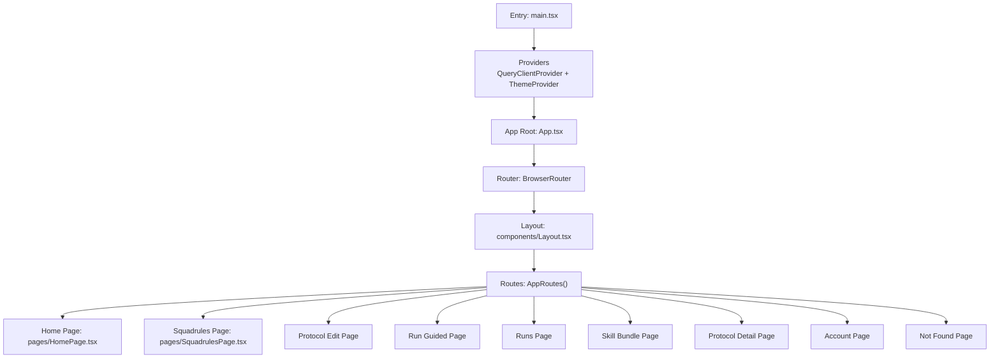
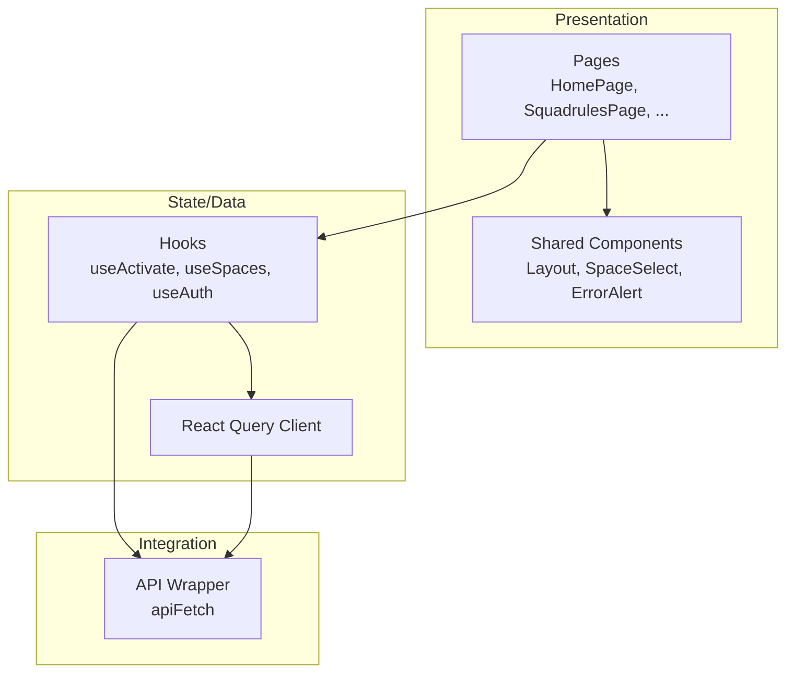
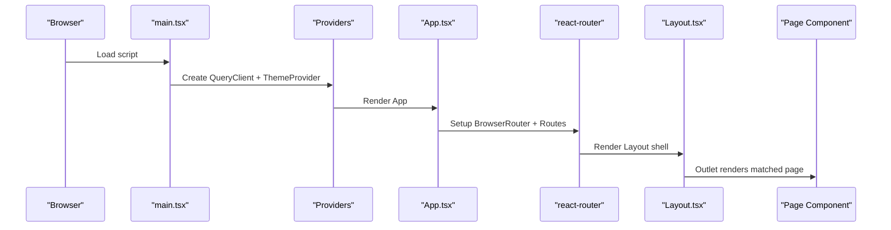
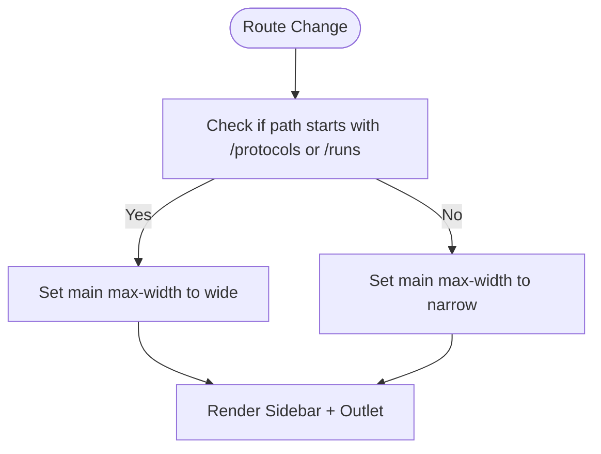
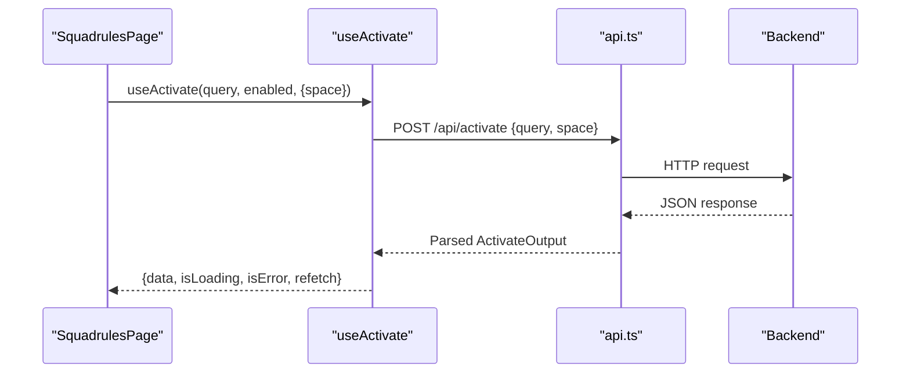
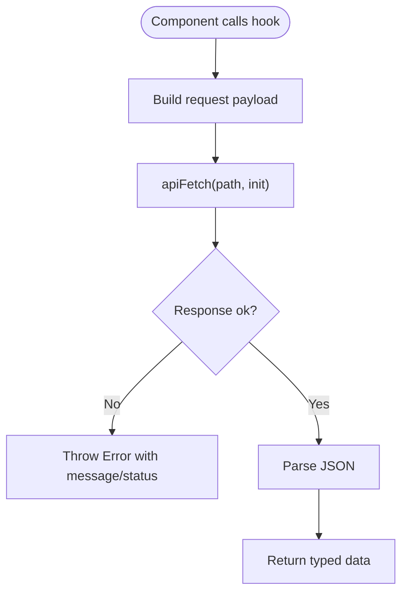
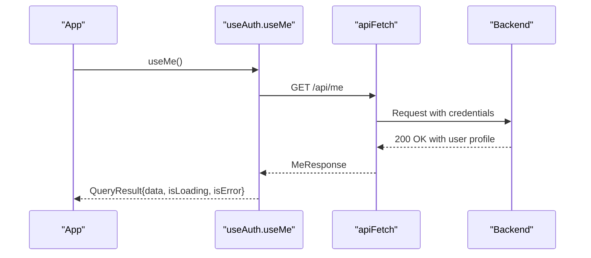
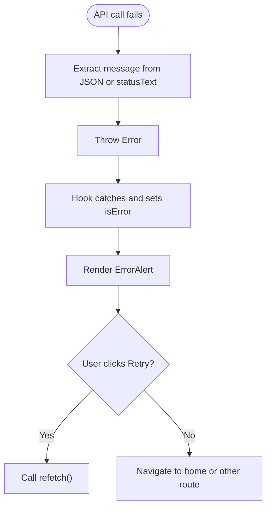
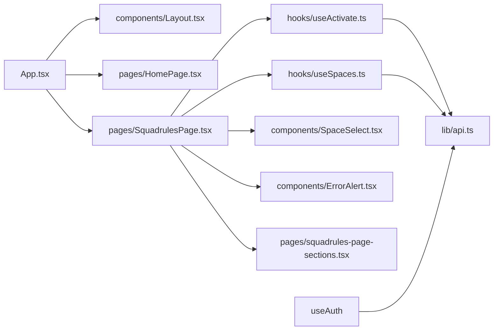

# UI Architecture and Components

<cite>
**Referenced Files in This Document**
- [main.tsx](file://src/ui/main.tsx)
- [App.tsx](file://src/ui/App.tsx)
- [Layout.tsx](file://src/ui/components/Layout.tsx)
- [HomePage.tsx](file://src/ui/pages/HomePage.tsx)
- [SquadrulesPage.tsx](file://src/ui/pages/SquadrulesPage.tsx)
- [squadrules-page-sections.tsx](file://src/ui/pages/squadrules-page-sections.tsx)
- [SpaceSelect.tsx](file://src/ui/components/SpaceSelect.tsx)
- [ErrorAlert.tsx](file://src/ui/components/ErrorAlert.tsx)
- [useAuth.ts](file://src/ui/hooks/useAuth.ts)
- [useSpaces.ts](file://src/ui/hooks/useSpaces.ts)
- [useActivate.ts](file://src/ui/hooks/useActivate.ts)
- [api.ts](file://src/ui/lib/api.ts)
</cite>

## Table of Contents
1. [Introduction](#introduction)
2. [Project Structure](#project-structure)
3. [Core Components](#core-components)
4. [Architecture Overview](#architecture-overview)
5. [Detailed Component Analysis](#detailed-component-analysis)
6. [Dependency Analysis](#dependency-analysis)
7. [Performance Considerations](#performance-considerations)
8. [Troubleshooting Guide](#troubleshooting-guide)
9. [Conclusion](#conclusion)

## Introduction
This document explains the SquadRules React UI architecture, focusing on component hierarchy, routing, layout system, page organization, navigation patterns, hook-based state management, API integration, authentication flow, and error handling. It is designed for both technical and non-technical readers to understand how the UI composes pages, manages data, and interacts with the backend.

## Project Structure
The UI is a React application bootstrapped via a single entry point that provides global providers (React Query client and theme provider). Routing is handled by react-router with route-level code splitting for performance. Pages are organized under src/ui/pages, shared components under src/ui/components, hooks under src/ui/hooks, and API utilities under src/ui/lib.

**Diagram sources**
- [main.tsx:1-20](file://src/ui/main.tsx#L1-L20)
- [App.tsx:1-133](file://src/ui/App.tsx#L1-L133)
- [Layout.tsx:1-109](file://src/ui/components/Layout.tsx#L1-L109)

**Section sources**
- [main.tsx:1-20](file://src/ui/main.tsx#L1-L20)
- [App.tsx:1-133](file://src/ui/App.tsx#L1-L133)

## Core Components
- Application root and routing:
  - The app wraps routes inside a router with a shared Layout. Each page is lazily loaded to reduce initial bundle size.
- Layout:
  - Provides sidebar navigation, skip-to-main link, dynamic main content width based on route, and version footer.
- Pages:
  - HomePage: search form, quick actions, space stats.
  - SquadrulesPage: query input, optional space scope, browse-by-label view, activation results.
  - Other pages (protocol edit/run/detail, runs, skill bundle, account, not found) are registered as routes.
- Shared components:
  - SpaceSelect: dropdown to select a space, with type badges.
  - ErrorAlert: consistent error display with retry and navigation actions.

Key responsibilities:
- Routing and code-splitting: App.tsx
- Shell and navigation: Layout.tsx
- Data-driven pages: HomePage.tsx, SquadrulesPage.tsx
- Reusable UI primitives: SpaceSelect.tsx, ErrorAlert.tsx

**Section sources**
- [App.tsx:1-133](file://src/ui/App.tsx#L1-L133)
- [Layout.tsx:1-109](file://src/ui/components/Layout.tsx#L1-L109)
- [HomePage.tsx:1-132](file://src/ui/pages/HomePage.tsx#L1-L132)
- [SquadrulesPage.tsx:1-219](file://src/ui/pages/SquadrulesPage.tsx#L1-L219)
- [SpaceSelect.tsx:1-67](file://src/ui/components/SpaceSelect.tsx#L1-L67)
- [ErrorAlert.tsx:1-71](file://src/ui/components/ErrorAlert.tsx#L1-L71)

## Architecture Overview
The UI follows a layered approach:
- Presentation layer: React components and pages.
- State/data layer: React Query hooks for fetching and caching.
- Integration layer: Lightweight fetch wrapper for API calls.
- Global providers: Theme and Query client.

**Diagram sources**
- [App.tsx:1-133](file://src/ui/App.tsx#L1-L133)
- [useActivate.ts:1-41](file://src/ui/hooks/useActivate.ts#L1-L41)
- [useSpaces.ts:1-48](file://src/ui/hooks/useSpaces.ts#L1-L48)
- [useAuth.ts:1-25](file://src/ui/hooks/useAuth.ts#L1-L25)
- [api.ts:1-14](file://src/ui/lib/api.ts#L1-L14)

## Detailed Component Analysis

### Application Entry and Routing
- Entry point initializes React DOM, sets up StrictMode, QueryClientProvider, ThemeProvider, and renders App.
- App defines a BrowserRouter with basename "/ui" and exposes AppRoutes for testability.
- Route tree uses lazy loading per page with Suspense fallbacks.

**Diagram sources**
- [main.tsx:1-20](file://src/ui/main.tsx#L1-L20)
- [App.tsx:1-133](file://src/ui/App.tsx#L1-L133)
- [Layout.tsx:1-109](file://src/ui/components/Layout.tsx#L1-L109)

**Section sources**
- [main.tsx:1-20](file://src/ui/main.tsx#L1-L20)
- [App.tsx:1-133](file://src/ui/App.tsx#L1-L133)

### Layout System and Navigation
- Layout renders a fixed-width sidebar with navigation links and a main area that adapts width depending on route.
- Uses react-router’s NavLink for active states and accessibility attributes.
- Exposes a skip-to-main link for keyboard users.

**Diagram sources**
- [Layout.tsx:1-109](file://src/ui/components/Layout.tsx#L1-L109)

**Section sources**
- [Layout.tsx:1-109](file://src/ui/components/Layout.tsx#L1-L109)

### Page Organization and Navigation Patterns
- HomePage:
  - Search form navigates to /squadrules with query parameter.
  - Quick action cards navigate to Browse (/squadrules), Create (/protocols/new), Runs (/runs).
  - Displays space statistics using useSpaces.
- SquadrulesPage:
  - Supports query and optional space scoping via URL search params.
  - Shows either browse-by-label view or activation results.
  - Delegates result rendering to squadrules-page-sections.

Navigation patterns:
- Declarative navigation via Link and programmatic via useNavigate.
- URL-driven state for queries and filters.

**Section sources**
- [HomePage.tsx:1-132](file://src/ui/pages/HomePage.tsx#L1-L132)
- [SquadrulesPage.tsx:1-219](file://src/ui/pages/SquadrulesPage.tsx#L1-L219)

### Hook-Based State Management
- useActivate:
  - Fetches activation choices from /api/activate with optional space scope.
  - Builds stable query keys including normalized query, space, and options.
- useSpaces:
  - Fetches spaces list with optional adapter titles inclusion.
  - Returns structured SpaceInfo[] for UI consumption.
- useAuth:
  - Fetches current user info from /api/me and surfaces it via React Query.

Data flow:
- Components call hooks → hooks call apiFetch → server responds → React Query caches and invalidates as needed.

**Diagram sources**
- [SquadrulesPage.tsx:1-219](file://src/ui/pages/SquadrulesPage.tsx#L1-L219)
- [useActivate.ts:1-41](file://src/ui/hooks/useActivate.ts#L1-L41)
- [api.ts:1-14](file://src/ui/lib/api.ts#L1-L14)

**Section sources**
- [useActivate.ts:1-41](file://src/ui/hooks/useActivate.ts#L1-L41)
- [useSpaces.ts:1-48](file://src/ui/hooks/useSpaces.ts#L1-L48)
- [useAuth.ts:1-25](file://src/ui/hooks/useAuth.ts#L1-L25)

### Component Composition Strategies
- SquadrulesPage composes:
  - SpaceSelect for filtering by space.
  - ErrorAlert for error presentation.
  - SearchResultsSkeleton for loading states.
  - Subsections from squadrules-page-sections for browse and results views.
- HomePage composes:
  - SurfaceCard for card layouts.
  - SpaceTypeBadge for space type labels.

Prop interfaces and usage examples:
- SpaceSelect props include id, spaces, value, onChange, includeAllOption, disabled, aria-describedby.
- ErrorAlert props include message, nextAction, onRetry, showGoBack, supportLink.

**Section sources**
- [SquadrulesPage.tsx:1-219](file://src/ui/pages/SquadrulesPage.tsx#L1-L219)
- [squadrules-page-sections.tsx:1-219](file://src/ui/pages/squadrules-page-sections.tsx#L1-L219)
- [SpaceSelect.tsx:1-67](file://src/ui/components/SpaceSelect.tsx#L1-L67)
- [ErrorAlert.tsx:1-71](file://src/ui/components/ErrorAlert.tsx#L1-L71)

### Event Handling
- Form submissions:
  - HomePage and SquadrulesPage handle form submit events to normalize inputs and update URL search params.
- User interactions:
  - SpaceSelect triggers onChange to update selected space.
  - ErrorAlert supports onRetry callbacks to re-fetch data.

**Section sources**
- [HomePage.tsx:1-132](file://src/ui/pages/HomePage.tsx#L1-L132)
- [SquadrulesPage.tsx:1-219](file://src/ui/pages/SquadrulesPage.tsx#L1-L219)
- [SpaceSelect.tsx:1-67](file://src/ui/components/SpaceSelect.tsx#L1-L67)
- [ErrorAlert.tsx:1-71](file://src/ui/components/ErrorAlert.tsx#L1-L71)

### Backend API Integration
- All network requests go through apiFetch which:
  - Normalizes headers to application/json.
  - Sends credentials same-origin for session/auth cookies.
  - Supports absolute URLs when provided.

Endpoints used:
- GET /api/me (via useAuth)
- POST /api/activate (via useActivate)
- POST /api/spaces (via useSpaces)

**Diagram sources**
- [api.ts:1-14](file://src/ui/lib/api.ts#L1-L14)
- [useAuth.ts:1-25](file://src/ui/hooks/useAuth.ts#L1-L25)
- [useActivate.ts:1-41](file://src/ui/hooks/useActivate.ts#L1-L41)
- [useSpaces.ts:1-48](file://src/ui/hooks/useSpaces.ts#L1-L48)

**Section sources**
- [api.ts:1-14](file://src/ui/lib/api.ts#L1-L14)
- [useAuth.ts:1-25](file://src/ui/hooks/useAuth.ts#L1-L25)
- [useActivate.ts:1-41](file://src/ui/hooks/useActivate.ts#L1-L41)
- [useSpaces.ts:1-48](file://src/ui/hooks/useSpaces.ts#L1-L48)

### Authentication Flow
- The UI obtains current user information via useMe which calls /api/me.
- Credentials are sent with each request using same-origin cookies; tokens are managed by the backend.
- Components can consume the user profile from React Query cache to gate features or personalize UI.

**Diagram sources**
- [useAuth.ts:1-25](file://src/ui/hooks/useAuth.ts#L1-L25)
- [api.ts:1-14](file://src/ui/lib/api.ts#L1-L14)

**Section sources**
- [useAuth.ts:1-25](file://src/ui/hooks/useAuth.ts#L1-L25)

### Error Handling Patterns
- Network errors:
  - Hooks convert non-ok responses into Errors with messages extracted from JSON or status text.
- UI presentation:
  - ErrorAlert displays messages, optional nextAction, retry button, and back navigation.
- Retry behavior:
  - Components expose refetch functions from hooks to allow retrying failed requests.

**Diagram sources**
- [useActivate.ts:1-41](file://src/ui/hooks/useActivate.ts#L1-L41)
- [useSpaces.ts:1-48](file://src/ui/hooks/useSpaces.ts#L1-L48)
- [ErrorAlert.tsx:1-71](file://src/ui/components/ErrorAlert.tsx#L1-L71)

**Section sources**
- [useActivate.ts:1-41](file://src/ui/hooks/useActivate.ts#L1-L41)
- [useSpaces.ts:1-48](file://src/ui/hooks/useSpaces.ts#L1-L48)
- [ErrorAlert.tsx:1-71](file://src/ui/components/ErrorAlert.tsx#L1-L71)

## Dependency Analysis
The following diagram shows key dependencies between UI modules:

**Diagram sources**
- [App.tsx:1-133](file://src/ui/App.tsx#L1-L133)
- [Layout.tsx:1-109](file://src/ui/components/Layout.tsx#L1-L109)
- [HomePage.tsx:1-132](file://src/ui/pages/HomePage.tsx#L1-L132)
- [SquadrulesPage.tsx:1-219](file://src/ui/pages/SquadrulesPage.tsx#L1-L219)
- [useActivate.ts:1-41](file://src/ui/hooks/useActivate.ts#L1-L41)
- [useSpaces.ts:1-48](file://src/ui/hooks/useSpaces.ts#L1-L48)
- [useAuth.ts:1-25](file://src/ui/hooks/useAuth.ts#L1-L25)
- [api.ts:1-14](file://src/ui/lib/api.ts#L1-L14)
- [SpaceSelect.tsx:1-67](file://src/ui/components/SpaceSelect.tsx#L1-L67)
- [ErrorAlert.tsx:1-71](file://src/ui/components/ErrorAlert.tsx#L1-L71)
- [squadrules-page-sections.tsx:1-219](file://src/ui/pages/squadrules-page-sections.tsx#L1-L219)

**Section sources**
- [App.tsx:1-133](file://src/ui/App.tsx#L1-L133)
- [SquadrulesPage.tsx:1-219](file://src/ui/pages/SquadrulesPage.tsx#L1-L219)
- [useActivate.ts:1-41](file://src/ui/hooks/useActivate.ts#L1-L41)
- [useSpaces.ts:1-48](file://src/ui/hooks/useSpaces.ts#L1-L48)
- [useAuth.ts:1-25](file://src/ui/hooks/useAuth.ts#L1-L25)
- [api.ts:1-14](file://src/ui/lib/api.ts#L1-L14)

## Performance Considerations
- Route-level code splitting reduces initial bundle size by loading pages on demand.
- Suspense fallbacks provide lightweight loading indicators during chunk loads.
- React Query caching minimizes redundant network requests and improves perceived performance.
- Avoid heavy computations in render paths; memoize derived data where appropriate.

[No sources needed since this section provides general guidance]

## Troubleshooting Guide
Common issues and resolutions:
- Activation query returns no results:
  - Verify query string and space filter; refine search or create new protocol.
- Spaces list fails to load:
  - Use the retry action in ErrorAlert; check network connectivity and permissions.
- Authentication errors:
  - Ensure credentials are being sent (same-origin); verify backend auth configuration.

Operational tips:
- Use refetch functions exposed by hooks to recover from transient failures.
- Inspect URL search params to confirm query and space filters are correctly applied.

**Section sources**
- [SquadrulesPage.tsx:1-219](file://src/ui/pages/SquadrulesPage.tsx#L1-L219)
- [ErrorAlert.tsx:1-71](file://src/ui/components/ErrorAlert.tsx#L1-L71)

## Conclusion
The SquadRules UI is a modular React application built around clear separation of concerns: routing and layout, page composition, hook-based data management, and a thin API integration layer. Its design emphasizes performance through code splitting, maintainability through reusable components and hooks, and robustness through consistent error handling and authentication flows.

[No sources needed since this section summarizes without analyzing specific files]