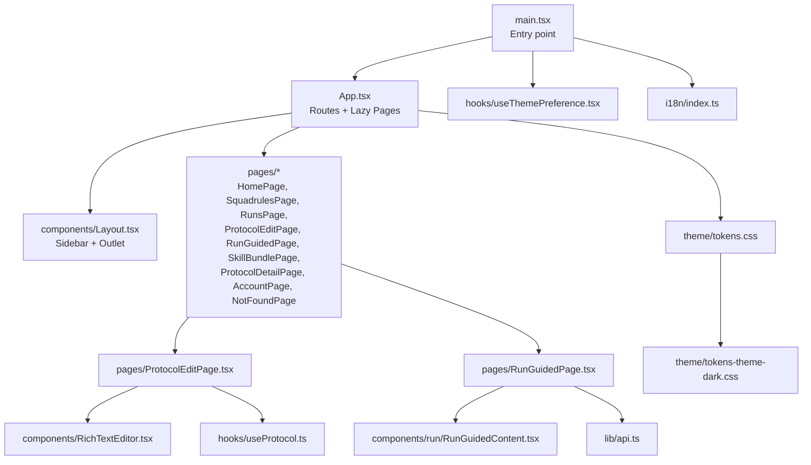
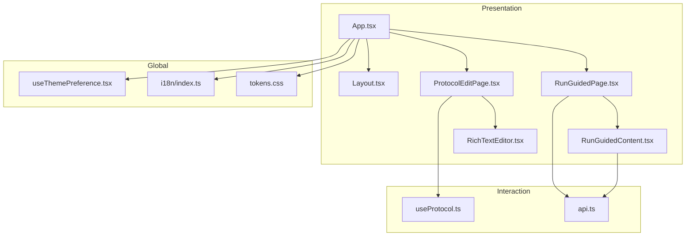
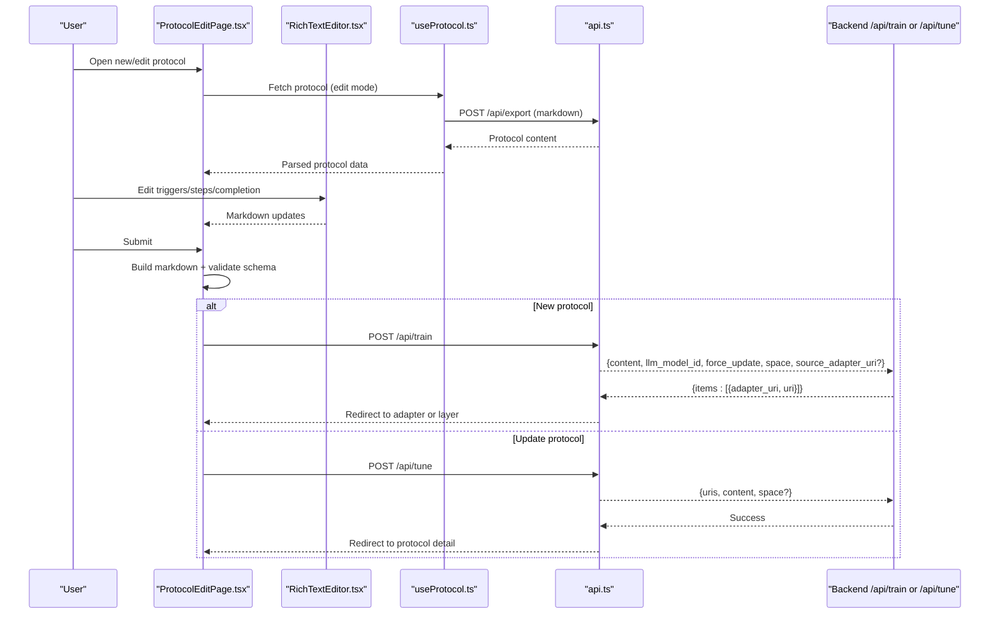
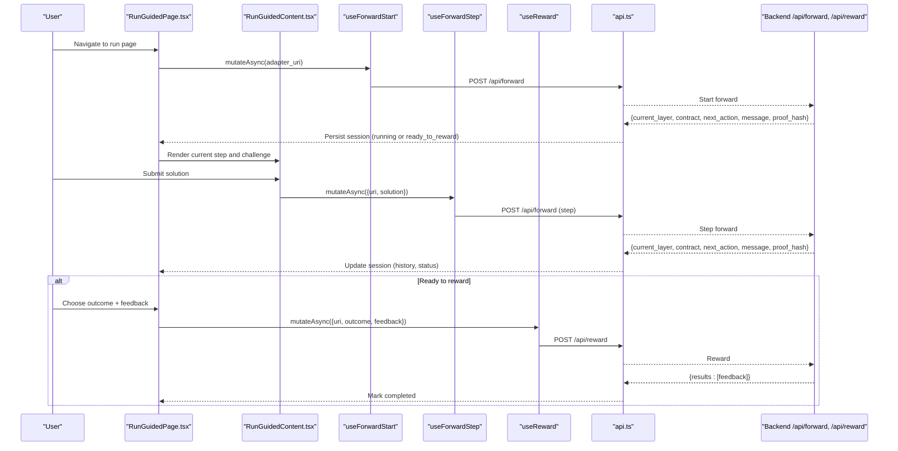
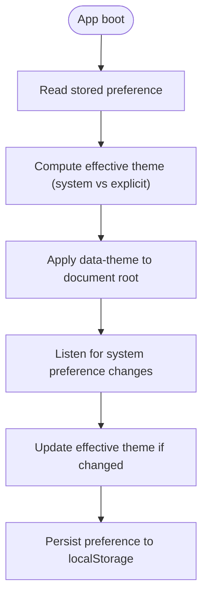
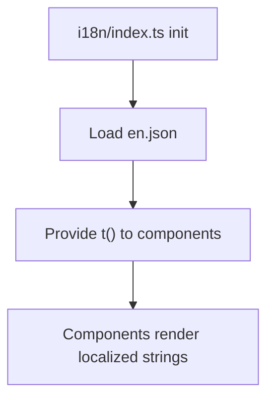
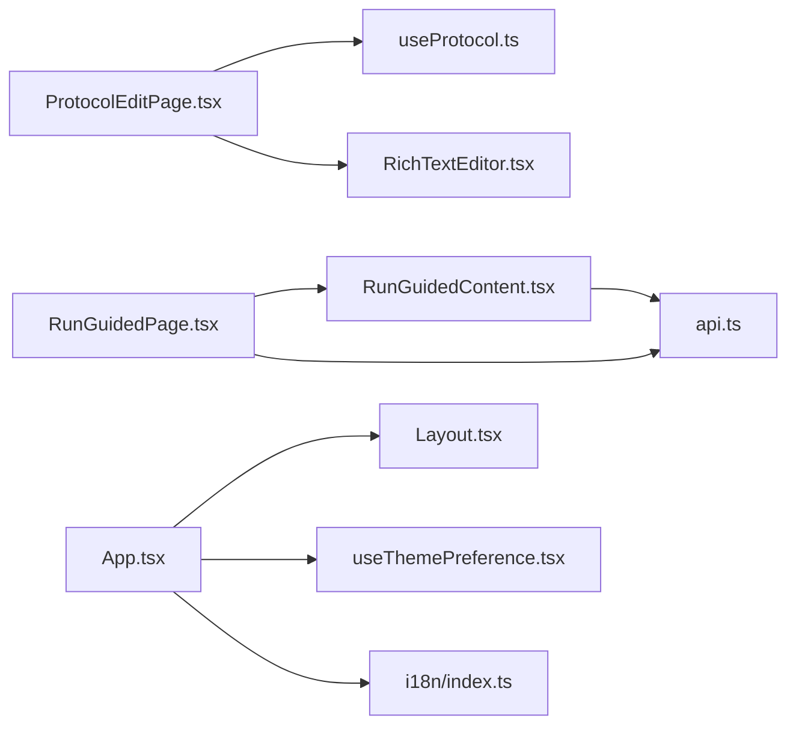

# Web Interface

<cite>
**Referenced Files in This Document**
- [App.tsx](file://src/ui/App.tsx)
- [main.tsx](file://src/ui/main.tsx)
- [Layout.tsx](file://src/ui/components/Layout.tsx)
- [ProtocolEditPage.tsx](file://src/ui/pages/ProtocolEditPage.tsx)
- [RunGuidedPage.tsx](file://src/ui/pages/RunGuidedPage.tsx)
- [RunGuidedContent.tsx](file://src/ui/components/run/RunGuidedContent.tsx)
- [RichTextEditor.tsx](file://src/ui/components/RichTextEditor.tsx)
- [useThemePreference.tsx](file://src/ui/hooks/useThemePreference.tsx)
- [i18n/index.ts](file://src/ui/i18n/index.ts)
- [api.ts](file://src/ui/lib/api.ts)
- [constants.ts](file://src/ui/pages/protocol-edit/constants.ts)
- [useProtocol.ts](file://src/ui/hooks/useProtocol.ts)
- [tokens.css](file://src/ui/theme/tokens.css)
- [tokens-theme-dark.css](file://src/ui/theme/tokens-theme-dark.css)
</cite>

## Table of Contents
1. [Introduction](#introduction)
2. [Project Structure](#project-structure)
3. [Core Components](#core-components)
4. [Architecture Overview](#architecture-overview)
5. [Detailed Component Analysis](#detailed-component-analysis)
6. [Dependency Analysis](#dependency-analysis)
7. [Performance Considerations](#performance-considerations)
8. [Troubleshooting Guide](#troubleshooting-guide)
9. [Conclusion](#conclusion)
10. [Appendices](#appendices)

## Introduction
This document describes the SquadRules React-based web interface. It explains the UI architecture, component structure, and state management patterns used to author protocols interactively, run guided workflows, and monitor progress. It also covers theming, internationalization, responsive design, integration with MCP widgets and embedded resources, static asset serving, customization options, extension points, and deployment considerations.

The interface is built around:
- A route-driven application with lazy-loaded pages for performance.
- An interactive protocol authoring experience backed by a rich markdown editor and validation.
- A guided run flow that orchestrates forward steps and rewards.
- A theme system supporting light and dark modes with system preference detection.
- Internationalization via i18next with English as the default language.
- API communication through a shared fetch wrapper configured for same-origin requests.

## Project Structure
The web interface lives under `src/ui`. The top-level entry renders React StrictMode, initializes query client and theme provider, and mounts the app. Routing is defined centrally with lazy loading per page. Shared layout, components, hooks, pages, theme tokens, and i18n configuration are organized into focused directories.

**Diagram sources**
- [main.tsx:1-20](file://src/ui/main.tsx#L1-L20)
- [App.tsx:1-133](file://src/ui/App.tsx#L1-L133)
- [Layout.tsx:1-109](file://src/ui/components/Layout.tsx#L1-L109)
- [ProtocolEditPage.tsx:1-338](file://src/ui/pages/ProtocolEditPage.tsx#L1-L338)
- [RunGuidedPage.tsx:1-240](file://src/ui/pages/RunGuidedPage.tsx#L1-L240)
- [RunGuidedContent.tsx:1-263](file://src/ui/components/run/RunGuidedContent.tsx#L1-L263)
- [RichTextEditor.tsx:1-265](file://src/ui/components/RichTextEditor.tsx#L1-L265)
- [useProtocol.ts:1-253](file://src/ui/hooks/useProtocol.ts#L1-L253)
- [api.ts:1-14](file://src/ui/lib/api.ts#L1-L14)
- [i18n/index.ts:1-13](file://src/ui/i18n/index.ts#L1-L13)
- [tokens.css:1-12](file://src/ui/theme/tokens.css#L1-L12)
- [tokens-theme-dark.css:1-47](file://src/ui/theme/tokens-theme-dark.css#L1-L47)

**Section sources**
- [main.tsx:1-20](file://src/ui/main.tsx#L1-L20)
- [App.tsx:1-133](file://src/ui/App.tsx#L1-L133)

## Core Components
- Application shell:
  - Entry point initializes React Query client, theme provider, and mounts the app.
  - Router defines routes with Suspense fallbacks and lazy imports for each page.
- Layout:
  - Provides sidebar navigation, logo, version display, and main content area with responsive width rules.
- Protocol authoring:
  - ProtocolEditPage orchestrates form state, import/export, step editing, validation, and saving via backend APIs.
  - RichTextEditor provides a Tiptap-based markdown editor with a constrained toolbar.
- Guided runs:
  - RunGuidedPage manages session lifecycle, forward start/step, reward submission, and history.
  - RunGuidedContent visualizes progress, current step, challenge card, solution form, and reward UI.

Key responsibilities:
- State management:
  - Local React state for forms and UI flags.
  - React Query for data fetching (protocol detail).
  - In-memory session persistence for guided runs.
- Data flow:
  - Protocol edit builds markdown from form state and validates against schema before sending to `/api/train` or `/api/tune`.
  - Guided run uses `/api/forward` and `/api/reward` endpoints via hooks.

**Section sources**
- [App.tsx:1-133](file://src/ui/App.tsx#L1-L133)
- [Layout.tsx:1-109](file://src/ui/components/Layout.tsx#L1-L109)
- [ProtocolEditPage.tsx:1-338](file://src/ui/pages/ProtocolEditPage.tsx#L1-L338)
- [RunGuidedPage.tsx:1-240](file://src/ui/pages/RunGuidedPage.tsx#L1-L240)
- [RunGuidedContent.tsx:1-263](file://src/ui/components/run/RunGuidedContent.tsx#L1-L263)
- [RichTextEditor.tsx:1-265](file://src/ui/components/RichTextEditor.tsx#L1-L265)
- [useProtocol.ts:1-253](file://src/ui/hooks/useProtocol.ts#L1-L253)

## Architecture Overview
The web interface follows a layered architecture:
- Presentation layer: React components and pages.
- Interaction layer: Hooks orchestrate API calls and local state.
- Data layer: React Query caches protocol data; sessions persist locally during guided runs.
- Theming and i18n: Global providers apply theme tokens and translations.

**Diagram sources**
- [App.tsx:1-133](file://src/ui/App.tsx#L1-L133)
- [Layout.tsx:1-109](file://src/ui/components/Layout.tsx#L1-L109)
- [ProtocolEditPage.tsx:1-338](file://src/ui/pages/ProtocolEditPage.tsx#L1-L338)
- [RunGuidedPage.tsx:1-240](file://src/ui/pages/RunGuidedPage.tsx#L1-L240)
- [RunGuidedContent.tsx:1-263](file://src/ui/components/run/RunGuidedContent.tsx#L1-L263)
- [RichTextEditor.tsx:1-265](file://src/ui/components/RichTextEditor.tsx#L1-L265)
- [useProtocol.ts:1-253](file://src/ui/hooks/useProtocol.ts#L1-L253)
- [api.ts:1-14](file://src/ui/lib/api.ts#L1-L14)
- [useThemePreference.tsx:1-149](file://src/ui/hooks/useThemePreference.tsx#L1-L149)
- [i18n/index.ts:1-13](file://src/ui/i18n/index.ts#L1-L13)
- [tokens.css:1-12](file://src/ui/theme/tokens.css#L1-L12)

## Detailed Component Analysis

### Protocol Authoring Interface
The protocol authoring workflow supports creating and editing protocols using a structured markdown format. Users can:
- Import existing protocol markdown.
- Edit triggers, steps, and completion text via a rich editor.
- Add/remove steps and configure step types (shell, forward, user_input, comment).
- Validate protocol structure before saving.
- Save new protocols to a target space or update existing ones, optionally moving between spaces.

**Diagram sources**
- [ProtocolEditPage.tsx:120-187](file://src/ui/pages/ProtocolEditPage.tsx#L120-L187)
- [RichTextEditor.tsx:210-248](file://src/ui/components/RichTextEditor.tsx#L210-L248)
- [useProtocol.ts:18-49](file://src/ui/hooks/useProtocol.ts#L18-L49)
- [api.ts:1-14](file://src/ui/lib/api.ts#L1-L14)

Validation and defaults:
- Schema enforces required sections and title.
- Default step type and fields ensure consistent authoring.

**Section sources**
- [ProtocolEditPage.tsx:1-338](file://src/ui/pages/ProtocolEditPage.tsx#L1-L338)
- [constants.ts:1-21](file://src/ui/pages/protocol-edit/constants.ts#L1-L21)
- [useProtocol.ts:94-253](file://src/ui/hooks/useProtocol.ts#L94-L253)
- [RichTextEditor.tsx:1-265](file://src/ui/components/RichTextEditor.tsx#L1-L265)

### Guided Run Flow
The guided run flow walks users through starting a protocol, submitting solutions, and providing feedback via reward.

**Diagram sources**
- [RunGuidedPage.tsx:56-165](file://src/ui/pages/RunGuidedPage.tsx#L56-L165)
- [RunGuidedContent.tsx:43-263](file://src/ui/components/run/RunGuidedContent.tsx#L43-L263)
- [api.ts:1-14](file://src/ui/lib/api.ts#L1-L14)

State transitions:
- Running → Ready to reward → Completed
- Error states surfaced with retry options.

**Section sources**
- [RunGuidedPage.tsx:1-240](file://src/ui/pages/RunGuidedPage.tsx#L1-L240)
- [RunGuidedContent.tsx:1-263](file://src/ui/components/run/RunGuidedContent.tsx#L1-L263)

### Theming System
Theming is implemented via CSS custom properties and a context provider:
- Theme choices: light, dark, and system.
- Effective theme computed based on preference and OS setting.
- Document attribute `data-theme` toggles theme-specific token overrides.
- Preference persisted in localStorage and synchronized across tabs via storage events.

**Diagram sources**
- [useThemePreference.tsx:26-60](file://src/ui/hooks/useThemePreference.tsx#L26-L60)
- [useThemePreference.tsx:68-133](file://src/ui/hooks/useThemePreference.tsx#L68-L133)
- [tokens.css:1-12](file://src/ui/theme/tokens.css#L1-L12)
- [tokens-theme-dark.css:1-47](file://src/ui/theme/tokens-theme-dark.css#L1-L47)

**Section sources**
- [useThemePreference.tsx:1-149](file://src/ui/hooks/useThemePreference.tsx#L1-L149)
- [tokens.css:1-12](file://src/ui/theme/tokens.css#L1-L12)
- [tokens-theme-dark.css:1-47](file://src/ui/theme/tokens-theme-dark.css#L1-L47)

### Internationalization Support
Internationalization is initialized with i18next:
- Default language set to English.
- Resources loaded from JSON file.
- Components access translations via `useTranslation`.

**Diagram sources**
- [i18n/index.ts:1-13](file://src/ui/i18n/index.ts#L1-L13)

**Section sources**
- [i18n/index.ts:1-13](file://src/ui/i18n/index.ts#L1-L13)

### Responsive Design Patterns
Responsive behavior is achieved through CSS variables and Tailwind utility classes:
- Sidebar width and main content max-width adapt to route context.
- Touch targets and spacing follow design tokens.
- Wide content routes expand main area beyond narrow constraints.

**Section sources**
- [Layout.tsx:8-25](file://src/ui/components/Layout.tsx#L8-L25)
- [Layout.tsx:34-104](file://src/ui/components/Layout.tsx#L34-L104)

### Integration with MCP Widgets, Embedded Resources, and Static Assets
- Static assets:
  - Logo SVG imported directly in layout; served as `/ui/assets/*.svg` when build settings inline assets at zero limit.
- MCP widgets:
  - Widget HTML/CSS/JS modules exist under `src/mcp-apps` for activation, forward, and spaces experiences.
  - Capability registration files expose UI offerings to the server.
- Embedded resources:
  - Constants and logos are embedded into the UI bundle for offline availability.

Note: These integrations are part of the broader repository but not directly referenced in the analyzed UI files. They complement the web interface by providing widget templates and capability declarations.

**Section sources**
- [Layout.tsx:5-6](file://src/ui/components/Layout.tsx#L5-L6)

## Dependency Analysis
The UI has clear separation between presentation, interaction, and global concerns. Key dependencies:
- Pages depend on hooks for data and actions.
- Hooks depend on the API wrapper.
- Theme and i18n are provided globally at app bootstrap.

**Diagram sources**
- [ProtocolEditPage.tsx:1-338](file://src/ui/pages/ProtocolEditPage.tsx#L1-L338)
- [RunGuidedPage.tsx:1-240](file://src/ui/pages/RunGuidedPage.tsx#L1-L240)
- [RunGuidedContent.tsx:1-263](file://src/ui/components/run/RunGuidedContent.tsx#L1-L263)
- [useProtocol.ts:1-253](file://src/ui/hooks/useProtocol.ts#L1-L253)
- [RichTextEditor.tsx:1-265](file://src/ui/components/RichTextEditor.tsx#L1-L265)
- [api.ts:1-14](file://src/ui/lib/api.ts#L1-L14)
- [App.tsx:1-133](file://src/ui/App.tsx#L1-L133)
- [Layout.tsx:1-109](file://src/ui/components/Layout.tsx#L1-L109)
- [useThemePreference.tsx:1-149](file://src/ui/hooks/useThemePreference.tsx#L1-L149)
- [i18n/index.ts:1-13](file://src/ui/i18n/index.ts#L1-L13)

**Section sources**
- [App.tsx:1-133](file://src/ui/App.tsx#L1-L133)
- [ProtocolEditPage.tsx:1-338](file://src/ui/pages/ProtocolEditPage.tsx#L1-L338)
- [RunGuidedPage.tsx:1-240](file://src/ui/pages/RunGuidedPage.tsx#L1-L240)

## Performance Considerations
- Route-level code splitting:
  - Each page is lazily imported to keep initial bundle size small.
- Suspense fallbacks:
  - Loading indicators improve perceived performance during async loads.
- Query caching:
  - React Query caches protocol data to avoid redundant network requests.
- Asset handling:
  - Inline SVG assets reduce HTTP overhead when configured appropriately.

[No sources needed since this section provides general guidance]

## Troubleshooting Guide
Common issues and resolutions:
- Protocol validation errors:
  - Ensure markdown includes required sections and title.
  - Check schema refinements for Activation Patterns and Reward Signal sections.
- Network errors:
  - Verify API base path and credentials configuration.
  - Inspect error messages returned from backend endpoints.
- Theme not applying:
  - Confirm `data-theme` attribute on document root.
  - Check localStorage permission and storage events.
- i18n keys missing:
  - Ensure translation keys exist in resource files.
  - Verify initialization and namespace usage.

**Section sources**
- [constants.ts:4-9](file://src/ui/pages/protocol-edit/constants.ts#L4-L9)
- [api.ts:1-14](file://src/ui/lib/api.ts#L1-L14)
- [useThemePreference.tsx:34-60](file://src/ui/hooks/useThemePreference.tsx#L34-L60)
- [i18n/index.ts:1-13](file://src/ui/i18n/index.ts#L1-L13)

## Conclusion
The SquadRules web interface provides a robust, extensible platform for protocol authoring and guided execution. Its architecture emphasizes clarity, performance, and accessibility through modular components, global providers, and well-defined data flows. Theming and internationalization enhance usability, while integration points support MCP widgets and embedded resources. Deployment should consider static asset configuration, API routing, and environment variables for versioning and feature flags.

[No sources needed since this section summarizes without analyzing specific files]

## Appendices
- Customization options:
  - Extend theme tokens by adding new theme files and updating imports.
  - Add new pages and routes in the central router.
  - Introduce new hooks for additional API interactions.
- Extension points:
  - Widget templates under `src/mcp-apps` for embedding MCP experiences.
  - Capability registration files to expose UI features to the server.
- Deployment considerations:
  - Configure Vite build settings for asset inlining and public paths.
  - Set up reverse proxy to serve `/ui` and `/api` routes correctly.
  - Ensure CORS and authentication middleware align with frontend expectations.

[No sources needed since this section provides general guidance]