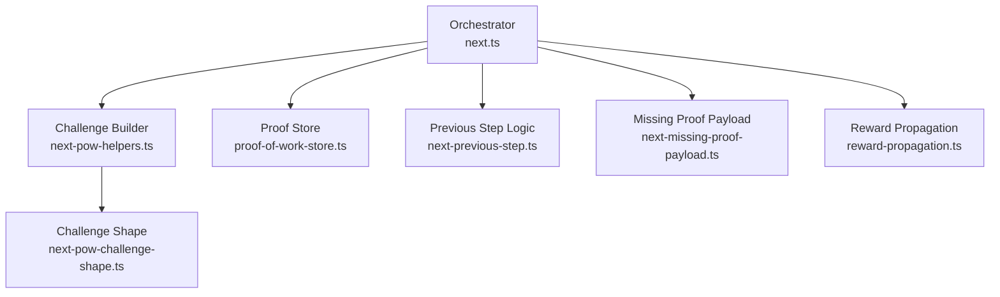
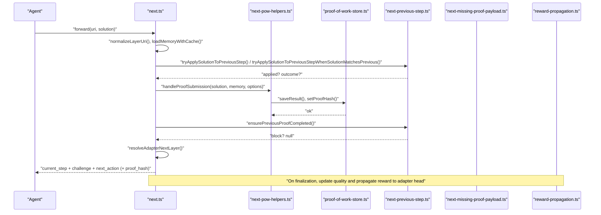
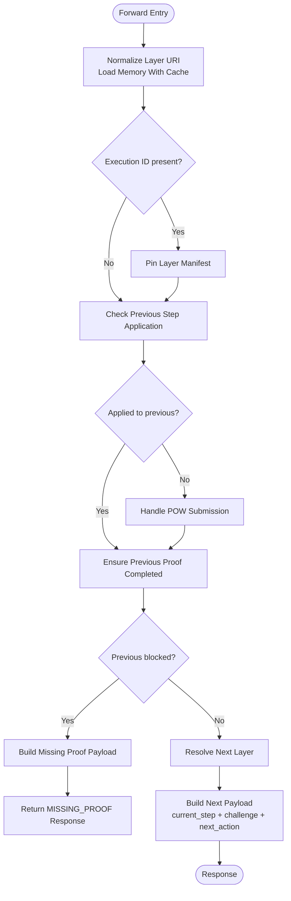
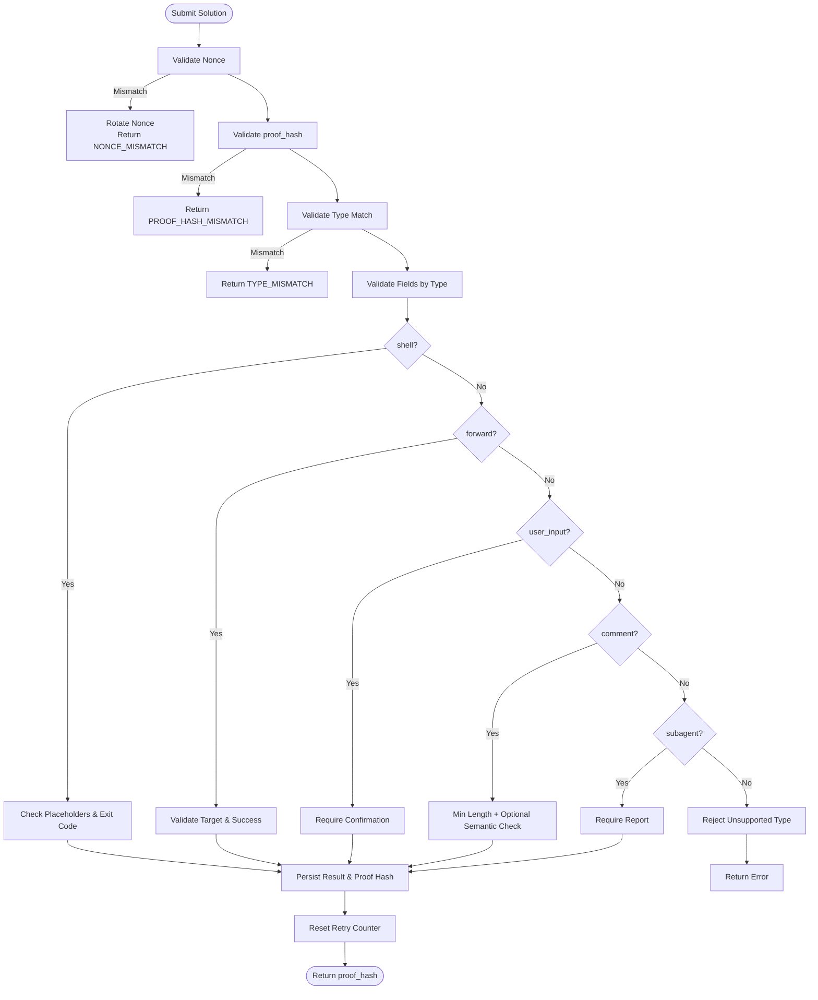
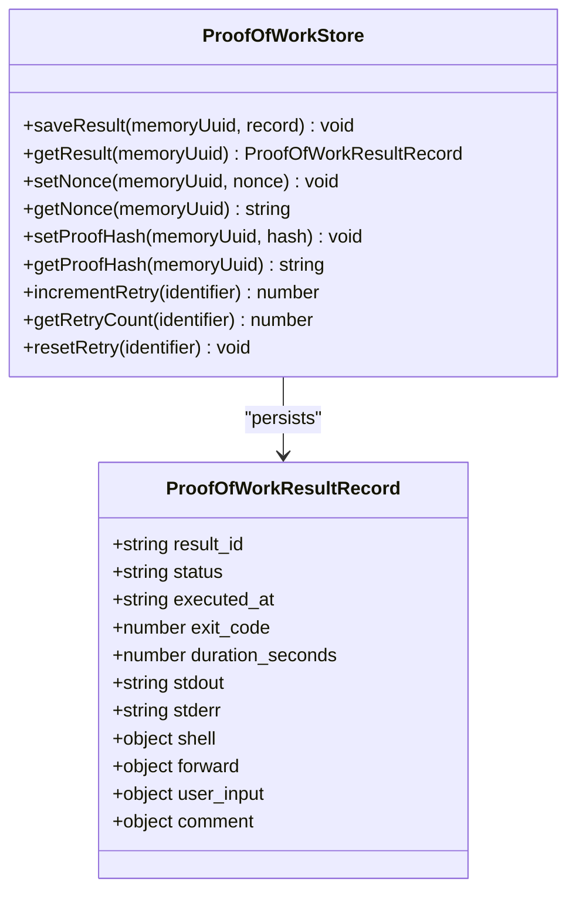
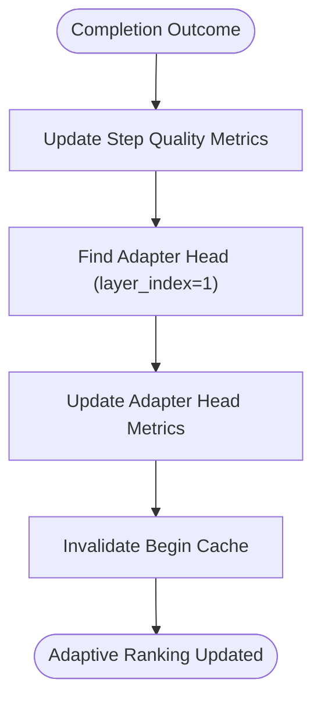
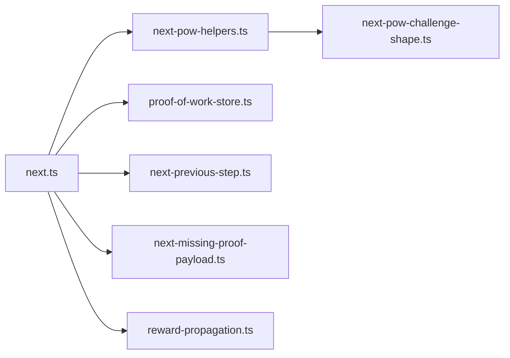

# Workflow Orchestration

<cite>
**Referenced Files in This Document**
- [next.ts](file://src/tools/next.ts)
- [next-pow-helpers.ts](file://src/tools/next-pow-helpers.ts)
- [next-pow-challenge-shape.ts](file://src/tools/next-pow-challenge-shape.ts)
- [next-proof-types.ts](file://src/tools/next-proof-types.ts)
- [next-missing-proof-payload.ts](file://src/tools/next-missing-proof-payload.ts)
- [next-previous-step.ts](file://src/tools/next-previous-step.ts)
- [proof-of-work-store.ts](file://src/services/proof-of-work-store.ts)
- [reward-propagation.ts](file://src/services/qdrant/reward-propagation.ts)
</cite>

## Table of Contents
1. [Introduction](#introduction)
2. [Project Structure](#project-structure)
3. [Core Components](#core-components)
4. [Architecture Overview](#architecture-overview)
5. [Detailed Component Analysis](#detailed-component-analysis)
6. [Dependency Analysis](#dependency-analysis)
7. [Performance Considerations](#performance-considerations)
8. [Troubleshooting Guide](#troubleshooting-guide)
9. [Conclusion](#conclusion)

## Introduction
This document explains the workflow orchestration engine that powers deterministic task execution in SquadRules. It focuses on:
- Step-by-step workflow execution with state persistence, checkpointing, and recovery
- The challenge-response pattern for proof generation, evidence collection, and verification
- The power-of-work (POW) mechanism to prevent abuse and ensure computational effort
- Reward propagation for adaptive learning and quality improvement over time
- Workflow composition patterns, conditional branching, and parallel execution considerations
- Examples of complex multi-step workflows and troubleshooting guidance
- Performance optimization, resource management, and scaling for high-throughput scenarios

The core flow is activate → forward → reward. Adapters define deterministic steps with verifiable proofs. Agents must create or repair adapters when workflows change.

## Project Structure
The orchestration logic centers around the `forward` tool’s shared execution path and its POW helpers. Key responsibilities are split across:
- Orchestration entry point and step navigation
- Challenge construction and submission handling
- Proof storage, nonce management, and retry control
- Missing-proof recovery and previous-step application
- Reward propagation to adapter heads



**Diagram sources**
- [next.ts:137-279](file://src/tools/next.ts#L137-L279)
- [next-pow-helpers.ts:43-60](file://src/tools/next-pow-helpers.ts#L43-L60)
- [proof-of-work-store.ts:47-170](file://src/services/proof-of-work-store.ts#L47-L170)
- [next-previous-step.ts:29-53](file://src/tools/next-previous-step.ts#L29-L53)
- [next-missing-proof-payload.ts:29-55](file://src/tools/next-missing-proof-payload.ts#L29-L55)
- [reward-propagation.ts:13-73](file://src/services/qdrant/reward-propagation.ts#L13-L73)

**Section sources**
- [next.ts:1-279](file://src/tools/next.ts#L1-L279)
- [next-pow-helpers.ts:1-334](file://src/tools/next-pow-helpers.ts#L1-L334)
- [proof-of-work-store.ts:1-174](file://src/services/proof-of-work-store.ts#L1-L174)
- [next-previous-step.ts:1-168](file://src/tools/next-previous-step.ts#L1-L168)
- [next-missing-proof-payload.ts:1-57](file://src/tools/next-missing-proof-payload.ts#L1-L57)
- [reward-propagation.ts:1-76](file://src/services/qdrant/reward-propagation.ts#L1-L76)

## Core Components
- Orchestrator (`next.ts`)
  - Normalizes layer URIs, loads memory with cache, pins layer manifests, validates previous steps, handles POW submissions, resolves next layers, and builds responses.
  - Updates per-step quality metrics on success/failure.
- POW Helpers (`next-pow-helpers.ts`)
  - Builds challenges with nonces, validates submissions by type, persists results and proof hashes, enforces required proofs, and returns structured error payloads.
- POW Challenge Shape (`next-pow-challenge-shape.ts`)
  - Renders challenge descriptions and fields for shell, forward, user_input, comment, and subagent types; guards against unknown contract types.
- POW Store (`proof-of-work-store.ts`)
  - Persists results, nonces, proof hashes, and retry counters with TTLs; exposes increment/reset operations.
- Previous Step Logic (`next-previous-step.ts`)
  - Applies solutions to previous steps when needed, ensures prior required proofs are complete, and constructs missing-proof blocks.
- Missing Proof Payload (`next-missing-proof-payload.ts`)
  - Builds current_step and challenge for MISSING_PROOF responses, including correct nonce and expected proof_hash.
- Reward Propagation (`reward-propagation.ts`)
  - Propagates final outcome metrics from completion layers to the adapter head for activation ranking.

**Section sources**
- [next.ts:24-83](file://src/tools/next.ts#L24-L83)
- [next.ts:85-129](file://src/tools/next.ts#L85-L129)
- [next.ts:137-279](file://src/tools/next.ts#L137-L279)
- [next-pow-helpers.ts:38-60](file://src/tools/next-pow-helpers.ts#L38-L60)
- [next-pow-helpers.ts:127-333](file://src/tools/next-pow-helpers.ts#L127-L333)
- [next-pow-challenge-shape.ts:39-133](file://src/tools/next-pow-challenge-shape.ts#L39-L133)
- [proof-of-work-store.ts:47-170](file://src/services/proof-of-work-store.ts#L47-L170)
- [next-previous-step.ts:29-167](file://src/tools/next-previous-step.ts#L29-L167)
- [next-missing-proof-payload.ts:29-55](file://src/tools/next-missing-proof-payload.ts#L29-L55)
- [reward-propagation.ts:13-73](file://src/services/qdrant/reward-propagation.ts#L13-L73)

## Architecture Overview
The orchestrator drives a deterministic chain:
- Load step memory and normalize URI
- Build challenge with nonce and proof_hash
- Validate and persist POW submission
- Ensure previous required proof is complete
- Resolve next layer and return next_action instructions
- On completion, propagate rewards to adapter head



**Diagram sources**
- [next.ts:137-279](file://src/tools/next.ts#L137-L279)
- [next-pow-helpers.ts:127-333](file://src/tools/next-pow-helpers.ts#L127-L333)
- [proof-of-work-store.ts:65-121](file://src/services/proof-of-work-store.ts#L65-L121)
- [next-previous-step.ts:29-167](file://src/tools/next-previous-step.ts#L29-L167)
- [next-missing-proof-payload.ts:29-55](file://src/tools/next-missing-proof-payload.ts#L29-L55)
- [reward-propagation.ts:13-73](file://src/services/qdrant/reward-propagation.ts#L13-L73)

## Detailed Component Analysis

### Orchestrator: Deterministic Step Execution
Responsibilities:
- Normalize layer URIs and extract execution context
- Cache memory reads via Redis
- Pin layer manifest on first forward of an execution to avoid UUID churn
- Apply solutions to previous steps when contracts are missing or mismatched
- Handle POW validation and persistence
- Enforce previous-step requirements before advancing
- Resolve next layer and build response payload with next_action
- Update per-step quality metrics on success/failure

Key behaviors:
- When a solution matches a previous step’s contract, it is applied there and the current step is advanced deterministically.
- If a previous required proof is missing, a MISSING_PROOF block is returned with guidance and a bounded retry policy.
- Quality metrics are updated even when errors occur, enabling adaptive learning.



**Diagram sources**
- [next.ts:36-83](file://src/tools/next.ts#L36-L83)
- [next.ts:137-279](file://src/tools/next.ts#L137-L279)
- [next-previous-step.ts:29-167](file://src/tools/next-previous-step.ts#L29-L167)
- [next-missing-proof-payload.ts:29-55](file://src/tools/next-missing-proof-payload.ts#L29-L55)

**Section sources**
- [next.ts:36-83](file://src/tools/next.ts#L36-L83)
- [next.ts:137-279](file://src/tools/next.ts#L137-L279)

### Challenge-Response Pattern: Proof Generation, Evidence Collection, Verification
Components:
- Challenge builder generates a nonce and renders the challenge shape based on the inference contract.
- Submission handler validates nonce, proof_hash, type, and field presence; records results and proof hashes; enforces required proofs.
- Challenge shape renderer adapts to supported proof types: shell, forward, user_input, comment, subagent.

Validation rules:
- Nonce must match stored value; mismatches rotate nonce and return a fresh challenge.
- proof_hash must match expected value (GENESIS_HASH for step 1, or stored hash of previous step).
- Type must match contract; missing fields produce structured errors.
- Shell proofs require real stdout/stderr (no placeholders); exit_code determines success/failure.
- Forward proofs must target the contracted adapter and report actual success.
- User input requires explicit confirmation.
- Comment proofs enforce minimum length and optional semantic relevance check.
- Subagent proofs require a non-empty report.



**Diagram sources**
- [next-pow-helpers.ts:127-333](file://src/tools/next-pow-helpers.ts#L127-L333)
- [next-pow-challenge-shape.ts:39-133](file://src/tools/next-pow-challenge-shape.ts#L39-L133)

**Section sources**
- [next-pow-helpers.ts:43-60](file://src/tools/next-pow-helpers.ts#L43-L60)
- [next-pow-helpers.ts:127-333](file://src/tools/next-pow-helpers.ts#L127-L333)
- [next-pow-challenge-shape.ts:39-133](file://src/tools/next-pow-challenge-shape.ts#L39-L133)
- [next-proof-types.ts:3-43](file://src/tools/next-proof-types.ts#L3-L43)

### Power-of-Work (POW) Mechanism
Purpose:
- Prevent abuse by requiring computational effort and honest evidence.
- Provide deterministic checkpoints through persisted results and proof hashes.
- Bound retries to avoid infinite loops while allowing recovery.

Mechanics:
- Nonce: short-lived (TTL), rotated on mismatch to break stuck loops.
- Proof hash: persisted per step, used to chain steps securely.
- Retry counter: incremented on failures, reset on success; bounded by MAX_RETRIES to escalate to must_obey:false.
- Result record: stores type-specific evidence and timestamps.



**Diagram sources**
- [proof-of-work-store.ts:47-170](file://src/services/proof-of-work-store.ts#L47-L170)

**Section sources**
- [proof-of-work-store.ts:38-45](file://src/services/proof-of-work-store.ts#L38-L45)
- [proof-of-work-store.ts:65-170](file://src/services/proof-of-work-store.ts#L65-L170)
- [next-pow-helpers.ts:167-185](file://src/tools/next-pow-helpers.ts#L167-L185)
- [next-pow-helpers.ts:307-333](file://src/tools/next-pow-helpers.ts#L307-L333)

### Reward Propagation System
Purpose:
- Improve activation ranking by propagating final outcomes to adapter heads.
- Enable adaptive learning over time by updating quality metrics and metadata.

Process:
- On successful completion, update per-step quality metrics.
- Propagate reward to the adapter head (layer_index=1) using space filters.
- Invalidate begin cache to reflect updated rankings.



**Diagram sources**
- [next.ts:85-129](file://src/tools/next.ts#L85-L129)
- [reward-propagation.ts:13-73](file://src/services/qdrant/reward-propagation.ts#L13-L73)

**Section sources**
- [next.ts:85-129](file://src/tools/next.ts#L85-L129)
- [reward-propagation.ts:13-73](file://src/services/qdrant/reward-propagation.ts#L13-L73)

### Workflow Composition Patterns, Conditional Branching, Parallel Execution
Patterns:
- Linear chains: each step resolves the next layer deterministically via resolveAdapterNextLayer.
- Conditional branching: previous-step application allows routing based on whether a solution applies to a prior step or the current one.
- Recovery paths: MISSING_PROOF responses guide agents to complete prerequisites before continuing.

Parallel execution:
- The orchestrator itself is sequential per step; however, multiple independent adapters can be executed concurrently at the service level.
- POW store operations are isolated per memory UUID, enabling safe concurrent submissions without cross-step interference.

Best practices:
- Use required proofs only where necessary to balance security and throughput.
- Keep step granularity small to enable fine-grained caching and faster recovery.
- Prefer deterministic contracts (shell, forward) for reproducibility; use comment/subagent for human-in-the-loop or delegation tasks.

[No sources needed since this section provides general guidance]

### Complex Multi-Step Workflow Example
Scenario: A three-step workflow validating infrastructure changes:
- Step 1 (shell): Run a linting command; required=true.
- Step 2 (forward): Forward to a deployment adapter; required=true.
- Step 3 (comment): Summarize validation and deployment outcome; required=false.

Flow:
- Agent calls forward with step 1; receives challenge with nonce and proof_hash.
- Agent submits shell proof; orchestrator validates, persists result/hash, updates quality.
- Orchestrator resolves step 2; agent forwards to deployment adapter and submits forward proof.
- Orchestrator ensures step 1 proof is complete; advances to step 3.
- Agent submits comment proof; orchestrator validates length and optionally semantic relevance.
- Completion triggers reward propagation to adapter head.

```mermaid
sequenceDiagram
participant Agent as "Agent"
participant Next as "next.ts"
participant Helpers as "next-pow-helpers.ts"
participant Store as "proof-of-work-store.ts"
Agent->>Next : "forward(step1_uri, {})"
Next-->>Agent : "challenge(shell), proof_hash=GENESIS_HASH"
Agent->>Next : "forward(step1_uri, {type : 'shell', ...})"
Next->>Helpers : "handleProofSubmission()"
Helpers->>Store : "saveResult(), setProofHash()"
Next-->>Agent : "challenge(forward), proof_hash=step1_hash"
Agent->>Next : "forward(step2_uri, {type : 'forward', ...})"
Next->>Helpers : "handleProofSubmission()"
Next->>Next : "ensurePreviousProofCompleted()"
Next-->>Agent : "challenge(comment), proof_hash=step2_hash"
Agent->>Next : "forward(step3_uri, {type : 'comment', ...})"
Next->>Helpers : "handleProofSubmission()"
Next-->>Agent : "complete; call reward"
```

**Diagram sources**
- [next.ts:137-279](file://src/tools/next.ts#L137-L279)
- [next-pow-helpers.ts:127-333](file://src/tools/next-pow-helpers.ts#L127-L333)
- [proof-of-work-store.ts:65-121](file://src/services/proof-of-work-store.ts#L65-L121)

**Section sources**
- [next.ts:137-279](file://src/tools/next.ts#L137-L279)
- [next-pow-helpers.ts:127-333](file://src/tools/next-pow-helpers.ts#L127-L333)

## Dependency Analysis
Key dependencies:
- Orchestrator depends on:
  - POW helpers for challenge building and submission handling
  - POW store for nonce, result, and hash persistence
  - Previous-step logic for recovery and prerequisite enforcement
  - Missing-proof payload builder for structured error responses
  - Reward propagation for finalizing quality updates

Coupling and cohesion:
- High cohesion within POW helpers and store; clear separation between orchestration and persistence.
- Low coupling between orchestrator and storage backends via typed interfaces.

Potential circular dependencies:
- None observed; helpers and store are leaf modules relative to orchestrator.

External integration points:
- Qdrant service for memory retrieval and quality updates (used indirectly via orchestrator utilities).
- Redis cache for memory resource caching and begin-cache invalidation.



**Diagram sources**
- [next.ts:137-279](file://src/tools/next.ts#L137-L279)
- [next-pow-helpers.ts:127-333](file://src/tools/next-pow-helpers.ts#L127-L333)
- [proof-of-work-store.ts:65-121](file://src/services/proof-of-work-store.ts#L65-L121)
- [next-previous-step.ts:29-167](file://src/tools/next-previous-step.ts#L29-L167)
- [next-missing-proof-payload.ts:29-55](file://src/tools/next-missing-proof-payload.ts#L29-L55)
- [next-pow-challenge-shape.ts:39-133](file://src/tools/next-pow-challenge-shape.ts#L39-L133)
- [reward-propagation.ts:13-73](file://src/services/qdrant/reward-propagation.ts#L13-L73)

**Section sources**
- [next.ts:137-279](file://src/tools/next.ts#L137-L279)
- [next-pow-helpers.ts:127-333](file://src/tools/next-pow-helpers.ts#L127-L333)
- [proof-of-work-store.ts:65-121](file://src/services/proof-of-work-store.ts#L65-L121)
- [next-previous-step.ts:29-167](file://src/tools/next-previous-step.ts#L29-L167)
- [next-missing-proof-payload.ts:29-55](file://src/tools/next-missing-proof-payload.ts#L29-L55)
- [next-pow-challenge-shape.ts:39-133](file://src/tools/next-pow-challenge-shape.ts#L39-L133)
- [reward-propagation.ts:13-73](file://src/services/qdrant/reward-propagation.ts#L13-L73)

## Performance Considerations
Optimization strategies:
- Cache memory resources via Redis to reduce Qdrant read latency.
- Pin layer manifests once per execution to avoid UUID churn and repeated resolution overhead.
- Use bounded retry counters to prevent excessive rework and quickly escalate to must_obey:false after MAX_RETRIES.
- Short TTLs for nonces and retry counters limit stale state and reduce storage pressure.
- Fail-open semantics for semantic checks allow progress under provider slowness while logging warnings.

Resource management:
- POW store operations are lightweight JSON writes/reads with TTLs; ensure Redis capacity for high-throughput workloads.
- Avoid embedding large outputs in proof records; prefer concise summaries and external artifacts where possible.

Scaling considerations:
- Horizontal scaling is straightforward due to stateless orchestrator and centralized POW store.
- Shard Redis keyspace by tenant if needed; monitor TTL expiration rates and adjust thresholds.
- Batch reward propagation updates during low-traffic windows if write amplification becomes a bottleneck.

[No sources needed since this section provides general guidance]

## Troubleshooting Guide
Common issues and resolutions:
- NONCE_MISMATCH
  - Cause: Submitted nonce does not match stored nonce.
  - Resolution: Use the retry_nonce from the error response; the system rotates nonce automatically.
  - Sources: [next-pow-helpers.ts:167-185](file://src/tools/next-pow-helpers.ts#L167-L185)

- PROOF_HASH_MISMATCH
  - Cause: proof_hash does not match expected value (GENESIS_HASH or previous step hash).
  - Resolution: Include the correct proof_hash from the previous response or current contract.
  - Sources: [next-pow-helpers.ts:188-195](file://src/tools/next-pow-helpers.ts#L188-L195)

- TYPE_MISMATCH
  - Cause: Submitted proof type differs from contract.
  - Resolution: Align solution.type with the contract’s required type.
  - Sources: [next-pow-helpers.ts:197-199](file://src/tools/next-pow-helpers.ts#L197-L199)

- PLACEHOLDER_EVIDENCE
  - Cause: Shell stdout/stderr still contain template placeholders.
  - Resolution: Replace placeholders with real output from your run.
  - Sources: [next-pow-helpers.ts:213-219](file://src/tools/next-pow-helpers.ts#L213-L219)

- FORWARD_TARGET_MISMATCH
  - Cause: Forward target does not match contract or is missing.
  - Resolution: Submit evidence.target with the exact adapter URI specified in the contract.
  - Sources: [next-pow-helpers.ts:231-249](file://src/tools/next-pow-helpers.ts#L231-L249)

- COMMENT_TOO_SHORT / COMMENT_IRRELEVANT
  - Cause: Comment below minimum length or semantically unrelated.
  - Resolution: Write a genuine summary meeting length and relevance criteria.
  - Sources: [next-pow-helpers.ts:265-296](file://src/tools/next-pow-helpers.ts#L265-L296)

- MISSING_PROOF
  - Cause: Previous required proof not completed.
  - Resolution: Follow next_action to complete the previous step, then retry forward.
  - Sources: [next-previous-step.ts:119-167](file://src/tools/next-previous-step.ts#L119-L167), [next-missing-proof-payload.ts:29-55](file://src/tools/next-missing-proof-payload.ts#L29-L55)

Quality update failures:
- Symptom: Quality metrics not updated despite successful steps.
- Action: Inspect logs for squadrulesQualityUpdateErrors; verify Qdrant connectivity and permissions.
- Sources: [next.ts:85-129](file://src/tools/next.ts#L85-L129)

**Section sources**
- [next-pow-helpers.ts:167-199](file://src/tools/next-pow-helpers.ts#L167-L199)
- [next-pow-helpers.ts:213-296](file://src/tools/next-pow-helpers.ts#L213-L296)
- [next-previous-step.ts:119-167](file://src/tools/next-previous-step.ts#L119-L167)
- [next-missing-proof-payload.ts:29-55](file://src/tools/next-missing-proof-payload.ts#L29-L55)
- [next.ts:85-129](file://src/tools/next.ts#L85-L129)

## Conclusion
SquadRules’ workflow orchestration engine enforces deterministic, auditable execution through a robust challenge-response model backed by POW mechanisms. The orchestrator coordinates step navigation, proof validation, and recovery paths, while reward propagation enables continuous quality improvement. By leveraging caching, bounded retries, and clear error signaling, the system scales effectively for high-throughput environments and supports complex multi-step workflows with conditional branching and parallel execution at the service level.

[No sources needed since this section summarizes without analyzing specific files]